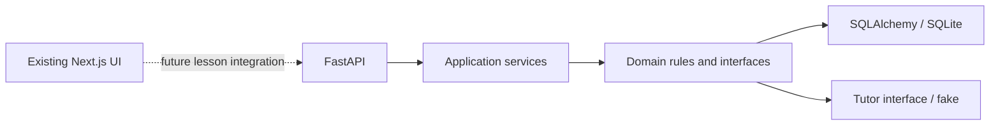

# Codex Session Log - 2026-10-31

Session: `01a18c8a-4fc7-70a0-bf35-3113cfa88f29` | Project: `Trace-v1` | Author: `Soorej S` | GitHub: `SoorejS`

---

[CLAUDE_LOG_ENTRY type=PROMPT num=1 session=01a18c8a-4fc7-70a0-bf35-3113cfa88f29]
timestamp: 2026-10-31T04:55:36.654897+00:00
time: 2026-10-31 10:25
chars: 14
turn_id: "01a1904e-cf89-7043-ae09-6b96a3d138dd"
capture_event: "UserPromptSubmit"
timestamp_source: "hook_capture_time_utc"
model: "gpt-6.1-sol"
cwd: "C:\\Users\\soore\\OneDrive\\Dokumen\\ChatGPT\\Trace-v1"
words: 2
has_code_block: false
has_file_paths: false
has_urls: false
likely_pasted: false

logging check

[CLAUDE_LOG_ENTRY type=RESPONSE num=1 session=01a18c8a-4fc7-70a0-bf35-3113cfa88f29]
timestamp: 2026-10-31T04:56:33.554888+00:00
time: 2026-10-31 10:26
chars: 327
turn_id: "01a1904e-cf89-7043-ae09-6b96a3d138dd"
capture_event: "Stop"
timestamp_source: "hook_capture_time_utc"
model: "gpt-6.1-sol"
cwd: "C:\\Users\\soore\\OneDrive\\Dokumen\\ChatGPT\\Trace-v1"

Your real prompt was **automatically captured** in the [session log](C:/Users/soore/OneDrive/Dokumen/ChatGPT/Trace-v1/.claude-logs/2026-10-31_10-25-36_01a18c8a-4fc7-70a0-bf35-3113cfa88f29.md).

Send `logging check` once more so I can verify this final answer was captured too.

No app code changed. Nothing committed or pushed.

[CLAUDE_LOG_ENTRY type=PROMPT num=2 session=01a18c8a-4fc7-70a0-bf35-3113cfa88f29]
timestamp: 2026-10-31T04:56:44.596706+00:00
time: 2026-10-31 10:26
chars: 14
turn_id: "01a19051-35be-75b3-8dc8-e045b3ca25e9"
capture_event: "UserPromptSubmit"
timestamp_source: "hook_capture_time_utc"
model: "gpt-6.1-sol"
cwd: "C:\\Users\\soore\\OneDrive\\Dokumen\\ChatGPT\\Trace-v1"
words: 2
has_code_block: false
has_file_paths: false
has_urls: false
likely_pasted: false

logging check

[CLAUDE_LOG_ENTRY type=RESPONSE num=2 session=01a18c8a-4fc7-70a0-bf35-3113cfa88f29]
timestamp: 2026-10-31T04:57:43.812454+00:00
time: 2026-10-31 10:27
chars: 386
turn_id: "01a19051-35be-75b3-8dc8-e045b3ca25e9"
capture_event: "Stop"
timestamp_source: "hook_capture_time_utc"
model: "gpt-6.1-sol"
cwd: "C:\\Users\\soore\\OneDrive\\Dokumen\\ChatGPT\\Trace-v1"

**Verified: automatic Codex logging is working.**

The [session log](C:/Users/soore/OneDrive/Dokumen/ChatGPT/Trace-v1/.claude-logs/2026-10-31_10-25-36_01a18c8a-4fc7-70a0-bf35-3113cfa88f29.md) contains two real prompts and my previous final answer, matching exactly. Commentary and tool output are excluded.

No app code changed. Nothing committed or pushed. We’re ready to start coding.

[CLAUDE_LOG_ENTRY type=PROMPT num=3 session=01a18c8a-4fc7-70a0-bf35-3113cfa88f29]
timestamp: 2026-10-31T04:59:58.896591+00:00
time: 2026-10-31 10:29
chars: 94
turn_id: "01a19054-2c56-7cb0-844f-4e833bdb5d05"
capture_event: "UserPromptSubmit"
timestamp_source: "hook_capture_time_utc"
model: "gpt-6.1-sol"
cwd: "C:\\Users\\soore\\OneDrive\\Dokumen\\ChatGPT\\Trace-v1"
words: 19
has_code_block: false
has_file_paths: false
has_urls: false
likely_pasted: false

so will all this be logged in the logs and can i start coding and architect the trace product

[CLAUDE_LOG_ENTRY type=RESPONSE num=3 session=01a18c8a-4fc7-70a0-bf35-3113cfa88f29]
timestamp: 2026-10-31T05:00:14.562210+00:00
time: 2026-10-31 10:30
chars: 508
turn_id: "01a19054-2c56-7cb0-844f-4e833bdb5d05"
capture_event: "Stop"
timestamp_source: "hook_capture_time_utc"
model: "gpt-6.1-sol"
cwd: "C:\\Users\\soore\\OneDrive\\Dokumen\\ChatGPT\\Trace-v1"

**Yes—you can start architecting and coding Trace now.**

Your prompts and my final answers are automatically saved in [`.claude-logs`](C:/Users/soore/OneDrive/Dokumen/ChatGPT/Trace-v1/.claude-logs) in this checkout. Earlier messages from before logging started aren’t backfilled. Internal reasoning, commentary, and tool output are excluded.

The logs stay local until committed and pushed. I’ll include them with any changes you authorize committing; nothing gets committed or pushed without your approval.

[CLAUDE_LOG_ENTRY type=PROMPT num=4 session=01a18c8a-4fc7-70a0-bf35-3113cfa88f29]
timestamp: 2026-10-31T05:43:26.445576+00:00
time: 2026-10-31 11:13
chars: 263
turn_id: "01a1907b-f308-7441-8475-c396d7b7320b"
capture_event: "UserPromptSubmit"
timestamp_source: "hook_capture_time_utc"
model: "gpt-6.1-sol"
cwd: "C:\\Users\\soore\\OneDrive\\Dokumen\\ChatGPT\\Trace-v1"
words: 31
has_code_block: false
has_file_paths: true
has_urls: false
likely_pasted: false

# Files pasted by the user:

## "# TRACE — MODULE 1: ARCHITECTURE AND ENGINEERING FOUNDATION You are the princip…": C:\Users\soore\.codex/attachments/b03ac61a-1091-4025-b649-6bd128f71d9a/Pasted text.txt

Pasted text contains the user's request.

## My request:

[CLAUDE_LOG_ENTRY type=RESPONSE num=4 session=01a18c8a-4fc7-70a0-bf35-3113cfa88f29]
timestamp: 2026-10-31T06:24:06.876861+00:00
time: 2026-10-31 11:54
chars: 2251
turn_id: "01a1907b-f308-7441-8475-c396d7b7320b"
capture_event: "Stop"
timestamp_source: "hook_capture_time_utc"
model: "gpt-6.1-sol"
cwd: "C:\\Users\\soore\\OneDrive\\Dokumen\\ChatGPT\\Trace-v1"

**Module 1 is implemented and verified locally. Nothing was committed or pushed.**

The audit confirmed an existing Next.js 16.4.3 / React 19.3.0 frontend with no backend. I added:

- A Python 3.13 FastAPI backend with validated settings, scoped SQLAlchemy sessions, Alembic migrations, health endpoints, safe errors, controlled CORS, structured logging and request limits.
- A typed AI-provider interface and deterministic fake.
- Generated OpenAPI/TypeScript contracts, frontend testing tools and GitHub Actions.
- Architecture documentation, six ADRs, the proposed data model, API contracts and testing strategy.

The design is preserved. Browser tests exposed an existing reduced-motion hydration bug; a small correction in [code-lens.tsx](C:/Users/soore/OneDrive/Dokumen/ChatGPT/Trace-v1/src/components/code/code-lens.tsx:146) resolved it.

| Validation | Actual result |
|---|---|
| Backend tests | **45 passed**, 97.48% coverage |
| Frontend component tests | **3 passed** |
| Desktop/mobile Chromium tests | **2 passed**, no page errors |
| Logging regression tests | **23 passed** |
| Ruff, formatting, mypy, ESLint, TypeScript, production build | Passed |
| Migrations, schema checks, real Uvicorn health check | Passed |
| OpenAPI/type regeneration | No drift |

**The learning product itself remains unimplemented:** learner sessions, immutable predictions, real notes verification, progress and live Gemini/Claude adapters are documented contracts, not working features yet.

The [full delivery report](C:/Users/soore/OneDrive/Dokumen/ChatGPT/Trace-v1/docs/architecture/module-1-report.md) contains the file inventory, decisions, stack deviations, exact commands/results, limitations and Module 2 plan. Reproducible setup is in [README.md](C:/Users/soore/OneDrive/Dokumen/ChatGPT/Trace-v1/README.md).

Module 2 should establish pseudonymous ownership, pinned lesson versions and immutable predictions, then prove the actual `body` → 422/no-row and `content` → successful-save/fresh-read behaviour.

[CLAUDE_LOG_ENTRY type=PROMPT num=5 session=01a18c8a-4fc7-70a0-bf35-3113cfa88f29]
timestamp: 2026-10-31T06:35:09.859870+00:00
time: 2026-10-31 12:05
chars: 263
turn_id: "01a190ab-50d0-7c70-ab88-5b18c53c09cc"
capture_event: "UserPromptSubmit"
timestamp_source: "hook_capture_time_utc"
model: "gpt-6.1-sol"
cwd: "C:\\Users\\soore\\OneDrive\\Dokumen\\ChatGPT\\Trace-v1"
words: 33
has_code_block: false
has_file_paths: true
has_urls: false
likely_pasted: false

# Files pasted by the user:

## "# TRACE — MODULE 2: CORE LEARNING ENGINE AND FIRST WORKING LESSON You are actin…": C:\Users\soore\.codex/attachments/da42f1e1-9e6d-4d1d-bf28-b18c8cfe26ae/Pasted text.txt

Pasted text contains the user's request.

## My request:

[CLAUDE_LOG_ENTRY type=RESPONSE num=5 session=01a18c8a-4fc7-70a0-bf35-3113cfa88f29]
timestamp: 2026-10-31T07:38:28.817109+00:00
time: 2026-10-31 13:08
chars: 1297
turn_id: "01a190ab-50d0-7c70-ab88-5b18c53c09cc"
capture_event: "Stop"
timestamp_source: "hook_capture_time_utc"
model: "gpt-6.1-sol"
cwd: "C:\\Users\\soore\\OneDrive\\Dokumen\\ChatGPT\\Trace-v1"

Module 2 is implemented and verified locally. The first lesson includes pseudonymous ownership, immutable predictions, preserved attempts, recorded hints, server-controlled completion and history after reload.

Actual verification works:

- `body` → **HTTP 422**, fresh database read confirms **zero rows**.
- `content` → **HTTP 201**, committed row confirmed through a separate database session.

Validation passed:

| Check | Result |
|---|---|
| Backend | 95 tests; 98.82% coverage |
| Frontend | 14 tests |
| Desktop/mobile browser | 4 tests |
| Logging regression | 23 tests |

Lint, formatting, type checks, production build, migrations and generated-contract checks also pass. Marketing UI and logging configuration are preserved. Guidance uses the labelled fixture provider.

See the [delivery report](C:/Users/soore/OneDrive/Dokumen/ChatGPT/Trace-v1/docs/architecture/module-2-report.md) and [startup instructions](C:/Users/soore/OneDrive/Dokumen/ChatGPT/Trace-v1/README.md).

Git status remains separated:

- **Staged:** your five existing logging/instruction files, preserved.
- **Unstaged:** configuration/documentation changes and existing Module 1 edits.
- **Untracked:** backend, learning UI, tests, architecture documents and shared logs.

I did not stage, commit or push anything.

[CLAUDE_LOG_ENTRY type=PROMPT num=6 session=01a18c8a-4fc7-70a0-bf35-3113cfa88f29]
timestamp: 2026-10-31T09:09:55.427566+00:00
time: 2026-10-31 14:39
chars: 263
turn_id: "01a19138-fff9-7a31-bfe6-000c183be3f6"
capture_event: "UserPromptSubmit"
timestamp_source: "hook_capture_time_utc"
model: "gpt-6.1-sol"
cwd: "C:\\Users\\soore\\OneDrive\\Dokumen\\ChatGPT\\Trace-v1"
words: 35
has_code_block: false
has_file_paths: true
has_urls: false
likely_pasted: false

# Files pasted by the user:

## "# Trace — Final Audit, Commit and Push (Modules 1 & 2) You are operating in the…": C:\Users\soore\.codex/attachments/5e782506-f287-4024-ab8c-9063f6644583/Pasted text.txt

Pasted text contains the user's request.

## My request:

