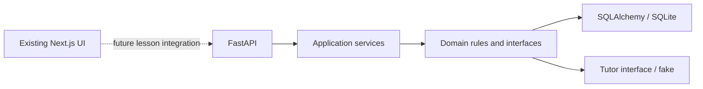
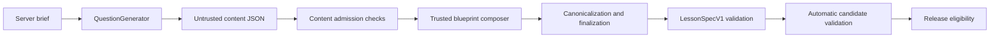
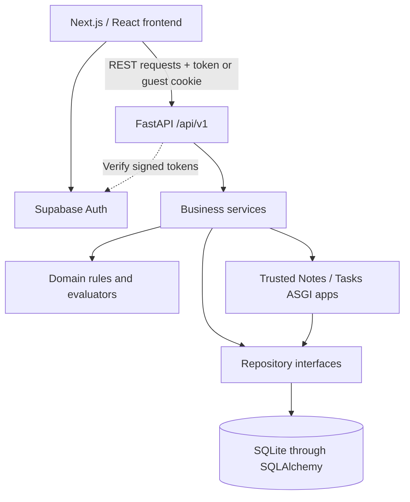
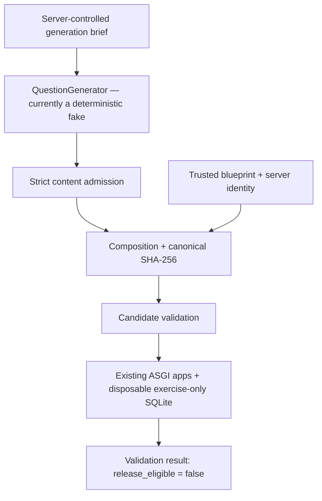

# Codex Session Log - 2026-10-31

Session: `01a18c8a-4fc7-70a0-bf35-3113cfa88f29` | Project: `Trace-v1` | Author: `Soorej S` | GitHub: `SoorejS`

---

[CLAUDE_LOG_ENTRY type=PROMPT num=1 session=01a18c8a-4fc7-70a0-bf35-3113cfa88f29]
timestamp: 2026-10-30T11:20:39.085Z
time: 2026-10-30 16:50
chars: 237
turn_id: "01a18c8a-5546-70d0-978f-65c04cfdd885"
capture_event: null
timestamp_source: "native_record.timestamp"
model: "gpt-6.1-sol"
cwd: "<TRACE_REPOSITORY>"
source_message_id: "msg_01a18c8a-57ad-7222-972c-424b9fe95a4d"
source_record_ordinal: 14
source_record_type: "response_item"
source_timestamp: "2026-10-30T11:20:39.085Z"
is_turn_continuation: false
original_exchange_number: 1
recovery_preserved_from: "historical_snapshot"
provenance: {"source_file": "<CODEX_HOME>/sessions/2026/10/30/rollout-2026-10-30T16-50-37-01a18c8a-4fc7-70a0-bf35-3113cfa88f29.jsonl", "source_line": 15, "source_record_type": "response_item.message.user", "source_session_id": "01a18c8a-4fc7-70a0-bf35-3113cfa88f29", "source_turn_id": "01a18c8a-5546-70d0-978f-65c04cfdd885", "source_call_id": null}
reconstructed: true
words: 33
has_code_block: false
has_file_paths: false
has_urls: false
likely_pasted: false

# Files pasted by the user:

## "I am Soorej. Help me understand and develop Trace, the coding-learning product …": <CODEX_HOME>/attachments/[RESOURCE ID REDACTED]/Pasted text.txt

Pasted text contains the user's request.

## My request:


[CLAUDE_LOG_ENTRY type=RESPONSE num=1 session=01a18c8a-4fc7-70a0-bf35-3113cfa88f29]
timestamp: 2026-10-30T11:24:39.216Z
time: 2026-10-30 16:54
chars: 7823
turn_id: "01a18c8a-5546-70d0-978f-65c04cfdd885"
capture_event: null
timestamp_source: "native_record.timestamp"
model: "gpt-6.1-sol"
cwd: "<TRACE_REPOSITORY>"
source_message_id: "msg_00547679234db823016ae47e4e6a448191a787d877ba31cfa7"
source_record_ordinal: 83
source_record_type: "response_item"
source_timestamp: "2026-10-30T11:24:39.216Z"
original_exchange_number: 1
recovery_preserved_from: "historical_snapshot"
provenance: {"source_file": "<CODEX_HOME>/sessions/2026/10/30/rollout-2026-10-30T16-50-37-01a18c8a-4fc7-70a0-bf35-3113cfa88f29.jsonl", "source_line": 84, "source_record_type": "response_item.message.assistant.final_answer", "source_session_id": "01a18c8a-4fc7-70a0-bf35-3113cfa88f29", "source_turn_id": "01a18c8a-5546-70d0-978f-65c04cfdd885", "source_call_id": null}
reconstructed: true

Trace is a coding-learning product for people who have already built small applications with AI but struggle to explain, change, diagnose, and verify the generated code. Its long-term ambition is **engineering judgment**: following behavior through code, identifying a failure, requesting a specific repair, and judging the result.

The first learning outcome is deliberately narrow: in one curated notes application, the learner follows a value through a Python function, outgoing payload, and receiving API schema; identifies a request-field mismatch; changes the mapping; and verifies the save. Success would demonstrate application of that concept. Broader debugging ability remains something to investigate.

I completed a read-only review. I changed no project files or settings and ran no project scripts, tests, or servers.

The decisions and open choices separate as follows:

| Status | My understanding |
|---|---|
| **Settled** | Coding only; AI builders as the intended learners; one notes application; failed-save/request-field diagnosis first; actual code reading and small changes; attempts before solutions; honest evidence and assistance records. |
| **Provisional** | Python lesson excerpts, FastAPI/SQLite, constrained expression parsing mapped to reviewed implementations, hint design, human assessment rubric, session length, and return interval. These need review against the actual project and learner behavior. |
| **Team direction** | Sohaib owns the Next.js frontend/design; you own lesson/backend work, checks, observations, and evidence. Both review correctness and the complete experience. |
| **Later possibilities** | Agent repair instructions with acceptance conditions, live coaching, additional failure classes, and a wider curriculum. |
| **Untested assumptions** | The target audience experiences this gap, accepts deliberate practice, finds this exercise relevant, returns voluntarily, and improves on comparable unfamiliar tasks. |

An authored lesson can test the product without a live model. If constrained execution is used later, the interface must explain what actually ran and distinguish unsupported expressions from incorrect Python.

The learner journey should be short but substantive:

1. **Attempt:** encounter a failed save and relevant code; predict behavior, diagnose the problem, attempt a small change, and choose verification evidence before feedback. A skip remains recorded.
2. **Learn:** receive a concise worked example linking code to observed behavior. Progressive hints provide increasing help.
3. **Practise:** try a related case and revise while preserving the original response and assistance history.
4. **Check independently:** attempt a fresh comparable case. Preserve the first response; task-specific help makes that attempt assisted. Missing in-app hints cannot establish that no external help occurred.
5. **Verify:** explain what a check would demonstrate, then inspect actual outcomes. A successful response, a fresh database read, and an invalid-input/regression check answer different questions.
6. **Return:** revisit a fresh variation after a real interval, recording dates and intervening practice or help.

This fits the Coding track because learners actively read and change code. It fits *Learning that sticks* through recall, application, later practice, and visible changes in capability. The proposed reason to return is useful continuation and another opportunity to apply a previously difficult concept; whether that motivates Day 3/7 returns needs observation.

**Completing the task and demonstrating understanding are different outcomes.** A correct repair may come from copying or hints. Stronger evidence includes explaining the value flow, locating the mismatch, predicting consequences, and selecting checks on a new comparable case with less help. Code outcomes, reasoning quality, evidence selection, and assistance should remain separate. Initial free-text judgments need human review.

The actual attached workspace is [Trace-v1](<TRACE_REPOSITORY>):

| Area | Observed locally |
|---|---|
| Git | Initialized repository on `master`, with no commits and no tracked files. |
| Frontend | No application files, Next.js configuration, or dependency manifest present. |
| Backend | No backend source, API routes, database, or checks present. |
| Instructions | No `AGENTS.md` found in the project or checked ancestor directories. |
| Logging | No `.claude-logs/` or project logging configuration. Git hooks contain sample files only; no `core.hooksPath` setting was returned. |

Therefore, frontend/backend integration and automatic cohort logging are **unverified in this project**. This inspection does not establish whether an external capture mechanism exists.

The historical [prototype README](<USER_HOME>/Documents/Codex/2026-10-28/tel/outputs/coding-learning-app/README.md) describes an implemented FastAPI/SQLite experience and a planned Next.js integration. Those claims belong to that earlier reference. They do not establish implementation or passing tests here. Its broader lesson plans also remain subordinate to your latest, narrower scope. I made no remote Git requests or attempts to recover the deleted integration.

The [logging guide](<USER_HOME>/Downloads/agent-session-logs-setup.md) confirms the canonical `.claude-logs/<timestamp>_<session-id>.md` format, stable session file, attribution/statistics, and prompt/final-response markers. Learner activity records serve a separate purpose. Later logging acceptance needs genuine prompt/answer capture followed by another automatic update, with correct attribution, exclusions, and tracking. Files merely existing would be insufficient evidence.

The cohort requirements are supported by :codex-file-citation{path="<USER_HOME>/Downloads/Playmakers C2 Onboarding.pdf" purpose="source"} and :codex-file-citation{path="<USER_HOME>/Downloads/8x Playmakers C2 Intro Call.pdf" purpose="source"}: individual ownership, personal daily updates including weekends, recorded/transcribed pair calls, tracked agent logs, and frequent narrated Loom demos with camera, clear audio, and a three-minute maximum. Localhost demos are acceptable; the template and suggested tools are optional. The documents supply no numerical scoring weights. Their schedule is October 28–November 6, with final demos November 5; current announcements and dashboard changes remain unchecked. This restart does not reset the sprint.

The smallest useful validation milestone is **one observed target learner**, followed by roughly 3–5 if the first session is informative. Establish their prerequisites and ask about a recent real difficulty before explaining Trace’s hypothesis. Watch their initial diagnosis, code attempt, and verification choice before helping; then teach and observe a comparable follow-up.

Evidence should preserve task versions, original responses, revisions, timing, actual outcomes, and assistance—including facilitator help. Use aliases, separate QA from participants, and keep private project code out of records. The Study room should distinguish observed behavior → interpretation → proposed change → recheck outcome. A “shipped” label records a report.

The result could change the lesson substantially: syntax confusion may require better code scaffolding; weak verification may become the main teaching focus; effortless field renaming may show that the exercise is too shallow. Choose one observed difficulty, make one later correction, and reobserve. A handful of attempts can guide that decision without establishing causal learning improvement, broad transfer, demand, or retention.

The essential workspace clarification is: **is this empty `Trace-v1` repository intentional? If existing frontend code should be reviewed, what is its exact local folder?**


[CLAUDE_LOG_ENTRY type=PROMPT num=2 session=01a18c8a-4fc7-70a0-bf35-3113cfa88f29]
timestamp: 2026-10-30T11:39:10.374Z
time: 2026-10-30 17:09
chars: 106
turn_id: "01a18c9b-4bc7-7f71-bef2-7e39be718759"
capture_event: null
timestamp_source: "native_record.timestamp"
model: "gpt-6.1-sol"
cwd: "<TRACE_REPOSITORY>"
source_message_id: "msg_01a18c9b-4ca6-7482-972d-ed8b18349a32"
source_record_ordinal: 90
source_record_type: "response_item"
source_timestamp: "2026-10-30T11:39:10.374Z"
is_turn_continuation: false
original_exchange_number: 2
recovery_preserved_from: "historical_snapshot"
provenance: {"source_file": "<CODEX_HOME>/sessions/2026/10/30/rollout-2026-10-30T16-50-37-01a18c8a-4fc7-70a0-bf35-3113cfa88f29.jsonl", "source_line": 91, "source_record_type": "response_item.message.user", "source_session_id": "01a18c8a-4fc7-70a0-bf35-3113cfa88f29", "source_turn_id": "01a18c9b-4bc7-7f71-bef2-7e39be718759", "source_call_id": null}
reconstructed: true
words: 8
has_code_block: false
has_file_paths: true
has_urls: true
likely_pasted: true

[https://github.com/Sohaib7932/trace](https://github.com/Sohaib7932/trace)
what and how much work is done?


[CLAUDE_LOG_ENTRY type=RESPONSE num=2 session=01a18c8a-4fc7-70a0-bf35-3113cfa88f29]
timestamp: 2026-10-30T11:42:15.997Z
time: 2026-10-30 17:12
chars: 3762
turn_id: "01a18c9b-4bc7-7f71-bef2-7e39be718759"
capture_event: null
timestamp_source: "native_record.timestamp"
model: "gpt-6.1-sol"
cwd: "<TRACE_REPOSITORY>"
source_message_id: "msg_00547679234db823016ae482855e4c81918c92cb0e6a5cccba"
source_record_ordinal: 200
source_record_type: "response_item"
source_timestamp: "2026-10-30T11:42:15.997Z"
original_exchange_number: 2
recovery_preserved_from: "historical_snapshot"
provenance: {"source_file": "<CODEX_HOME>/sessions/2026/10/30/rollout-2026-10-30T16-50-37-01a18c8a-4fc7-70a0-bf35-3113cfa88f29.jsonl", "source_line": 201, "source_record_type": "response_item.message.assistant.final_answer", "source_session_id": "01a18c8a-4fc7-70a0-bf35-3113cfa88f29", "source_turn_id": "01a18c9b-4bc7-7f71-bef2-7e39be718759", "source_call_id": null}
reconstructed: true

**Sohaib has done substantial frontend/design work. GitHub currently contains a homepage and an interactive lesson demo; the complete learning product is still early.**

I reviewed `main` at commit [`a3ea743`](https://github.com/Sohaib7932/trace/commit/a3ea7434ec51f1d70a69ccc7096069d684733a8d). There are **12 commits** across October 29–30. My earlier “empty folder” finding applied to your local `Trace-v1`, not this GitHub repository.

| Area | What is actually done |
|---|---|
| Frontend foundation | Next.js, React, TypeScript, Tailwind, reusable components, and design tokens. |
| Homepage | Navigation, hero, feature cards, learning-loop explanation, walkthrough, example progress history, and footer. [Page source](https://github.com/Sohaib7932/trace/blob/a3ea7434ec51f1d70a69ccc7096069d684733a8d/src/app/page.tsx) |
| Interactive demo | Prediction choices, locked prediction, sample-result reveal, editable code line, hint, feedback, attempt counter, and restart. [Demo source](https://github.com/Sohaib7932/trace/blob/a3ea7434ec51f1d70a69ccc7096069d684733a8d/src/components/marketing/lesson-demo.tsx) |
| Motion and accessibility | Code magnifier, animated diagrams, scroll sequences, mobile navigation, keyboard handling, and reduced-motion alternatives are implemented in source. |
| Real execution/backend | No backend, database, API integration, or live code verification found. |
| Saved learning evidence | No persistent attempts, revisions, hint history, or learner sessions found. |
| Return/progress | Illustrative content exists. Actual delayed practice and recorded progress remain unimplemented. |

**The demo is interactive, but its verification is scripted.** It accepts a predefined answer—`count: notes.length`—and displays authored response values. The source explicitly labels these as sample output. Across the 40 TypeScript/TSX files inspected, I found no network requests or persistent storage integration. [Lesson content](https://github.com/Sohaib7932/trace/blob/a3ea7434ec51f1d70a69ccc7096069d684733a8d/src/content/demo-lesson.ts)

There is also an important content difference: the current demo teaches **JavaScript/Express early returns and adding a response field**. Your agreed first lesson teaches **a Python request-field mismatch causing a failed save**. The frontend provides useful components, but the agreed lesson still needs to be connected.

The remaining core work is:

- Implement the agreed failed-save lesson with real request validation, save behavior, and fresh-read checks.
- Preserve original responses, timestamps, task versions, revisions, and assistance.
- Add comparable practice, an independent check, and a genuine delayed revisit.
- Connect real progress evidence and the facilitator observation workflow.
- Observe learners and make a correction based on their behavior.

The displayed Day 1/5/12 history is explicitly an **example record**, not pilot evidence. [Progress source](https://github.com/Sohaib7932/trace/blob/a3ea7434ec51f1d70a69ccc7096069d684733a8d/src/components/marketing/progress-record.tsx)

Logging has progressed too: Claude hooks and one committed session log exist. However, the logger includes subagent conversations, which conflicts with your handoff’s exclusions. These files do not demonstrate working Codex capture. [Logging instructions](https://github.com/Sohaib7932/trace/blob/a3ea7434ec51f1d70a69ccc7096069d684733a8d/AGENTS.md)

**My assessment: substantial frontend prototype work; no complete learning flow with real backend evidence yet.** A single completion percentage would hide that difference. I found no automated test suite or GitHub Actions runs, and I did not run the application, so visual quality and runtime reliability remain independently unverified.


[CLAUDE_LOG_ENTRY type=PROMPT num=3 session=01a18c8a-4fc7-70a0-bf35-3113cfa88f29]
timestamp: 2026-10-30T13:40:51.814Z
time: 2026-10-30 19:10
chars: 56
turn_id: "01a18d0a-b4f8-7c71-b727-011ec1d8f1fa"
capture_event: null
timestamp_source: "native_record.timestamp"
model: "gpt-6.1-sol"
cwd: "<TRACE_REPOSITORY>"
source_message_id: "msg_01a18d0a-b5e6-7ed0-ac4c-7e644c242f9f"
source_record_ordinal: 207
source_record_type: "response_item"
source_timestamp: "2026-10-30T13:40:51.814Z"
is_turn_continuation: false
original_exchange_number: 3
recovery_preserved_from: "historical_snapshot"
provenance: {"source_file": "<CODEX_HOME>/sessions/2026/10/30/rollout-2026-10-30T16-50-37-01a18c8a-4fc7-70a0-bf35-3113cfa88f29.jsonl", "source_line": 208, "source_record_type": "response_item.message.user", "source_session_id": "01a18c8a-4fc7-70a0-bf35-3113cfa88f29", "source_turn_id": "01a18d0a-b4f8-7c71-b727-011ec1d8f1fa", "source_call_id": null}
reconstructed: true
words: 11
has_code_block: false
has_file_paths: false
has_urls: false
likely_pasted: false

get my system ready to commit code to the repo there....


[CLAUDE_LOG_ENTRY type=RESPONSE num=3 session=01a18c8a-4fc7-70a0-bf35-3113cfa88f29]
timestamp: 2026-10-30T13:43:28.432Z
time: 2026-10-30 19:13
chars: 484
turn_id: "01a18d0a-b4f8-7c71-b727-011ec1d8f1fa"
capture_event: null
timestamp_source: "native_record.timestamp"
model: "gpt-6.1-sol"
cwd: "<TRACE_REPOSITORY>"
source_message_id: "msg_00547679234db823016ae49efead5881919bddbdd6be378947"
source_record_ordinal: 260
source_record_type: "response_item"
source_timestamp: "2026-10-30T13:43:28.432Z"
original_exchange_number: 3
recovery_preserved_from: "historical_snapshot"
provenance: {"source_file": "<CODEX_HOME>/sessions/2026/10/30/rollout-2026-10-30T16-50-37-01a18c8a-4fc7-70a0-bf35-3113cfa88f29.jsonl", "source_line": 261, "source_record_type": "response_item.message.assistant.final_answer", "source_session_id": "01a18c8a-4fc7-70a0-bf35-3113cfa88f29", "source_turn_id": "01a18d0a-b4f8-7c71-b727-011ec1d8f1fa", "source_call_id": null}
reconstructed: true

Git is ready in [Trace-v1](<TRACE_REPOSITORY>).

- Connected `origin` to `Sohaib7932/trace`.
- Downloaded `main` and configured tracking of `origin/main`.
- Set the local commit author to **Soorej S**.
- Verified GitHub account **SoorejS** has write access.
- Confirmed the working tree is clean.

Nothing was committed or pushed. Pushes remain yours.

Before implementation, **automatic Codex session logging still needs verification**; the repository’s existing hooks target Claude.


[CLAUDE_LOG_ENTRY type=PROMPT num=4 session=01a18c8a-4fc7-70a0-bf35-3113cfa88f29]
timestamp: 2026-10-30T13:44:01.774Z
time: 2026-10-30 19:14
chars: 166
turn_id: "01a18d0d-9b45-7883-9bbb-c39779d34ed4"
capture_event: null
timestamp_source: "native_record.timestamp"
model: "gpt-6.1-sol"
cwd: "<TRACE_REPOSITORY>"
source_message_id: "msg_01a18d0d-9bee-7880-9c26-2de8b3a18abe"
source_record_ordinal: 267
source_record_type: "response_item"
source_timestamp: "2026-10-30T13:44:01.774Z"
is_turn_continuation: false
original_exchange_number: 4
recovery_preserved_from: "historical_snapshot"
provenance: {"source_file": "<CODEX_HOME>/sessions/2026/10/30/rollout-2026-10-30T16-50-37-01a18c8a-4fc7-70a0-bf35-3113cfa88f29.jsonl", "source_line": 268, "source_record_type": "response_item.message.user", "source_session_id": "01a18c8a-4fc7-70a0-bf35-3113cfa88f29", "source_turn_id": "01a18d0d-9b45-7883-9bbb-c39779d34ed4", "source_call_id": null}
reconstructed: true
words: 27
has_code_block: false
has_file_paths: false
has_urls: false
likely_pasted: false

set up automatic Codex logging in .claude-logs using the cohort format and verify real prompts and final answers are captured. don't change app code or push anything.


[CLAUDE_LOG_ENTRY type=RESPONSE num=4 session=01a18c8a-4fc7-70a0-bf35-3113cfa88f29]
timestamp: 2026-10-30T13:55:23.722Z
time: 2026-10-30 19:25
chars: 878
turn_id: "01a18d0d-9b45-7883-9bbb-c39779d34ed4"
capture_event: null
timestamp_source: "native_record.timestamp"
model: "gpt-6.1-sol"
cwd: "<TRACE_REPOSITORY>"
source_message_id: "msg_00547679234db823016ae4a1c86cf88191953deaddcbb46697"
source_record_ordinal: 452
source_record_type: "response_item"
source_timestamp: "2026-10-30T13:55:23.722Z"
original_exchange_number: 4
recovery_preserved_from: "historical_snapshot"
provenance: {"source_file": "<CODEX_HOME>/sessions/2026/10/30/rollout-2026-10-30T16-50-37-01a18c8a-4fc7-70a0-bf35-3113cfa88f29.jsonl", "source_line": 453, "source_record_type": "response_item.message.assistant.final_answer", "source_session_id": "01a18c8a-4fc7-70a0-bf35-3113cfa88f29", "source_turn_id": "01a18d0d-9b45-7883-9bbb-c39779d34ed4", "source_call_id": null}
reconstructed: true

Prepared and staged the [Codex hooks](<TRACE_REPOSITORY>/.codex/hooks.json), exporter, tests, and instructions.

- Preserves the cohort format and `.claude-logs` location.
- Excludes commentary, reasoning, tools, injected context, and subagents.
- Starts with this logging request; earlier history stays excluded.
- Passed **13 logging tests** and a read-only check against real transcript messages.

**Automatic capture is not yet verified.** Codex requires human review of new hooks before running them. [Official documentation](https://learn.chatgpt.com/docs/hooks)

Open a terminal and run:

```powershell
codex -C "<TRACE_REPOSITORY>"
```

Enter `/hooks`, review and trust this project’s `UserPromptSubmit` and `Stop` handlers, then reply **“logging check”** here. I’ll inspect actual capture and subsequent updates.

App code is unchanged. Nothing was committed or pushed.


[CLAUDE_LOG_ENTRY type=PROMPT num=5 session=01a18c8a-4fc7-70a0-bf35-3113cfa88f29]
timestamp: 2026-10-30T13:56:07.053Z
time: 2026-10-30 19:26
chars: 536
turn_id: "01a18d18-ac6e-7490-aef0-22e72beffcae"
capture_event: null
timestamp_source: "native_record.timestamp"
model: "gpt-6.1-sol"
cwd: "<TRACE_REPOSITORY>"
source_message_id: "msg_01a18d18-ad0d-79e0-954e-1be1a29852f9"
source_record_ordinal: 459
source_record_type: "response_item"
source_timestamp: "2026-10-30T13:56:07.053Z"
is_turn_continuation: false
original_exchange_number: 5
recovery_preserved_from: "historical_snapshot"
provenance: {"source_file": "<CODEX_HOME>/sessions/2026/10/30/rollout-2026-10-30T16-50-37-01a18c8a-4fc7-70a0-bf35-3113cfa88f29.jsonl", "source_line": 460, "source_record_type": "response_item.message.user", "source_session_id": "01a18c8a-4fc7-70a0-bf35-3113cfa88f29", "source_turn_id": "01a18d18-ac6e-7490-aef0-22e72beffcae", "source_call_id": null}
reconstructed: true
words: 49
has_code_block: false
has_file_paths: true
has_urls: true
likely_pasted: true

<send_user_message_question_reply>
[{"questionItemId":"[/"request_user_input_async/",/"call_55b54a5a9d5e405a8367c12a881c58fc/",0]","question":"Codex requires human review before new hooks can run (https://learn.chatgpt.com/docs/hooks). In a terminal opened in Trace-v1, run `codex`, enter `/hooks`, and review/trust the UserPromptSubmit and Stop handlers from this project's `.codex/hooks.json`. Then reply here so I can check a real automatic capture.","answer":"I reviewed and trusted both hooks"}]
</send_user_message_question_reply>


[CLAUDE_LOG_ENTRY type=RESPONSE num=5 session=01a18c8a-4fc7-70a0-bf35-3113cfa88f29]
timestamp: 2026-10-30T14:01:47.363Z
time: 2026-10-30 19:31
chars: 465
turn_id: "01a18d18-ac6e-7490-aef0-22e72beffcae"
capture_event: null
timestamp_source: "native_record.timestamp"
model: "gpt-6.1-sol"
cwd: "<TRACE_REPOSITORY>"
source_message_id: "msg_00547679234db823016ae4a348d9488191954ae07f5f060d2b"
source_record_ordinal: 572
source_record_type: "response_item"
source_timestamp: "2026-10-30T14:01:47.363Z"
original_exchange_number: 5
recovery_preserved_from: "historical_snapshot"
provenance: {"source_file": "<CODEX_HOME>/sessions/2026/10/30/rollout-2026-10-30T16-50-37-01a18c8a-4fc7-70a0-bf35-3113cfa88f29.jsonl", "source_line": 573, "source_record_type": "response_item.message.assistant.final_answer", "source_session_id": "01a18c8a-4fc7-70a0-bf35-3113cfa88f29", "source_turn_id": "01a18d18-ac6e-7490-aef0-22e72beffcae", "source_call_id": null}
reconstructed: true

Confirmed: Codex reports **both hooks enabled and trusted**.

The logger also now handles question-dialog replies; **15 tests pass**. However, **no automatic Codex log has appeared yet**, so capture remains unverified.

Please type **`logging check`** as a normal message here. Your confirmation came through the question dialog; we still need to test the ordinary prompt path and inspect real saved answers.

App code is unchanged. Nothing was committed or pushed.


[CLAUDE_LOG_ENTRY type=PROMPT num=6 session=01a18c8a-4fc7-70a0-bf35-3113cfa88f29]
timestamp: 2026-10-30T14:37:51.976Z
time: 2026-10-30 20:07
chars: 13
turn_id: "01a18d3e-e4f6-7a52-87bf-20023e96d45f"
capture_event: null
timestamp_source: "native_record.timestamp"
model: "gpt-6.1-sol"
cwd: "<TRACE_REPOSITORY>"
source_message_id: "msg_01a18d3e-e5e8-7752-880d-062c3124fefa"
source_record_ordinal: 581
source_record_type: "response_item"
source_timestamp: "2026-10-30T14:37:51.976Z"
is_turn_continuation: false
original_exchange_number: 6
recovery_preserved_from: "historical_snapshot"
provenance: {"source_file": "<CODEX_HOME>/sessions/2026/10/30/rollout-2026-10-30T16-50-37-01a18c8a-4fc7-70a0-bf35-3113cfa88f29.jsonl", "source_line": 582, "source_record_type": "response_item.message.user", "source_session_id": "01a18c8a-4fc7-70a0-bf35-3113cfa88f29", "source_turn_id": "01a18d3e-e4f6-7a52-87bf-20023e96d45f", "source_call_id": null}
reconstructed: true
words: 2
has_code_block: false
has_file_paths: false
has_urls: false
likely_pasted: false

logging check


[CLAUDE_LOG_ENTRY type=RESPONSE num=6 session=01a18c8a-4fc7-70a0-bf35-3113cfa88f29]
timestamp: 2026-10-30T14:41:07.447Z
time: 2026-10-30 20:11
chars: 684
turn_id: "01a18d3e-e4f6-7a52-87bf-20023e96d45f"
capture_event: null
timestamp_source: "native_record.timestamp"
model: "gpt-6.1-sol"
cwd: "<TRACE_REPOSITORY>"
source_message_id: "msg_00547679234db823016ae4ac80eb908191b189da3b18b58f5c"
source_record_ordinal: 634
source_record_type: "response_item"
source_timestamp: "2026-10-30T14:41:07.447Z"
original_exchange_number: 6
recovery_preserved_from: "historical_snapshot"
provenance: {"source_file": "<CODEX_HOME>/sessions/2026/10/30/rollout-2026-10-30T16-50-37-01a18c8a-4fc7-70a0-bf35-3113cfa88f29.jsonl", "source_line": 635, "source_record_type": "response_item.message.assistant.final_answer", "source_session_id": "01a18c8a-4fc7-70a0-bf35-3113cfa88f29", "source_turn_id": "01a18d3e-e4f6-7a52-87bf-20023e96d45f", "source_call_id": null}
reconstructed: true

**The check failed: no Codex log was created.** Both hooks are enabled and trusted, but this running chat isn’t invoking them.

Please fully quit and reopen Codex, return to **this same chat**, and type **`logging check`** again. This will test whether reloading activates the configuration. No need to trust the hooks again.

App code is unchanged; nothing was committed or pushed.

The [Computer Use skill](<CODEX_HOME>/plugins/cache/openai-bundled/computer-use/26.1023.50603/skills/computer-use/SKILL.md) requires guidance stating, “Do not automate the ChatGPT desktop app UI or Codex CLI or Codex extensions within Windows apps.” I can’t perform that UI step through Computer Use.


[CLAUDE_LOG_ENTRY type=PROMPT num=7 session=01a18c8a-4fc7-70a0-bf35-3113cfa88f29]
timestamp: 2026-10-30T14:54:57.975Z
time: 2026-10-30 20:24
chars: 237
turn_id: "01a18d4e-8d04-7553-afcb-b2544e94d15f"
capture_event: null
timestamp_source: "native_record.timestamp"
model: "gpt-6.1-sol"
cwd: "<TRACE_REPOSITORY>"
source_message_id: "msg_01a18d4e-8db7-7eb2-a3fe-8515c9dc73dd"
source_record_ordinal: 641
source_record_type: "response_item"
source_timestamp: "2026-10-30T14:54:57.975Z"
is_turn_continuation: false
original_exchange_number: 7
recovery_preserved_from: "historical_snapshot"
provenance: {"source_file": "<CODEX_HOME>/sessions/2026/10/30/rollout-2026-10-30T16-50-37-01a18c8a-4fc7-70a0-bf35-3113cfa88f29.jsonl", "source_line": 642, "source_record_type": "response_item.message.user", "source_session_id": "01a18c8a-4fc7-70a0-bf35-3113cfa88f29", "source_turn_id": "01a18d4e-8d04-7553-afcb-b2544e94d15f", "source_call_id": null}
reconstructed: true
words: 32
has_code_block: false
has_file_paths: false
has_urls: false
likely_pasted: false

# Files pasted by the user:

## "# Task: Fix Codex session logging into the existing shared `.claude-logs/` dire…": <CODEX_HOME>/attachments/[RESOURCE ID REDACTED]/Pasted text.txt

Pasted text contains the user's request.

## My request:


[CLAUDE_LOG_ENTRY type=RESPONSE num=7 session=01a18c8a-4fc7-70a0-bf35-3113cfa88f29]
timestamp: 2026-10-30T15:20:43.598Z
time: 2026-10-30 20:50
chars: 2332
turn_id: "01a18d4e-8d04-7553-afcb-b2544e94d15f"
capture_event: null
timestamp_source: "native_record.timestamp"
model: "gpt-6.1-sol"
cwd: "<TRACE_REPOSITORY>"
source_message_id: "msg_00547679234db823016ae4b5c2ceb481919391ba5c9a266176"
source_record_ordinal: 867
source_record_type: "response_item"
source_timestamp: "2026-10-30T15:20:43.598Z"
original_exchange_number: 7
recovery_preserved_from: "historical_snapshot"
provenance: {"source_file": "<CODEX_HOME>/sessions/2026/10/30/rollout-2026-10-30T16-50-37-01a18c8a-4fc7-70a0-bf35-3113cfa88f29.jsonl", "source_line": 868, "source_record_type": "response_item.message.assistant.final_answer", "source_session_id": "01a18c8a-4fc7-70a0-bf35-3113cfa88f29", "source_turn_id": "01a18d4e-8d04-7553-afcb-b2544e94d15f", "source_call_id": null}
reconstructed: true

The adapter now uses **native event payloads**, and **23 handler tests pass**. **Live automatic capture remains unverified**, so the full task is not yet complete.

1. **Root cause:** The previous adapter incorrectly required internal transcript JSONL instead of reading `prompt` and `last_assistant_message`. That defect is fixed. Separately, this running desktop session hasn’t invoked the hooks; its exact runtime cause remains unproven.

2. **Files changed:** [Capture script](<TRACE_REPOSITORY>/scripts/codex_session_log.py), [tests](<TRACE_REPOSITORY>/scripts/tests/test_codex_session_log.py), [logging instructions](<TRACE_REPOSITORY>/scripts/CODEX_LOGGING.md), and [AGENTS.md](<TRACE_REPOSITORY>/AGENTS.md). Removed the obsolete cutoff policy and custom attribution-cache settings.

3. **Configuration layer:** Project-level [.codex/hooks.json](<TRACE_REPOSITORY>/.codex/hooks.json). Both handlers remain enabled and trusted. No duplicate definitions or conflicting hook policies were found.

4. **Events:** `UserPromptSubmit` captures `prompt`; `Stop` captures `last_assistant_message`, associated by session and turn IDs. This follows the [official hook contract](https://developers.openai.com/codex/hooks).

5. **Claude compatibility:** Existing Claude hooks, script, and session log remain unchanged. Coexistence tests passed.

6. **Handler tests:** All **23 passed**, including two exchanges, duplicate processing, concurrent writes, redaction, and protection against overwriting another agent’s file.

7. **Real capture:** **No real prompt/final pair has yet been automatically verified.** Test data stayed in temporary directories.

8. **Resulting file:** No real Codex Markdown file exists yet. Its canonical destination is [.claude-logs](<TRACE_REPOSITORY>/.claude-logs), using `<timestamp>_<session-id>.md`.

9. **Restart:** Still outstanding. I verified that both native Codex processes started **before the hook file was created**. Fully quit Codex, reopen it, resume **this same chat**, and type **`logging check`**. After the answer, send another genuine project prompt to test the next exchange.

10. **Remaining limitation:** Fresh-session automatic capture still needs proof; Sohaib’s machine has not been tested.

Changes are staged for review. **No app code changed, and nothing was committed or pushed.**


[CLAUDE_LOG_ENTRY type=PROMPT num=8 session=01a18c8a-4fc7-70a0-bf35-3113cfa88f29]
timestamp: 2026-10-31T03:15:20.311Z
time: 2026-10-31 08:45
chars: 161
turn_id: "01a18ff4-5fad-7122-b92f-01f62078a928"
capture_event: null
timestamp_source: "native_record.timestamp"
model: "gpt-6.1-sol"
cwd: "<TRACE_REPOSITORY>"
source_message_id: "msg_01a18ff4-6276-79e1-b8c8-5f0332d45999"
source_record_ordinal: 877
source_record_type: "response_item"
source_timestamp: "2026-10-31T03:15:20.311Z"
is_turn_continuation: false
original_exchange_number: 8
recovery_preserved_from: "historical_snapshot"
provenance: {"source_file": "<CODEX_HOME>/sessions/2026/10/30/rollout-2026-10-30T16-50-37-01a18c8a-4fc7-70a0-bf35-3113cfa88f29.jsonl", "source_line": 878, "source_record_type": "response_item.message.user", "source_session_id": "01a18c8a-4fc7-70a0-bf35-3113cfa88f29", "source_turn_id": "01a18ff4-5fad-7122-b92f-01f62078a928", "source_call_id": null}
reconstructed: true
words: 37
has_code_block: false
has_file_paths: false
has_urls: false
likely_pasted: false

can i just fork that repo and contribute on it and update the agents logs for codex and just go at it ??
or since i am added i can just do it ?
i dont understand


[CLAUDE_LOG_ENTRY type=RESPONSE num=8 session=01a18c8a-4fc7-70a0-bf35-3113cfa88f29]
timestamp: 2026-10-31T03:16:36.497Z
time: 2026-10-31 08:46
chars: 1176
turn_id: "01a18ff4-5fad-7122-b92f-01f62078a928"
capture_event: null
timestamp_source: "native_record.timestamp"
model: "gpt-6.1-sol"
cwd: "<TRACE_REPOSITORY>"
source_message_id: "msg_00547679234db823016ae55d90be18819189df48480c8d9a3c"
source_record_ordinal: 895
source_record_type: "response_item"
source_timestamp: "2026-10-31T03:16:36.497Z"
original_exchange_number: 8
recovery_preserved_from: "historical_snapshot"
provenance: {"source_file": "<CODEX_HOME>/sessions/2026/10/30/rollout-2026-10-30T16-50-37-01a18c8a-4fc7-70a0-bf35-3113cfa88f29.jsonl", "source_line": 896, "source_record_type": "response_item.message.assistant.final_answer", "source_session_id": "01a18c8a-4fc7-70a0-bf35-3113cfa88f29", "source_turn_id": "01a18ff4-5fad-7122-b92f-01f62078a928", "source_call_id": null}
reconstructed: true

**You can contribute directly. You already have write access to [Sohaib’s repository](https://github.com/Sohaib7932/trace), so you don’t need a fork.**

Your [local Trace-v1 folder](<TRACE_REPOSITORY>) is already connected to it.

| Term | Meaning | For you |
|---|---|---|
| **Fork** | Another repository under your account | Unnecessary here |
| **Clone/local checkout** | The repository’s files on your computer | Already set up |
| **Branch** | A separate line of work inside the shared repository | Use this for your changes |

The workflow for you two is:

1. You work on your own branch, such as `codex/lesson-backend`.
2. Sohaib works on his own branch.
3. You commit your changes and your agent logs.
4. You push your branch yourself.
5. Review and merge changes into `main` through a pull request.

**Codex logging can be fixed in this same repository.** Both agents should generate separate session files inside the shared `.claude-logs/` folder, attributed to the correct developer.

Git access is ready. The remaining prerequisite is verifying that Codex actually captures real prompts and final answers automatically. A fork would not resolve that logging issue.


[CLAUDE_LOG_ENTRY type=PROMPT num=9 session=01a18c8a-4fc7-70a0-bf35-3113cfa88f29]
timestamp: 2026-10-31T04:36:38.044Z
time: 2026-10-31 10:06
chars: 56
turn_id: "01a1903e-ce47-7153-8d7b-99aa972ccece"
capture_event: null
timestamp_source: "native_record.timestamp"
model: "gpt-6.1-sol"
cwd: "<TRACE_REPOSITORY>"
source_message_id: "msg_01a1903e-d01c-7d03-9c91-6daa85a09fde"
source_record_ordinal: 902
source_record_type: "response_item"
source_timestamp: "2026-10-31T04:36:38.044Z"
is_turn_continuation: false
original_exchange_number: 9
recovery_preserved_from: "historical_snapshot"
provenance: {"source_file": "<CODEX_HOME>/sessions/2026/10/30/rollout-2026-10-30T16-50-37-01a18c8a-4fc7-70a0-bf35-3113cfa88f29.jsonl", "source_line": 903, "source_record_type": "response_item.message.user", "source_session_id": "01a18c8a-4fc7-70a0-bf35-3113cfa88f29", "source_turn_id": "01a1903e-ce47-7153-8d7b-99aa972ccece", "source_call_id": null}
reconstructed: true
words: 13
has_code_block: false
has_file_paths: false
has_urls: false
likely_pasted: false

ok so if i commit and give prompt will it be seen there?


[CLAUDE_LOG_ENTRY type=RESPONSE num=9 session=01a18c8a-4fc7-70a0-bf35-3113cfa88f29]
timestamp: 2026-10-31T04:36:59.365Z
time: 2026-10-31 10:06
chars: 424
turn_id: "01a1903e-ce47-7153-8d7b-99aa972ccece"
capture_event: null
timestamp_source: "native_record.timestamp"
model: "gpt-6.1-sol"
cwd: "<TRACE_REPOSITORY>"
source_message_id: "msg_00547679234db823016ae570695b308191aa2c4210b9471e67"
source_record_ordinal: 907
source_record_type: "response_item"
source_timestamp: "2026-10-31T04:36:59.365Z"
original_exchange_number: 9
recovery_preserved_from: "historical_snapshot"
provenance: {"source_file": "<CODEX_HOME>/sessions/2026/10/30/rollout-2026-10-30T16-50-37-01a18c8a-4fc7-70a0-bf35-3113cfa88f29.jsonl", "source_line": 908, "source_record_type": "response_item.message.assistant.final_answer", "source_session_id": "01a18c8a-4fc7-70a0-bf35-3113cfa88f29", "source_turn_id": "01a1903e-ce47-7153-8d7b-99aa972ccece", "source_call_id": null}
reconstructed: true

If you mean **your prompts appearing on GitHub**, the sequence is:

**Give prompt → logger saves prompt and final answer in `.claude-logs/` → commit that file → push → visible on GitHub.**

A commit only saves changes locally; pushing publishes them.

**Committing the logging setup does not activate it.** Automatic capture is still unverified, so we must first confirm that a real prompt and answer appear in the log file.


[CLAUDE_LOG_ENTRY type=PROMPT num=10 session=01a18c8a-4fc7-70a0-bf35-3113cfa88f29]
timestamp: 2026-10-31T04:37:22.387Z
time: 2026-10-31 10:07
chars: 118
turn_id: "01a1903f-7cb5-74a2-8763-f580c3386ae3"
capture_event: null
timestamp_source: "native_record.timestamp"
model: "gpt-6.1-sol"
cwd: "<TRACE_REPOSITORY>"
source_message_id: "msg_01a1903f-7d53-7db2-aebf-9a453e8d3b85"
source_record_ordinal: 914
source_record_type: "response_item"
source_timestamp: "2026-10-31T04:37:22.387Z"
is_turn_continuation: false
original_exchange_number: 10
recovery_preserved_from: "historical_snapshot"
provenance: {"source_file": "<CODEX_HOME>/sessions/2026/10/30/rollout-2026-10-30T16-50-37-01a18c8a-4fc7-70a0-bf35-3113cfa88f29.jsonl", "source_line": 915, "source_record_type": "response_item.message.user", "source_session_id": "01a18c8a-4fc7-70a0-bf35-3113cfa88f29", "source_turn_id": "01a1903f-7cb5-74a2-8763-f580c3386ae3", "source_call_id": null}
reconstructed: true
words: 19
has_code_block: false
has_file_paths: false
has_urls: false
likely_pasted: false

ok then verify codex logging is actually working in .claude-logs before we start coding. don't commit or push anything


[CLAUDE_LOG_ENTRY type=RESPONSE num=10 session=01a18c8a-4fc7-70a0-bf35-3113cfa88f29]
timestamp: 2026-10-31T04:39:07.847Z
time: 2026-10-31 10:09
chars: 699
turn_id: "01a1903f-7cb5-74a2-8763-f580c3386ae3"
capture_event: null
timestamp_source: "native_record.timestamp"
model: "gpt-6.1-sol"
cwd: "<TRACE_REPOSITORY>"
source_message_id: "msg_00547679234db823016ae570e948148191ad73dcbb7128f1c6"
source_record_ordinal: 942
source_record_type: "response_item"
source_timestamp: "2026-10-31T04:39:07.847Z"
original_exchange_number: 10
recovery_preserved_from: "historical_snapshot"
provenance: {"source_file": "<CODEX_HOME>/sessions/2026/10/30/rollout-2026-10-30T16-50-37-01a18c8a-4fc7-70a0-bf35-3113cfa88f29.jsonl", "source_line": 943, "source_record_type": "response_item.message.assistant.final_answer", "source_session_id": "01a18c8a-4fc7-70a0-bf35-3113cfa88f29", "source_turn_id": "01a1903f-7cb5-74a2-8763-f580c3386ae3", "source_call_id": null}
reconstructed: true

**Verification failed: Codex logging is not recording this chat yet.**

- `.claude-logs/` contains only the existing Claude log.
- No Codex session file contains your recent prompts or my final answers.
- Both Codex hooks are enabled and trusted.
- The backend still predates the hook setup—it has not restarted since they were added.

Please **fully exit Codex so its backend stops, reopen it, return to this same chat, and send `logging check`**. A fresh-session test is the next step; restarting alone is not proof that capture works.

We’ll hold application coding until a real prompt/final pair and subsequent exchange are captured.

Nothing was changed, committed, or pushed during this check.


[CLAUDE_LOG_ENTRY type=PROMPT num=11 session=01a18c8a-4fc7-70a0-bf35-3113cfa88f29]
timestamp: 2026-10-31T04:40:16.075Z
time: 2026-10-31 10:10
chars: 59
turn_id: "01a19042-2346-7de3-a01e-49b584a18c7b"
capture_event: null
timestamp_source: "native_record.timestamp"
model: "gpt-6.1-sol"
cwd: "<TRACE_REPOSITORY>"
source_message_id: "msg_01a19042-23cb-7690-a0bd-00244bae2251"
source_record_ordinal: 949
source_record_type: "response_item"
source_timestamp: "2026-10-31T04:40:16.075Z"
is_turn_continuation: false
original_exchange_number: 11
recovery_preserved_from: "historical_snapshot"
provenance: {"source_file": "<CODEX_HOME>/sessions/2026/10/30/rollout-2026-10-30T16-50-37-01a18c8a-4fc7-70a0-bf35-3113cfa88f29.jsonl", "source_line": 950, "source_record_type": "response_item.message.user", "source_session_id": "01a18c8a-4fc7-70a0-bf35-3113cfa88f29", "source_turn_id": "01a19042-2346-7de3-a01e-49b584a18c7b", "source_call_id": null}
reconstructed: true
words: 12
has_code_block: false
has_file_paths: false
has_urls: false
likely_pasted: false

ok exit then i will close codex too and tyrpe logging check


[CLAUDE_LOG_ENTRY type=RESPONSE num=11 session=01a18c8a-4fc7-70a0-bf35-3113cfa88f29]
timestamp: 2026-10-31T04:40:25.783Z
time: 2026-10-31 10:10
chars: 133
turn_id: "01a19042-2346-7de3-a01e-49b584a18c7b"
capture_event: null
timestamp_source: "native_record.timestamp"
model: "gpt-6.1-sol"
cwd: "<TRACE_REPOSITORY>"
source_message_id: "msg_00547679234db823016ae571395aa08191b05b6f7337715cbb"
source_record_ordinal: 954
source_record_type: "response_item"
source_timestamp: "2026-10-31T04:40:25.783Z"
original_exchange_number: 11
recovery_preserved_from: "historical_snapshot"
provenance: {"source_file": "<CODEX_HOME>/sessions/2026/10/30/rollout-2026-10-30T16-50-37-01a18c8a-4fc7-70a0-bf35-3113cfa88f29.jsonl", "source_line": 955, "source_record_type": "response_item.message.assistant.final_answer", "source_session_id": "01a18c8a-4fc7-70a0-bf35-3113cfa88f29", "source_turn_id": "01a19042-2346-7de3-a01e-49b584a18c7b", "source_call_id": null}
reconstructed: true

Okay. Fully close and reopen Codex, return to **this same chat**, and type **`logging check`**. I’ll verify the actual log file then.


[CLAUDE_LOG_ENTRY type=PROMPT num=12 session=01a18c8a-4fc7-70a0-bf35-3113cfa88f29]
timestamp: 2026-10-31T04:49:35.876Z
time: 2026-10-31 10:19
chars: 13
turn_id: "01a1904a-addc-7c03-80d1-da83745ad9a4"
capture_event: null
timestamp_source: "native_record.timestamp"
model: "gpt-6.1-sol"
cwd: "<TRACE_REPOSITORY>"
source_message_id: "msg_01a1904a-ae84-7e11-8d08-dedf75965044"
source_record_ordinal: 961
source_record_type: "response_item"
source_timestamp: "2026-10-31T04:49:35.876Z"
is_turn_continuation: false
original_exchange_number: 12
recovery_preserved_from: "historical_snapshot"
provenance: {"source_file": "<CODEX_HOME>/sessions/2026/10/30/rollout-2026-10-30T16-50-37-01a18c8a-4fc7-70a0-bf35-3113cfa88f29.jsonl", "source_line": 962, "source_record_type": "response_item.message.user", "source_session_id": "01a18c8a-4fc7-70a0-bf35-3113cfa88f29", "source_turn_id": "01a1904a-addc-7c03-80d1-da83745ad9a4", "source_call_id": null}
reconstructed: true
words: 2
has_code_block: false
has_file_paths: false
has_urls: false
likely_pasted: false

logging check


[CLAUDE_LOG_ENTRY type=RESPONSE num=12 session=01a18c8a-4fc7-70a0-bf35-3113cfa88f29]
timestamp: 2026-10-31T04:52:01.454Z
time: 2026-10-31 10:22
chars: 516
turn_id: "01a1904a-addc-7c03-80d1-da83745ad9a4"
capture_event: null
timestamp_source: "native_record.timestamp"
model: "gpt-6.1-sol"
cwd: "<TRACE_REPOSITORY>"
source_message_id: "msg_00547679234db823016ae573efd4708191885b87bfeaa3a07d"
source_record_ordinal: 1003
source_record_type: "response_item"
source_timestamp: "2026-10-31T04:52:01.454Z"
original_exchange_number: 12
recovery_preserved_from: "historical_snapshot"
provenance: {"source_file": "<CODEX_HOME>/sessions/2026/10/30/rollout-2026-10-30T16-50-37-01a18c8a-4fc7-70a0-bf35-3113cfa88f29.jsonl", "source_line": 1004, "source_record_type": "response_item.message.assistant.final_answer", "source_session_id": "01a18c8a-4fc7-70a0-bf35-3113cfa88f29", "source_turn_id": "01a1904a-addc-7c03-80d1-da83745ad9a4", "source_call_id": null}
reconstructed: true

**Still no Codex log.** The background app never restarted: it is running as **`ChatGPT.exe`, PID `13632`**, inside the installed **OpenAI.Codex** package.

My earlier restart instructions were too vague. Please:

1. Open Task Manager with **Ctrl + Shift + Esc**.
2. Under **Details**, find **`ChatGPT.exe` with PID `13632`** and choose **End task**.
3. Reopen Codex, return to this same chat, and type **`logging check`**.

That will let us test a genuinely fresh process. Nothing was changed, committed, or pushed.


[CLAUDE_LOG_ENTRY type=PROMPT num=13 session=01a18c8a-4fc7-70a0-bf35-3113cfa88f29]
timestamp: 2026-10-31T04:55:36.654897+00:00
time: 2026-10-31 10:25
chars: 13
turn_id: "01a1904e-cf89-7043-ae09-6b96a3d138dd"
capture_event: "UserPromptSubmit"
timestamp_source: "hook_capture_time_utc"
model: "gpt-6.1-sol"
cwd: "<TRACE_REPOSITORY>"
source_message_id: "msg_01a19050-36c0-7f52-b62b-da98ab6d25c3"
source_record_ordinal: 1019
source_record_type: "response_item"
source_timestamp: "2026-10-31T04:55:38.432Z"
is_turn_continuation: false
original_exchange_number: 1
recovery_preserved_from: "canonical"
words: 2
has_code_block: false
has_file_paths: false
has_urls: false
likely_pasted: false

logging check


[CLAUDE_LOG_ENTRY type=RESPONSE num=13 session=01a18c8a-4fc7-70a0-bf35-3113cfa88f29]
timestamp: 2026-10-31T04:56:33.554888+00:00
time: 2026-10-31 10:26
chars: 297
turn_id: "01a1904e-cf89-7043-ae09-6b96a3d138dd"
capture_event: "Stop"
timestamp_source: "hook_capture_time_utc"
model: "gpt-6.1-sol"
cwd: "<TRACE_REPOSITORY>"
source_message_id: "msg_0c048e52670a70a1016ae574ff9db08191aa44e431adadcef4"
source_record_ordinal: 1058
source_record_type: "response_item"
source_timestamp: "2026-10-31T04:56:32.529Z"
original_exchange_number: 1
recovery_preserved_from: "canonical"

Your real prompt was **automatically captured** in the [session log](<TRACE_REPOSITORY>/.claude-logs/2026-10-31_10-25-36_01a18c8a-4fc7-70a0-bf35-3113cfa88f29.md).

Send `logging check` once more so I can verify this final answer was captured too.

No app code changed. Nothing committed or pushed.


[CLAUDE_LOG_ENTRY type=PROMPT num=14 session=01a18c8a-4fc7-70a0-bf35-3113cfa88f29]
timestamp: 2026-10-31T04:56:44.596706+00:00
time: 2026-10-31 10:26
chars: 13
turn_id: "01a19051-35be-75b3-8dc8-e045b3ca25e9"
capture_event: "UserPromptSubmit"
timestamp_source: "hook_capture_time_utc"
model: "gpt-6.1-sol"
cwd: "<TRACE_REPOSITORY>"
source_message_id: "msg_01a19051-3cf4-7782-b0f2-f1cc477af36b"
source_record_ordinal: 1067
source_record_type: "response_item"
source_timestamp: "2026-10-31T04:56:45.556Z"
is_turn_continuation: false
original_exchange_number: 2
recovery_preserved_from: "canonical"
words: 2
has_code_block: false
has_file_paths: false
has_urls: false
likely_pasted: false

logging check


[CLAUDE_LOG_ENTRY type=RESPONSE num=14 session=01a18c8a-4fc7-70a0-bf35-3113cfa88f29]
timestamp: 2026-10-31T04:57:43.812454+00:00
time: 2026-10-31 10:27
chars: 356
turn_id: "01a19051-35be-75b3-8dc8-e045b3ca25e9"
capture_event: "Stop"
timestamp_source: "hook_capture_time_utc"
model: "gpt-6.1-sol"
cwd: "<TRACE_REPOSITORY>"
source_message_id: "msg_0c048e52670a70a1016ae575460d5c81919fa3019734925c36"
source_record_ordinal: 1104
source_record_type: "response_item"
source_timestamp: "2026-10-31T04:57:43.057Z"
original_exchange_number: 2
recovery_preserved_from: "canonical"

**Verified: automatic Codex logging is working.**

The [session log](<TRACE_REPOSITORY>/.claude-logs/2026-10-31_10-25-36_01a18c8a-4fc7-70a0-bf35-3113cfa88f29.md) contains two real prompts and my previous final answer, matching exactly. Commentary and tool output are excluded.

No app code changed. Nothing committed or pushed. We’re ready to start coding.


[CLAUDE_LOG_ENTRY type=PROMPT num=15 session=01a18c8a-4fc7-70a0-bf35-3113cfa88f29]
timestamp: 2026-10-31T04:59:58.896591+00:00
time: 2026-10-31 10:29
chars: 93
turn_id: "01a19054-2c56-7cb0-844f-4e833bdb5d05"
capture_event: "UserPromptSubmit"
timestamp_source: "hook_capture_time_utc"
model: "gpt-6.1-sol"
cwd: "<TRACE_REPOSITORY>"
source_message_id: "msg_01a19054-3414-7622-ba7f-4edbf113cec6"
source_record_ordinal: 1111
source_record_type: "response_item"
source_timestamp: "2026-10-31T04:59:59.892Z"
is_turn_continuation: false
original_exchange_number: 3
recovery_preserved_from: "canonical"
words: 19
has_code_block: false
has_file_paths: false
has_urls: false
likely_pasted: false

so will all this be logged in the logs and can i start coding and architect the trace product


[CLAUDE_LOG_ENTRY type=RESPONSE num=15 session=01a18c8a-4fc7-70a0-bf35-3113cfa88f29]
timestamp: 2026-10-31T05:00:14.562210+00:00
time: 2026-10-31 10:30
chars: 478
turn_id: "01a19054-2c56-7cb0-844f-4e833bdb5d05"
capture_event: "Stop"
timestamp_source: "hook_capture_time_utc"
model: "gpt-6.1-sol"
cwd: "<TRACE_REPOSITORY>"
source_message_id: "msg_0c048e52670a70a1016ae575dbfa5881918c7e561bd8c9c288"
source_record_ordinal: 1116
source_record_type: "response_item"
source_timestamp: "2026-10-31T05:00:13.726Z"
original_exchange_number: 3
recovery_preserved_from: "canonical"

**Yes—you can start architecting and coding Trace now.**

Your prompts and my final answers are automatically saved in [`.claude-logs`](<TRACE_REPOSITORY>/.claude-logs) in this checkout. Earlier messages from before logging started aren’t backfilled. Internal reasoning, commentary, and tool output are excluded.

The logs stay local until committed and pushed. I’ll include them with any changes you authorize committing; nothing gets committed or pushed without your approval.


[CLAUDE_LOG_ENTRY type=PROMPT num=16 session=01a18c8a-4fc7-70a0-bf35-3113cfa88f29]
timestamp: 2026-10-31T05:43:26.445576+00:00
time: 2026-10-31 11:13
chars: 237
turn_id: "01a1907b-f308-7441-8475-c396d7b7320b"
capture_event: "UserPromptSubmit"
timestamp_source: "hook_capture_time_utc"
model: "gpt-6.1-sol"
cwd: "<TRACE_REPOSITORY>"
source_message_id: "msg_01a1907b-fe2f-7463-a199-a49094f0c095"
source_record_ordinal: 1123
source_record_type: "response_item"
source_timestamp: "2026-10-31T05:43:27.535Z"
is_turn_continuation: false
original_exchange_number: 4
recovery_preserved_from: "canonical"
words: 33
has_code_block: false
has_file_paths: false
has_urls: false
likely_pasted: false

# Files pasted by the user:

## "# TRACE — MODULE 1: ARCHITECTURE AND ENGINEERING FOUNDATION You are the princip…": <CODEX_HOME>/attachments/[RESOURCE ID REDACTED]/Pasted text.txt

Pasted text contains the user's request.

## My request:


[CLAUDE_LOG_ENTRY type=RESPONSE num=16 session=01a18c8a-4fc7-70a0-bf35-3113cfa88f29]
timestamp: 2026-10-31T06:24:06.876861+00:00
time: 2026-10-31 11:54
chars: 2161
turn_id: "01a1907b-f308-7441-8475-c396d7b7320b"
capture_event: "Stop"
timestamp_source: "hook_capture_time_utc"
model: "gpt-6.1-sol"
cwd: "<TRACE_REPOSITORY>"
source_message_id: "msg_0c048e52670a70a1016ae5897e47308191888ac7dcce7c3dd9"
source_record_ordinal: 1635
source_record_type: "response_item"
source_timestamp: "2026-10-31T06:24:05.927Z"
original_exchange_number: 4
recovery_preserved_from: "canonical"

**Module 1 is implemented and verified locally. Nothing was committed or pushed.**

The audit confirmed an existing Next.js 16.4.3 / React 19.3.0 frontend with no backend. I added:

- A Python 3.13 FastAPI backend with validated settings, scoped SQLAlchemy sessions, Alembic migrations, health endpoints, safe errors, controlled CORS, structured logging and request limits.
- A typed AI-provider interface and deterministic fake.
- Generated OpenAPI/TypeScript contracts, frontend testing tools and GitHub Actions.
- Architecture documentation, six ADRs, the proposed data model, API contracts and testing strategy.



The design is preserved. Browser tests exposed an existing reduced-motion hydration bug; a small correction in [code-lens.tsx](<TRACE_REPOSITORY>/src/components/code/code-lens.tsx:146) resolved it.

| Validation | Actual result |
|---|---|
| Backend tests | **45 passed**, 97.48% coverage |
| Frontend component tests | **3 passed** |
| Desktop/mobile Chromium tests | **2 passed**, no page errors |
| Logging regression tests | **23 passed** |
| Ruff, formatting, mypy, ESLint, TypeScript, production build | Passed |
| Migrations, schema checks, real Uvicorn health check | Passed |
| OpenAPI/type regeneration | No drift |

**The learning product itself remains unimplemented:** learner sessions, immutable predictions, real notes verification, progress and live Gemini/Claude adapters are documented contracts, not working features yet.

The [full delivery report](<TRACE_REPOSITORY>/docs/architecture/module-1-report.md) contains the file inventory, decisions, stack deviations, exact commands/results, limitations and Module 2 plan. Reproducible setup is in [README.md](<TRACE_REPOSITORY>/README.md).

Module 2 should establish pseudonymous ownership, pinned lesson versions and immutable predictions, then prove the actual `body` → 422/no-row and `content` → successful-save/fresh-read behaviour.


[CLAUDE_LOG_ENTRY type=PROMPT num=17 session=01a18c8a-4fc7-70a0-bf35-3113cfa88f29]
timestamp: 2026-10-31T06:35:09.859870+00:00
time: 2026-10-31 12:05
chars: 237
turn_id: "01a190ab-50d0-7c70-ab88-5b18c53c09cc"
capture_event: "UserPromptSubmit"
timestamp_source: "hook_capture_time_utc"
model: "gpt-6.1-sol"
cwd: "<TRACE_REPOSITORY>"
source_message_id: "msg_01a190ab-582d-7651-9a8c-4cbfba26d838"
source_record_ordinal: 1642
source_record_type: "response_item"
source_timestamp: "2026-10-31T06:35:10.765Z"
is_turn_continuation: false
original_exchange_number: 5
recovery_preserved_from: "canonical"
words: 35
has_code_block: false
has_file_paths: false
has_urls: false
likely_pasted: false

# Files pasted by the user:

## "# TRACE — MODULE 2: CORE LEARNING ENGINE AND FIRST WORKING LESSON You are actin…": <CODEX_HOME>/attachments/[RESOURCE ID REDACTED]/Pasted text.txt

Pasted text contains the user's request.

## My request:


[CLAUDE_LOG_ENTRY type=RESPONSE num=17 session=01a18c8a-4fc7-70a0-bf35-3113cfa88f29]
timestamp: 2026-10-31T07:38:28.817109+00:00
time: 2026-10-31 13:08
chars: 1237
turn_id: "01a190ab-50d0-7c70-ab88-5b18c53c09cc"
capture_event: "Stop"
timestamp_source: "hook_capture_time_utc"
model: "gpt-6.1-sol"
cwd: "<TRACE_REPOSITORY>"
source_message_id: "msg_0c048e52670a70a1016ae59aef267881919666e61a8e6638d7"
source_record_ordinal: 2239
source_record_type: "response_item"
source_timestamp: "2026-10-31T07:38:27.516Z"
original_exchange_number: 5
recovery_preserved_from: "canonical"

Module 2 is implemented and verified locally. The first lesson includes pseudonymous ownership, immutable predictions, preserved attempts, recorded hints, server-controlled completion and history after reload.

Actual verification works:

- `body` → **HTTP 422**, fresh database read confirms **zero rows**.
- `content` → **HTTP 201**, committed row confirmed through a separate database session.

Validation passed:

| Check | Result |
|---|---|
| Backend | 95 tests; 98.82% coverage |
| Frontend | 14 tests |
| Desktop/mobile browser | 4 tests |
| Logging regression | 23 tests |

Lint, formatting, type checks, production build, migrations and generated-contract checks also pass. Marketing UI and logging configuration are preserved. Guidance uses the labelled fixture provider.

See the [delivery report](<TRACE_REPOSITORY>/docs/architecture/module-2-report.md) and [startup instructions](<TRACE_REPOSITORY>/README.md).

Git status remains separated:

- **Staged:** your five existing logging/instruction files, preserved.
- **Unstaged:** configuration/documentation changes and existing Module 1 edits.
- **Untracked:** backend, learning UI, tests, architecture documents and shared logs.

I did not stage, commit or push anything.


[CLAUDE_LOG_ENTRY type=PROMPT num=18 session=01a18c8a-4fc7-70a0-bf35-3113cfa88f29]
timestamp: 2026-10-31T09:09:55.427566+00:00
time: 2026-10-31 14:39
chars: 237
turn_id: "01a19138-fff9-7a31-bfe6-000c183be3f6"
capture_event: "UserPromptSubmit"
timestamp_source: "hook_capture_time_utc"
model: "gpt-6.1-sol"
cwd: "<TRACE_REPOSITORY>"
source_message_id: "msg_01a19139-085f-76d1-bdb8-258315236ed3"
source_record_ordinal: 2246
source_record_type: "response_item"
source_timestamp: "2026-10-31T09:09:56.448Z"
is_turn_continuation: false
original_exchange_number: 6
recovery_preserved_from: "canonical"
words: 37
has_code_block: false
has_file_paths: false
has_urls: false
likely_pasted: false

# Files pasted by the user:

## "# Trace — Final Audit, Commit and Push (Modules 1 & 2) You are operating in the…": <CODEX_HOME>/attachments/[RESOURCE ID REDACTED]/Pasted text.txt

Pasted text contains the user's request.

## My request:


[CLAUDE_LOG_ENTRY type=RESPONSE num=18 session=01a18c8a-4fc7-70a0-bf35-3113cfa88f29]
timestamp: 2026-10-31T09:25:22.329038+00:00
time: 2026-10-31 14:55
chars: 2398
turn_id: "01a19138-fff9-7a31-bfe6-000c183be3f6"
capture_event: "Stop"
timestamp_source: "hook_capture_time_utc"
model: "gpt-6.1-sol"
cwd: "<TRACE_REPOSITORY>"
source_message_id: "msg_0c048e52670a70a1016ae5b3f7cbf081919777aae8ad11018c"
source_record_ordinal: 2559
source_record_type: "response_item"
source_timestamp: "2026-10-31T09:25:21.133Z"
original_exchange_number: 6
recovery_preserved_from: "canonical"

Pushed successfully to [feat/trace-module-1-2](https://github.com/Sohaib7932/trace/tree/feat/trace-module-1-2). Local and remote HEAD match, upstream tracking is configured, and `main` remains unchanged.

| Commit | Included |
|---|---|
| [`28274ed`](https://github.com/Sohaib7932/trace/commit/28274ed1c188d200931ff0205b3586f7de85e8da) — `chore(logging): add shared Claude and Codex session capture` | Hooks, adapter, tests, instructions and genuine session records |
| [`77008d2`](https://github.com/Sohaib7932/trace/commit/77008d212ffc5d63160dd94717929c24017a8fa5) — `feat(trace): deliver Modules 1 and 2 learning platform` | Backend, migrations, learning engine/UI, generated contracts, tests, CI and documentation |

Modules 1 and 2 share configuration and API files, so they were committed together.

Fresh local validation:

| Check | Result |
|---|---|
| Backend | **95 passed; 98.82% coverage** |
| Frontend | **14 passed** |
| Desktop/mobile browser | **4 passed** |
| Logging | **24 passed**, including the original 23 |
| Lint, formatting, types, build, migrations, repeated seed, contract generation and HTTP health checks | Passed |

**Remote [GitHub CI](https://github.com/Sohaib7932/trace/actions/runs/41188390873) also completed successfully:** Windows backend, Linux backend and frontend.

The secret audit found only deliberate test credentials. Environment examples are safe; runtime databases, environments, caches and browser artifacts were excluded. No dedicated secret scanner was installed, so verification used pattern scanning and manual review.

The logging audit found four app-generated suggestion records. I preserved and excluded them, added a narrow rejection check, and retained the genuine session log. These originals remain untracked:

- [10:27:48 log](<TRACE_REPOSITORY>/.claude-logs/2026-10-31_10-27-48_[RESOURCE ID REDACTED].md)
- [10:30:20 log](<TRACE_REPOSITORY>/.claude-logs/2026-10-31_10-30-20_[RESOURCE ID REDACTED].md)
- [11:54:10 log](<TRACE_REPOSITORY>/.claude-logs/2026-10-31_11-54-10_[RESOURCE ID REDACTED].md)
- [13:08:38 log](<TRACE_REPOSITORY>/.claude-logs/2026-10-31_13-08-38_[RESOURCE ID REDACTED].md)

At the final check, tracked files and the index were clean. The Stop hook may append this answer afterward, creating a new local log change.

Full details: [final audit report](<TRACE_REPOSITORY>/docs/architecture/final-audit-module-1-2.md).


[CLAUDE_LOG_ENTRY type=PROMPT num=19 session=01a18c8a-4fc7-70a0-bf35-3113cfa88f29]
timestamp: 2026-10-31T11:28:33.494217+00:00
time: 2026-10-31 16:58
chars: 237
turn_id: "01a191b7-e867-7dc0-af6c-df8b0f4547fd"
capture_event: "UserPromptSubmit"
timestamp_source: "hook_capture_time_utc"
model: "gpt-6.1-sol"
cwd: "<TRACE_REPOSITORY>"
source_message_id: "msg_01a191b7-f4fe-7682-969d-f53a800c02a7"
source_record_ordinal: 2566
source_record_type: "response_item"
source_timestamp: "2026-10-31T11:28:34.568Z"
is_turn_continuation: false
original_exchange_number: 7
recovery_preserved_from: "canonical"
words: 35
has_code_block: false
has_file_paths: false
has_urls: false
likely_pasted: false

# Files pasted by the user:

## "# Trace — Module 3: Transfer Learning & Spaced Retrieval You are the lead engin…": <CODEX_HOME>/attachments/[RESOURCE ID REDACTED]/Pasted text.txt

Pasted text contains the user's request.

## My request:


[CLAUDE_LOG_ENTRY type=RESPONSE num=19 session=01a18c8a-4fc7-70a0-bf35-3113cfa88f29]
timestamp: 2026-10-31T12:14:29.662403+00:00
time: 2026-10-31 17:44
chars: 2653
turn_id: "01a191b7-e867-7dc0-af6c-df8b0f4547fd"
capture_event: "Stop"
timestamp_source: "hook_capture_time_utc"
model: "gpt-6.1-sol"
cwd: "<TRACE_REPOSITORY>"
source_message_id: "msg_0c048e52670a70a1016ae5db9bc3f881919d0b374037e7b40f"
source_record_ordinal: 3173
source_record_type: "response_item"
source_timestamp: "2026-10-31T12:14:28.731Z"
original_exchange_number: 7
recovery_preserved_from: "canonical"

Module 3 is implemented, committed and pushed. I verified [PR #1](https://github.com/Sohaib7932/trace/pull/1) was merged before starting.

Branch: `feat/trace-module-3-transfer-retention`
Commit: [`f24caca`](https://github.com/Sohaib7932/trace/commit/f24cacaaa55f7cbc2da85125bd4562cc7cfdea82) — `feat(learning): add transfer challenge and spaced retrieval`

[Open the PR comparison against main](https://github.com/Sohaib7932/trace/compare/main...feat/trace-module-3-transfer-retention).

The completed journey now includes:

- **Nested-payload transfer:** an independently versioned task lesson. Flat requests produce real **422/zero-row** evidence; corrected nested requests produce **201**, committed persistence and independent readback.
- **Spaced retrieval:** checkpoints due **1 and 7 UTC days** after transfer completion, with deterministic feedback, preserved responses and persisted completion. Missed checkpoints remain available.
- **Integrated UI and APIs:** transfer navigation, factual phase progress, retrieval controls and reload persistence. Migration `0004_transfer_retrieval` adds three tables.
- **Return access:** a 30-day credential default with protected renewal of still-valid credentials near expiry.

The original lesson and marketing design are preserved.

| Fresh local validation | Result |
|---|---|
| Backend | **128 passed; 98.98% coverage** |
| Frontend | **21 passed** |
| Desktop/mobile browser | **6 passed** |
| Logging | **24 passed** |

Lint, formatting, types, production build, migrations, repeated seeding and generated-contract checks passed. **[Remote CI passed](https://github.com/Sohaib7932/trace/actions/runs/41199935828)** for Windows backend, Linux backend and frontend.

The secret audit found only known dummy test values. Genuine logs are included. Four app-generated suggestion logs remain preserved and untracked: [10:27:48](<TRACE_REPOSITORY>/.claude-logs/2026-10-31_10-27-48_[RESOURCE ID REDACTED].md), [10:30:20](<TRACE_REPOSITORY>/.claude-logs/2026-10-31_10-30-20_[RESOURCE ID REDACTED].md), [11:54:10](<TRACE_REPOSITORY>/.claude-logs/2026-10-31_11-54-10_[RESOURCE ID REDACTED].md), [13:08:38](<TRACE_REPOSITORY>/.claude-logs/2026-10-31_13-08-38_[RESOURCE ID REDACTED].md).

Local and remote HEAD match; tracked files and the index were clean at final inspection. `main` is unchanged. The Stop hook may append this answer afterward.

Live AI, external notifications, account recovery, export/deletion and deployment remain outside scope. Learning outcomes have not been evaluated with learners.

Full details: [Module 3 delivery report](<TRACE_REPOSITORY>/docs/architecture/module-3-report.md).


[CLAUDE_LOG_ENTRY type=PROMPT num=20 session=01a18c8a-4fc7-70a0-bf35-3113cfa88f29]
timestamp: 2026-10-31T13:25:05.439154+00:00
time: 2026-10-31 18:55
chars: 237
turn_id: "01a19222-9a56-7092-911e-5a84a9c5fb6d"
capture_event: "UserPromptSubmit"
timestamp_source: "hook_capture_time_utc"
model: "gpt-6.1-sol"
cwd: "<TRACE_REPOSITORY>"
source_message_id: "msg_01a19222-a5e5-7903-8ef6-ebc25f661ea2"
source_record_ordinal: 3183
source_record_type: "response_item"
source_timestamp: "2026-10-31T13:25:06.672Z"
is_turn_continuation: false
original_exchange_number: 8
recovery_preserved_from: "canonical"
words: 34
has_code_block: false
has_file_paths: false
has_urls: false
likely_pasted: false

# Files pasted by the user:

## "# Trace — Module 4: Identity, Authentication & Account Ownership You are the le…": <CODEX_HOME>/attachments/[RESOURCE ID REDACTED]/Pasted text.txt

Pasted text contains the user's request.

## My request:


[CLAUDE_LOG_ENTRY type=RESPONSE num=20 session=01a18c8a-4fc7-70a0-bf35-3113cfa88f29]
timestamp: 2026-10-31T14:19:04.057083+00:00
time: 2026-10-31 19:49
chars: 1755
turn_id: "01a19222-9a56-7092-911e-5a84a9c5fb6d"
capture_event: "Stop"
timestamp_source: "hook_capture_time_utc"
model: "gpt-6.1-sol"
cwd: "<TRACE_REPOSITORY>"
source_message_id: "msg_0c048e52670a70a1016ae5f8d07adc8191a8b4cfe53de84ee7"
source_record_ordinal: 3820
source_record_type: "response_item"
source_timestamp: "2026-10-31T14:19:03.280Z"
original_exchange_number: 8
recovery_preserved_from: "canonical"

Module 4 is implemented, committed and pushed on `feat/trace-module-4-account-auth`. Module 3’s PR #2 was verified as merged before work began.

Implemented:

- Supabase Google OAuth and email/password flows, confirmation/resend, recovery, refresh and logout.
- Permanent Trace accounts, trusted roles and audited operator role grants.
- Explicit guest-history claims that preserve learning records and reject conflicting ownership.
- Account pages, Next.js session handling and independent FastAPI JWT verification.
- Migration `0005_account_identity`, generated contracts and setup documentation.

| Validation | Result |
|---|---|
| Backend | 211 passed; 98.94% coverage |
| Frontend | 51 passed |
| Desktop/mobile E2E | 12 passed |
| Shared logging | 24 passed |

Lint, types, formatting, builds, migrations and contract checks passed. **[Final CI passed](https://github.com/Sohaib7932/trace/actions/runs/41209234962)** on Linux, Windows and frontend.

Commits: `4207285` implementation; `4f6a37f` delivery report. Remote HEAD matches, with zero ahead/behind. No PR was created.

**Provider setup remains:** configure your Supabase project, Google OAuth, required email confirmation, signing keys and SMTP using the [setup guide](<TRACE_REPOSITORY>/docs/architecture/account-setup.md). Browser tests used a controlled authentication fixture; real Google login and email delivery were not tested.

Genuine logs are included. Four existing suggestion logs remain preserved and untracked; this final answer will append through the native hook after the turn ends.

[Full delivery report](<TRACE_REPOSITORY>/docs/architecture/module-4-report.md) · [Compare against main](https://github.com/Sohaib7932/trace/compare/main...feat/trace-module-4-account-auth)


[CLAUDE_LOG_ENTRY type=PROMPT num=21 session=01a18c8a-4fc7-70a0-bf35-3113cfa88f29]
timestamp: 2026-10-31T17:20:51.527152+00:00
time: 2026-10-31 22:50
chars: 1036
turn_id: "01a192fa-7358-7103-8cc0-d4354a44ac5c"
capture_event: "UserPromptSubmit"
timestamp_source: "hook_capture_time_utc"
model: "gpt-6.1-sol"
cwd: "<TRACE_REPOSITORY>"
source_message_id: "msg_01a192fa-7f9d-7e50-9b3c-eab68e9e7065"
source_record_ordinal: 3827
source_record_type: "response_item"
source_timestamp: "2026-10-31T17:20:52.639Z"
is_turn_continuation: false
original_exchange_number: 9
recovery_preserved_from: "canonical"
words: 146
has_code_block: false
has_file_paths: false
has_urls: false
likely_pasted: true

Inspect my local Trace repository and help me prepare the environment configuration Sohaib needs to test Module 4 authentication on his machine.

Repository: `<TRACE_REPOSITORY>`

Please:

1. Check whether `.env.local` exists in the repository root.
2. Check whether `backend/.env` exists.
3. Inspect `.env.local.example` and `backend/.env.example` to identify the required configuration.
4. Determine which values are already configured and which are missing, without printing any secret values into the terminal, report, chat logs, or Git.
5. Check whether my current configuration points to a real Supabase project or is still blank/test configuration.
6. Prepare safe, shareable environment templates for Sohaib, clearly identifying which values he must obtain from our shared Supabase project and which are machine-specific.
7. Do not invent credentials, change authentication code, modify existing environment files, or commit or push anything.

Report the exact file paths and what is missing. Do not expose actual secret values.


[CLAUDE_LOG_ENTRY type=RESPONSE num=21 session=01a18c8a-4fc7-70a0-bf35-3113cfa88f29]
timestamp: 2026-10-31T17:24:39.018458+00:00
time: 2026-10-31 22:54
chars: 1692
turn_id: "01a192fa-7358-7103-8cc0-d4354a44ac5c"
capture_event: "Stop"
timestamp_source: "hook_capture_time_utc"
model: "gpt-6.1-sol"
cwd: "<TRACE_REPOSITORY>"
source_message_id: "msg_0c048e52670a70a1016ae6245001008191968392d4296a4a96"
source_record_ordinal: 3876
source_record_type: "response_item"
source_timestamp: "2026-10-31T17:24:38.022Z"
original_exchange_number: 9
recovery_preserved_from: "canonical"

**Local authentication is unconfigured.** I found no real Supabase project or test-fixture configuration in the inspected env files or inherited overrides.

| File | Finding |
|---|---|
| `<TRACE_REPOSITORY>/.env.local` | Does not exist |
| `<TRACE_REPOSITORY>/backend/.env` | Exists; 12 development settings configured, Supabase project settings missing |
| [.env.local.example](<TRACE_REPOSITORY>/.env.local.example) | Local URLs supplied; Supabase URL and publishable key blank |
| [backend/.env.example](<TRACE_REPOSITORY>/backend/.env.example) | Project URL, issuer and JWKS blank; defaults supplied |

Missing for authentication:

- Frontend: `NEXT_PUBLIC_SUPABASE_URL`, `NEXT_PUBLIC_SUPABASE_PUBLISHABLE_KEY`, and the machine-specific `NEXT_PUBLIC_SITE_URL`. The API URL has a fallback.
- Backend: `TRACE_SUPABASE_URL`, `TRACE_SUPABASE_ISSUER`, `TRACE_SUPABASE_JWKS_URL`.

Backend audience, cache duration and loopback-auth settings are absent from your actual file but already use application defaults.

Prepared separate files for Sohaib:

- [Frontend template](<TRACE_REPOSITORY>/docs/architecture/sohaib-auth-environment/frontend.env.example)
- [Backend template](<TRACE_REPOSITORY>/docs/architecture/sohaib-auth-environment/backend.env.example)
- [Handoff instructions and audit](<TRACE_REPOSITORY>/docs/architecture/sohaib-auth-environment/README.md)

He must obtain the shared project URL and publishable key; issuer/JWKS are derived from that URL. Local URLs, ports, CORS and SQLite settings belong to his machine.

No actual credentials were copied or exposed. Existing environment files, examples and authentication code remain unchanged. **Nothing was committed or pushed.**


[CLAUDE_LOG_ENTRY type=PROMPT num=22 session=01a18c8a-4fc7-70a0-bf35-3113cfa88f29]
timestamp: 2026-10-31T17:35:42.672739+00:00
time: 2026-10-31 23:05
chars: 94
turn_id: "01a19308-0f80-7ad3-86fe-df67d50e8694"
capture_event: "UserPromptSubmit"
timestamp_source: "hook_capture_time_utc"
model: "gpt-6.1-sol"
cwd: "<TRACE_REPOSITORY>"
source_message_id: "msg_01a19308-1861-7d70-a8dc-8487bb319fde"
source_record_ordinal: 3883
source_record_type: "response_item"
source_timestamp: "2026-10-31T17:35:43.719Z"
is_turn_continuation: false
original_exchange_number: 10
recovery_preserved_from: "canonical"
words: 17
has_code_block: false
has_file_paths: false
has_urls: false
likely_pasted: false

what are yet to be configured and implemented like supabase google oauth and all tell me those


[CLAUDE_LOG_ENTRY type=RESPONSE num=22 session=01a18c8a-4fc7-70a0-bf35-3113cfa88f29]
timestamp: 2026-10-31T17:36:49.012220+00:00
time: 2026-10-31 23:06
chars: 2941
turn_id: "01a19308-0f80-7ad3-86fe-df67d50e8694"
capture_event: "Stop"
timestamp_source: "hook_capture_time_utc"
model: "gpt-6.1-sol"
cwd: "<TRACE_REPOSITORY>"
source_message_id: "msg_0c048e52670a70a1016ae627247f488191887e231715e467e6"
source_record_ordinal: 3905
source_record_type: "response_item"
source_timestamp: "2026-10-31T17:36:48.214Z"
original_exchange_number: 10
recovery_preserved_from: "canonical"

**The Module 4 authentication code is implemented. The remaining work is provider configuration and testing with real accounts.** Your local checkout currently has no Supabase project configured. I haven’t inspected the shared project’s dashboards, so some dashboard work may already exist.

| Area | Already implemented | Still needs configuration or verification |
|---|---|---|
| **Supabase connection** | Browser/server SDKs and backend integration | Obtain the shared project URL and publishable key; fill the frontend/backend environment files |
| **Google OAuth** | Google button, PKCE flow and callback handling | Configure Google Cloud’s consent screen/Web OAuth client, register Supabase’s callback, and enable Google in Supabase. [Google setup](https://supabase.com/docs/guides/auth/social-sign-in/auth-google) |
| **Email/password** | Registration, login, confirmation, resend and password recovery | Enable email/password and required email confirmation in the shared project |
| **Email delivery** | Confirmation/reset link handling | Configure the email templates and verify delivery. Production needs custom SMTP; Supabase’s default service is restricted. [SMTP guidance](https://supabase.com/docs/guides/auth/auth-smtp) |
| **JWT signing** | Independent FastAPI signature and claims verification | Confirm the project uses ES256 or RS256 and exposes matching public JWKS keys. [Signing keys](https://supabase.com/docs/guides/auth/signing-keys) |
| **Redirect URLs** | Safe callback redirects | Configure Supabase Site URL and allowed callbacks to match each tester’s frontend address |
| **Machine environment** | Safe templates prepared | Create root `.env.local`; add the missing Supabase fields to `backend/.env`; confirm local URLs, CORS and cookie settings |
| **Live testing** | Automated fixture tests passed | Test actual Google consent, delivered email links, password recovery, refresh/logout, guest-history claims and another-device resume |

Permanent Trace identities, learner ownership, conflict protection, roles and the audited role-grant CLI are already implemented.

Further product features **still require implementation**:

- Creator Studio, lesson authoring and publishing.
- Creator/admin management interfaces—the current module provides their authorization foundation.
- A live AI tutor—the current tutor is a deterministic fake.
- Account deletion/data export and combining separate learner histories.
- Different-email account linking.
- Production deployment and operational hardening.

Those future features do **not** block testing Module 4 authentication. Phone/SMS and passwordless OTP/magic-link login were intentionally excluded.

The next practical step is **access to the shared Supabase project**, followed by provider setup, filling the prepared templates, and real-account testing. The exact instructions are in the [setup guide](<TRACE_REPOSITORY>/docs/architecture/account-setup.md).


[CLAUDE_LOG_ENTRY type=PROMPT num=23 session=01a18c8a-4fc7-70a0-bf35-3113cfa88f29]
timestamp: 2026-10-31T17:37:38.824817+00:00
time: 2026-10-31 23:07
chars: 39
turn_id: "01a19309-c71e-7693-afac-4bb753a97170"
capture_event: "UserPromptSubmit"
timestamp_source: "hook_capture_time_utc"
model: "gpt-6.1-sol"
cwd: "<TRACE_REPOSITORY>"
source_message_id: "msg_01a19309-dd90-72f1-b3e6-5c2a48416d42"
source_record_ordinal: 3921
source_record_type: "response_item"
source_timestamp: "2026-10-31T17:37:39.728Z"
is_turn_continuation: false
original_exchange_number: 11
recovery_preserved_from: "canonical"
words: 8
has_code_block: false
has_file_paths: false
has_urls: false
likely_pasted: false

i have not delpoyed the backend right ?


[CLAUDE_LOG_ENTRY type=RESPONSE num=23 session=01a18c8a-4fc7-70a0-bf35-3113cfa88f29]
timestamp: 2026-10-31T17:38:01.882514+00:00
time: 2026-10-31 23:08
chars: 410
turn_id: "01a19309-c71e-7693-afac-4bb753a97170"
capture_event: "Stop"
timestamp_source: "hook_capture_time_utc"
model: "gpt-6.1-sol"
cwd: "<TRACE_REPOSITORY>"
source_message_id: "msg_02a14bb15d7e399e016ae627776ecc819198b2808879f42817"
source_record_ordinal: 3927
source_record_type: "response_item"
source_timestamp: "2026-10-31T17:38:01.190Z"
original_exchange_number: 11
recovery_preserved_from: "canonical"

Correct—**we haven’t deployed Trace’s backend.**

So far, we’ve run and tested FastAPI locally and pushed the code to GitHub. The SQLite database is also local.

Supabase Auth is a separate service; configuring it won’t deploy your FastAPI backend.

You and Sohaib can test authentication by running the frontend and backend locally on your own machines. **A shared, publicly hosted backend is still pending.**


[CLAUDE_LOG_ENTRY type=PROMPT num=24 session=01a18c8a-4fc7-70a0-bf35-3113cfa88f29]
timestamp: 2026-11-01T07:39:19.339220+00:00
time: 2026-11-01 13:09
chars: 199
turn_id: "01a1960c-65a5-7df3-b53b-b471eb39bda0"
capture_event: "UserPromptSubmit"
timestamp_source: "hook_capture_time_utc"
model: "gpt-6.1-sol"
cwd: "<TRACE_REPOSITORY>"
source_message_id: "msg_01a1960c-7216-7f61-bf1e-302637c51ba8"
source_record_ordinal: 3942
source_record_type: "response_item"
source_timestamp: "2026-11-01T07:39:20.474Z"
is_turn_continuation: false
original_exchange_number: 12
recovery_preserved_from: "canonical"
words: 28
has_code_block: false
has_file_paths: false
has_urls: false
likely_pasted: false

# Files pasted by the user:

## "# Trace — Design the Lesson Specification V1 (No Implementation) You are acting…": <CODEX_HOME>/attachments/[RESOURCE ID REDACTED]/Pasted text.txt

## My request:
###


[CLAUDE_LOG_ENTRY type=RESPONSE num=24 session=01a18c8a-4fc7-70a0-bf35-3113cfa88f29]
timestamp: 2026-11-01T08:18:54.837717+00:00
time: 2026-11-01 13:48
chars: 1242
turn_id: "01a1960c-65a5-7df3-b53b-b471eb39bda0"
capture_event: "Stop"
timestamp_source: "hook_capture_time_utc"
model: "gpt-6.1-sol"
cwd: "<TRACE_REPOSITORY>"
source_message_id: "msg_0c048e52670a70a1016ae6f5ea9be481919ec4e8b7c2ac4856"
source_record_ordinal: 4282
source_record_type: "response_item"
source_timestamp: "2026-11-01T08:18:53.816Z"
original_exchange_number: 12
recovery_preserved_from: "canonical"

Created the complete **[Trace Lesson Specification V1](<TRACE_REPOSITORY>/docs/architecture/lesson-specification-v1.md)** with all 16 requested sections, architecture diagrams, repository findings and implementation-status labels.

It includes:

- A minimal domain model built around existing abstractions.
- Checkpoint, evaluation, verification and AI boundaries.
- Invite-only authoring and independent admin approval/publication.
- Immutable versioning, compatibility requirements, API/persistence implications and unresolved risks.

Complete examples:

- [Original lesson and pinned transfer definitions](<TRACE_REPOSITORY>/docs/architecture/examples/lesson-specification-v1.json)
- [Synthetic learner-attempt and verification journal](<TRACE_REPOSITORY>/docs/architecture/examples/lesson-attempt-v1.json)

The recommendation limits Creator V1 to the two approved exercise templates and prevents baseline or preview success from completing a learner’s lesson.

**Validation:** 153 documentation consistency checks passed. Application tests were not run.

Only three documentation files were added. Existing files and user edits were preserved. No implementation, migrations, package installation, configuration changes, commits or pushes.


[CLAUDE_LOG_ENTRY type=PROMPT num=25 session=01a18c8a-4fc7-70a0-bf35-3113cfa88f29]
timestamp: 2026-11-01T10:12:29.869267+00:00
time: 2026-11-01 15:42
chars: 2496
turn_id: "01a19698-a352-7f22-9875-6c95c4f5b639"
capture_event: "UserPromptSubmit"
timestamp_source: "hook_capture_time_utc"
model: "gpt-6.1-sol"
cwd: "<TRACE_REPOSITORY>"
source_message_id: "msg_01a19698-ae9b-7043-9b05-9943bbb46d88"
source_record_ordinal: 4289
source_record_type: "response_item"
source_timestamp: "2026-11-01T10:12:31.009Z"
is_turn_continuation: false
original_exchange_number: 13
recovery_preserved_from: "canonical"
words: 341
has_code_block: false
has_file_paths: true
has_urls: false
likely_pasted: true

# TRACE CREATOR MODE V1 — PHASE 0: LEGACY COMPATIBILITY BASELINE

We have approved the implementation roadmap for Trace Creator Mode V1.

Read:/
`docs/architecture/lesson-specification-v1.md`

The objective is to implement Creator Mode while preserving the existing learner application.

Before any implementation, establish a reliable compatibility baseline.

## Existing architecture

Retain the existing:

- Next.js frontend.
- FastAPI backend.
- SQLAlchemy/SQLite persistence.
- Alembic migration history.
- Existing lesson, session and attempt records.
- Deterministic evaluators.
- Trusted verification adapters.
- Account identity, roles and guest-history claiming.
- Transfer and spaced retrieval systems.

## Your task

Perform a repository-level compatibility audit and prepare the Phase 0 test plan.

Inspect the actual source, not just documentation.

Verify and identify:

1. Existing lesson definitions and hashes.
2. Legacy lesson API contracts.
3. Existing session lifecycle and transition rules.
4. Prediction persistence and idempotency.
5. Modification-attempt persistence.
6. Successful and failed verification behaviour.
7. Five existing verification evidence checks.
8. Transfer session behaviour.
9. Retrieval scheduling and answer persistence.
10. Guest-to-account history claiming.
11. Current SQL constraints, foreign keys and triggers.
12. Existing migration upgrade and database integrity procedures.
13. Existing frontend learner routes and API contracts.
14. Relevant backend, frontend and E2E tests.

Identify the minimum regression tests needed before introducing lesson_spec_v1.

## Deliverable

Create a structured report containing:

- Existing implementation and source locations.
- Verified behaviour versus unverified implementation.
- Important invariants that cannot change.
- Existing test coverage.
- Missing regression tests.
- Migration compatibility risks.
- Proposed Phase 0 acceptance criteria.

Provide a dependency-aware checklist for Phase 1.

## Strict restrictions

- Read-only task.
- Do not modify source code.
- Do not modify database files.
- Do not create migrations.
- Do not modify existing migrations.
- Do not install dependencies.
- Do not run destructive commands.
- Do not commit or push.
- Preserve all user edits and `.claude-logs/`.
- Do not claim tests pass unless executed.
- Do not invent implementation details.

Do not proceed to Phase 1 automatically.

We will review and authorize each implementation milestone separately.


[CLAUDE_LOG_ENTRY type=RESPONSE num=25 session=01a18c8a-4fc7-70a0-bf35-3113cfa88f29]
timestamp: 2026-11-01T10:30:40.690970+00:00
time: 2026-11-01 16:00
chars: 20943
turn_id: "01a19698-a352-7f22-9875-6c95c4f5b639"
capture_event: "Stop"
timestamp_source: "hook_capture_time_utc"
model: "gpt-6.1-sol"
cwd: "<TRACE_REPOSITORY>"
source_message_id: "msg_0c048e52670a70a1016ae7147454588191932c87b1780135c1"
source_record_ordinal: 4601
source_record_type: "response_item"
source_timestamp: "2026-11-01T10:30:39.059Z"
original_exchange_number: 13
recovery_preserved_from: "canonical"

# Phase 0 compatibility audit

**The audit is complete, but the full runtime baseline is not yet established.** The main blocker is that your configured local database remains at `0004_transfer_retrieval`, while the current source requires `0005_account_identity`.

I inspected the [Lesson Specification V1](<TRACE_REPOSITORY>/docs/architecture/lesson-specification-v1.md), application source, migrations, API schemas and test assertions at commit `4f6a37f7790023bbb0de3d6025426bf7d27b89da`.

No files, databases, migrations or dependencies were changed. Nothing was committed or pushed. Phase 1 has not started.

## 1. Checks actually performed

| Check | Result |
|---|---|
| Pure session, evaluator and retrieval-time tests | **26 passed** |
| Generate OpenAPI in memory and compare with the checked-in snapshot | **Identical:** 21 paths, 23 operations |
| Inspect configured [SQLite database](<TRACE_REPOSITORY>/backend/trace.db) using an immutable read-only connection | Revision: `0004_transfer_retrieval` |
| SQLite `integrity_check` | **`ok`** |
| SQLite `foreign_key_check` | **Zero violations** |
| Installed legacy triggers versus migration source | **All 33 match**, ignoring whitespace |
| Stored legacy lesson hashes versus source | **Both match** |
| Database preservation | Bytes, size and modification time unchanged; no SQLite sidecars created |
| Repository preservation | All 223 inspected non-log file states unchanged, including environment files and Git index |

The 26 tests ran with bytecode generation, pytest caching and automatic plugin loading disabled.

**Not executed:** backend integration tests, migration upgrades/downgrades, frontend tests, builds or Playwright. These create databases or artifacts. Live Supabase and Google OAuth were also not tested.

## 2. Existing implementation and compatibility contract

### Lesson definitions and hashes

Both lessons are Python-defined, seeded independently and currently use content version `1.0.0`.

| Lesson | SHA-256 |
|---|---|
| `fastapi-payload-mismatch` | `c3231631019829efe5cd1882b361cf22b8bdcdd51caca2a67a60dd73b326707e` |
| `fastapi-nested-payload-transfer` | `c4aefadd5f468da2505db0d14cd4d12bdc1f707282d241a10118cae39c49db0d` |

These values were recomputed from source and independently matched against the stored rows.

[Catalog implementation](<TRACE_REPOSITORY>/backend/app/services/catalog.py:35) hashes the five public content fields together with the expected mapping, prediction answer and adapter identifier. Seeding returns an unchanged existing version and rejects changed content under the same lesson/version.

**Invariant:** retain these bytes, hashes, version identities and legacy hashing algorithms. The proposed V1 canonicalization must apply to new definitions without recalculating old records.

### Legacy API contracts

The current contract is defined by the [learning DTOs](<TRACE_REPOSITORY>/backend/app/schemas/learning.py), [route handlers](<TRACE_REPOSITORY>/backend/app/api/v1/learning.py) and [public projections](<TRACE_REPOSITORY>/backend/app/api/presentation.py).

| Contract | Existing behavior |
|---|---|
| `GET /api/v1/lessons/{lesson_id}` | Flat response: `id`, `version_id`, `version`, `title`, `objective`, `scenario`, `outgoing_code`, `schema_code`. Optional version query. |
| `POST /api/v1/sessions` | Accepts lesson slug and optional version, defaulting to `1.0.0`; returns a server-pinned session with HTTP 201. |
| Session reads | Session, progress, prediction, attempts and verifications remain separately readable. |
| Prediction, attempt and hint submissions | Persisted responses use HTTP 201. |
| Verification | Empty request body; server determines outcome and returns saved evidence. |
| Journey and retrieval | Owner-scoped reads; retrieval answers persist separately with HTTP 201. |
| Account claiming | Authenticated, explicit empty-body operation with a UUID retry key. |

Unknown request properties are rejected. Important mutations require UUID `Idempotency-Key` headers. Write-origin/client-header protections and credential handling are centralized.

Errors retain the structured envelope containing `code`, `message`, `request_id` and `details`. Dependency failures are reported separately from authentication failures and learner mistakes.

**Important current behavior:** an unspecified catalog version resolves by creation time. There is no active-publication pointer or format filter yet.

### Session lifecycle

The [domain transition function](<TRACE_REPOSITORY>/backend/app/domain/learning.py:23) implements:

```text
awaiting_prediction → ready_for_attempt → verification_pending
                                             ↓
                                  needs_revision → verification_pending
                                             or
                                          completed
```

Any nonterminal session can become `abandoned`. Completion requires verified success. New learner actions cannot reopen completed or abandoned sessions; saved idempotent responses can still replay.

Sessions permanently retain their learner and lesson-version references.

### Predictions and modification attempts

The [learning service](<TRACE_REPOSITORY>/backend/app/services/learning.py:48) preserves:

- One original prediction per session, including its exact reasoning.
- Same-key, same-payload prediction replay; conflicting replacements return 409.
- Progress after any valid prediction, including an incorrect prediction.
- Numbered, append-only modification attempts with explanation, retry key and server-recorded hint count.
- Attempt replay without duplication; changed content under the same key conflicts.
- Constrained mappings only: `body/content` or `flat/nested`.
- A three-request guidance limit, including failed requests. Provider failures are recorded without invented guidance.

There is no arbitrary learner-code execution or general persisted investigation response.

### Verification outcomes and five evidence checks

The [verification service](<TRACE_REPOSITORY>/backend/app/services/verification.py:30) reserves a run, executes outside the reservation transaction, then finalizes evidence and progression transactionally.

The [notes adapter](<TRACE_REPOSITORY>/backend/app/verification/asgi_notes.py) and [tasks adapter](<TRACE_REPOSITORY>/backend/app/verification/asgi_tasks.py) execute private FastAPI applications through ASGI. They perform actual persistence and read back run-scoped rows through a separate database context.

| Outcome | Existing meaning |
|---|---|
| `passed` | Correct mapping, HTTP 201, valid response, no validation errors, exactly one matching freshly read row, matching response/database identity. |
| `failed` | Recognized incorrect mapping produces HTTP 422, required missing/extra validation codes and zero rows. |
| `error` | Missing, unavailable, unexpected or contradictory evidence; infrastructure failure is not graded as learner failure. |

The five persisted success checks are:

| Check | Required evidence | Source |
|---|---|---|
| `http_status` | HTTP 201 | `asgi_http` |
| `api_response` | Expected response shape and fixture values | `asgi_http` |
| `validation` | Accepted request, no validation errors | `asgi_http` |
| `row_count` | Exactly one run-scoped row | `fresh_database_read` |
| `stored_values` | Exact values and response/readback ID agreement | `fresh_database_read` |

Execution failures can record an `execution` check instead of fabricating five observations.

Retries preserve important distinctions:

- Active pending verification conflicts.
- Passed/failed verification replays without another runtime write.
- An error can retry under a new key.
- An older finalized result remains replayable while a newer run is pending.
- Stale pending runs are retired after the recovery deadline.

**Compatibility detail:** legacy failure classification accepts the required validation codes as a subset. V1’s proposed stricter profiles must not silently reinterpret historical outcomes.

### Transfer and retrieval

The [learning service](<TRACE_REPOSITORY>/backend/app/services/learning.py) unlocks transfer after **any owned completed original session**. Current transfer sessions have no explicit parent-session link.

A nested correction requires prior failed verification of a flat attempt. Submission alone or an infrastructure error does not satisfy that prerequisite.

The [retrieval service](<TRACE_REPOSITORY>/backend/app/services/retrieval.py:20) schedules two checkpoints in the transfer-completion transaction:

- Completion +24 hours.
- Completion +168 hours.

[Retrieval definitions](<TRACE_REPOSITORY>/backend/app/domain/retrieval.py) currently live in Python and pin question IDs/hashes. Their hash algorithm differs from the lesson hash algorithm.

Questions remain hidden until due. Missed checkpoints remain due. Every answer is preserved; the first correct answer completes the checkpoint once. Exact-key replay remains valid after completion, and due times do not move.

### Account identity and guest-history claiming

The [account service](<TRACE_REPOSITORY>/backend/app/services/accounts.py) and [account repository](<TRACE_REPOSITORY>/backend/app/db/accounts.py) implement:

- Provider issuer/subject mapping to a separate Trace user identity.
- Database-controlled roles.
- Explicit claiming using a valid guest credential.
- Atomic revocation of guest credentials and attachment of the existing learner to the account.
- Preservation of learner/session/history identities rather than copying history.
- Exact-key claim receipts for safe retries after cookie removal.
- Rejection of cross-account claims and accounts already owning another history.
- Transaction rollback on failed claims.

[Authentication dependencies](<TRACE_REPOSITORY>/backend/app/api/dependencies.py) reject invalid supplied Bearer authentication rather than downgrading to guest access.

These implementations exist in source. **Their operation against your current local database is not verified because its Module 4 migration is absent.**

### Frontend learner compatibility

Existing learner entry points remain:

- [Original lesson route](<TRACE_REPOSITORY>/src/app/learn/fastapi-payload-mismatch/page.tsx)
- [Transfer lesson route](<TRACE_REPOSITORY>/src/app/learn/fastapi-nested-payload-transfer/page.tsx)

The [workspace](<TRACE_REPOSITORY>/src/components/learning/workspace.tsx:19) restores server progress using a saved session link or owned journey history. Existing session content comes from its pinned progress response.

The [API client](<TRACE_REPOSITORY>/src/lib/api/client.ts) centralizes cookies, Bearer tokens and retry keys. Refresh failures fail closed.

**Compatibility risk:** new starts explicitly submit the version returned by the current flat catalog endpoint. Returning a V1 definition through that endpoint could break the existing workspace.

Creator drafts, preview, invitations, review/publication and a general `lesson_spec_v1` learner workspace are not implemented.

## 3. SQL and migration baseline

The current [SQLAlchemy models](<TRACE_REPOSITORY>/backend/app/db/models.py) declare **22 tables**. Your database contains the **16 tables appropriate to revision 0004**, plus Alembic’s version table.

Missing relative to source head:

```text
users
auth_subjects
user_roles
role_grant_events
account_learners
account_action_limits
```

Their nine account guards are also absent because migration 0005 has not run. This is a schema-version mismatch, not evidence of corruption.

Existing constraints and guards include:

| Area | Protection |
|---|---|
| Versions and sessions | Unique lesson/version; immutable version rows; pinned session identity, owner and version; state/completion-time checks. |
| Predictions and attempts | One prediction per session; unique attempt number/retry key; bounded mappings and hint counts. |
| Verification | Same-session composite attempt FK; unique run/check identities; pending-to-final transition protection; five matched checks required during successful finalization. |
| Runtime evidence | One note/task per run; append-only rows; pending-run and lesson-scope guards. |
| Retrieval | Unique transfer/ordinal and answer number/key; frozen schedule; due/completion guards; append-only answers. |
| Accounts at source head | Unique subject mapping and learner ownership; credential revocation/exclusivity; protected ownership and audit history. |

Database guards enforce structural conditions. Deterministic evaluators remain responsible for interpreting response and stored-value evidence.

The migration chain is:

```text
0001_foundation
→ 0002_learning
→ 0003_constraint_names
→ 0004_transfer_retrieval
→ 0005_account_identity
```

Relevant procedures:

- [0003](<TRACE_REPOSITORY>/backend/alembic/versions/0003_constraint_names.py) repairs constraint names through SQLite batch rebuilding, restores triggers and checks foreign keys.
- [0004](<TRACE_REPOSITORY>/backend/alembic/versions/0004_transfer_retrieval.py) extends mappings and adds transfer/retrieval storage while preserving guards.
- [0005](<TRACE_REPOSITORY>/backend/alembic/versions/0005_account_identity.py) adds account storage without rebuilding learning history.
- Startup performs no automatic migration or seeding. [Readiness](<TRACE_REPOSITORY>/backend/app/db/health.py) compares actual and expected migration heads.
- Populated downgrade refusals exist for transfer and account history. **An empty-database downgrade test does not establish safe rollback of populated databases:** earlier downgrades drop learning tables.

### Migration compatibility risks

1. **Local schema lag:** establish a verified Module 4 baseline before introducing another schema change.
2. **Baseline/preview semantics:** current runs require a modification attempt, and passed learner verification drives completion. New baseline/authoring contexts require explicit source/purpose constraints.
3. **Slug-specific guards:** new lesson slugs cannot safely reuse adapters merely by supplying JSON.
4. **Catalog selection:** creation-time lookup must not mix legacy and V1 formats.
5. **Historical hashes/questions:** new canonicalization and authored retrieval must leave existing algorithms and question definitions authoritative.
6. **SQLite rebuilding:** preserve FKs, unique constraints and trigger behavior through every table rebuild.
7. **Runtime reproducibility:** current adapter identifiers do not constitute retained immutable runtime manifests.

## 4. Existing test coverage

Only the domain row below was executed during this audit.

| Layer | Existing assertions inspected | Status |
|---|---|---|
| Domain | [Session/notes evaluation](<TRACE_REPOSITORY>/backend/tests/unit/test_learning_domain.py), [transfer evaluation and UTC boundaries](<TRACE_REPOSITORY>/backend/tests/unit/test_transfer_domain.py) | **26 passed** |
| Learning integration | [Journey/persistence/retries](<TRACE_REPOSITORY>/backend/tests/integration/test_learning.py), [failure handling and migration preservation](<TRACE_REPOSITORY>/backend/tests/integration/test_learning_failures.py), [older-result replay](<TRACE_REPOSITORY>/backend/tests/integration/test_retry_replay.py) | Not executed |
| Transfer/retrieval | [Real nested verification, scheduling rollback, concurrency, due boundaries and answer history](<TRACE_REPOSITORY>/backend/tests/integration/test_transfer_retrieval.py) | Not executed |
| Accounts | [Populated upgrade, claiming, rollback, concurrent ownership and second-device resume](<TRACE_REPOSITORY>/backend/tests/integration/test_accounts.py) | Not executed |
| Database/API | [Transactions, FK enforcement and schema drift](<TRACE_REPOSITORY>/backend/tests/integration/test_database.py), [API/middleware boundaries](<TRACE_REPOSITORY>/backend/tests/integration/test_api.py) | Not executed |
| Frontend | Six Vitest/RTL files covering transport/authentication, learner forms, evidence, journey/retrieval and navigation | Not executed |
| Browser | [Original journey](<TRACE_REPOSITORY>/tests/e2e/learning.spec.ts), [transfer/retrieval](<TRACE_REPOSITORY>/tests/e2e/transfer-retrieval.spec.ts), [accounts](<TRACE_REPOSITORY>/tests/e2e/accounts.spec.ts), [homepage](<TRACE_REPOSITORY>/tests/e2e/homepage.spec.ts) | Not executed |

Playwright configures desktop Chromium and Pixel 7 projects. Its authentication service is a controlled loopback fixture; those tests do not establish live Supabase/Google behavior.

The [quality workflow](<TRACE_REPOSITORY>/.github/workflows/quality.yml) includes backend checks on Windows/Linux, migration/schema checks, generated-contract checks and frontend/browser checks. Backend coverage has an enforced **85% threshold**; no fresh coverage percentage was measured here.

### Minimum missing regression coverage

These are proposed test additions, not changes made during this audit.

| Priority | Required regression |
|---|---|
| P0 | **Fixed hash fixtures:** retain the existing original-lesson literal assertion; add fixed transfer-lesson and both retrieval-question digests. Recomputing expected hashes with the same production function cannot detect all accidental drift. |
| P0 | **Legacy contract fixtures:** freeze normalized legacy request/response shapes, defaults, statuses, error envelopes and private-field exclusions. Preserve the legacy portions when new APIs are added. |
| P0 | **Complete lifecycle/replay matrix:** cover permitted and rejected transitions, terminal behavior, incorrect-but-valid prediction progression and saved-response replay after completion. |
| P0 | **Actual verification races:** concurrent duplicate verification, timeout/recovery, abandoned sessions with late workers and late writes after finalization. Current stale-run tests primarily inject pending records rather than exercising these races. |
| P0 | **Reusable populated migration fixture:** include both lessons, failed/error/pending/successful runs, guidance, retrieval answers, guest history and claimed account ownership. Compare legacy fields, identities, hashes, constraints and guards before/after upgrading. |
| P0 | **Browser version-resume regression:** restore an old pinned session after a newer catalog version exists; retain prediction, attempts, evidence and ownership through reload. |

Existing migration tests already provide valuable preservation coverage. The account test snapshots 13 learning tables across upgrade and claim; it is not a complete schema/guard inventory.

V1 parser, preview isolation and publication tests belong with their respective implementations. They should not be represented as existing legacy capabilities.

## 5. Proposed Phase 0 acceptance criteria

- [x] Inspect actual source and identify compatibility boundaries.
- [x] Record and verify both legacy lesson hashes.
- [x] Verify current database integrity and installed legacy guards without changing it.
- [x] Execute pure domain tests and verify OpenAPI snapshot consistency.
- [ ] Establish a disposable database at `0005_account_identity`, proving populated upgrade preservation first.
- [ ] Execute existing backend integration, authentication and migration suites.
- [ ] Add and execute the missing P0 regressions above.
- [ ] Execute frontend checks and both configured Playwright projects against isolated fixtures.
- [ ] Record successful integrity, FK, schema-drift and guard checks after upgrades.
- [ ] Review results and explicitly authorize Phase 1.

**Current status:** the report is complete; the full compatibility acceptance gate remains open. No upgrade was performed on your local database.

## 6. Dependency-aware Phase 1 checklist

1. **Close Phase 0 first.** Resolve the baseline schema mismatch through separately authorized work and retain reproducible regression fixtures.
2. **Implement definition validation independently.** Add bounded V1 types, reference/topology validation and canonical hash fixtures while retaining legacy loaders.
3. **Define storage and runtime boundaries.** Specify immutable snapshots, retained template bindings, source/purpose relationships and exact transfer/retrieval associations before changing persistence.
4. **Review a forward-only migration.** Preserve migrations 0001–0005, legacy identities/hashes and equivalent guards. Prove compatibility on populated disposable databases.
5. **Add format-aware resolution and projections.** Preserve legacy defaults and flat DTOs; introduce explicit V1 entry/progress contracts.
6. **Enable V1 execution only after its guards exist.** A baseline or preview pass must never complete a learner session. Preserve repair evidence, retry semantics and atomic retrieval scheduling.
7. **Keep authoring/publication gated by those foundations.** Draft ownership, isolated preview and independent review must precede any Creator publication.

Each implementation milestone remains subject to separate review and authorization.


[CLAUDE_LOG_ENTRY type=PROMPT num=26 session=01a18c8a-4fc7-70a0-bf35-3113cfa88f29]
timestamp: 2026-11-01T10:33:50.329523+00:00
time: 2026-11-01 16:03
chars: 237
turn_id: "01a196ac-2fa3-7253-b1ab-4c825bcb752a"
capture_event: "UserPromptSubmit"
timestamp_source: "hook_capture_time_utc"
model: "gpt-6.1-sol"
cwd: "<TRACE_REPOSITORY>"
source_message_id: "msg_01a196ac-376c-71b0-9503-75632b490cc7"
source_record_ordinal: 4608
source_record_type: "response_item"
source_timestamp: "2026-11-01T10:33:51.212Z"
is_turn_continuation: false
original_exchange_number: 14
recovery_preserved_from: "canonical"
words: 33
has_code_block: false
has_file_paths: false
has_urls: false
likely_pasted: false

# Files pasted by the user:

## "# TRACE — PHASE 0 COMPLETION: REGRESSION AND MIGRATION VALIDATION We have compl…": <CODEX_HOME>/attachments/[RESOURCE ID REDACTED]/Pasted text.txt

Pasted text contains the user's request.

## My request:


[CLAUDE_LOG_ENTRY type=RESPONSE num=26 session=01a18c8a-4fc7-70a0-bf35-3113cfa88f29]
timestamp: 2026-11-01T11:12:24.146931+00:00
time: 2026-11-01 16:42
chars: 6478
turn_id: "01a196ac-2fa3-7253-b1ab-4c825bcb752a"
capture_event: "Stop"
timestamp_source: "hook_capture_time_utc"
model: "gpt-6.1-sol"
cwd: "<TRACE_REPOSITORY>"
source_message_id: "msg_0c048e52670a70a1016ae71e80133c8191bc4dedd7e12d2faf"
source_record_ordinal: 5207
source_record_type: "response_item"
source_timestamp: "2026-11-01T11:12:23.420Z"
original_exchange_number: 14
recovery_preserved_from: "canonical"

**Phase 0 is ready for review and approval.** All requested validation passed using isolated databases. Your real `backend/trace.db` remains unchanged at revision `0004_transfer_retrieval`.

## Executed tests and checks

| Validation | Result |
|---|---|
| Existing backend suite | **211 passed** |
| New backend regressions | **93 passed** |
| Final combined backend suite | **304 passed; 99.49% coverage** |
| Frontend tests | **51 passed** |
| Desktop Chromium | **7 passed** |
| Pixel 7 Chromium emulation | **7 passed** |
| Browser retries | **Zero** |
| Frontend lint, type checking and production build | **Passed** |
| Backend lint, formatting and mypy | **Passed** |
| Regenerated OpenAPI and TypeScript contracts | **Byte-for-byte unchanged** |

All execution used this disposable project copy, with environment files and the developer database excluded:

```powershell
$validationRoot = '<CODEX_HOME>/visualizations/2026/10/30/01a18c8a-4fc7-70a0-bf35-3113cfa88f29/trace-phase0-validation-e8a19c33'
Set-Location -LiteralPath $validationRoot
```

The successful backend commands were:

```powershell
./backend/.venv/Scripts/python.exe -B -m pytest backend/tests --basetemp "$validationRoot/test-results/backend-existing-sockets" -p no:cacheprovider -o faulthandler_timeout=30 -q
```

```powershell
./backend/.venv/Scripts/python.exe -B -m pytest backend/tests/unit/test_legacy_baseline.py backend/tests/integration/test_legacy_contracts.py backend/tests/integration/test_legacy_replays.py backend/tests/integration/test_phase0_verification.py backend/tests/integration/test_phase0_migration.py --basetemp "$validationRoot/test-results/backend-new" -p no:cacheprovider -o "addopts=--allow-hosts=127.0.0.1,::1 --allow-unix-socket" -o faulthandler_timeout=30 --tb=short -q
```

```powershell
./backend/.venv/Scripts/python.exe -B -m pytest backend/tests --basetemp "$validationRoot/test-results/backend-final" -p no:cacheprovider -o faulthandler_timeout=30 --junitxml test-results/backend-final.xml -q
```

Frontend and browser commands:

```powershell
npm.cmd test
npm.cmd run lint
npm.cmd run typecheck
npm.cmd run build
node ./node_modules/@playwright/test/cli.js test --project=desktop-chromium --project=mobile-chromium --retries=0 --reporter=list,junit
```

Build/browser execution used the controlled loopback configuration and existing installed Chromium binaries. Dependency synchronization and downloads were disabled.

## Regression coverage added

| Coverage | Source |
|---|---|
| Literal hashes for both lessons and retrieval questions; 72 transition combinations | [Legacy baseline tests](<TRACE_REPOSITORY>/backend/tests/unit/test_legacy_baseline.py:25) |
| Frozen API schemas, actual responses, error snapshots and private-field exclusions | [Contract tests](<TRACE_REPOSITORY>/backend/tests/integration/test_legacy_contracts.py:72) |
| Terminal replay, conflicting retries and abandonment at every nonterminal stage | [Replay tests](<TRACE_REPOSITORY>/backend/tests/integration/test_legacy_replays.py:11) |
| Concurrent verification, actual ASGI timeout, stale recovery and late workers for both adapters | [Verification tests](<TRACE_REPOSITORY>/backend/tests/integration/test_phase0_verification.py:110) |
| Populated pre-0005 upgrade and subsequent history claiming | [Migration test](<TRACE_REPOSITORY>/backend/tests/integration/test_phase0_migration.py:87) |
| Browser restoration of a pinned 1.0.0 session after catalog changes | [Browser regression](<TRACE_REPOSITORY>/tests/e2e/legacy-version.spec.ts:5) |

Supporting fixtures were added. The only existing file edited was [Playwright configuration](<TRACE_REPOSITORY>/playwright.config.ts:22): it now uses the disposable catalog-control fixture and disables dependency synchronization.

## Migration validation

The new test built a disposable database directly at `0004_transfer_retrieval`, containing:

- Both lessons and multiple guest histories.
- Original and transfer sessions.
- Passed, failed, error and pending verification records.
- Modification attempts and guidance.
- Retrieval schedules and saved answers.

The forward upgrade to `0005_account_identity` passed these assertions:

- All existing rows, IDs, ownership references and lesson/question hashes remained unchanged.
- Existing sessions and progress remained accessible.
- Existing table, index and trigger definitions remained present.
- All six account tables and nine account guards were created.
- Foreign keys remained enabled.
- SQLite integrity returned `ok`; foreign-key violations remained zero.
- Claiming one guest history preserved its learning records and left the other guest history unchanged.
- Exact claim retries remained stable; the claimed guest credential stopped working.

Populated downgrade **refusals** were tested for transfer and account history. No claim is made that destructive populated downgrades are safe.

The pre-0005 fixture temporarily uses the historical credential lookup while creating old-schema data. Current authentication is restored before post-upgrade validation.

## Failures, defects and exclusions

**No application assertion failures remain, and no application defect was discovered.**

An initial runner attempt produced 55 passes and 156 setup errors because its temporary-directory parent was missing. Subsequent sandbox attempts stalled during Windows loopback initialization. Corrected execution with local socket access passed. The restricted build also stalled; the normal build passed with network access.

Not executed, intentionally:

- Migrations against the real developer database.
- Live Supabase or Google OAuth testing.
- Linux CI execution.

Playwright cleaned the shared disposable output directory, removing the earlier backend JUnit file. The backend result above comes from its completed pytest output; the browser JUnit report remains available.

The optional Next.js feedback check could not reach its service after a network retry. No feedback was submitted.

## Preservation and approval status

Final comparisons confirmed:

- Application source and migrations unchanged.
- Real database bytes, size and modification time unchanged.
- Environment files, existing user edits, Git index and HEAD unchanged.
- No manual deletion or reorganization of `.claude-logs/`.
- No dependency installation, commit or push.

**No requested fixture validation remains unexecuted. The remaining Phase 0 gate is your review and approval. Phase 1 has not started.**


[CLAUDE_LOG_ENTRY type=PROMPT num=27 session=01a18c8a-4fc7-70a0-bf35-3113cfa88f29]
timestamp: 2026-11-01T11:20:37.945578+00:00
time: 2026-11-01 16:50
chars: 2724
turn_id: "01a196d7-0743-7ab1-b709-ff971e0b49a2"
capture_event: "UserPromptSubmit"
timestamp_source: "hook_capture_time_utc"
model: "gpt-6.1-sol"
cwd: "<TRACE_REPOSITORY>"
source_message_id: "msg_01a196d7-0f95-7802-a217-5c9db420f9f5"
source_record_ordinal: 5214
source_record_type: "response_item"
source_timestamp: "2026-11-01T11:20:39.061Z"
is_turn_continuation: false
original_exchange_number: 15
recovery_preserved_from: "canonical"
words: 377
has_code_block: false
has_file_paths: true
has_urls: false
likely_pasted: true

# TRACE CREATOR MODE V1 — PHASE 1.1: TYPED LESSON SPECIFICATION ENGINE

Phase 0 has been reviewed and is ready for approval.

Begin Phase 1 with the first bounded deliverable: the Lesson Specification V1 domain model and strict validator.

Read:

- docs/architecture/lesson-specification-v1.md
- Existing backend domain models, Pydantic schemas and validation patterns.
- Existing lesson catalog and legacy hashing implementation.
- AGENTS.md and all applicable coding instructions.

## Objective

Implement a strict, typed Python representation of the proposed lesson_spec_v1 definition.

Cover:

- Lesson metadata.
- Version and specification identifiers.
- Learning objectives.
- Scenario and source artifacts.
- Prediction checkpoint.
- Investigation checkpoint.
- Modification checkpoint.
- Verification checkpoint.
- Transfer checkpoint.
- Retrieval checkpoints.
- Hints.
- Explanations.
- Misconceptions.
- Completion and tutor policies.
- Private evaluator and verification configuration.

Use discriminated unions for checkpoint variants.

Enforce the specification's fixed V1 topology, bounded inputs, unique local IDs, reference integrity and supported template constraints.

## Important boundaries

1. This first deliverable must be a pure domain/schema implementation.
2. Do not create or run database migrations.
3. Do not change existing database models.
4. Do not change legacy lesson definitions, versions or hashing.
5. Do not change existing learner APIs.
6. Do not introduce arbitrary evaluator expressions or executable creator content.
7. Do not implement Creator Workspace or publication.
8. Do not alter frontend files.

Place the implementation in an appropriate new domain module, following existing repository conventions.

Add comprehensive tests for:

- Valid notes lesson.
- Valid transfer-only task lesson.
- Missing required fields.
- Unknown fields.
- Duplicate IDs.
- Invalid checkpoint ordering.
- Invalid references.
- Invalid version identifiers.
- Invalid template configuration.
- Payload and text limits.
- Private versus public definition data.

Use the supplied example JSON files as reference fixtures. Validate their consistency rather than changing them silently.

## Acceptance criteria

- Existing 304 backend test baseline remains passing.
- New validator tests pass.
- Existing lesson hashes remain unchanged.
- Existing legacy API and database contracts remain unchanged.
- No frontend or migration changes.
- No secrets or answer keys appear in learner-facing projections.

Run appropriate tests and report exact evidence.

Do not commit or push.

Stop after this deliverable. Definition canonicalization and database persistence require separate review and authorization.


[CLAUDE_LOG_ENTRY type=PROMPT num=28 session=01a18c8a-4fc7-70a0-bf35-3113cfa88f29]
timestamp: 2026-11-01T11:23:31.809Z
time: 2026-11-01 16:53
chars: 480
turn_id: "01a196d7-0743-7ab1-b709-ff971e0b49a2"
capture_event: "CodexTranscriptRecovery"
timestamp_source: "transcript.timestamp"
model: null
cwd: "C:\\Users\\soore\\OneDrive\\Dokumen\\ChatGPT\\Trace-v1"
source_message_id: "msg_01a196d9-b260-7ff0-9496-474657f68d54"
source_record_ordinal: 5260
source_record_type: "response_item"
source_timestamp: "2026-11-01T11:23:31.809Z"
is_turn_continuation: true
words: 38
has_code_block: false
has_file_paths: false
has_urls: false
likely_pasted: false

<send_user_message_question_reply>
[{"questionItemId":"[\"request_user_input_async\",\"call_85e349e60a594972abc297ae9c542580\",0]","question":"The existing 304-test suite runs Alembic inside disposable database fixtures. Does “do not run database migrations” allow those existing test-fixture migrations for regression validation? I’ll keep the real database untouched either way.","answer":"Allow existing disposable test-fixture migrations"}]
</send_user_message_question_reply>


[CLAUDE_LOG_ENTRY type=RESPONSE num=27 session=01a18c8a-4fc7-70a0-bf35-3113cfa88f29]
timestamp: 2026-11-01T11:56:41.801396+00:00
time: 2026-11-01 17:26
chars: 1572
turn_id: "01a196d7-0743-7ab1-b709-ff971e0b49a2"
capture_event: "Stop"
timestamp_source: "hook_capture_time_utc"
model: "gpt-6.1-sol"
cwd: "<TRACE_REPOSITORY>"
source_message_id: "msg_0c048e52670a70a1016ae728f2d06c819188e4bee97565b5d3"
source_record_ordinal: 5613
source_record_type: "response_item"
source_timestamp: "2026-11-01T11:56:41.138Z"
original_exchange_number: 15
recovery_preserved_from: "canonical"

Implemented Phase 1.1 in the new [lesson_spec domain package](<TRACE_REPOSITORY>/backend/app/domain/lesson_spec/definition.py:105).

It provides strict, immutable models, discriminated checkpoint/rule unions, topology and reference validation, template constraints, bounded JSON parsing and an initial learner projection that excludes private rules, digests and unreleased content.

Both definition examples and the attempt journal were checked and left unchanged.

| Validation | Result |
|---|---|
| Full backend suite | **711 passed: 304 baseline + 407 new cases** |
| Coverage | **98.88%** |
| Mypy | **76 source files passed** |
| Ruff lint/format | **Passed** |
| Legacy OpenAPI | **Identical: 21 paths, 23 operations** |
| Failures/errors/skips | **0 / 0 / 0** |

[Validator tests](<TRACE_REPOSITORY>/backend/tests/unit/test_lesson_spec_v1.py) · [JUnit evidence](<CODEX_HOME>/visualizations/2026/10/30/01a18c8a-4fc7-70a0-bf35-3113cfa88f29/trace-phase0-validation-e8a19c33/phase1-1-results/backend.xml)

Defensive limits include 64 KiB UTF-8 definitions, JSON nesting of 32, and bounded declarative retrieval-schema examples without executable statements.

**Digests are format-checked only.** Canonicalization, hash verification, external target resolution and persistence remain deferred.

No existing files changed during this milestone. Frontend, legacy definitions/hashing, APIs, database models, migrations, environment files and the real database remain unchanged. Only the approved existing disposable test-fixture migrations ran. No commit or push was made.


[CLAUDE_LOG_ENTRY type=PROMPT num=29 session=01a18c8a-4fc7-70a0-bf35-3113cfa88f29]
timestamp: 2026-11-01T11:59:36.540462+00:00
time: 2026-11-01 17:29
chars: 2724
turn_id: "01a196fa-b702-7632-a11a-ce590e0534c5"
capture_event: "UserPromptSubmit"
timestamp_source: "hook_capture_time_utc"
model: "gpt-6.1-sol"
cwd: "<TRACE_REPOSITORY>"
source_message_id: "msg_01a196fa-bece-7c30-8c27-1dc03b5b7f38"
source_record_ordinal: 5623
source_record_type: "response_item"
source_timestamp: "2026-11-01T11:59:37.678Z"
is_turn_continuation: false
original_exchange_number: 16
recovery_preserved_from: "canonical"
words: 369
has_code_block: false
has_file_paths: true
has_urls: false
likely_pasted: true

# TRACE — NEXT MILESTONE: AI GENERATION CONTRACT V1

We have completed Phase 0 and implemented Phase 1.1.

The new package is:/
`backend/app/domain/lesson_spec/`

We have changed Trace's immediate product direction from human Creator Mode to AI-generated coding practice with hybrid delivery.

## Product decisions

- Daily shared coding challenges.
- Personalized coding challenges based on factual learner evidence.
- AI generates educational content.
- Trusted Trace code supplies executable fixtures, expected answers, evaluators and verification contracts.
- Every generated challenge must pass automatic validation before release.
- Existing Notes and Nested Tasks templates are the initial supported families.
- Human creators, invitation workflows and publication dashboards are deferred.

## Task

Inspect the new lesson_spec package and design a separate typed AI generation output contract.

The AI must be able to generate:

- Challenge title and description.
- Learning objectives.
- Scenario narrative.
- Prediction prompts and choices.
- Investigation prompts.
- Modification instructions.
- Progressive hints.
- Explanations.
- Misconception descriptions.
- Contextual variations within approved template parameters.

The AI must NOT generate:

- Answer keys.
- Correct mappings.
- Verification rules.
- Evaluator implementations or expressions.
- Database queries or table names.
- Executable Python, shell or unrestricted source code.
- Trusted runtime configuration.
- Completion decisions.

The server must compose the generated educational content with a trusted template definition.

## Architecture boundaries

Keep the QuestionGenerator separate from the existing TutorProvider.

Design:

1. GeneratedChallengeContent schema.
2. Provider-independent QuestionGenerator interface.
3. Deterministic fake provider for tests.
4. Template-aware content validation.
5. Trusted server-side definition composition.
6. Provenance and generation-version requirements.
7. Public learner projection safeguards.

Inspect how the generated content can be composed into the existing Phase 1.1 lesson_spec models without weakening their strict validation.

Identify any fields in the existing model that should remain exclusively server-controlled.

## Strict instructions

DESIGN ONLY. Do not modify source code yet.

Do not continue human Creator Mode implementation./
Do not create migrations./
Do not change existing lesson definitions or hashes./
Do not modify frontend code./
Do not introduce arbitrary code execution./
Do not commit or push./
Preserve Phase 0 tests, Phase 1.1 work, user changes and .claude-logs.

Produce a technical design and a small implementation plan for this milestone. Stop for review.


[CLAUDE_LOG_ENTRY type=RESPONSE num=29 session=01a18c8a-4fc7-70a0-bf35-3113cfa88f29]
timestamp: 2026-11-01T12:14:27.850009+00:00
time: 2026-11-01 17:44
chars: 14400
turn_id: "01a196fa-b702-7632-a11a-ce590e0534c5"
capture_event: "Stop"
timestamp_source: "hook_capture_time_utc"
model: "gpt-6.1-sol"
cwd: "<TRACE_REPOSITORY>"
source_message_id: "msg_0c048e52670a70a1016ae72cde556c81918a4ff39d7dd85e6c"
source_record_ordinal: 5738
source_record_type: "response_item"
source_timestamp: "2026-11-01T12:14:27.116Z"
original_exchange_number: 16
recovery_preserved_from: "canonical"

The proposed boundary is: **AI generates educational copy; Trace constructs and validates the challenge. Never request a complete `LessonSpecV1` from the model.**

This design preserves Phase 1.1 and defers human Creator Mode workflows.

## 1. What the existing implementation supports

Inspection confirmed:

- [Value types](<TRACE_REPOSITORY>/backend/app/domain/lesson_spec/fields.py) already provide strict, immutable models and bounded text.
- [Definition validation](<TRACE_REPOSITORY>/backend/app/domain/lesson_spec/definition.py:105) enforces topology, references, template mappings, profiles and evidence requirements.
- [Template constraints](<TRACE_REPOSITORY>/backend/app/domain/lesson_spec/templates.py) fix executable source and fixture values.
- [The initial learner projection](<TRACE_REPOSITORY>/backend/app/domain/lesson_spec/definition.py:461) excludes private configuration and unreleased content.
- [TutorProvider](<TRACE_REPOSITORY>/backend/app/ai/interface.py) concerns assistance during learning. Generation should remain a separate capability.

**Current variation is limited to narrative and instructional content.** Notes and Tasks inputs are literals, and source artifacts must match trusted strings exactly. Changing fixture values or receiving schemas requires a separately reviewed template revision.

## 2. `GeneratedChallengeContent`

This should be a separate model, not a subclass or partial serialization of `LessonSpecV1`.

Recommended properties:

- Strict types, frozen nested values and `extra="forbid"`.
- Required contract version.
- Duplicate JSON-property rejection.
- Maximum **16 KiB UTF-8** output.
- Plain text without HTML, URLs, code blocks or executable content.
- No unrestricted metadata dictionary.

Proposed contract:

| Field | Proposed type/bound | Meaning |
|---|---|---|
| `contract_version` | Literal `"1.0.0"` | Generation output format |
| `title` | Text, 120 characters | Challenge title |
| `description` | Text, 600 characters | Maps to definition summary |
| `context_variant` | An ID permitted by the request | Narrative variation only |
| `objectives` | 1–3 `ObjectiveCopy` values | Requested objective slots and statements |
| `scenario_narrative` | Text, 2,000 characters | Framing consistent with the fixed exercise |
| `prediction.prompt` | Text, 1,000 characters | Prediction instructions |
| `prediction.choice_wording` | Three fixed outcome slots | Approved wording selections |
| `investigation_prompt` | Text, 1,000 characters | Directs examination of supplied artifacts |
| `modification_instructions` | Text, 1,000 characters | Describes the constrained editing activity |
| `hints` | Three named slots, 500 characters each | Orient, compare, investigate evidence |
| `explanations` | Concept/evidence framing, 1,000 characters each | Released after server-controlled events |
| `misconceptions` | 0–3 permitted misconception slots | General descriptions and feedback |

Slot references identify **copy destinations**, not checkpoint IDs, evaluation rules or correctness decisions.

For example, an objective contains:

```text
ObjectiveCopy:
    slot_key: permitted objective slot
    statement: bounded plain text
```

Trace supplies its actual objective ID and evidence-checkpoint associations.

### Prediction choices

Keep the outcome slots server-owned:

```text
rejected
saved
server_error
```

For V1, the generator selects wording from an approved set for each slot. Trace renders the IDs and final labels.

This prevents a model from attaching “a record will be saved” to the `rejected` option while still producing structurally valid JSON. Freeform choice labels should wait for a stronger semantic-validation policy.

### Explanations

AI may generate pedagogical framing. **Specific technical explanations of the correct mapping come from trusted template fragments.**

The server combines those fragments with accepted generated copy. The model neither supplies nor establishes the correction.

### Misconceptions

AI supplies descriptions for requested, registered slots. Trace supplies their indicators.

The current model supports `mapping_selected` indicators only. It cannot support a new inferred diagnosis merely because AI supplies a plausible description.

## 3. Separate `QuestionGenerator` interface

Proposed provider-independent interface:

```python
class QuestionGenerator(Protocol):
    def generate(
        self,
        request: GenerationRequest,
    ) -> GenerationCompletion: ...
```

These are proposed interfaces, not implemented code.

**`GenerationRequest`** contains a server-built brief:

- Requested contract version.
- Selected template family and copy-slot specification.
- Permitted narrative variants.
- Approved prediction wording choices.
- Requested objective and misconception slots.
- Allowed instructional facts.
- Optional minimized factual evidence summaries.

Exclude credentials, database details, private answer keys, raw learner reasoning and arbitrary user instructions.

**`GenerationCompletion`** contains:

- Raw JSON output.
- Transport-observed provider/model metadata.
- Completion status, including refusal or truncation.

Raw JSON allows the server to enforce byte limits and detect duplicate properties before typed parsing. Provider-side structured output is helpful but does not replace server validation.

Keep `TutorProvider` unchanged. Shared provider transport may be reusable later, but generation and tutoring retain separate requests, permissions and contexts.

### Deterministic fake

Add a separate proposed `FakeQuestionGenerator`:

- Identical brief and fixture revision produce identical content.
- Supports both initial template families.
- No network, clock, randomness or learner-record access.
- Clearly marked `test_fixture` through server-controlled metadata.
- Separate failure fixtures exercise refusal, malformed output, truncation and prohibited fields.

A failed live request must not silently become fake content labeled as real AI generation.

## 4. Server-controlled fields

The generator must never own these existing definition fields:

| Area | Exclusively server-controlled |
|---|---|
| Identity | Lesson ID, version UUID, content version, specification version, digest |
| Structure | Entry mode, checkpoint IDs/types/order/dependencies, objective associations |
| Runtime | Template binding, revision, source artifacts, fixture inputs and initial mapping |
| Correctness | Answers, correct mappings, evaluation rules and policy revisions |
| Verification | Profiles, statuses, validation codes, expected rows/values, identity checks and timeout |
| Guidance | Hint IDs/levels/targets and explanation release events |
| Misconceptions | Indicator kind, checkpoint and mapping value |
| Journey | Transfer target and its pinned identity/digest |
| Retrieval | Question pack, payload, schema display, options, keys, feedback associations and schedules |
| Progress | Completion policies, grades, session transitions and completion decisions |

The existing `authored_only` tutor policy can continue to mean **pre-generated static guidance**. AI origin belongs in provenance; it should not be mislabeled as human authorship.

The current learner service still delivers fake-provider hints. Composing generated hints into a definition does **not** make them available through that service automatically.

## 5. Trusted composition

Use explicit field assignment, not dictionary merging.



The composer receives:

1. A server-selected trusted blueprint.
2. Validated generated content.
3. Server-owned identity/version information.
4. Trusted transfer and retrieval bindings.

It fills only designated educational-copy slots. Everything else comes from the blueprint.

Examples:

| Generated content | Composition destination |
|---|---|
| Title/description | `title`, `summary` |
| Objective statements | Server-created objective records |
| Scenario narrative | `scenario.context` |
| Core instructions | Corresponding checkpoint prompts |
| Hints | Server-created hint records and associations |
| Explanation framing | Combined with trusted factual explanation blocks |
| Misconception descriptions | Server-created records with trusted indicators |

Then call the existing strict validator. Do not make fields optional or bypass validation through `model_construct()`.

### Canonicalization remains a dependency

Phase 1.1 checks digest **format**, not digest correctness.

General composition therefore cannot honestly produce a finalized, releasable definition until canonicalization is implemented and approved. Do not insert zero, fabricated or reused digests merely to satisfy the required field.

The initial generation-contract implementation can produce an internal composition body or plan. Finalization remains blocked until that dependency exists.

## 6. Automatic validation before release

Use separate gates:

1. **Output validation:** strict schema, limits, duplicate properties and prohibited fields.
2. **Template validation:** requested slots and variants only; no incompatible technical claims.
3. **Composition validation:** trusted fields unchanged; final size and references valid.
4. **Definition validation:** existing `validate_lesson_spec`.
5. **Trusted runtime validation:** expected baseline, incorrect repair and correct repair cases.
6. **Release eligibility:** exact definition, runtime and validation versions bound together.

Runtime validation should establish:

- Baseline: expected 422 and zero rows.
- Incorrect repair: recognized failure.
- Correct repair: all five evidence checks pass.
- Infrastructure failure: validation error, never learner failure.

### Important semantic limit

Schema validation cannot prove arbitrary prose is accurate or free of indirect answer leakage.

For initial automatic release, use registered technical fact blocks and controlled wording for answer-sensitive prompts/options. Reject uncertain content and fall back to an already validated challenge. A second AI reviewer may flag problems, but it must not become correctness authority.

If unrestricted technical prose is required, its admission policy needs separate review rather than a claim that text scanning guarantees correctness.

### Validation must not create learner history

[Current verification persistence](<TRACE_REPOSITORY>/backend/app/db/models.py:197) requires learner-session and modification-attempt references. Its service also advances learner completion.

Generation therefore needs a separate validation context/runner. Do not validate candidates by creating production learner sessions, completions or retrieval schedules.

That runner and V1 execution/persistence integration remain later implementation work.

## 7. Daily and personalized delivery

Both delivery modes consume the same generation contract.

| Mode | Server responsibility |
|---|---|
| Daily shared | Select one accepted immutable version for a configured challenge date/scope |
| Personalized | Select eligible practice using a pinned snapshot of factual learner evidence |

Suitable personalization evidence includes:

- Recorded prediction outcomes.
- Modification counts and observed mapping actions.
- Guidance requests/delivery.
- Retrieval responses.
- Completed prerequisites.

Exclude infrastructure failures from learner-error signals. Do not infer mastery, intelligence, motivation or external independence.

Requests should reuse accepted results on reload/retry. Changing generated wording creates a new candidate/version; it never edits an existing learner’s pinned challenge.

Retain existing prerequisites. A personalized request cannot grant completion or bypass transfer eligibility.

For the first slice, keep transfer targets and retrieval packs server-supplied. AI-generated retrieval keys or schema code are outside this contract.

## 8. Provenance and public safeguards

Provenance belongs in a **server-created envelope**, outside AI output.

Record:

- Generation request/attempt IDs.
- Daily or personalized origin.
- Contract, prompt, adapter, composer and validation-policy versions.
- Requested and observed provider/model identifiers.
- Template/blueprint identity and revision.
- Evidence snapshot reference for personalization.
- Accepted definition identity/digest and validation certificate.
- Timestamps, failure codes and fallback origin.

Do not record credentials, chain-of-thought or unnecessary learner text.

Never return raw `GeneratedChallengeContent` directly to learners: it contains unreleased hints and explanations. Use the existing initial projection, followed later by separate server-authorized staged projections.

Do not expose private digests, provenance containing learner evidence, future retrieval content or validation-run internals.

## 9. Small implementation plan

The next bounded implementation should be:

1. **Contract and port:** separate generation models, safe brief, completion envelope and `QuestionGenerator`.
2. **Fake and admission validator:** deterministic fixtures for both families; template-aware slot and content checks.
3. **Pure composition:** explicit educational-field mapping, trusted-field preservation and provenance construction.
4. **Tests and review:** preserve the current 711-case baseline and add generation-specific coverage.

Required tests should cover:

- Unknown/prohibited fields at every nesting level.
- Incorrect option-slot wording, unsupported variants and incompatible copy.
- Attempts to replace trusted fields.
- Fake-provider determinism and failure handling.
- Reference-fixture consistency.
- Public-projection leakage.
- Rejection of release without finalization and trusted validation.

Stop that implementation before live providers, canonicalization, persistence, scheduling or learner delivery. Human creators, invitations and publication dashboards remain deferred.

**This pass changed no files.** All 239 protected file states, the real database, Git index and HEAD remained unchanged. Tests were not rerun during this design-only task.


[CLAUDE_LOG_ENTRY type=PROMPT num=30 session=01a18c8a-4fc7-70a0-bf35-3113cfa88f29]
timestamp: 2026-11-01T12:24:36.166777+00:00
time: 2026-11-01 17:54
chars: 237
turn_id: "01a19711-9909-76f2-b02e-ae59e6871164"
capture_event: "UserPromptSubmit"
timestamp_source: "hook_capture_time_utc"
model: "gpt-6.1-sol"
cwd: "<TRACE_REPOSITORY>"
source_message_id: "msg_01a19711-a038-7d92-a768-e8721a4bf16d"
source_record_ordinal: 5745
source_record_type: "response_item"
source_timestamp: "2026-11-01T12:24:37.177Z"
is_turn_continuation: false
original_exchange_number: 17
recovery_preserved_from: "canonical"
words: 33
has_code_block: false
has_file_paths: false
has_urls: false
likely_pasted: false

# Files pasted by the user:

## "# Trace — Phase 2.1: Generation Contract and Provider Interface Implement the f…": <CODEX_HOME>/attachments/[RESOURCE ID REDACTED]/Pasted text.txt

Pasted text contains the user's request.

## My request:


[CLAUDE_LOG_ENTRY type=RESPONSE num=30 session=01a18c8a-4fc7-70a0-bf35-3113cfa88f29]
timestamp: 2026-11-01T12:47:11.097534+00:00
time: 2026-11-01 18:17
chars: 2197
turn_id: "01a19711-9909-76f2-b02e-ae59e6871164"
capture_event: "Stop"
timestamp_source: "hook_capture_time_utc"
model: "gpt-6.1-sol"
cwd: "<TRACE_REPOSITORY>"
source_message_id: "msg_0c048e52670a70a1016ae734c810088191a39328c1507beb77"
source_record_ordinal: 6014
source_record_type: "response_item"
source_timestamp: "2026-11-01T12:47:10.262Z"
original_exchange_number: 17
recovery_preserved_from: "canonical"

Implemented Phase 2.1. **Five files created; no existing files modified.**

Files created:

- [generation.py](<TRACE_REPOSITORY>/backend/app/schemas/generation.py)
- [question_generator.py](<TRACE_REPOSITORY>/backend/app/ai/question_generator.py)
- [generation_fixtures.py](<TRACE_REPOSITORY>/backend/tests/generation_fixtures.py)
- [test_generation.py](<TRACE_REPOSITORY>/backend/tests/unit/test_generation.py)
- [test_question_generator.py](<TRACE_REPOSITORY>/backend/tests/contract/test_question_generator.py)

The strict, immutable models are:

- **Content:** `GeneratedChallengeContent`, `ObjectiveCopy`, `MisconceptionCopy`, `PredictionCopy`, `PredictionChoiceWording`, `ProgressiveHints`, `ExplanationCopy`.
- **Request:** `GenerationRequest`, `ApprovedWordingOption`, `ApprovedPredictionWording`, `LearnerEvidenceSummary`.
- **Completion:** `GenerationCompletion`, `ProviderMetadata`, `ModelMetadata`, `TransportMetadata`.

`QuestionGenerator.generate(request) -> GenerationCompletion` is a separate Protocol. Existing tutor behavior remains unchanged.

Content uses contract version `1.0.0`, bounded copy, fixed prediction slots, unique references, and syntax guards against markup, URLs and common executable syntax. Parsed content has a **16 KiB UTF-8 limit**. The completion envelope preserves raw output verbatim under a separate 64 KiB capture ceiling.

Verification:

- New tests: **247 passed**.
- Focused new and existing domain/AI tests: **761 passed**.
- Full backend suite: **958 passed**, zero failures/errors/skips; **98.82% coverage**.
- Ruff lint and formatting passed; mypy passed for **78 source files**.
- OpenAPI matched exactly: **21 paths, 23 operations**.

All 239 protected pre-existing file states remained unchanged, including Phase 1.1, environment files, the real database and Git index. Frontend, migrations, legacy lessons, APIs and logs were preserved. No providers or network execution were added. Nothing was committed or pushed.

Later admission work still needs to enforce approved-reference membership, original wire-size limits, duplicate JSON properties and semantic validity. These contracts do not approve content for release.

Stopped at Phase 2.1.


[CLAUDE_LOG_ENTRY type=PROMPT num=31 session=01a18c8a-4fc7-70a0-bf35-3113cfa88f29]
timestamp: 2026-11-01T13:03:08.408630+00:00
time: 2026-11-01 18:33
chars: 237
turn_id: "01a19734-e063-7f71-8106-18e0420a40fe"
capture_event: "UserPromptSubmit"
timestamp_source: "hook_capture_time_utc"
model: "gpt-6.1-sol"
cwd: "<TRACE_REPOSITORY>"
source_message_id: "msg_01a19734-e7d0-7f03-8a10-d4f52ba5a7c0"
source_record_ordinal: 6021
source_record_type: "response_item"
source_timestamp: "2026-11-01T13:03:09.264Z"
is_turn_continuation: false
original_exchange_number: 18
recovery_preserved_from: "canonical"
words: 31
has_code_block: false
has_file_paths: false
has_urls: false
likely_pasted: false

# Files pasted by the user:

## "# Trace — Phase 2.2: FakeQuestionGenerator and Content Admission Implement Phas…": <CODEX_HOME>/attachments/[RESOURCE ID REDACTED]/Pasted text.txt

Pasted text contains the user's request.

## My request:


[CLAUDE_LOG_ENTRY type=RESPONSE num=31 session=01a18c8a-4fc7-70a0-bf35-3113cfa88f29]
timestamp: 2026-11-01T13:24:43.961743+00:00
time: 2026-11-01 18:54
chars: 3237
turn_id: "01a19734-e063-7f71-8106-18e0420a40fe"
capture_event: "Stop"
timestamp_source: "hook_capture_time_utc"
model: "gpt-6.1-sol"
cwd: "<TRACE_REPOSITORY>"
source_message_id: "msg_0c048e52670a70a1016ae73d9204f481918fdcc9622836ee87"
source_record_ordinal: 6273
source_record_type: "response_item"
source_timestamp: "2026-11-01T13:24:43.160Z"
original_exchange_number: 18
recovery_preserved_from: "canonical"

Phase 2.2 is complete. **Seven files added; existing source files preserved.**

Files created:

- [fake_question_generator.py](<TRACE_REPOSITORY>/backend/app/ai/providers/fake_question_generator.py) — deterministic `FakeQuestionGenerator`.
- [question_fixtures.py](<TRACE_REPOSITORY>/backend/app/ai/providers/question_fixtures.py) — fixed Notes and Nested Tasks educational copy.
- [generation_copy.py](<TRACE_REPOSITORY>/backend/app/domain/generation_copy.py) — reviewed family-specific copy destinations.
- [generation_admission.py](<TRACE_REPOSITORY>/backend/app/schemas/generation_admission.py) — typed acceptance, rejection and failure codes.
- [challenge_content_admission.py](<TRACE_REPOSITORY>/backend/app/services/challenge_content_admission.py) — admission pipeline.
- [test_fake_question_generator.py](<TRACE_REPOSITORY>/backend/tests/contract/test_fake_question_generator.py) and [test_generation_admission.py](<TRACE_REPOSITORY>/backend/tests/unit/test_generation_admission.py) — new tests.

The fake supports both families and all requested deterministic failure fixtures. Its metadata explicitly identifies test-fixture generation. It uses no network, database, file, clock or randomness access.

Admission runs through these stages:

| Stage | Checks and stable failure codes |
|---|---|
| A — Completion | `completion_refused`, `completion_truncated`, `completion_unsuccessful`, `missing_output` |
| B — Original UTF-8 size | Enforces 16 KiB before parsing: `raw_output_too_large` |
| C — Strict JSON | `invalid_utf8`, `invalid_json`, `duplicate_json_property`, `non_standard_json_number`, `json_root_not_object`, `json_depth_exceeded` |
| D — Phase 2.1 contract | `contract_invalid` |
| E — Request-bound references | `template_reference_mismatch`, `context_variant_not_permitted`, `objective_slots_mismatch`, `prediction_wording_not_permitted`, `fixed_slots_mismatch`, `misconception_slots_mismatch` |
| F — Final syntax gate | `content_restricted` |

Rejections contain constant, bounded diagnostics without generated input or exception traces. Acceptance includes contract and policy versions, validated content, the server-selected family, and **`release_eligible=False`**.

Verification:

- New tests: **134 passed**.
- Combined focused regressions: **895 passed**.
- Full backend: **1,092 passed**, zero failures/errors/skips.
- Coverage: **98.65%**, compared with the historical 98.82%.
- Ruff lint and formatting passed; mypy passed for **83 source files**.
- OpenAPI matched exactly: **21 paths, 23 operations**.

All **244 pre-existing protected file states** remained unchanged. Phase 1.1, Phase 2.1, the real database, environment files, migrations, frontend, learner APIs, tutor behavior and existing work were preserved. No logs were deleted. Nothing was committed or pushed.

The existing model already rejects prohibited text and invalid fixed slots during Stage D; those checks remain intact. Byte inputs and missing successful output are rejected by the existing completion contract. Family binding uses reviewed copy IDs; additional destinations require a policy update. Admission cannot establish semantic truth, technical correctness or freedom from indirect answer leaks.

Stopped after Phase 2.2.


[CLAUDE_LOG_ENTRY type=PROMPT num=32 session=01a18c8a-4fc7-70a0-bf35-3113cfa88f29]
timestamp: 2026-11-01T13:41:04.337336+00:00
time: 2026-11-01 19:11
chars: 242
turn_id: "01a19757-9aad-7df0-899c-37b498f28469"
capture_event: "UserPromptSubmit"
timestamp_source: "hook_capture_time_utc"
model: "gpt-6.1-sol"
cwd: "<TRACE_REPOSITORY>"
source_message_id: "msg_01a19757-a39e-7db0-a4f8-f1346aebe8ff"
source_record_ordinal: 6283
source_record_type: "response_item"
source_timestamp: "2026-11-01T13:41:05.566Z"
is_turn_continuation: false
original_exchange_number: 19
recovery_preserved_from: "canonical"
words: 27
has_code_block: false
has_file_paths: true
has_urls: true
likely_pasted: true

[https://github.com/Sohaib7932/trace/pull/4](https://github.com/Sohaib7932/trace/pull/4)

integrate this with this current merged code of sohaib and then push this code with proper implementation and merge with the codex logs for everything .


[CLAUDE_LOG_ENTRY type=PROMPT num=33 session=01a18c8a-4fc7-70a0-bf35-3113cfa88f29]
timestamp: 2026-11-01T13:44:22.475Z
time: 2026-11-01 19:14
chars: 371
turn_id: "01a19757-9aad-7df0-899c-37b498f28469"
capture_event: "CodexTranscriptRecovery"
timestamp_source: "transcript.timestamp"
model: null
cwd: "C:\\Users\\soore\\OneDrive\\Dokumen\\ChatGPT\\Trace-v1"
source_message_id: "msg_01a1975a-a4ca-7d82-9a63-3ee8a316ba52"
source_record_ordinal: 6383
source_record_type: "response_item"
source_timestamp: "2026-11-01T13:44:22.475Z"
is_turn_continuation: true
words: 33
has_code_block: false
has_file_paths: false
has_urls: false
likely_pasted: false

<send_user_message_question_reply>
[{"questionItemId":"[\"request_user_input_async\",\"call_3605fc0e8a9f48a6a1c2a0889ac42977\",0]","question":"Should the tested integration land in `main` through a merged PR, or should I leave it as a pushed integration branch and PR for review?","answer":"Push integration branch and leave PR open"}]
</send_user_message_question_reply>


[CLAUDE_LOG_ENTRY type=RESPONSE num=32 session=01a18c8a-4fc7-70a0-bf35-3113cfa88f29]
timestamp: 2026-11-01T14:03:24.736208+00:00
time: 2026-11-01 19:33
chars: 803
turn_id: "01a19757-9aad-7df0-899c-37b498f28469"
capture_event: "Stop"
timestamp_source: "hook_capture_time_utc"
model: "gpt-6.1-sol"
cwd: "<TRACE_REPOSITORY>"
source_message_id: "msg_0c048e52670a70a1016ae746a8e5748191bc261943d3d004d8"
source_record_ordinal: 6765
source_record_type: "response_item"
source_timestamp: "2026-11-01T14:03:23.820Z"
original_exchange_number: 19
recovery_preserved_from: "canonical"

Pushed the integrated code to `codex/integrate-ai-generation-pr4` and opened **[PR #5](https://github.com/Sohaib7932/trace/pull/5)**. It is open and mergeable, as requested.

Combined Sohaib’s PR #4 with your Phase 0–2.2 work and shared logs. Fixed the auth callback, asynchronous Google-auth test, and legacy browser-test compatibility/isolation.

Verified:

- Backend: **1,092 passed**
- Frontend: **78 passed**
- Browser: **23 passed, 1 existing skip**
- Logging: **24 passed**
- Lint, type checks and production build passed

Real environment files and your database are untouched. GitHub/Vercel checks are still running.

Genuine logs are committed; four old suggestion-only artifacts remain preserved locally. This final reply can only be captured after sending, so it isn’t included in this push.


[CLAUDE_LOG_ENTRY type=PROMPT num=34 session=01a18c8a-4fc7-70a0-bf35-3113cfa88f29]
timestamp: 2026-11-01T14:23:29.751810+00:00
time: 2026-11-01 19:53
chars: 237
turn_id: "01a1977e-71a0-7511-bf05-b711d0f159ed"
capture_event: "UserPromptSubmit"
timestamp_source: "hook_capture_time_utc"
model: "gpt-6.1-sol"
cwd: "<TRACE_REPOSITORY>"
source_message_id: "msg_01a1977e-797f-70f1-a731-c46ca8a722a8"
source_record_ordinal: 6775
source_record_type: "response_item"
source_timestamp: "2026-11-01T14:23:30.687Z"
is_turn_continuation: false
original_exchange_number: 20
recovery_preserved_from: "canonical"
words: 31
has_code_block: false
has_file_paths: false
has_urls: false
likely_pasted: false

# Files pasted by the user:

## "# Trace — Phase 2.3: Trusted Blueprint Composition and Canonicalization Impleme…": <CODEX_HOME>/attachments/[RESOURCE ID REDACTED]/Pasted text.txt

Pasted text contains the user's request.

## My request:


[CLAUDE_LOG_ENTRY type=RESPONSE num=34 session=01a18c8a-4fc7-70a0-bf35-3113cfa88f29]
timestamp: 2026-11-01T14:44:20.062769+00:00
time: 2026-11-01 20:14
chars: 2764
turn_id: "01a1977e-71a0-7511-bf05-b711d0f159ed"
capture_event: "Stop"
timestamp_source: "hook_capture_time_utc"
model: "gpt-6.1-sol"
cwd: "<TRACE_REPOSITORY>"
source_message_id: "msg_0c048e52670a70a1016ae750393e14819188c7da9f8bbbf6b5"
source_record_ordinal: 7094
source_record_type: "response_item"
source_timestamp: "2026-11-01T14:44:19.191Z"
original_exchange_number: 20
recovery_preserved_from: "canonical"

Implemented Phase 2.3 on `feat/phase-2-3-trusted-composition`, based on merged PR #5. **No commits or pushes.**

Six files created:

- [canonical.py](<TRACE_REPOSITORY>/backend/app/domain/lesson_spec/canonical.py) — canonical bytes, digest calculation, finalization and verification.
- [lesson_composition.py — schemas](<TRACE_REPOSITORY>/backend/app/schemas/lesson_composition.py) — `TrustedLessonBlueprint`, `CompositionIdentity`, `CompositionMetadata`, `ComposedLessonCandidate`.
- [lesson_composition.py — service](<TRACE_REPOSITORY>/backend/app/services/lesson_composition.py) — pure composition.
- [composition_fixtures.py](<TRACE_REPOSITORY>/backend/tests/composition_fixtures.py) — explicitly test-only complete blueprints.
- [test_lesson_spec_canonical.py](<TRACE_REPOSITORY>/backend/tests/unit/test_lesson_spec_canonical.py)
- [test_lesson_composition.py](<TRACE_REPOSITORY>/backend/tests/unit/test_lesson_composition.py)

Canonicalization uses sorted, compact UTF-8 JSON with unescaped Unicode and no NaN or unsupported numeric types. Text and array order remain unchanged. SHA-256 covers **every definition field except the root `content_sha256`**, including private configuration and pinned target digests. Finalization replaces the supplied digest, revalidates the complete definition, and verifies the computed digest. The complete definition must fit 64 KiB.

Composition changes only the permitted educational copy and explicitly supplied identity. Prediction labels come from approved request wording. Trusted factual explanations remain verbatim before generated framing; overflow is rejected. Structural IDs, source bytes, private rules, fixtures, policies, transfer references and retrieval data remain unchanged.

Results are immutable **`composed_unverified`** candidates with **`release_eligible=False`**. Missing transfer-target definitions are reported as unavailable while their pinned references remain intact.

Verification:

- New tests: **123 passed**
- Combined Phase 1.1–2.3 tests: **911 passed**
- Full backend: **1,215 passed**, **97.82% coverage**
- Ruff lint/format passed; mypy passed for **86 source files**
- OpenAPI unchanged: **21 paths, 23 operations**

All **268 protected pre-existing file states** remained unchanged. No real database, migration, frontend, learner API or existing contract changed. Logs and the old integration branch were preserved. Composition performs no external I/O.

**Production-blueprint gap remains:** no authoritative complete production blueprints exist. The reusable interfaces are implemented and tested with explicit fixtures, but no production registry or caller is wired. Digest verification establishes integrity, not review authority or runtime correctness.

Stopped after Phase 2.3.


[CLAUDE_LOG_ENTRY type=PROMPT num=35 session=01a18c8a-4fc7-70a0-bf35-3113cfa88f29]
timestamp: 2026-11-01T15:00:30.547853+00:00
time: 2026-11-01 20:30
chars: 238
turn_id: "01a197a0-5492-7a11-94f3-2393abe35bb2"
capture_event: "UserPromptSubmit"
timestamp_source: "hook_capture_time_utc"
model: "gpt-6.1-sol"
cwd: "<TRACE_REPOSITORY>"
source_message_id: "msg_01a197a0-5d36-7f52-bc27-e379bfd19be3"
source_record_ordinal: 7101
source_record_type: "response_item"
source_timestamp: "2026-11-01T15:00:31.671Z"
is_turn_continuation: false
original_exchange_number: 21
recovery_preserved_from: "canonical"
words: 36
has_code_block: false
has_file_paths: false
has_urls: false
likely_pasted: false

# Files pasted by the user:

## "# Trace — Phase 2.4: Automatic Candidate and Runtime Validation Implement **Pha…": <CODEX_HOME>/attachments/[RESOURCE ID REDACTED]/Pasted text.txt

## My request:
raise the pr for this and go for phase 2.4


[CLAUDE_LOG_ENTRY type=RESPONSE num=35 session=01a18c8a-4fc7-70a0-bf35-3113cfa88f29]
timestamp: 2026-11-01T15:41:12.454344+00:00
time: 2026-11-01 21:11
chars: 3056
turn_id: "01a197a0-5492-7a11-94f3-2393abe35bb2"
capture_event: "Stop"
timestamp_source: "hook_capture_time_utc"
model: "gpt-6.1-sol"
cwd: "<TRACE_REPOSITORY>"
source_message_id: "msg_0c048e52670a70a1016ae75d8d259c8191a94483021386b500"
source_record_ordinal: 7551
source_record_type: "response_item"
source_timestamp: "2026-11-01T15:41:11.576Z"
original_exchange_number: 21
recovery_preserved_from: "canonical"

Opened **[PR #6](https://github.com/Sohaib7932/trace/pull/6)** for Phase 2.3, including genuine shared logs.

**Phase 2.4 is implemented locally and remains uncommitted and unpushed.**

The new `CandidateValidationService` provides four stages:

1. **Integrity:** fresh schema validation, canonical digest/bytes verification, candidate state and reserved identity checks.
2. **References:** validates component relationships and exact pinned transfer targets. Missing targets return unavailable.
3. **Preservation:** independently compares protected fields against the trusted blueprint, then checks the original composition inputs.
4. **Runtime:** reuses the existing ASGI applications and evaluators. Both baseline rejection and successful repair must satisfy all five evidence categories.

Results distinguish `invalid`, `runtime_failed`, `unavailable` and `validated`. They report stage outcomes and runtime execution/completion flags with bounded diagnostics. **Every result retains `release_eligible=False`.**

Each runtime profile uses fresh in-memory SQLite storage containing only exercise tables. No learner sessions, attempts, progress, retrieval records or real database data are created.

New files:

- [Gate](<TRACE_REPOSITORY>/backend/app/services/candidate_validation.py), [result schemas](<TRACE_REPOSITORY>/backend/app/schemas/candidate_validation.py), [isolated runtime](<TRACE_REPOSITORY>/backend/app/verification/candidate_runtime.py).
- [Runtime port](<TRACE_REPOSITORY>/backend/app/repositories/candidate_validation.py), [exercise-storage port](<TRACE_REPOSITORY>/backend/app/repositories/exercise.py).
- [Unit tests](<TRACE_REPOSITORY>/backend/tests/unit/test_candidate_validation.py), [contract tests](<TRACE_REPOSITORY>/backend/tests/contract/test_candidate_runtime_port.py), [integration tests](<TRACE_REPOSITORY>/backend/tests/integration/test_candidate_runtime.py), [test fixtures](<TRACE_REPOSITORY>/backend/tests/candidate_validation_fixtures.py).

Four existing files changed only in repository imports/type annotations: [notes.py](<TRACE_REPOSITORY>/backend/app/services/notes.py), [tasks.py](<TRACE_REPOSITORY>/backend/app/services/tasks.py), [asgi_notes.py](<TRACE_REPOSITORY>/backend/app/verification/asgi_notes.py), [asgi_tasks.py](<TRACE_REPOSITORY>/backend/app/verification/asgi_tasks.py).

Verification:

- New tests: **128 passed**
- Combined Phase 1.1–2.4: **1,039 passed**
- Full backend: **1,343 passed**, **96.99% coverage**
- Ruff lint/format passed; mypy passed for **91 source files**
- OpenAPI unchanged: **21 paths, 23 operations**

Real database/environment files, application schema, migrations, frontend, Phase 2.3 contracts and logs were preserved.

Work remains on `feat/phase-2-3-trusted-composition` under the supplied dirty-tree rule, with nothing staged. Production enablement still needs authoritative blueprints, server pipeline wiring and the separately authorized provider work. Fixture-based success does not establish production approval.

Stopped after Phase 2.4; Phase 3.1 was not started.


[CLAUDE_LOG_ENTRY type=PROMPT num=36 session=01a18c8a-4fc7-70a0-bf35-3113cfa88f29]
timestamp: 2026-11-01T15:44:29.373526+00:00
time: 2026-11-01 21:14
chars: 92
turn_id: "01a197c8-988c-7be2-8172-d11bc9a848ab"
capture_event: "UserPromptSubmit"
timestamp_source: "hook_capture_time_utc"
model: "gpt-6.1-sol"
cwd: "<TRACE_REPOSITORY>"
source_message_id: "msg_01a197c8-a070-7922-889a-136b4f72b4bc"
source_record_ordinal: 7558
source_record_type: "response_item"
source_timestamp: "2026-11-01T15:44:30.320Z"
is_turn_continuation: false
original_exchange_number: 22
recovery_preserved_from: "canonical"
words: 16
has_code_block: false
has_file_paths: false
has_urls: false
likely_pasted: false

commit and push phase 2.4 now
and give me the architecture of the current trace project/repo


[CLAUDE_LOG_ENTRY type=RESPONSE num=36 session=01a18c8a-4fc7-70a0-bf35-3113cfa88f29]
timestamp: 2026-11-01T15:54:27.066219+00:00
time: 2026-11-01 21:24
chars: 4939
turn_id: "01a197c8-988c-7be2-8172-d11bc9a848ab"
capture_event: "Stop"
timestamp_source: "hook_capture_time_utc"
model: "gpt-6.1-sol"
cwd: "<TRACE_REPOSITORY>"
source_message_id: "msg_0c048e52670a70a1016ae7609d66148191a8b70f54ec7cc7be"
source_record_ordinal: 7667
source_record_type: "response_item"
source_timestamp: "2026-11-01T15:54:25.998Z"
original_exchange_number: 22
recovery_preserved_from: "canonical"

Committed and pushed Phase 2.4:

- **Branch:** `feat/phase-2-4-candidate-validation`
- **Commit:** `8e3fca3`
- **[PR #7](https://github.com/Sohaib7932/trace/pull/7)** is open for review.
- Genuine shared logs are included. Environment files and your database are unchanged.

The architecture below reflects this pushed branch; Phase 2.4 reaches `main` when PR #7 is merged.

Trace has **two applications: a Next.js frontend and a FastAPI backend**. The backend is a modular monolith—one application organized into clear layers.



**Supabase handles authentication; SQLite stores Trace’s learning data.**

The frontend provides the homepage, lessons hub, learning workspaces, account pages and authentication screens. It calls FastAPI directly through a typed REST client, with TanStack Query managing server-state caching. Next.js handles the authentication callback and cookie refresh.

FastAPI independently checks signed authentication tokens and manages local account roles and learner ownership. Guests use an HttpOnly credential. Signing in can explicitly claim guest history.

The repository is organized around these responsibilities:

| Area | Location | Responsibility |
|---|---|---|
| Frontend routes | [src/app](<TRACE_REPOSITORY>/src/app) | Pages, layouts and authentication callback |
| UI components | [src/components](<TRACE_REPOSITORY>/src/components) | Marketing, auth, lessons hub and workspace |
| Frontend integration | [src/lib](<TRACE_REPOSITORY>/src/lib) | Typed API client, Supabase clients and journey helpers |
| HTTP boundary | [api](<TRACE_REPOSITORY>/backend/app/api) / [schemas](<TRACE_REPOSITORY>/backend/app/schemas) | Routes, validation and response projections |
| Business logic | [services](<TRACE_REPOSITORY>/backend/app/services) | Accounts, sessions, attempts, verification and retrieval |
| Domain logic | [domain](<TRACE_REPOSITORY>/backend/app/domain) | State transitions, evaluators and lesson specifications |
| Storage boundaries | [repositories](<TRACE_REPOSITORY>/backend/app/repositories) / [db](<TRACE_REPOSITORY>/backend/app/db) | Interfaces and SQLAlchemy implementations |
| Runtime verification | [verification](<TRACE_REPOSITORY>/backend/app/verification) | Controlled exercise execution and candidate runtime checks |
| AI interfaces | [ai](<TRACE_REPOSITORY>/backend/app/ai) | Separate tutor and question-generator ports |

The current learner engine supports two fixed lessons: Notes field mapping and nested Tasks payload mapping. Sessions pin lesson versions, original predictions stay locked, and attempts, hints and verification evidence are saved. Successful transfer schedules persisted practice checkpoints at **+1 and +7 days**. These are served through requests; there is no background scheduling worker.

Verification runs the trusted exercise applications in-process through ASGI. It checks HTTP status, response shape, validation behavior, row count and stored values before recording completion.

The newer generation pipeline is separate:



These modules are implemented and tested, but the learner application does not invoke this pipeline yet. Complete blueprints currently exist only as explicit test fixtures.

Still deferred are authoritative production blueprint registration, live AI providers, generated-challenge persistence, daily/personalized assignments, publication and learner-facing generation integration. The existing tutor also currently uses a fake provider.

Quality checks cover backend unit/contract/integration tests, frontend Vitest tests, and Playwright desktop/mobile journeys. GitHub Actions checks backend Windows/Linux compatibility and frontend builds. Phase 2.4 has **1,343 passing backend tests**, **96.99% coverage**, passing Ruff/mypy checks, and unchanged OpenAPI at **21 paths and 23 operations**.


[CLAUDE_LOG_ENTRY type=PROMPT num=37 session=01a18c8a-4fc7-70a0-bf35-3113cfa88f29]
timestamp: 2026-11-01T16:34:42.933676+00:00
time: 2026-11-01 22:04
chars: 458
turn_id: "01a197f6-9385-7402-a344-0edb28d9629d"
capture_event: "UserPromptSubmit"
timestamp_source: "hook_capture_time_utc"
model: "gpt-6.1-sol"
cwd: "<TRACE_REPOSITORY>"
source_message_id: "msg_01a197f6-9c2d-7b92-8cc8-5e504ee0e690"
source_record_ordinal: 7674
source_record_type: "response_item"
source_timestamp: "2026-11-01T16:34:43.892Z"
is_turn_continuation: false
original_exchange_number: 23
recovery_preserved_from: "canonical"
words: 69
has_code_block: false
has_file_paths: false
has_urls: false
likely_pasted: false

# Files pasted by the user:

## "# TRACE — PHASE 3.1 # Live AI Infrastructure, Exercise Generation, Lesson Tutor…": <CODEX_HOME>/attachments/[RESOURCE ID REDACTED]/Pasted text.txt

## My request:
One last instruction: don't let Codex interpret this as permission to rewrite the existing architecture just to make an LLM integration easier. Its job is to plug AI into Trace's existing learning system, not replace the system you've spent Phase 0–2.4 building.


[CLAUDE_LOG_ENTRY type=RESPONSE num=37 session=01a18c8a-4fc7-70a0-bf35-3113cfa88f29]
timestamp: 2026-11-01T16:40:38.609894+00:00
time: 2026-11-01 22:10
chars: 2556
turn_id: "01a197f6-9385-7402-a344-0edb28d9629d"
capture_event: "Stop"
timestamp_source: "hook_capture_time_utc"
model: "gpt-6.1-sol"
cwd: "<TRACE_REPOSITORY>"
source_message_id: "msg_0c048e52670a70a1016ae76b7b37448191aa3a424eb14e1780"
source_record_ordinal: 7819
source_record_type: "response_item"
source_timestamp: "2026-11-01T16:40:37.719Z"
original_exchange_number: 23
recovery_preserved_from: "canonical"

I’ll preserve Trace’s existing architecture and plug AI into its established interfaces.

The read-only preflight is complete. **Implementation has not started because your Phase 3.1 safety gate requires clarification.**

- Current branch: `feat/phase-2-4-candidate-validation`.
- Phase 2.4 commit: `8e3fca3d9721be875c383ef5ab2113a685220a0f`.
- [PR #6](https://github.com/Sohaib7932/trace/pull/6) and [PR #7](https://github.com/Sohaib7932/trace/pull/7) are merged.
- Remote `main` is now `3a60a64a109c09125446e0ff124ffe7fa7420366`. The new branch should start there.
- Source files are clean. One tracked session log is modified and four existing logs are untracked under [.claude-logs](<TRACE_REPOSITORY>/.claude-logs).

The integration will preserve these boundaries:

| Capability | Integration point |
|---|---|
| Generation | Existing `QuestionGenerator`, admission, composition and candidate-validation pipeline |
| Tutoring | Existing `TutorProvider`; separate `LessonAssistant` for free-form questions |
| Support | Separate `SupportAssistant` and allowlisted document retrieval |
| Correctness/progress | Existing deterministic evaluators, runtime verification and learner services |

The current hint workflow explicitly accepts fixture responses only. Live integration therefore needs a small, backward-compatible source/provenance update. It does not require replacing the learning engine or weakening lesson-spec validation.

Three prerequisites remain unresolved:

1. **Log-only dirty-tree exception:** your task says to stop when the tree is dirty. I’ve requested permission to proceed while preserving all logs without committing them.
2. **Provider decision:** configuration currently selects `fake`. No approved live provider, generation model, conversational model, credential configuration or spending cap was found. [Gemini](https://ai.google.dev/gemini-api/docs/generate-content/structured-output?hl=en) and [Claude](https://platform.claude.com/docs/en/build-with-claude/structured-outputs) support structured output, but neither has been selected.
3. **Production support sources:** no approved customer-support corpus or escalation contact exists. Production blueprints also remain unavailable. Provider-neutral interfaces and test fixtures can proceed once the repository gate is resolved.

No source, configuration, database, migration or frontend changes were made. No tests or live-provider calls were run, and nothing was committed, pushed or deployed. The reported 1,343-test baseline has not been rerun during this preflight.


[CLAUDE_LOG_ENTRY type=PROMPT num=38 session=01a18c8a-4fc7-70a0-bf35-3113cfa88f29]
timestamp: 2026-11-01T16:51:45.797331+00:00
time: 2026-11-01 22:21
chars: 1599
turn_id: "01a19806-306c-7020-8fcd-2bdca5c56d2e"
capture_event: "UserPromptSubmit"
timestamp_source: "hook_capture_time_utc"
model: "gpt-6.1-sol"
cwd: "<TRACE_REPOSITORY>"
source_message_id: "msg_01a19806-3b71-7da1-aea7-526603696486"
source_record_ordinal: 7826
source_record_type: "response_item"
source_timestamp: "2026-11-01T16:51:47.697Z"
is_turn_continuation: false
original_exchange_number: 24
recovery_preserved_from: "canonical"
words: 161
has_code_block: false
has_file_paths: true
has_urls: false
likely_pasted: true

<send_user_message_question_reply>
[{"questionItemId":"[/"request_user_input_async/",/"call_387f74b5bfd446149c5c279af8f2b8bc/",0]","question":"Your Phase 3.1 preflight requires a clean tree, but only shared logs are modified/untracked. May I proceed with those logs preserved, without committing or deleting them?","answer":"Allow existing log-only changes; proceed"},{"questionItemId":"[/"request_user_input_async/",/"call_387f74b5bfd446149c5c279af8f2b8bc/",1]","question":"Which single AI provider, exact generation model ID, exact conversational model ID, credential environment-variable name, and spending/usage cap has the team approved? Do not paste an API key. If undecided, say so; only provider-neutral work can proceed.","answer":"The provider has not yet been formally approved./nProceed with provider-neutral infrastructure, interfaces, configuration schemas, mock adapters and deterministic tests./nDo not select or install an arbitrary provider SDK, invent model IDs, or make live API calls./nKeep the provider integration replaceable. Do not begin provider-specific live implementation until the provider, generation model, conversational model, credential environment variable and spending cap are confirmed./nThe expected product has three separate capabilities:/n1. QuestionGenerator for coding exercise generation./n2. TutorProvider / LessonAssistant for contextual hints and lesson tutoring./n3. Separate SupportAssistant for documentation-grounded customer-support RAG./nPreserve the existing architecture and all Phase 2.3/2.4 boundaries."}]
</send_user_message_question_reply>


[CLAUDE_LOG_ENTRY type=RESPONSE num=38 session=01a18c8a-4fc7-70a0-bf35-3113cfa88f29]
timestamp: 2026-11-01T17:16:12.959021+00:00
time: 2026-11-01 22:46
chars: 1461
turn_id: "01a19806-306c-7020-8fcd-2bdca5c56d2e"
capture_event: "Stop"
timestamp_source: "hook_capture_time_utc"
model: "gpt-6.1-sol"
cwd: "<TRACE_REPOSITORY>"
source_message_id: "msg_0c048e52670a70a1016ae773d6b8c8819186ea9be22dc1be50"
source_record_ordinal: 8300
source_record_type: "response_item"
source_timestamp: "2026-11-01T17:16:11.889Z"
original_exchange_number: 24
recovery_preserved_from: "canonical"

Implemented the **provider-neutral Phase 3.1 subset** on `feat/phase-3-1-live-ai-integration`, based on merged Phase 2.4.

Added:

- Shared bounded client, configuration schema, usage accounting and explicit mock transport.
- Adapter behind the existing `QuestionGenerator`.
- Compatible `TutorProvider` adapter and separate stateless `LessonAssistant`.
- Separate support RAG interfaces with allowlisted retrieval and source quotations; unavailable by default.

Verification:

- Baseline: **1,343 passed**, 96.99% coverage.
- Final: **1,601 passed**, **96.86% coverage**, including 258 new tests.
- Ruff passed for 150 files; mypy passed for 107 source files.
- OpenAPI unchanged: **21 paths, 23 operations**.
- All **280 pre-existing protected files** unchanged.

The existing architecture, learner workflows, hashes, evaluators, migrations, frontend, databases and logs are preserved. No new routes, assignments or generated-challenge persistence were added. `release_eligible` remains false.

[Technical report and integration contracts](<TRACE_REPOSITORY>/docs/architecture/phase-3-1-provider-neutral.md) · [Safe configuration example](<TRACE_REPOSITORY>/backend/ai.env.example)

No SDK installed, provider selected, model IDs invented or live calls made. Live integration still requires provider/model/budget approval; production generation and support also need approved blueprints and documentation.

**Nothing committed or pushed.** Stopped for review.


[CLAUDE_LOG_ENTRY type=PROMPT num=39 session=01a18c8a-4fc7-70a0-bf35-3113cfa88f29]
timestamp: 2026-11-01T17:28:20.251862+00:00
time: 2026-11-01 22:58
chars: 2491
turn_id: "01a19827-abd7-73e1-8158-da4cf686c354"
capture_event: "UserPromptSubmit"
timestamp_source: "hook_capture_time_utc"
model: "gpt-6.1-sol"
cwd: "<TRACE_REPOSITORY>"
source_message_id: "msg_01a19827-b401-7820-8f9d-447f5202cb58"
source_record_ordinal: 8309
source_record_type: "response_item"
source_timestamp: "2026-11-01T17:28:21.250Z"
is_turn_continuation: false
original_exchange_number: 25
recovery_preserved_from: "canonical"
words: 348
has_code_block: false
has_file_paths: false
has_urls: false
likely_pasted: true

commit and push code and implement this&#x20;


# Trace — Phase 3.1B Provider Integration Readiness Audit

Perform a READ-ONLY readiness audit for Phase 3.1B.

Phase 3.1A has been implemented on `feat/phase-3-1-live-ai-integration`.

The reported results are:

- 1,601 backend tests passed.
- 258 new Phase 3.1A tests passed.
- Ruff passed across 150 Python files.
- Mypy passed across 107 source files.
- OpenAPI unchanged at 21 paths and 23 operations.
- All 280 protected pre-existing files preserved.

## Objective

Prepare the repository for tomorrow's approved live LLM provider integration.

The provider, exact generation model, conversational model, credential environment-variable name and spending cap have not yet been confirmed by the team.

## Instructions

1. Inspect the existing Phase 3.1A implementation.
2. Map the exact shared client and transport interfaces.
3. Inspect the QuestionGenerator adapter and admission integration.
4. Inspect the TutorProvider adapter and LessonAssistant service.
5. Inspect SupportAssistant and approved-document retrieval.
6. Identify the exact dependency-injection and application-wiring gaps.
7. Identify the compatibility requirements for the existing fixture-only learner hint route.
8. Identify the production-blueprint requirements for actual challenge generation.
9. Identify the customer-support documentation and escalation requirements.
10. Inspect existing dependency versions and determine what an approved provider adapter would require.

## Strict restrictions

- Do not modify source files.
- Do not install SDKs or dependencies.
- Do not invent a provider or model ID.
- Do not create credentials or configuration values.
- Do not make live API calls.
- Do not change learner routes, policies, sessions or verification.
- Do not modify databases or migrations.
- Do not commit, stage, push or merge.
- Preserve all Phase 3.1A changes and genuine shared logs exactly.

## Final report

Provide:

1. Exact integration points and relevant file paths.
2. Current provider-client architecture.
3. Required provider-specific adapter implementation.
4. Generation integration steps.
5. Tutoring integration steps.
6. Support integration steps and missing source materials.
7. Existing learner hint-route compatibility risks.
8. Expected configuration variables.
9. Provider-specific information still needed from the team.
10. A minimal, ordered implementation plan for tomorrow.

Do not implement anything. Stop after the audit.


[CLAUDE_LOG_ENTRY type=PROMPT num=40 session=01a18c8a-4fc7-70a0-bf35-3113cfa88f29]
timestamp: 2026-11-01T17:30:22.916Z
time: 2026-11-01 23:00
chars: 403
turn_id: "01a19827-abd7-73e1-8158-da4cf686c354"
capture_event: "CodexTranscriptRecovery"
timestamp_source: "transcript.timestamp"
model: null
cwd: "C:\\Users\\soore\\OneDrive\\Dokumen\\ChatGPT\\Trace-v1"
source_message_id: "msg_01a19829-8f44-7050-b2c7-4fc778bd3d40"
source_record_ordinal: 8375
source_record_type: "response_item"
source_timestamp: "2026-11-01T17:30:22.916Z"
is_turn_continuation: true
words: 34
has_code_block: false
has_file_paths: false
has_urls: false
likely_pasted: false

<send_user_message_question_reply>
[{"questionItemId":"[\"request_user_input_async\",\"call_2ffdbc5206ed42709ea5fc5457a294f9\",0]","question":"Should I commit and push the completed Phase 3.1A work before the read-only audit, or follow the audit’s explicit restriction against committing, staging and pushing?","answer":"Commit and push Phase 3.1A, then audit only"}]
</send_user_message_question_reply>


[CLAUDE_LOG_ENTRY type=RESPONSE num=39 session=01a18c8a-4fc7-70a0-bf35-3113cfa88f29]
timestamp: 2026-11-01T17:34:57.225136+00:00
time: 2026-11-01 23:04
chars: 9154
turn_id: "01a19827-abd7-73e1-8158-da4cf686c354"
capture_event: "Stop"
timestamp_source: "hook_capture_time_utc"
model: "gpt-6.1-sol"
cwd: "<TRACE_REPOSITORY>"
source_message_id: "msg_0c048e52670a70a1016ae7781c67f881919a20141a10271a7b"
source_record_ordinal: 8456
source_record_type: "response_item"
source_timestamp: "2026-11-01T17:34:56.317Z"
original_exchange_number: 25
recovery_preserved_from: "canonical"

Phase 3.1A is **committed and pushed** as [`eede2009`](https://github.com/Sohaib7932/trace/commit/eede2009e46b3ad249b1aea8991687a713f206ef) on `feat/phase-3-1-live-ai-integration`. The commit includes the 24 deliverables and genuine shared log. No PR was opened or merged.

The Phase 3.1B audit is complete. **Internal provider integration can proceed after approval; live learner activation needs additional compatibility work.** No audit implementation changes were made.

**1. Exact integration points**

| Area | Existing source |
|---|---|
| Shared client and transport | [client.py](<TRACE_REPOSITORY>/backend/app/ai/client.py:38) |
| Transport request, result and usage schemas | [ai_client.py](<TRACE_REPOSITORY>/backend/app/schemas/ai_client.py:29) |
| AI configuration | [ai_settings.py](<TRACE_REPOSITORY>/backend/app/core/ai_settings.py:14) |
| Generation adapter | [bounded_question_generator.py](<TRACE_REPOSITORY>/backend/app/ai/providers/bounded_question_generator.py:32) |
| Tutor and free-form lesson adapters | [bounded_tutor.py](<TRACE_REPOSITORY>/backend/app/ai/providers/bounded_tutor.py:84) |
| Public lesson-context builder and service | [lesson_assistant.py](<TRACE_REPOSITORY>/backend/app/services/lesson_assistant.py:22) |
| Support service and retrieval | [support.py](<TRACE_REPOSITORY>/backend/app/services/support.py:15), [support_knowledge.py](<TRACE_REPOSITORY>/backend/app/repositories/support_knowledge.py:44) |
| Application lifecycle and dependencies | [main.py](<TRACE_REPOSITORY>/backend/app/main.py:20), [dependencies.py](<TRACE_REPOSITORY>/backend/app/api/dependencies.py:52) |

**2. Current client architecture**

The shared boundary is:

```text
BoundedAIClient.complete(capability, instructions, data, output_schema, subject)
    → AITransport.complete(TransportRequest)
    → TransportCompletion
    → ClientCompletion
```

It already handles request/output limits, model routing, sanitized errors, bounded retries, deadlines, rate counters and usage accounting.

Live operation is deliberately blocked:

- Settings allow only `disabled` and `mock`.
- `AITransport.source` accepts only `test_fixture`.
- The client rejects non-fixture transports.
- Returned provider/source metadata is hardcoded to mock/fixture values.

A provider SDK adapter alone therefore cannot enable live operation.

**3. Required provider-specific implementation**

After approval, implement one transport and a small, reviewed extension to those activation gates. It must:

- Load the approved credential server-side without exposing its value.
- Use the exact approved models.
- Preserve original generation response text for admission.
- Map refusals, truncation and failures into existing typed results.
- Supply genuine provider/model/request/usage metadata.
- Enforce actual connection/read deadlines and bounded response reads.
- Prevent SDK retries from multiplying wrapper retries.
- Define pricing, cost reservations and budget scope.

The current timeout check rejects late results after transport returns; it cannot interrupt an SDK that ignores its timeout contract. Returned model IDs must also satisfy the client’s exact-match check—alias resolution needs an explicit policy.

**4. Dependency injection and application wiring**

Application startup currently manages database resources only. No shared AI client, generation factory, LessonAssistant or SupportAssistant is registered. The tutor dependency always returns `FakeTutorProvider`.

The shared client should be reused through application lifecycle ownership. Constructing it per request would reset its rate and spending counters. Those counters are currently process-local.

Generation uses the `"internal"` subject; tutoring also defaults to `"internal"`. Public integrations need server-owned user/learner subjects and capability-specific limits.

**5. Generation readiness**

Preserve the existing sequence:

```text
GenerationRequest → QuestionGenerator → ChallengeContentAdmission
→ compose_lesson_spec → CandidateValidationService
```

The adapter already preserves raw output for duplicate-key, size, schema and reference checks. No replacement parser or second generation protocol is needed.

Actual challenge generation still requires:

- Approved complete Notes and Tasks production blueprints.
- Trusted brief construction and server-reserved identities.
- Exact transfer-target identity/version/digest.
- Internal orchestration with `IsolatedCandidateRuntime` injected.

Complete blueprints currently exist only as test fixtures. They must remain test-only. Persistence, publication and assignment remain deferred, with `release_eligible=False`.

**6. Tutoring and existing hint-route risks**

The three existing `TutorProvider` signatures can remain intact. Free-form questions already have a separate `LessonAssistant` with bounded public context.

Public hint activation needs more than changing dependency injection:

- [LearningService.hint](<TRACE_REPOSITORY>/backend/app/services/learning.py:177) rejects non-fixture responses.
- `HintResponse.provider` accepts only `"fake"`.
- Saved interactions default to fake provider/fixture provenance.
- New tutoring adapters retain `source`, but discard transport model/request metadata.
- Frontend types and guidance wording are fixture-only.
- Lesson Specification V1 still requires `TutorPolicy.mode="authored_only"`.

**The provider call currently runs inside the learner write transaction.** [SqlLearningRepository.write](<TRACE_REPOSITORY>/backend/app/db/learning.py:290) acquires SQLite’s write gate before that call. Network latency and retries would hold it.

Before public activation, review transaction reservation/finalization, concurrency and provenance. Preserve ownership, prediction-first behavior, exact idempotent retries, sequential hints, terminal-session restrictions and the three-request guidance budget. Failed requests currently consume that budget.

**7. Support readiness**

Support is separate and stateless. Its model selects retrieved passage IDs; the server returns exact quotations and source references. Preserve this grounding contract.

Production source inventory and escalation configuration are empty. Required approvals include:

- Product overview and learner navigation.
- Login/Google troubleshooting.
- Progress, hints and learning-cycle explanations.
- Common technical problems.
- Accurate daily-exercise availability.
- A human support destination.

The escalation contract currently accepts a label and public HTTPS URL. Internal architecture/operator documents are not approved support sources.

Any future support endpoint should use required account authentication, existing write-origin protections, account action limits and a server-owned account subject. It should avoid learner-creation dependencies and expose no document-selection parameters.

**8. Configuration and dependencies**

Existing variables use the `TRACE_LLM_` prefix:

```text
MODE
PROVIDER_ID
GENERATION_MODEL_ID
CONVERSATIONAL_MODEL_ID
CREDENTIAL_ENV_VAR
MAX_REQUEST_BYTES / MAX_RESPONSE_BYTES
MAX_INPUT_TOKENS / MAX_OUTPUT_TOKENS
CONNECT_TIMEOUT_SECONDS / RESPONSE_TIMEOUT_SECONDS / TOTAL_TIMEOUT_SECONDS
MAX_RETRIES
REQUESTS_PER_MINUTE / MAX_SUBJECTS
SPEND_LIMIT_MICROUSD / MAX_COST_PER_ATTEMPT_MICROUSD
```

The credential field contains a variable **name**, not its value. [ai.env.example](<TRACE_REPOSITORY>/backend/ai.env.example) is inactive; its keys cannot simply be copied into the existing strict application `.env` schema.

Verified installed/locked versions include Python 3.13.5, FastAPI 0.162.0, Pydantic 2.14.2, pydantic-settings 2.16.2, SQLAlchemy 2.0.55 and `httpx2` 2.16.0.

No vendor SDK or conventional `httpx` is installed. After provider approval, check its official SDK requirements against Python 3.13/Pydantic 2. Existing `httpx2` must not be assumed interchangeable with an SDK’s conventional `httpx` dependency.

**9. Team decisions still required**

Provider name, exact generation and conversational model IDs, credential environment-variable name, spending cap and its window/scope. Production blueprints, support documents and escalation destination also remain outstanding.

**10. Minimal plan for tomorrow**

1. Confirm those provider and budget decisions.
2. Review the selected provider’s official API/SDK requirements.
3. Extend live-mode configuration and truthful provenance.
4. Implement and mock-test one bounded transport.
5. Add application-scoped lifecycle/DI and subject binding.
6. Validate internal generation, tutoring and support operations separately.
7. Review hint-route transaction/API/provenance compatibility before activation.
8. Run regressions, static checks and OpenAPI comparison; perform a bounded real smoke test only with explicit credential/spending authorization.

No tests were rerun for this read-only audit. The prior **1,601 passing tests, 258 new tests, Ruff and mypy results** remain supported by the verified unchanged source snapshot. All **310 audited files** retained identical content, size and modification times. Four pre-existing untracked log artifacts remain preserved.

Stopped after the audit.


[CLAUDE_LOG_ENTRY type=PROMPT num=41 session=01a18c8a-4fc7-70a0-bf35-3113cfa88f29]
timestamp: 2026-11-01T17:55:45.389169+00:00
time: 2026-11-01 23:25
chars: 15162
turn_id: "01a19840-c372-77d3-bac3-8e73e347cb7d"
capture_event: "UserPromptSubmit"
timestamp_source: "hook_capture_time_utc"
model: "gpt-6.1-sol"
cwd: "<TRACE_REPOSITORY>"
source_message_id: "msg_01a19840-ce33-7ba1-b294-efc9a481598d"
source_record_ordinal: 8466
source_record_type: "response_item"
source_timestamp: "2026-11-01T17:55:46.357Z"
is_turn_continuation: false
original_exchange_number: 26
recovery_preserved_from: "canonical"
words: 2127
has_code_block: false
has_file_paths: false
has_urls: false
likely_pasted: true

# TRACE — PROVIDER-INDEPENDENT BACKEND COMPLETION

## Mission

Complete the remaining backend engineering work that can be safely implemented WITHOUT a live LLM provider, provider credentials, paid API usage, or frontend changes.

The objective is to make Trace's existing AI foundation usable by future provider integrations while completing the trusted lesson, generation, tutoring, support and assignment infrastructure.

This is a multi-milestone engineering task. Work incrementally, validate every milestone and preserve backward compatibility.

Do not attempt a giant rewrite.

---

# PART 0 — CRITICAL REPOSITORY SAFETY

Before making changes:

1. Inspect the Git branch, remote configuration, working tree and recent commits.
2. Identify the Phase 3.1A commit:
   `eede2009e46b3ad249b1aea8991687a713f206ef`
3. Identify existing Phase 3.1A changes and keep them separate from this work.
4. Determine whether the Phase 3.1A PR has been created and whether its branch is available remotely.
5. Preserve all uncommitted modifications, untracked files, shared Codex logs, databases, migrations, environment files and user-created work.
6. Never use:
   - `git reset --hard`
   - `git clean`
   - destructive checkout operations
   - force push
   - automatic deletion of untracked files
   - overwriting existing user changes.

If the working tree is dirty, inspect and report the modifications before switching branches.

If safe, create a separate working branch:

`feat/phase-3-2-provider-independent-completion`

If branch creation is unsafe because of existing work, stop and report why.

Do not commit, push, create a PR or merge without explicit authorization.

---

# PART 1 — PHASE 3.2A: TRUSTED PRODUCTION BLUEPRINTS

Priority: Highest.

Author complete, independently reviewable production blueprint candidates for the two existing Trace lesson families:

1. `fastapi-payload-mismatch` — Notes.
2. `fastapi-nested-payload-transfer` — Tasks.

## Source-of-truth inspection

Inspect the actual:

- Lesson definitions.
- FastAPI exercise applications.
- Pydantic schemas.
- Database models.
- Verification implementations.
- Evaluators.
- Runtime bindings.
- Existing Phase 2.3 composition logic.
- Existing Phase 2.4 candidate validation logic.

Do not use test fixtures as production definitions.

Use fixtures only to understand schemas and testing conventions.

## Blueprint requirements

Each blueprint must contain the complete fields required by `LessonSpecV1`, including:

- Lesson identity and version.
- Learning objectives.
- Scenario and educational content.
- Code artifacts and references.
- Checkpoint topology.
- Prediction choices.
- Misconception definitions.
- Progressive hints.
- Trusted explanations.
- Completion policy.
- Tutor policy.
- Private runtime bindings.
- Evaluation configuration.
- Verification criteria.
- Transfer relationships.
- Pinned references and canonical digests.

Only use facts established by the actual implementation or approved requirements.

Do not invent runtime expectations, database values or evaluator rules.

## Validation

Use the existing Phase 2.3 and 2.4 infrastructure.

Verify:

- Strict schema validation.
- Canonical SHA-256 integrity.
- Identity and version consistency.
- Complete component references.
- Trusted configuration preservation.
- Runtime binding integrity.
- Transfer references.
- Notes runtime execution.
- Tasks runtime execution.
- Independent database readback.
- All applicable evidence categories.

Candidates must remain unpublished and unassigned.

`release_eligible` must remain false.

Do not introduce a production registry or learner endpoint in this milestone.

---

# PART 2 — PHASE 3.2B: GENERATED CANDIDATE LIFECYCLE AND PROVENANCE

Priority: High.

Prepare the backend lifecycle needed to handle future AI-generated lesson candidates.

Inspect the existing generation contracts, composition service and validation service first.

Implement the smallest compatible extension needed to preserve:

- Candidate identity.
- Source blueprint identity and version.
- Source blueprint digest.
- Composition input provenance.
- Generation request identity.
- Candidate creation timestamp.
- Validation result.
- Candidate state.
- Review status.
- Release eligibility.
- Rejection reasons.
- Auditability.

## Lifecycle requirements

Maintain strict separation between:

1. Generated content.
2. Composed candidate.
3. Validated candidate.
4. Human-reviewed candidate.
5. Production-approved candidate.
6. Learner-assigned exercise.

Successful technical validation must NOT automatically mean production approval.

Generated candidate content must never modify trusted runtime or evaluator configuration.

Only permit state transitions that are explicitly defined and tested.

## Persistence

Inspect whether existing repository abstractions and database models support this.

Introduce a migration only if genuinely necessary.

Requirements:

- Preserve existing learner records.
- Never modify historical learner sessions.
- Keep existing schemas backward compatible.
- Use database transactions correctly.
- Test migration upgrades and downgrades.
- Test duplicate and idempotent operations.
- Test invalid state transitions.
- Do not run migrations against the user's real database during development tests.

Do not persist or promote test-only lesson fixtures as production content.

No learner assignment or publication in this milestone.

---

# PART 3 — PHASE 3.3A: TUTORING TRANSACTION SAFETY

Priority: High.

Address the issue discovered in the Phase 3.1B architecture audit.

The current learner hint flow can hold a SQLite write transaction while waiting for a tutor provider call.

This is unsafe for future network-based AI operations.

Refactor the flow so that slow external work does not hold the learner database write lock.

## Required design

Inspect the existing learning service, repository transaction abstractions and tutor interfaces before modifying anything.

Design a safe reservation/finalization flow:

1. Authenticate and authorize the learner session.
2. Validate lesson and hint policy.
3. Reserve an idempotent tutoring operation.
4. Release the learner write transaction.
5. Invoke the tutor abstraction outside the database write transaction.
6. Validate the tutor result.
7. Finalize the interaction in a short transaction.
8. Return a backward-compatible response.

Handle:

- Duplicate requests.
- Concurrent requests.
- Provider timeouts.
- Provider exceptions.
- Invalid tutor responses.
- Retried requests.
- Partial failures.
- Learner session expiration.
- Hint-policy enforcement.

Do not weaken ownership checks.

Do not allow an LLM to bypass authored hint policies.

Preserve existing learner API behaviour wherever possible.

Continue using the deterministic fake tutor in tests.

Add concurrency and failure-injection tests.

---

# PART 4 — PHASE 3.3B: APPLICATION-SCOPED AI LIFECYCLE

Prepare the shared AI infrastructure for future provider integration.

Use the existing Phase 3.1A contracts.

Inspect the application startup/shutdown lifecycle and dependency injection architecture.

Implement only what is necessary to establish:

- Application-scoped AI client ownership.
- Shared client reuse.
- Explicit mock and disabled operation modes.
- Correct startup and shutdown behaviour.
- Dependency injection into internal services.
- Configuration validation.
- Deterministic test isolation.
- Clean resource disposal.

The client must not be recreated independently for every request.

Do not silently activate live provider mode.

Do not install provider SDKs.

Do not introduce credentials.

Do not make network requests.

Do not add new public AI endpoints merely to prove that dependency injection works.

All default production behaviour must remain safe when live AI is not configured.

---

# PART 5 — PHASE 3.4A: SUPPORT KNOWLEDGE BASE READINESS

Prepare the support assistant for eventual use without activating an unapproved production knowledge base.

Inspect the existing SupportAssistant and retrieval contracts.

Create a structured draft documentation package covering:

1. Trace overview and product capabilities.
2. Account registration and authentication.
3. Google authentication troubleshooting.
4. Learning session navigation.
5. Prediction, attempts and verification.
6. Hints and lesson explanations.
7. Progress and retrieval exercises.
8. Daily exercise availability.
9. Common technical problems.
10. Human support and escalation procedure.

Do not invent operational policies or support contact details.

Mark unapproved documents as draft.

Create deterministic retrieval evaluation fixtures for:

- Exact source matching.
- Relevant source selection.
- Unsupported questions.
- Conflicting documents.
- Missing documents.
- Stale documentation.
- Source reference integrity.
- Prompt injection within retrieved content.

Ensure retrieved documents remain untrusted data.

The LLM must never be allowed to choose arbitrary files or bypass source allowlists.

Do not expose document selection to clients.

Do not activate production support while the approved corpus and escalation destination are missing.

---

# PART 6 — DAILY EXERCISE POLICY READINESS

Prepare the backend for the product rule:

A learner may receive at most THREE new exercise assignments per learner-local calendar day.

Important distinctions:

- New assignments consume the quota.
- Hints do not consume the quota.
- Explanations do not consume the quota.
- Retries do not consume the quota.
- Existing exercises do not consume the quota.
- Retrieval and review exercises do not consume the quota unless explicitly classified as new assignments.

Inspect the current identity, timezone, lesson assignment and scheduling architecture.

Implement only where the authoritative learner-local timezone and assignment semantics are established.

Requirements:

- Server-side enforcement.
- Concurrency safety.
- Idempotent assignment creation.
- Correct local-day boundaries.
- UTC-safe persistence.
- Tests across midnight and timezone boundaries.
- No reliance on frontend enforcement.

Do not use the server's local timezone as a substitute for the learner's timezone.

If a required timezone policy, account field or assignment model is missing, prepare the service contract and document the unresolved decision rather than inventing a policy.

Do not create assignments from unapproved or unvalidated candidates.

Do not assign test fixtures in production.

---

# PART 7 — PERSONALIZATION READINESS

Prepare the deterministic backend inputs for future personalized generation.

Do not implement live LLM personalization.

Inspect existing learner profiles and evidence collection.

Identify which trusted signals can support:

- Learner interests.
- Current skill level.
- Previous misconceptions.
- Attempt history.
- Recent success and failure.
- Preferred exercise context.
- Difficulty progression.

Establish strict boundaries:

- Interests may change scenario framing.
- Interests must not change the learning objective.
- Interests must not change evaluator correctness.
- Learner history must be bounded.
- Do not expose private evaluation configuration.
- Do not pass unnecessary personal data into future prompts.
- Do not invent an interest taxonomy without an approved product vocabulary.

Where requirements are missing, prepare a technical proposal rather than introducing arbitrary fields or migrations.

---

# PART 8 — PRESERVE EXISTING RETRIEVAL BEHAVIOUR

Do not change the existing retrieval schedule in this task.

The currently implemented schedule uses the existing +1/+7-day behaviour anchored to transfer completion.

The proposed Day 3 / Day 7 model requires a separate audit and product decision.

Do not silently replace +1 with +3.

Preserve historical schedules, existing learner progress and pinned lesson identity.

Keep retrieval exercises separate from the three-new-exercise daily quota.

---

# PART 9 — TESTING AND QUALITY GATES

After each implementation milestone:

1. Run focused tests.
2. Run relevant regression tests.
3. Inspect changed files.
4. Verify that existing contracts remain compatible.
5. Verify that no unintended database changes occurred.
6. Verify that no live network calls occurred.

At the end, run:

- Full backend pytest suite.
- Coverage.
- Ruff.
- Formatting checks.
- Mypy.
- OpenAPI contract comparison.
- Migration tests if migrations were introduced.
- Relevant concurrency tests.
- Security and ownership tests.

Compare results against the Phase 3.1A baseline:

- 1,601 passing backend tests.
- 96.86% coverage.
- 21 OpenAPI paths.
- 23 OpenAPI operations.
- Ruff and formatting passing.
- Mypy passing across 107 source files.

Do not claim that the baseline is preserved unless the full suite has actually been run.

Do not weaken tests or reduce coverage simply to achieve a passing build.

---

# PART 10 — HARD RESTRICTIONS

Throughout this task:

- No live LLM integration.
- No provider SDKs.
- No real credentials.
- No paid API requests.
- No network-based AI calls.
- No changes to frontend code.
- No creator marketplace.
- No arbitrary code execution.
- No learner-data deletion.
- No rewriting working lesson runtimes.
- No destructive database changes.
- No promotion of test fixtures.
- No automatic production publishing.
- No automatic learner assignment of unapproved candidates.

Use deterministic fake implementations for all AI-related tests.

---

# PART 11 — EXECUTION STRATEGY

Execute the work in this order:

1. Repository safety and preflight audit.
2. Phase 3.2A trusted production blueprints.
3. Phase 3.2B candidate lifecycle and provenance.
4. Phase 3.3A tutoring transaction safety.
5. Phase 3.3B application-scoped AI lifecycle.
6. Phase 3.4A support knowledge base readiness.
7. Daily exercise policy readiness.
8. Personalization readiness.
9. Final regression and preservation audit.

Do not begin a dependent milestone until its prerequisites pass.

If an implementation requires a missing product decision, document the blocker and continue only with independent work.

If a milestone causes regression, stop that milestone, investigate and repair it before proceeding.

Do not silently skip a failed quality gate.

Do not report a milestone as complete merely because files have been created.

---

# FINAL REPORT

At completion, provide:

1. Each milestone's status: complete, partial or blocked.
2. Files created and modified.
3. Architecture changes.
4. Database migrations, if any.
5. Tests added.
6. Focused test results.
7. Full regression results.
8. Coverage changes.
9. Ruff, formatting and mypy results.
10. OpenAPI changes.
11. Any outstanding product decisions.
12. Git branch and working-tree status.
13. Confirmation that Phase 3.1A files and commits were preserved.
14. Explicit confirmation that no live provider calls or credentials were used.

Be precise about what is implemented versus merely prepared.

The final objective is a reliable, provider-independent Trace backend that is ready for future live AI integration without compromising the existing learning system.


[CLAUDE_LOG_ENTRY type=RESPONSE num=41 session=01a18c8a-4fc7-70a0-bf35-3113cfa88f29]
timestamp: 2026-11-01T19:26:16.872641+00:00
time: 2026-11-02 00:56
chars: 1838
turn_id: "01a19840-c372-77d3-bac3-8e73e347cb7d"
capture_event: "Stop"
timestamp_source: "hook_capture_time_utc"
model: "gpt-6.1-sol"
cwd: "<TRACE_REPOSITORY>"
source_message_id: "msg_0c048e52670a70a1016ae79252cb1c819181993e5898e26240"
source_record_ordinal: 9924
source_record_type: "response_item"
source_timestamp: "2026-11-01T19:26:16.075Z"
original_exchange_number: 26
recovery_preserved_from: "canonical"

Implemented the provider-independent work on `feat/phase-3-2-provider-independent-completion`.

| Milestone | Status |
|---|---|
| Trusted blueprint candidates | Complete; human review pending, unpublished |
| Candidate lifecycle/provenance | Complete; validation, review and approval remain separate |
| Tutor transaction safety | Complete; provider calls run outside write transactions |
| Application-scoped AI lifecycle | Complete; shared disabled/mock resources |
| Support readiness | Complete; ten drafts and retrieval evaluations, production corpus inactive |
| Daily assignments | Partial; contracts/calendar math complete, enforcement blocked by missing policy |
| Personalization | Partial; bounded factual aggregation complete, profiles and selection policies deferred |

**Final verification**

- **1,921 tests passed**, including **320 new tests**; no failures or skips.
- **97.17% coverage**, up from 96.86%.
- Ruff/format: **182 files passed**.
- Mypy: **125 source files passed**.
- OpenAPI exactly unchanged: **21 paths, 23 operations**.

Added migrations `0006_candidate_lifecycle` and `0007_tutor_reservations`; upgrades/downgrades were tested only in disposable databases. Real database/environment files, existing migrations, frontend and legacy hashes remain unchanged. Retrieval stays **+1/+7 days**.

Created **51 files** and modified **11 existing files**. The [full report and file inventory](<TRACE_REPOSITORY>/docs/architecture/provider-independent-completion.md) records architecture changes, focused results and outstanding decisions.

All candidates remain `release_eligible=False`. No production publication, assignment, live provider calls, credentials or SDK installations were used.

Phase 3.1A commit `eede2009` and shared logs are preserved. **Nothing from this task is staged, committed or pushed.**


[CLAUDE_LOG_ENTRY type=PROMPT num=42 session=01a18c8a-4fc7-70a0-bf35-3113cfa88f29]
timestamp: 2026-11-01T19:34:24.631921+00:00
time: 2026-11-02 01:04
chars: 246
turn_id: "01a1989b-18db-7b10-8922-4b4b44690467"
capture_event: "UserPromptSubmit"
timestamp_source: "hook_capture_time_utc"
model: "gpt-6.1-sol"
cwd: "<TRACE_REPOSITORY>"
source_message_id: "msg_01a1989b-2012-7571-99e3-55887f271710"
source_record_ordinal: 9932
source_record_type: "response_item"
source_timestamp: "2026-11-01T19:34:25.554Z"
is_turn_continuation: false
original_exchange_number: 27
recovery_preserved_from: "canonical"
words: 37
has_code_block: false
has_file_paths: false
has_urls: false
likely_pasted: false

# Files pasted by the user:

## "# TRACE — PHASE 3.5A: ENGINEERING EVIDENCE MODEL ## Mission Build the backend f…": <CODEX_HOME>/attachments/[RESOURCE ID REDACTED]/Pasted text.txt

## My request:
commit code and push then implement the next phase


[CLAUDE_LOG_ENTRY type=RESPONSE num=42 session=01a18c8a-4fc7-70a0-bf35-3113cfa88f29]
timestamp: 2026-11-01T19:58:22.715677+00:00
time: 2026-11-02 01:28
chars: 1263
turn_id: "01a1989b-18db-7b10-8922-4b4b44690467"
capture_event: "Stop"
timestamp_source: "hook_capture_time_utc"
model: "gpt-6.1-sol"
cwd: "<TRACE_REPOSITORY>"
source_message_id: "msg_0c048e52670a70a1016ae799d97da881918410ada4c7b571aa"
source_record_ordinal: 10605
source_record_type: "response_item"
source_timestamp: "2026-11-01T19:58:20.916Z"
original_exchange_number: 27
recovery_preserved_from: "canonical"

Committed and pushed the prior Phase 3.2–3.4 work as [0ec219d](https://github.com/Sohaib7932/trace/commit/0ec219d983e96e297adb9434e5a392402d6a6110).

Phase 3.5A is implemented and remains **uncommitted** on `feat/phase-3-2-provider-independent-completion`.

It adds six typed competencies, owner-scoped evidence extraction, pinned lesson/source validation, stable evidence IDs and separate hint-request/delivery observations. Unknown assistance stays unknown.

Validation:

- **2,230 tests passed**, including **309 new tests**.
- Coverage **97.33%**, up from 97.17%.
- Ruff and formatting passed across 187 files.
- Mypy passed across 127 source files.
- OpenAPI unchanged: **21 paths, 23 operations**.

Seven new files; no existing application files changed. No new migrations, frontend changes, credentials or live AI calls. Protected files, databases and logs were preserved.

Investigation actions, exact parent Notes-session links and independent-work evidence remain unavailable. Debugging observations establish failure-to-repair chronology only.

Full details: [implementation report](<TRACE_REPOSITORY>/docs/architecture/engineering-evidence-v1.md) and [Notes/Tasks evidence matrix](<TRACE_REPOSITORY>/docs/architecture/engineering-evidence-sources.md).


[CLAUDE_LOG_ENTRY type=PROMPT num=43 session=01a18c8a-4fc7-70a0-bf35-3113cfa88f29]
timestamp: 2026-11-01T20:13:58.292746+00:00
time: 2026-11-02 01:43
chars: 7506
turn_id: "01a198bf-50b5-7d63-961c-02fdcb73d151"
capture_event: "UserPromptSubmit"
timestamp_source: "hook_capture_time_utc"
model: "gpt-6.1-sol"
cwd: "<TRACE_REPOSITORY>"
source_message_id: "msg_01a198bf-584c-7f32-a75d-da7caeb34eed"
source_record_ordinal: 10612
source_record_type: "response_item"
source_timestamp: "2026-11-01T20:13:59.245Z"
is_turn_continuation: false
original_exchange_number: 28
recovery_preserved_from: "canonical"
words: 1144
has_code_block: false
has_file_paths: false
has_urls: false
likely_pasted: true

# TRACE — PR #9: CI FAILURE INVESTIGATION, REPAIR AND PUSH

## Objective

Resolve the failing GitHub Actions checks for PR #9 and push the verified fixes to the existing remote branch.

PR: #9

Repository: `Sohaib7932/trace`

Source branch: `feat/phase-3-2-provider-independent-completion`

Base branch currently shown: `main`

Current PR title:
`feat(backend): add provider-independent learning infrastructure`

The screenshot shows:
- Backend Windows pull_request: FAILED.
- Backend Windows push: FAILED.
- Backend Ubuntu pull_request: CANCELLED.
- Backend Ubuntu push: PASSED.
- Frontend pull_request: PASSED.
- Frontend push: PASSED.
- Vercel preview: PASSED.
- No merge conflicts reported.

Do not guess why the Windows checks failed. Retrieve and inspect their actual GitHub Actions logs.

## PART 1 — PRESERVE THE REPOSITORY

Before doing anything:

1. Inspect `git status`.
2. Inspect the current branch and HEAD.
3. Inspect `git remote -v`.
4. Inspect the latest commit.
5. Confirm the current branch is `feat/phase-3-2-provider-independent-completion`.
6. Confirm PR #9 points to the intended source and base branches.
7. Inspect existing tracked and untracked changes.
8. Preserve all shared Codex logs and existing user work.

Do not:
- Reset or clean the working tree.
- Force push.
- Rewrite existing published commits.
- Change the PR base branch.
- Merge PR #9.
- Merge PR #8 automatically.
- Remove untracked files.
- Overwrite environment files or databases.

Do not create a new feature branch. Work on the existing PR #9 branch.

## PART 2 — INVESTIGATE THE EXACT CI FAILURES

Use GitHub Actions or GitHub CLI to inspect:

1. The failed `Quality / backend (windows-latest) (pull_request)` run.
2. The failed `Quality / backend (windows-latest) (push)` run.
3. The cancelled `Quality / backend (ubuntu-latest) (pull_request)` run.
4. The successful Ubuntu push run for comparison.

Inspect:
- Complete job logs.
- Failed workflow steps.
- Test names and stack traces.
- Python and dependency versions.
- Environment variables and configuration.
- Coverage output.
- Ruff output.
- Formatting output.
- Mypy output.
- Migration and database errors.
- Test duration and timeout failures.

Find the first genuine failure in each Windows job.

Do not rely only on the final summary.

Determine whether the two Windows failures have the same root cause.

Check whether the cancelled Ubuntu PR run was superseded by another run or cancelled for an unrelated reason.

## PART 3 — REPRODUCE LOCALLY

Inspect the actual GitHub Actions workflow files.

Determine the exact commands executed by the backend quality workflow on Windows.

Reproduce the failing checks using the repository's configured Python version and dependencies.

Run the relevant commands in PowerShell.

Compare Windows and Ubuntu behaviour.

Investigate platform-specific causes where supported by the logs, including:

- Windows path separators.
- File locking and SQLite behaviour.
- Temporary-directory cleanup.
- File encoding and newline handling.
- Case-sensitive versus case-insensitive paths.
- Subprocess invocation.
- Shell-specific command differences.
- Async event-loop cleanup.
- Migration path resolution.
- Dependency installation differences.
- Python-version differences.
- Timeouts and coverage collection.

These are investigation possibilities, not assumed causes.

Do not change source code until the actual failure is understood.

## PART 4 — FIX THE ROOT CAUSE

Make the smallest targeted correction.

Requirements:

- Fix the underlying defect rather than hiding the symptom.
- Preserve Linux compatibility.
- Preserve Windows compatibility.
- Preserve existing API contracts.
- Preserve migration integrity.
- Preserve existing test coverage.
- Maintain the Phase 3.2–3.4 architecture.
- Keep deterministic fake AI behaviour.
- Keep all production approval and assignment restrictions.

Do not:
- Skip failing tests.
- Add blanket Windows skips.
- Lower coverage thresholds.
- Disable Ruff, formatting or mypy.
- Weaken assertions.
- Remove migration checks.
- Change test expectations merely to make them pass.
- Add arbitrary sleep statements to conceal race conditions.
- Suppress genuine exceptions.

If a failure is caused by CI infrastructure rather than application code, document the evidence and make only a justified workflow correction.

## PART 5 — REGRESSION VALIDATION

After fixing:

1. Run each previously failing Windows check locally.
2. Run the affected tests independently.
3. Run the full backend test suite.
4. Run Ruff.
5. Run formatting checks.
6. Run mypy.
7. Run migration upgrade/downgrade tests.
8. Run relevant concurrency and ownership tests.
9. Compare OpenAPI against the existing contract.
10. Inspect the complete Git diff.

Compare against the last verified backend baseline:

- 1,921 tests passed.
- 97.17% coverage.
- Ruff and formatting passed.
- Mypy passed.
- OpenAPI: 21 paths and 23 operations.

Do not claim these results are preserved unless they are actually reproduced.

## PART 6 — REVIEW THE PR DIFF FOR ACCIDENTAL DATA EXPOSURE

The current PR screenshot shows `.claude-logs` included among the changed files.

Inspect all changed log files and the complete PR diff for:

- API keys.
- Access tokens.
- Passwords.
- Session cookies.
- Private credentials.
- Personal email addresses.
- Account identifiers or sensitive fingerprints.
- Private conversation or development information that should not be publicly shared.

Do not print any discovered secret in the report.

Do not delete or rewrite shared logs merely to make the diff smaller.

If a real credential or token is exposed, STOP the push and report the file and line location without reproducing the secret. Recommend rotation.

If logs contain private information whose publication needs my approval, STOP before pushing and report it.

Do not add new session logs to the PR.

## PART 7 — GIT AND PUSH

Only after:

- Root causes are understood.
- Fixes are implemented.
- All relevant regression tests pass.
- Static checks pass.
- The complete diff is reviewed.
- No unapproved sensitive information is being published.

Then:

1. Stage only the intentional source, test and workflow fixes.
2. Do not stage unrelated logs or environment files.
3. Create a descriptive commit for the CI repair.
4. Push normally to the existing remote source branch:

`feat/phase-3-2-provider-independent-completion`

Use an ordinary `git push`.

Never force push.

Do not merge PR #9.

Do not merge PR #8 automatically.

Allow GitHub Actions to run again after pushing.

## PART 8 — FINAL REPORT

Report:

1. Exact cause of each failed Windows check.
2. Exact cancelled Ubuntu check status and explanation.
3. Files changed.
4. Root-cause fixes implemented.
5. Tests run locally on Windows.
6. Full backend regression results.
7. Coverage.
8. Ruff, formatting and mypy results.
9. OpenAPI comparison.
10. Whether sensitive information was found in `.claude-logs`.
11. Commit hash created.
12. Confirmation of successful push.
13. New GitHub Actions run URLs.
14. Current PR #9 status.

Do not claim CI is green until GitHub reports all required checks as successful.

## DEFINITION OF DONE

The actual CI failures are diagnosed and fixed, local regression checks pass, the changes are pushed to the existing PR #9 branch, and fresh GitHub Actions runs verify the fix.

No tests are weakened, no protected data is overwritten, and no PR is merged automatically.


after this investigation go and implement


[CLAUDE_LOG_ENTRY type=RESPONSE num=43 session=01a18c8a-4fc7-70a0-bf35-3113cfa88f29]
timestamp: 2026-11-01T20:37:15.775674+00:00
time: 2026-11-02 02:07
chars: 2135
turn_id: "01a198bf-50b5-7d63-961c-02fdcb73d151"
capture_event: "Stop"
timestamp_source: "hook_capture_time_utc"
model: "gpt-6.1-sol"
cwd: "<TRACE_REPOSITORY>"
source_message_id: "msg_0c048e52670a70a1016ae7a2f3ef28819198c82d7aa37a65a0"
source_record_ordinal: 11025
source_record_type: "response_item"
source_timestamp: "2026-11-01T20:37:14.989Z"
original_exchange_number: 28
recovery_preserved_from: "canonical"

Implemented and pushed [0b3ba09](https://github.com/Sohaib7932/trace/commit/0b3ba09d44b26d18158cac0cdb376998ff150cdf) to `feat/phase-3-2-provider-independent-completion`. **Fresh CI is green.** [PR #9](https://github.com/Sohaib7932/trace/pull/9) remains open and unmerged.

The actual logs established:

| Original check | Cause |
|---|---|
| Windows PR | CRLF checkout changed support-document bytes, breaking the manifest’s SHA-256 assertion. |
| Windows push | Same hash failure, plus a JWT test clock mismatch: signing used wall time while verification used frozen time, making `iat` appear future-issued. |
| Ubuntu PR | All 1,921 tests passed; GitHub explicitly cancelled the job through matrix fail-fast after Windows failed. |
| Ubuntu push | Passed the complete workflow. |

Four files changed:

- [.gitattributes](<TRACE_REPOSITORY>/.gitattributes): enforce LF for pinned support documents.
- [auth_fixtures.py](<TRACE_REPOSITORY>/backend/tests/auth_fixtures.py): allow a shared signing clock.
- [test_jwt.py](<TRACE_REPOSITORY>/backend/tests/unit/test_jwt.py): share fixture clocks and retain strict future-token rejection.
- [test_support_readiness.py](<TRACE_REPOSITORY>/backend/tests/unit/test_support_readiness.py): verify hashes through fresh Git checkouts with both CRLF settings.

Windows validation passed:

- **103 focused tests; 1,925 full backend tests**—four added.
- **97.17% coverage**, unchanged.
- Ruff/formatting: **182 files**; mypy: **125 source files**.
- Migration upgrade/downgrade, concurrency and ownership tests passed.
- All **24 logging-script tests** passed.
- OpenAPI unchanged: **21 paths, 23 operations**.

Both fresh workflows succeeded: [push run](https://github.com/Sohaib7932/trace/actions/runs/41347167750), [PR run](https://github.com/Sohaib7932/trace/actions/runs/41347174176). Windows, Ubuntu, frontend and Vercel checks are green.

The complete PR diff and published changed log review found no credential or privacy blocker. No new log content was pushed. Shared logs, uncommitted Phase 3.5A work, environment files and the development database were preserved. Neither PR was merged.


[CLAUDE_LOG_ENTRY type=PROMPT num=44 session=01a18c8a-4fc7-70a0-bf35-3113cfa88f29]
timestamp: 2026-11-02T01:29:55.932046+00:00
time: 2026-11-02 06:59
chars: 237
turn_id: "01a199e0-958e-7173-b3c4-e110064f2ec8"
capture_event: "UserPromptSubmit"
timestamp_source: "hook_capture_time_utc"
model: "gpt-6.1-sol"
cwd: "<TRACE_REPOSITORY>"
source_message_id: "msg_01a199e0-9ded-7980-a425-67c2d2a3b217"
source_record_ordinal: 11032
source_record_type: "response_item"
source_timestamp: "2026-11-02T01:29:56.973Z"
is_turn_continuation: false
original_exchange_number: 29
recovery_preserved_from: "canonical"
words: 33
has_code_block: false
has_file_paths: false
has_urls: false
likely_pasted: false

# Files pasted by the user:

## "# TRACE — PHASE 3.5A: ENGINEERING EVIDENCE MODEL ## Mission Implement Trace's c…": <CODEX_HOME>/attachments/[RESOURCE ID REDACTED]/Pasted text.txt

Pasted text contains the user's request.

## My request:


[CLAUDE_LOG_ENTRY type=RESPONSE num=44 session=01a18c8a-4fc7-70a0-bf35-3113cfa88f29]
timestamp: 2026-11-02T01:58:03.692643+00:00
time: 2026-11-02 07:28
chars: 1687
turn_id: "01a199e0-958e-7173-b3c4-e110064f2ec8"
capture_event: "Stop"
timestamp_source: "hook_capture_time_utc"
model: "gpt-6.1-sol"
cwd: "<TRACE_REPOSITORY>"
source_message_id: "msg_0c048e52670a70a1016ae7ee24e7008191a19be5a46c076e15"
source_record_ordinal: 11524
source_record_type: "response_item"
source_timestamp: "2026-11-02T01:58:02.969Z"
original_exchange_number: 29
recovery_preserved_from: "canonical"

Phase 3.5A is complete and **uncommitted** on `feat/phase-3-5a-engineering-evidence`, based on verified merged main [`897bd02`](https://github.com/Sohaib7932/trace/commit/897bd02fc23006a9254bccb997f4134eebadf29b). Both required merge commits are ancestors.

The preserved implementation now provides typed evidence contracts, owner-scoped extraction, pinned source provenance and explicit coverage for all six competencies.

- **Direct evidence:** prediction and runtime verification.
- **Partial support:** mapping modifications, debugging recovery and Tasks transfer.
- **Unavailable:** captured investigation actions, independent-work proof and exact parent Notes-session linkage.
- Retrieval answers remain factual auxiliary records, without unsupported competency labels. Unknown assistance stays unknown.

Validation:

| Gate | Result |
|---|---|
| Fresh merged-main baseline | 1,925 passed; 97.17% coverage |
| Focused evidence tests | 378 passed |
| Full regression | **2,303 passed** |
| Coverage | **97.35%**, up 0.18 percentage points |
| Ruff / formatting | 187 files passed |
| Mypy | 127 source files passed |
| OpenAPI | Unchanged: 21 paths, 23 operations |

Migration, ownership, security and concurrency tests passed. Seven Phase 3.5A files were extended; all other protected files, including databases, environment files and shared logs, were preserved.

See the [full implementation report](<TRACE_REPOSITORY>/docs/architecture/engineering-evidence-v1.md) and [source/coverage matrix](<TRACE_REPOSITORY>/docs/architecture/engineering-evidence-sources.md).

No migrations, frontend changes, live AI calls or Phase 3.5B work. Nothing staged, committed, pushed or merged.


[CLAUDE_LOG_ENTRY type=PROMPT num=45 session=01a18c8a-4fc7-70a0-bf35-3113cfa88f29]
timestamp: 2026-11-02T02:08:58.504600+00:00
time: 2026-11-02 07:38
chars: 12862
turn_id: "01a19a04-54f4-7423-a5d9-e53bdedf2e91"
capture_event: "UserPromptSubmit"
timestamp_source: "hook_capture_time_utc"
model: "gpt-6.1-sol"
cwd: "<TRACE_REPOSITORY>"
source_message_id: "msg_01a19a04-5cb9-7c23-81a3-6a7da0a01c0a"
source_record_ordinal: 11531
source_record_type: "response_item"
source_timestamp: "2026-11-02T02:08:59.578Z"
is_turn_continuation: false
original_exchange_number: 30
recovery_preserved_from: "canonical"
words: 1780
has_code_block: false
has_file_paths: true
has_urls: false
likely_pasted: true

commit and push code and then do the next phase


# TRACE — PHASE 3.5B: EVIDENCE-GROUNDED AI FEEDBACK

## Mission

Implement the provider-independent foundation for evidence-grounded feedback in Trace.

Use the completed Phase 3.5A Engineering Evidence V1 implementation as the authoritative source of learner evidence.

Trace must be able to explain:

- What the learner actually demonstrated.
- What they got wrong.
- Why the observed result occurred.
- What remains unknown or unproven.
- What the learner should investigate or attempt next.

The central rule:

**AI explains trusted evidence. AI does not create, modify or overrule evidence.**

Use deterministic mock providers. No live LLM provider, credentials, SDK installation or paid API calls.

This milestone must prepare the internal feedback architecture for eventual provider integration without activating learner-facing AI grading.

---

# PART 0 — REPOSITORY SAFETY AND BASELINE

The completed Phase 3.1A–3.4 implementation is merged into main.

Phase 3.5A is complete but remains uncommitted on:

`feat/phase-3-5a-engineering-evidence`

Its implementation is based on verified merged main:

`897bd02fc23006a9254bccb997f4134eebadf29b`

The existing Phase 3.5A work must be preserved.

Before implementation:

1. Inspect Git branch, HEAD and working tree.
2. Identify every Phase 3.5A uncommitted file.
3. Read:
   - `docs/architecture/engineering-evidence-v1.md`
   - `docs/architecture/engineering-evidence-sources.md`
4. Read the provider-independent completion report.
5. Verify all six competency definitions.
6. Verify evidence extraction and provenance rules.
7. Run the Phase 3.5A focused tests.
8. Confirm the 2,303-test regression baseline if the checkout permits.

Do not:
- Reset or clean the working tree.
- Drop or overwrite existing Phase 3.5A changes.
- Rebase or switch away from the current branch.
- Rewrite existing migrations.
- Delete shared logs.
- Stage, commit, push, create a PR or merge.

Continue on the current branch if safe.

If the repository contains conflicting work, stop and report it.

---

# PART 1 — ESTABLISH THE FEEDBACK ARCHITECTURE

Inspect the existing:

- EngineeringEvidenceService.
- EngineeringEvidenceBatch and source contracts.
- Competency taxonomy.
- LessonAssistant.
- TutorProvider.
- QuestionGenerator.
- Shared AI client and application resources.
- SupportAssistant.
- Lesson definitions and private evaluator boundaries.

Do not create a parallel learner-evidence system.

Do not duplicate raw learner history unnecessarily.

Design a dedicated internal `EvidenceFeedbackService` and provider-neutral feedback contract if the existing interfaces cannot safely support this capability.

Keep these responsibilities separate:

1. Evidence extraction.
2. Deterministic evidence interpretation.
3. Feedback context construction.
4. Optional provider-generated explanatory language.
5. Output validation.
6. Safe presentation-ready response.

The backend must determine which claims are supported before any AI call.

---

# PART 2 — FEEDBACK CONTRACT

Define a frozen, strict, versioned feedback request and response schema.

The request should include, where available:

- Stable request ID.
- Authenticated learner and session identity.
- Pinned lesson identity and version.
- Exact lesson digest.
- Relevant attempt or checkpoint reference.
- Relevant competency.
- Validated evidence references.
- Deterministically established correctness.
- Verification facts.
- Assistance context.
- Bounded trusted lesson content.
- Feedback policy version.

Do not accept evidence, competency labels, correctness or runtime results directly from an untrusted client.

The service must build the request from the existing authenticated principal and EngineeringEvidenceService.

The response should represent five possible sections:

### A. What you demonstrated

Specific learner actions supported by evidence.

### B. What needs improvement

A specific discrepancy, misconception or incomplete action established by trusted observations.

### C. Why it happened

An explanation using actual execution results and approved lesson material.

### D. What to try next

One actionable investigation or learning step.

### E. Evidence references

The precise evidence IDs and trusted lesson references supporting the feedback.

Sections may be absent when evidence is unavailable.

Include explicit feedback states:

- `supported`
- `partially_supported`
- `insufficient_evidence`
- `unavailable`

Do not treat an absent observation as a failed competency.

---

# PART 3 — DETERMINISTIC EVIDENCE INTERPRETATION

Create a deterministic policy layer that controls all substantive feedback claims.

Examples:

| Observed evidence | Allowed interpretation |
|---|---|
| Incorrect prediction and known actual result | Explain the discrepancy |
| Correct prediction, no code change | Confirm prediction only |
| Modification submitted, no successful execution | Modification occurred; implementation success remains unproven |
| Failed execution followed by a passing changed attempt | Report observed recovery, not proven diagnosis |
| Verification passed | State the exact passed checks |
| Hint requested but not delivered | Do not claim hint assistance |
| Tutor assistance delivered before action | Attribute assistance accurately |
| Investigation not captured | Investigation ability unknown |
| Transfer task completed successfully | Report the actual transfer result |
| No supporting evidence | Abstain from the claim |

Respect the Phase 3.5A limitations:

- No captured investigation actions.
- No actual submitted code patch.
- Debugging recovery is chronology only.
- No independent-work proof.
- No exact parent Notes-session linkage.
- Authored-help and external-help visibility are incomplete.
- Unknown assistance remains unknown.

Never turn these limitations into positive or negative competency judgments.

Do not create artificial evidence to make feedback sound more comprehensive.

---

# PART 4 — CONTROLLED AI PROVIDER INTERFACE

Use the existing Phase 3.1A shared infrastructure and Phase 3.3B application-scoped resources.

Create a dedicated provider protocol if necessary, such as `EvidenceFeedbackProvider`.

Do not break existing TutorProvider or LessonAssistant contracts.

The feedback pipeline must work without a live model.

Recommended flow:

1. Authenticate learner.
2. Validate learner/session ownership.
3. Extract trusted evidence using EngineeringEvidenceService.
4. Determine supported claims through deterministic policy.
5. Build a bounded context using pinned trusted lesson content.
6. Invoke a deterministic mock provider.
7. Validate returned structured content.
8. Verify every cited evidence and lesson reference.
9. Return a safe result.

The model may help phrase the explanation.

The model may not:
- Determine correctness.
- Create verification results.
- Invent learner actions.
- Create evidence IDs.
- Change the lesson version.
- Assign competency scores.
- Override deterministic policy.
- Reveal private evaluation configuration.

---

# PART 5 — OUTPUT VALIDATION AND SECURITY

Implement strict structured-output validation.

Validate:

- Exact schema version.
- Allowed feedback state.
- Bounded text length.
- Valid section structure.
- Evidence references exist in the request bundle.
- Lesson references match the pinned lesson.
- No unsupported observations are presented as facts.
- No private evaluator details are disclosed.
- No arbitrary links or document paths are introduced.

Invalid evidence references must cause rejection or safe fallback.

Do not silently discard invalid citations while retaining their conclusions.

Treat learner submissions, code, explanations and retrieved documents as untrusted data.

Add tests for prompt injection and attempts to manipulate the feedback provider.

All source evidence must originate from trusted backend repositories.

---

# PART 6 — NOTES AND TASKS INTEGRATION

Build deterministic feedback scenarios using actual lesson implementations.

## Notes: fastapi-payload-mismatch

Cover:

- Incorrect prediction.
- Pydantic validation failure.
- Incorrect payload modification.
- Successful correction.
- HTTP response evidence.
- Independent database readback.
- Claims that must remain unsupported.

## Tasks: fastapi-nested-payload-transfer

Cover:

- Flat versus nested payload misunderstanding.
- Incorrect prediction.
- Failed execution.
- Modified mapping.
- Successful execution.
- Actual verification evidence.
- Transfer result.
- Missing parent-session relationship.

Never invent lesson facts or runtime results.

Use pinned legacy lesson definitions and exact digests.

Unassigned blueprint candidates must not be substituted for historical lesson versions.

---

# PART 7 — DETERMINISTIC MOCK AND EVALUATION SUITE

Implement a deterministic feedback provider with controllable outputs.

Cover:

- Fully supported feedback.
- Partially supported feedback.
- Insufficient evidence.
- Unavailable feedback.
- Invalid evidence ID.
- Invalid lesson reference.
- Conflicting conclusions.
- Unsupported competence claim.
- Malformed output.
- Oversized output.
- Provider timeout.
- Provider exception.
- Prompt injection.
- Attempts to expose private evaluator rules.

Build an evaluation suite that checks factual grounding rather than generic fluency.

Metrics should include:

- Evidence-reference validity.
- Unsupported-claim rejection.
- Assistance attribution accuracy.
- Abstention accuracy.
- Lesson-version consistency.
- Verification-claim consistency.
- Privacy leakage rejection.

Do not introduce an arbitrary model-quality score.

---

# PART 8 — APPLICATION AND API BOUNDARY

Use application-scoped resources.

Do not create a new public AI endpoint just to demonstrate the service.

Keep feedback internal unless an existing authenticated learner API can safely expose the required capability without breaking contracts.

If a future public endpoint would require a new contract, document it for a separate integration milestone.

Do not introduce persistence unless an explicit architectural need exists.

If persistence is justified:
- Use additive migrations.
- Preserve historical records.
- Test idempotency.
- Test transaction boundaries.
- Use disposable databases only.

Do not alter existing learner hint behaviour.

---

# PART 9 — STRICTLY OUT OF SCOPE

Do not:

- Integrate a live LLM provider.
- Install a provider SDK.
- Add credentials.
- Make paid API requests.
- Generate learner competency scores.
- Implement mastery thresholds.
- Implement adaptive difficulty.
- Implement Phase 3.5C.
- Implement Phase 3.5D.
- Build new frontend screens.
- Add interest-based personalization.
- Change daily assignment policy.
- Change the +1/+7 retrieval schedule.
- Change lesson runtimes.
- Publish or assign unapproved candidates.

---

# PART 10 — TESTING AND QUALITY GATES

Run focused tests first.

Then run the full backend suite and compare against the verified Phase 3.5A baseline:

- 2,303 backend tests.
- 97.35% coverage.
- Ruff/formatting across 187 Python files.
- Mypy across 127 source files.
- OpenAPI: 21 paths and 23 operations.

The exact final baseline must be freshly reproduced before declaring regression results.

Also run:
- Existing migration tests.
- Ownership and security tests.
- Tutor transaction/concurrency tests.
- Notes and Tasks runtime tests.
- Evidence integrity tests.
- Mock-provider evaluation suite.
- API/OpenAPI comparison.

Do not lower coverage thresholds or weaken existing assertions.

If the baseline changes, explain precisely why.

---

# PART 11 — FINAL REPORT

Report:

1. Phase 3.5A prerequisite verification.
2. New feedback contracts.
3. Deterministic policy rules.
4. Evidence sources consumed.
5. Notes feedback coverage.
6. Tasks feedback coverage.
7. Mock provider implementation.
8. Output validation and security guarantees.
9. Files created and modified.
10. Database changes, if any.
11. Tests added and results.
12. Full regression results.
13. Coverage and static checks.
14. OpenAPI comparison.
15. Remaining instrumentation gaps.
16. Git branch and working-tree status.

Distinguish:
- Deterministically established facts.
- Mock-generated explanatory text.
- Provider integration not yet implemented.
- Unsupported claims that correctly produce abstention.

Do not commit, push or merge.

## DEFINITION OF DONE

Trace can transform validated engineering evidence into bounded, structured, evidence-grounded feedback through an internal provider-neutral service.

The deterministic backend establishes what is true; the provider only helps explain it.

Missing evidence produces explicit uncertainty rather than fabricated learner assessment.

No live AI provider, arbitrary competency score or public learner-facing AI grading is activated.


[CLAUDE_LOG_ENTRY type=PROMPT num=46 session=01a18c8a-4fc7-70a0-bf35-3113cfa88f29]
timestamp: 2026-11-02T02:51:57.166124+00:00
time: 2026-11-02 08:21
chars: 36
turn_id: "01a19a2b-acef-7492-b131-373eba742cce"
capture_event: "UserPromptSubmit"
timestamp_source: "hook_capture_time_utc"
model: "gpt-6.1-sol"
cwd: "<TRACE_REPOSITORY>"
source_message_id: "msg_01a19a2b-b50c-7143-8f9c-d64cf5657b62"
source_record_ordinal: 11761
source_record_type: "response_item"
source_timestamp: "2026-11-02T02:51:58.092Z"
is_turn_continuation: false
original_exchange_number: 31
recovery_preserved_from: "canonical"
words: 6
has_code_block: false
has_file_paths: false
has_urls: false
likely_pasted: false

continue and check well and continue


[CLAUDE_LOG_ENTRY type=RESPONSE num=46 session=01a18c8a-4fc7-70a0-bf35-3113cfa88f29]
timestamp: 2026-11-02T04:25:28.528000+00:00
time: 2026-11-02 09:55
chars: 1822
turn_id: "01a19a2b-acef-7492-b131-373eba742cce"
capture_event: "Stop"
timestamp_source: "hook_capture_time_utc"
model: "gpt-6.1-sol"
cwd: "<TRACE_REPOSITORY>"
source_message_id: "msg_0c048e52670a70a1016ae810aec2f48191b768e83873ee3eb1"
source_record_ordinal: 12348
source_record_type: "response_item"
source_timestamp: "2026-11-02T04:25:26.885Z"
original_exchange_number: 31
recovery_preserved_from: "canonical"

Phase 3.5B is complete and checked. Phase 3.5A was previously committed and pushed as `e319f1e`. Phase 3.5B remains **uncommitted and unpushed** on `feat/phase-3-5a-engineering-evidence`.

Implemented:

- Strict, versioned feedback contracts and internal `EvidenceFeedbackService`.
- Deterministic interpretation of trusted engineering evidence.
- Mock provider selecting backend-approved wording.
- Exact evidence and lesson-reference validation, with safe fallback and explicit uncertainty.
- Application-scoped integration and **332 new tests**, covering Notes, Tasks, ownership, provider failures and injection attempts.

Fresh validation:

| Check | Result |
|---|---|
| Phase 3.5A prerequisite | 2,303 passed; 97.35% coverage |
| Final backend suite | **2,635 passed**, zero failures or skips |
| Final coverage | **97.39%** |
| Ruff and formatting | Passed across 203 Python files |
| Mypy | Passed across 134 source files |
| OpenAPI | Unchanged: 21 paths, 23 operations |

One existing timeout test passed unusually slowly during the full run. Both Notes and Tasks timeout cases passed again in **2.16 seconds**; the slowdown’s cause remains unconfirmed.

Existing evidence limitations remain explicit: missing investigation activity, code patches, diagnosis, independent-work proof and parent-session linkage do not become competency judgments.

No frontend, learner-route, lesson-runtime, database-model or migration changes were made. Environment files, the real database and shared logs were preserved. No live provider calls, credentials or SDK installation were used. Nothing is staged.

The [full implementation and validation report](<TRACE_REPOSITORY>/docs/architecture/evidence-grounded-feedback-v1.md) contains the file inventory, policy rules, security guarantees and remaining integration boundaries.


[CLAUDE_LOG_ENTRY type=PROMPT num=47 session=01a18c8a-4fc7-70a0-bf35-3113cfa88f29]
timestamp: 2026-11-02T04:50:38.162452+00:00
time: 2026-11-02 10:20
chars: 234
turn_id: "01a19a98-547c-7b63-a9d6-ce52310a3432"
capture_event: "UserPromptSubmit"
timestamp_source: "hook_capture_time_utc"
model: "gpt-6.1-sol"
cwd: "<TRACE_REPOSITORY>"
source_message_id: "msg_01a19a98-5d66-7351-a8e6-29cde2d374bf"
source_record_ordinal: 12355
source_record_type: "response_item"
source_timestamp: "2026-11-02T04:50:39.084Z"
is_turn_continuation: false
original_exchange_number: 32
recovery_preserved_from: "canonical"
words: 34
has_code_block: false
has_file_paths: false
has_urls: false
likely_pasted: false

# Files pasted by the user:

## "# TRACE — PHASE 3.5C: LEARNER-FACING EVIDENCE FEEDBACK ARCHITECTURE & SECURITY …": <CODEX_HOME>/attachments/[RESOURCE ID REDACTED]/Pasted text.txt

## My request:
COMMIT AND PUSH CODE AND DO PHASE 3.5C


[CLAUDE_LOG_ENTRY type=RESPONSE num=47 session=01a18c8a-4fc7-70a0-bf35-3113cfa88f29]
timestamp: 2026-11-02T05:07:55.269851+00:00
time: 2026-11-02 10:37
chars: 1087
turn_id: "01a19a98-547c-7b63-a9d6-ce52310a3432"
capture_event: "Stop"
timestamp_source: "hook_capture_time_utc"
model: "gpt-6.1-sol"
cwd: "<TRACE_REPOSITORY>"
source_message_id: "msg_0c048e52670a70a1016ae81aa4c7a48191b2590d6d9bf2078f"
source_record_ordinal: 12646
source_record_type: "response_item"
source_timestamp: "2026-11-02T05:07:54.494Z"
original_exchange_number: 32
recovery_preserved_from: "canonical"

Phase 3.5B is **committed and pushed** as [e82bbd7](https://github.com/Sohaib7932/trace/commit/e82bbd737246dbd347e370f4668bde2003b044c4).

Phase 3.5C’s architecture and security review is complete. Read the [design report](<TRACE_REPOSITORY>/docs/architecture/evidence-feedback-learner-integration-v1.md).

The review identified required safeguards before public exposure:

- Gate prediction correctness until the approved lesson stage.
- Revalidate credentials, account status and ownership after slow provider work.
- Replace internal source identifiers with safe citation aliases.
- Add request limits, sanitized errors and no-store handling.

The report includes the visibility matrix, proposed API, threat model, implementation sequence and decisions requiring approval.

**Validation:** 315 existing tests passed; zero failures or skips. OpenAPI remains unchanged at 21 paths and 23 operations. All 380 existing non-log files were preserved.

The Phase 3.5C document remains **uncommitted** for review. No endpoint, frontend, migration or live-provider integration was implemented.


[CLAUDE_LOG_ENTRY type=PROMPT num=48 session=01a18c8a-4fc7-70a0-bf35-3113cfa88f29]
timestamp: 2026-11-02T05:11:27.550999+00:00
time: 2026-11-02 10:41
chars: 4788
turn_id: "01a19aab-664c-7981-9207-b2fbc4f4f883"
capture_event: "UserPromptSubmit"
timestamp_source: "hook_capture_time_utc"
model: "gpt-6.1-sol"
cwd: "<TRACE_REPOSITORY>"
source_message_id: "msg_01a19aab-6e2a-70b2-8ff8-c7b8a023a76f"
source_record_ordinal: 12653
source_record_type: "response_item"
source_timestamp: "2026-11-02T05:11:28.555Z"
is_turn_continuation: false
original_exchange_number: 33
recovery_preserved_from: "canonical"
words: 694
has_code_block: true
has_file_paths: true
has_urls: true
likely_pasted: true

# TRACE — PR #11: FIX EVIDENCE FEEDBACK TEST ASSERTION

## Objective

Fix the failing GitHub Actions push workflow for PR #11.

PR:/
[https://github.com/Sohaib7932/trace/pull/11](https://github.com/Sohaib7932/trace/pull/11)

Branch:/
`feat/phase-3-5a-engineering-evidence`

Latest PR commit:/
`e82bbd737246dbd347e370f4668bde2003b044c4`

### Confirmed failure

The push workflow failed on:

`tests/unit/test_evidence_feedback_policy.py::test_failed_notes_prediction_and_actual_checks_have_separate_supported_claims`

The problematic assertion is:
```java
assert "422" not in request.model_dump_json()
```

The failure output shows the substring `422` inside a UUID:

`319e-3203-4223-a6c3-...`

The test currently searches the complete JSON string, so a UUID containing those digits can trigger a false positive.

The intended security guarantee must remain unchanged: raw HTTP status values, raw validation details and unnecessary runtime payload data must not enter the evidence-feedback request.

## PART 1 — REPOSITORY PRESERVATION

Before changing anything:

1. Inspect the current branch and HEAD.
2. Inspect local and remote branch status.
3. Inspect Git status and all modified/untracked files.
4. Confirm PR #11 still points to the expected branch.
5. Preserve all existing Phase 3.5A and Phase 3.5B implementation work.

Do not reset, clean, stash, overwrite or discard existing work.

Do not create another branch.

Do not merge or close PR #11.

## PART 2 — VERIFY THE ACTUAL SERIALIZED SCHEMA

Inspect:

- `test_evidence_feedback_policy.py`
- `evidence_feedback_policy.py`
- `engineering_evidence.py`
- The relevant verification check schemas.
- The serialized request structure from the failing fixture.

Determine exactly which fields contain:

- Source UUIDs.
- Check categories.
- Check outcomes.
- Raw HTTP status values, if any.
- Raw validation messages, if any.
- Raw response payloads, if any.

Do not assume a value is absent without examining the actual serialized structure.

## PART 3 — FIX THE ASSERTION PROPERLY

Replace the broad substring assertion with a structural check.

The test should verify that:

1. Raw HTTP status values are not present as actual data values.
2. Raw validation error strings are absent.
3. Raw observed response payloads are absent.
4. Private evaluator or request data is not exposed.
5. Legitimate UUIDs and source references remain valid.

Inspect the exact schema before choosing the structural assertions.

Do not merely change `"422"` to another substring.

Do not remove the security assertion.

Do not hardcode the random or generated UUID from the failing CI log.

### Add a regression case

Add a deterministic test case containing a valid UUID whose textual representation includes the digit sequence `422`.

Verify that:

- The identifier remains present and valid.
- The structural security assertion passes.
- An actual leaked raw HTTP status value is still rejected.
- A leaked validation detail is still rejected.

The test must distinguish UUID text from real status-code data.

## PART 4 — TESTING

Run:

1. The single failing test.
2. The entire `test_evidence_feedback_policy.py` module.
3. All Phase 3.5B focused feedback tests.
4. Full backend pytest suite.
5. Ruff.
6. Formatting checks.
7. Mypy.
8. OpenAPI comparison.
9. Relevant ownership and security tests.

Compare with the PR #11 reported baseline:

- 2,635 tests.
- 97.39% coverage.
- Ruff/formatting: 203 Python files.
- Mypy: 134 source files.
- OpenAPI: 21 paths, 23 operations.

Do not weaken assertions, skip tests or lower coverage thresholds.

## PART 5 — GIT REVIEW AND PUSH

Review the complete diff.

Only the necessary test and test-fixture changes should be introduced unless the schema inspection establishes an actual application-code defect.

Check that no unrelated files, logs, environment files or database files are staged.

Perform the necessary privacy review.

After all validation passes:

1. Stage only the intentional test changes.
2. Create a descriptive test-fix commit.
3. Push normally to the existing branch:

`feat/phase-3-5a-engineering-evidence`

Use ordinary `git push`. Never force push.

Do not merge PR #11.

## PART 6 — FINAL REPORT

Report:

- Root cause.
- Exact assertion correction.
- New regression test.
- Focused test results.
- Full regression results.
- Coverage.
- Ruff, formatting and mypy.
- OpenAPI comparison.
- Files changed.
- Commit hash.
- Push confirmation.
- Fresh GitHub Actions run URLs.

Do not claim CI is green until the new push and PR workflows both pass.

## DEFINITION OF DONE

The test verifies absence of actual sensitive runtime values structurally, valid UUID references cannot create false positives, all regression tests pass, and the fix is pushed to the existing PR #11 branch.


[CLAUDE_LOG_ENTRY type=RESPONSE num=48 session=01a18c8a-4fc7-70a0-bf35-3113cfa88f29]
timestamp: 2026-11-02T05:35:18.200657+00:00
time: 2026-11-02 11:05
chars: 1538
turn_id: "01a19aab-664c-7981-9207-b2fbc4f4f883"
capture_event: "Stop"
timestamp_source: "hook_capture_time_utc"
model: "gpt-6.1-sol"
cwd: "<TRACE_REPOSITORY>"
source_message_id: "msg_0c048e52670a70a1016ae8210f13e48191bb7a813af750df44"
source_record_ordinal: 13110
source_record_type: "response_item"
source_timestamp: "2026-11-02T05:35:17.316Z"
original_exchange_number: 33
recovery_preserved_from: "canonical"

Fixed and pushed as [3c547d8](https://github.com/Sohaib7932/trace/commit/3c547d847c3ab312d89375be49f68b13d2268f8d). **Both fresh CI workflows passed.**

The failure was a false positive: the whole-JSON substring check matched `422` inside a UUID. Actual serialized checks contained categories and boolean outcomes, without raw runtime values.

Changed only [test_evidence_feedback_policy.py](<TRACE_REPOSITORY>/backend/tests/unit/test_evidence_feedback_policy.py:83):

- Replaced substring scanning with parsed-value and exact-field assertions.
- Added 13 regression cases retaining a valid UUID containing `422` while rejecting leaked status values, validation details, payloads and private data.
- No application code changed.

| Validation | Result |
|---|---|
| Previously failing test | 1 passed |
| Policy module | 43 passed |
| Focused feedback suite | 345 passed |
| Full backend suite | **2,648 passed**, zero failures/skips |
| Coverage | **97.39%**, unchanged |
| Ruff and formatting | Passed: 203 files |
| Mypy | Passed: 134 source files |
| OpenAPI | Unchanged: 21 paths, 23 operations |

Fresh GitHub results:

- [Push workflow](https://github.com/Sohaib7932/trace/actions/runs/41394120426): **passed**
- [PR workflow](https://github.com/Sohaib7932/trace/actions/runs/41394125728): **passed**

Both include successful Ubuntu backend, Windows backend and frontend jobs. PR #11 remains open and unmerged. Shared logs, the local Phase 3.5C document, environment files and databases were preserved and excluded from the commit.


[CLAUDE_LOG_ENTRY type=PROMPT num=49 session=01a18c8a-4fc7-70a0-bf35-3113cfa88f29]
timestamp: 2026-11-02T05:43:25.217816+00:00
time: 2026-11-02 11:13
chars: 237
turn_id: "01a19ac8-a8de-79f3-a8e7-37cdf2aee998"
capture_event: "UserPromptSubmit"
timestamp_source: "hook_capture_time_utc"
model: "gpt-6.1-sol"
cwd: "<TRACE_REPOSITORY>"
source_message_id: "msg_01a19ac8-b117-77b2-b0be-1df5a46101b3"
source_record_ordinal: 13117
source_record_type: "response_item"
source_timestamp: "2026-11-02T05:43:26.232Z"
is_turn_continuation: false
original_exchange_number: 34
recovery_preserved_from: "canonical"
words: 34
has_code_block: false
has_file_paths: false
has_urls: false
likely_pasted: false

# Files pasted by the user:

## "# TRACE — PHASE 3.5C.1 + 3.5C.2 # FRESH RELEASE AUTHORIZATION AND PUBLIC FEEDBA…": <CODEX_HOME>/attachments/[RESOURCE ID REDACTED]/Pasted text.txt

Pasted text contains the user's request.

## My request:


[CLAUDE_LOG_ENTRY type=RESPONSE num=49 session=01a18c8a-4fc7-70a0-bf35-3113cfa88f29]
timestamp: 2026-11-02T07:35:42.833100+00:00
time: 2026-11-02 13:05
chars: 2566
turn_id: "01a19ac8-a8de-79f3-a8e7-37cdf2aee998"
capture_event: "Stop"
timestamp_source: "hook_capture_time_utc"
model: "gpt-6.1-sol"
cwd: "<TRACE_REPOSITORY>"
source_message_id: "msg_0c048e52670a70a1016ae83d4538f48191a30b7de5b0622fa9"
source_record_ordinal: 14552
source_record_type: "response_item"
source_timestamp: "2026-11-02T07:35:41.886Z"
original_exchange_number: 34
recovery_preserved_from: "canonical"

**Phase 3.5C.1 and 3.5C.2 are complete and validated.** Changes remain local and uncommitted.

**3.5C.1 — Fresh release authorization**

Implemented fresh account/guest eligibility checks, session ownership and pinned-lesson validation before and after evaluation. A validated evaluation envelope, canonical evidence fingerprint and full source-history fence reject stale results. Provider failures and fallback cannot bypass authorization.

Race tests cover credential changes, account changes, evidence mutations and expiry. One limitation remains: storage changes after the final database snapshot cannot retroactively revoke an already prepared response.

**3.5C.2 — Safe feedback projection**

Implemented a separate strict public response schema and internal orchestration service:

- First-attempt gate prevents premature correctness evaluation or provider invocation.
- Response-local citation aliases replace internal source identifiers.
- Public lesson digests use public content only.
- Unsupported claims and dependent citations are removed together.
- Privacy tests cover identifier leakage, private evaluator data, citation substitution and provider diagnostics.

Production audience, terminal reflection, next-action and mock-delivery permissions remain **disabled pending approval**. No public endpoint exists. Existing evidence limitations still produce uncertainty rather than competency judgments.

**Executed validation**

| Check | Result |
|---|---|
| Fresh prerequisite baseline | 2,648 passed; 97.39% coverage |
| Final full backend suite | **3,174 passed**, zero failures/errors/skips |
| New tests | 281 C1 + 245 C2 |
| Final coverage | **97.62%**, up 0.23 percentage points |
| Ruff and formatting | Passed across 216 Python files |
| Mypy | Passed across 141 source files |
| OpenAPI | Exactly unchanged: 21 paths, 23 operations |

The full suite included migration, ownership, security, concurrency and Notes/Tasks runtime regressions.

The [full implementation report](<TRACE_REPOSITORY>/docs/architecture/evidence-feedback-release-projection-v1.md) contains the exact 16-file inventory, architecture, focused results, preservation evidence and remaining decisions.

Branch remains `feat/phase-3-5a-engineering-evidence`, at unchanged HEAD `3c547d847c3ab312d89375be49f68b13d2268f8d`. Nothing was staged, committed, pushed or merged. Shared logs, existing work, environment files and the real database were preserved. No frontend changes, migrations, live provider calls, provider credentials or dependency installations were introduced.


[CLAUDE_LOG_ENTRY type=PROMPT num=50 session=01a18c8a-4fc7-70a0-bf35-3113cfa88f29]
timestamp: 2026-11-02T07:42:45.224146+00:00
time: 2026-11-02 13:12
chars: 4363
turn_id: "01a19b35-e997-75e0-8b4f-f20502c2cfb1"
capture_event: "UserPromptSubmit"
timestamp_source: "hook_capture_time_utc"
model: "gpt-6.1-sol"
cwd: "<TRACE_REPOSITORY>"
source_message_id: "msg_01a19b35-f1b6-7052-86fd-3178c30b5c56"
source_record_ordinal: 14559
source_record_type: "response_item"
source_timestamp: "2026-11-02T07:42:46.198Z"
is_turn_continuation: false
original_exchange_number: 35
recovery_preserved_from: "canonical"
words: 634
has_code_block: false
has_file_paths: false
has_urls: false
likely_pasted: true

commit and push code and then do the below objective pls


# TRACE — Generate Frontend API Integration Handoff for Sohaib

I need a complete, accurate API integration document for our frontend developer.

Sohaib is responsible for building the functional frontend and integrating the existing backend APIs. He needs to know exactly what is implemented and ready to consume.

## Task

Inspect the actual FastAPI backend implementation, API routers, dependencies, Pydantic schemas, authentication logic, configuration and relevant tests.

Use the existing OpenAPI specification as a cross-check. The current backend has 21 paths and 23 operations.

Create:

1. `docs/frontend-api-integration.md`
2. A machine-readable OpenAPI JSON export at an appropriate documentation path, generated from the actual running application schema if possible.

## The documentation must contain

### A. API inventory

For every actual HTTP endpoint, document:

- HTTP method and exact path.
- Purpose and functionality.
- Implementation status.
- Authentication requirements.
- Required permissions and ownership rules.
- Request parameters and body schemas.
- Response schema with realistic examples.
- Possible HTTP errors and their meanings.

### B. Authentication

Explain the actual frontend authentication flow:

- Supabase JWT requirements, if applicable.
- Authorization header format.
- Guest-session behavior and history claiming, if implemented.
- Token expiry and unauthorized responses.
- Relevant frontend configuration variable NAMES, never secret values.

### C. Learning APIs

Give special attention to the existing Notes and Tasks learning runtimes:

- Lesson discovery and lesson details.
- Session creation and lifecycle.
- Prediction submission.
- Attempts and code changes.
- Execution and verification.
- Hints.
- Progress.
- Retrieval/revisit functionality.

Only document features and endpoints that actually exist. Do not invent paths or payloads.

### D. Frontend integration guide

For each available endpoint, explain:

- Which frontend screen or user action should call it.
- When to call it.
- Whether it is session-specific.
- How to handle loading, success, empty and error states.
- Whether retries are safe.
- Any sequencing requirements between calls.

Include concise TypeScript request/response examples derived from the real schemas.

### E. Explicit availability classification

Classify every feature as:

- READY: implemented, exposed through HTTP and usable by the frontend.
- PARTIAL: exposed but with limitations or unfinished dependencies.
- INTERNAL ONLY: backend service exists but no public HTTP endpoint exists.
- NOT IMPLEMENTED: no working implementation exists.

Pay particular attention to the new Phase 3.5C.1 and 3.5C.2 work.

The internal evidence-feedback and public-projection foundations must NOT be described as frontend APIs. There is no public learner feedback endpoint yet.

Do not imply that a live LLM provider, production AI functionality, support corpus or daily assignment quota is active unless the actual code proves it.

### F. Developer setup

Document:

- How to start the backend.
- Local API base URL, based on actual project configuration.
- How to access OpenAPI/Swagger documentation.
- CORS requirements.
- Required environment variable NAMES.
- How the frontend should configure its API client.

Never reveal environment variable values, credentials, tokens, database secrets or API keys.

### G. Integration priorities

Recommend the order Sohaib should integrate the actual available APIs, starting with the Notes and Tasks learner experience.

Identify blockers and APIs that need coordination with me.

## Accuracy and safety requirements

- Inspect source code, not just route names.
- Cross-check schemas against actual implementation and tests.
- Never invent endpoints, response fields or authentication behavior.
- Clearly separate public HTTP APIs from internal services.
- Do not modify application implementation.
- Do not change migrations, environment files, databases or existing reports.
- Preserve my current six-file uncommitted Phase 3.5C changes.
- Do not stage, commit, push, merge, reset or clean anything.
- Do not rerun the complete backend test suite.

Finally, provide a summary of the exact files created, the API inventory count, and any details that could not be verified.


[CLAUDE_LOG_ENTRY type=RESPONSE num=50 session=01a18c8a-4fc7-70a0-bf35-3113cfa88f29]
timestamp: 2026-11-02T07:56:27.233116+00:00
time: 2026-11-02 13:26
chars: 1101
turn_id: "01a19b35-e997-75e0-8b4f-f20502c2cfb1"
capture_event: "Stop"
timestamp_source: "hook_capture_time_utc"
model: "gpt-6.1-sol"
cwd: "<TRACE_REPOSITORY>"
source_message_id: "msg_0c048e52670a70a1016ae8422480d88191af8b6a7df07cbfe6"
source_record_ordinal: 14829
source_record_type: "response_item"
source_timestamp: "2026-11-02T07:56:26.490Z"
original_exchange_number: 35
recovery_preserved_from: "canonical"

Committed and pushed Phase 3.5C as [`fc5b1d1`](https://github.com/Sohaib7932/trace/commit/fc5b1d1e44fc4030db289bbfe17f4bec559ecc8a) to the existing branch.

Created these **uncommitted** handoff files:

- [Frontend API integration guide](<TRACE_REPOSITORY>/docs/frontend-api-integration.md)
- [Generated OpenAPI JSON](<TRACE_REPOSITORY>/docs/api/openapi.json)

The guide covers all **21 paths / 23 operations**, authentication, schemas, examples, ownership, retries, frontend sequencing and integration priorities. It explicitly identifies feedback, generation and support as internal services without public APIs.

Validation completed:

- OpenAPI matches the actual application schema and existing specification.
- All 23 JSON examples validate against their Pydantic models.
- TypeScript examples pass strict compilation.
- All 401 preserved files remained unchanged during documentation work.

Real deployment, Supabase/Google OAuth and email delivery remain **unverified**. No application, database, environment or frontend changes were made for the handoff. The full backend suite was not rerun.


[CLAUDE_LOG_ENTRY type=PROMPT num=51 session=01a18c8a-4fc7-70a0-bf35-3113cfa88f29]
timestamp: 2026-11-02T08:23:32.694551+00:00
time: 2026-11-02 13:53
chars: 2027
turn_id: "01a19b5b-419d-7fd3-9b3c-4b71cb96b0a2"
capture_event: "UserPromptSubmit"
timestamp_source: "hook_capture_time_utc"
model: "gpt-6.1-sol"
cwd: "<TRACE_REPOSITORY>"
source_message_id: "msg_01a19b5b-4b60-7520-a6e4-7898cbd486a2"
source_record_ordinal: 14836
source_record_type: "response_item"
source_timestamp: "2026-11-02T08:23:33.985Z"
is_turn_continuation: false
original_exchange_number: 36
recovery_preserved_from: "canonical"
words: 295
has_code_block: false
has_file_paths: true
has_urls: false
likely_pasted: true

# TRACE — Publish Frontend API Documentation

PR #12 has been merged into main.

Verified merge commit:/
`cf9c764c6354becf273470225078768ab76ef477`

The following two documentation files have already been generated and validated:

1. docs/frontend-api-integration.md
2. docs/api/openapi.json

## Objective

Publish these two files in a separate documentation branch and prepare a documentation PR.

## Step 1 — Git preflight

- Inspect current branch, HEAD and complete git status.
- Fetch origin.
- Verify the Phase 3.5C merge commit is an ancestor of origin/main.
- Inspect both documentation files and confirm they exist.
- Identify all unrelated modified, untracked and ignored files.

Preserve all unrelated local work, logs, databases, environment files and reports.

## Step 2 — Create documentation branch

Create:

`docs/frontend-api-integration`

Base it directly on the latest origin/main.

Carry forward the two existing documentation files without regenerating them or modifying their contents.

If switching branches would overwrite or lose existing work, STOP and report the issue. Never stash, reset, clean or discard changes.

## Step 3 — Validate

- Confirm both files exist.
- Parse openapi.json as valid JSON.
- Verify its 21 paths and 23 operations.
- Check the Markdown references the correct OpenAPI location.
- Run git diff --check.
- Confirm no application code, frontend code, migrations or environment files changed.

Do not rerun the full backend test suite.

## Step 4 — Publish

Stage ONLY:

- docs/frontend-api-integration.md
- docs/api/openapi.json

Inspect the staged file list before committing.

Commit message:

`docs(api): add frontend integration handoff`

Push the new branch to origin.

Prepare a PR against main titled:

`docs(api): publish frontend integration guide and OpenAPI contract`

Do not merge the PR.

If GitHub CLI is available and authenticated, create the PR. Otherwise provide the branch and comparison URL.

Return the final branch, commit SHA, pushed status and PR URL.


[CLAUDE_LOG_ENTRY type=RESPONSE num=51 session=01a18c8a-4fc7-70a0-bf35-3113cfa88f29]
timestamp: 2026-11-02T08:28:13.636870+00:00
time: 2026-11-02 13:58
chars: 751
turn_id: "01a19b5b-419d-7fd3-9b3c-4b71cb96b0a2"
capture_event: "Stop"
timestamp_source: "hook_capture_time_utc"
model: "gpt-6.1-sol"
cwd: "<TRACE_REPOSITORY>"
source_message_id: "msg_0c048e52670a70a1016ae849980e548191aa7e0b3719c335f8"
source_record_ordinal: 14951
source_record_type: "response_item"
source_timestamp: "2026-11-02T08:28:12.798Z"
original_exchange_number: 36
recovery_preserved_from: "canonical"

Pushed successfully:

- **Branch:** `docs/frontend-api-integration`
- **Commit:** `871c5d41a9a715733e603248d648aaa469471357`
- **Base:** verified `origin/main` merge commit.
- **Changes:** only the two documentation files, unchanged.

Validation passed: JSON parsing, **21 paths / 23 operations**, Markdown link and whitespace checks. Unrelated work was preserved; the full backend suite was not rerun.

**PR was not created:** GitHub CLI authentication is invalid, and the connected integration lacks permission (403).

[Open the comparison and create the PR](https://github.com/Sohaib7932/trace/compare/main...docs/frontend-api-integration?expand=1&title=docs%28api%29%3A+publish+frontend+integration+guide+and+OpenAPI+contract)

Nothing was merged.


[CLAUDE_LOG_ENTRY type=PROMPT num=52 session=01a18c8a-4fc7-70a0-bf35-3113cfa88f29]
timestamp: 2026-11-02T08:40:06.288042+00:00
time: 2026-11-02 14:10
chars: 2801
turn_id: "01a19b6a-6927-7f93-a211-d7051ff2d594"
capture_event: "UserPromptSubmit"
timestamp_source: "hook_capture_time_utc"
model: "gpt-6.1-sol"
cwd: "<TRACE_REPOSITORY>"
source_message_id: "msg_01a19b6a-73bd-7541-a1b4-7b398318681f"
source_record_ordinal: 14958
source_record_type: "response_item"
source_timestamp: "2026-11-02T08:40:07.358Z"
is_turn_continuation: false
original_exchange_number: 37
recovery_preserved_from: "canonical"
words: 396
has_code_block: false
has_file_paths: true
has_urls: false
likely_pasted: true

We have a hard deadline: **finish the meeting-ready Trace MVP by 4:00 PM PKT today, ahead of the 6:30 PM PKT meeting.**

### Documentation handoff status

The frontend API documentation has already been pushed:

- Branch: `docs/frontend-api-integration`
- Commit: `871c5d41a9a715733e603248d648aaa469471357`
- Files: `docs/frontend-api-integration.md` and `docs/api/openapi.json`
- Validation: JSON parsing, 21 paths / 23 operations, Markdown link and whitespace checks passed.
- The GitHub CLI/integration could not create the PR because of authentication failure/403.
- The GitHub comparison page is now open and ready for manual PR creation by me.

Do not recreate this branch, alter those files, or waste time retrying the same GitHub authentication failure. I will create the documentation PR manually.

### Remaining Phase 3.5C work

C1 and C2 are complete and merged in PR #12. Treat them as completed foundations.

Finish the remaining stages:

**C3 — Operational security**

- Rate limits
- Concurrency limits
- Request/provider deadlines
- Sanitized errors
- `Cache-Control: no-store`
- Correct handling of provider failures and timeouts

**C4 — Authenticated feedback API**

- Implement `POST /api/v1/sessions/{session_id}/feedback`.
- Reuse the existing fresh authorization and public projection foundations.
- Enforce ownership and authentication.
- Ensure the endpoint never exposes internal evidence, private lesson data, raw learner submissions, or unauthorized answers.
- Update the OpenAPI schema and frontend integration documentation.

**C5 — Frontend integration**

- Sohaib owns connecting the feedback experience to the real API.
- Keep frontend and backend work moving in parallel.
- No invented endpoints or misleading mock responses presented as live features.

**C6 — End-to-end security and release validation**

- Test authentication and authorization.
- Test session ownership and answer visibility.
- Test privacy and citation filtering.
- Test rate limits, concurrency and timeout behaviour.
- Test provider failures and safe fallbacks.
- Run the focused tests and relevant regression suite.

### Execution constraints

1. Inspect the current branch, working tree and existing implementation before editing.
2. Preserve unrelated local changes and untracked work.
3. Do not use destructive Git commands.
4. Do not create duplicate APIs or duplicate authorization logic.
5. Do not activate a live provider or expose credentials in the frontend.
6. Do not claim production readiness without evidence.
7. Record exactly what was implemented, tested, committed, pushed and merged.
8. Prioritise the working feedback journey and meeting demo over secondary features.

**Deadline: 4:00 PM PKT. Report blockers immediately rather than silently reducing security requirements.**


[CLAUDE_LOG_ENTRY type=PROMPT num=53 session=01a18c8a-4fc7-70a0-bf35-3113cfa88f29]
timestamp: 2026-11-02T08:41:56.471Z
time: 2026-11-02 14:11
chars: 489
turn_id: "01a19b6a-6927-7f93-a211-d7051ff2d594"
capture_event: "CodexTranscriptRecovery"
timestamp_source: "transcript.timestamp"
model: null
cwd: "C:\\Users\\soore\\OneDrive\\Dokumen\\ChatGPT\\Trace-v1"
source_message_id: "msg_01a19b6c-1df7-71b0-b39c-c6636760768e"
source_record_ordinal: 14995
source_record_type: "response_item"
source_timestamp: "2026-11-02T08:41:56.471Z"
is_turn_continuation: true
words: 38
has_code_block: false
has_file_paths: false
has_urls: false
likely_pasted: false

<send_user_message_question_reply>
[{"questionItemId":"[\"request_user_input_async\",\"call_bef9461a29db4c0d878d5b84c02eff82\",0]","question":"C1/C2 intentionally left the feedback audience and completed-session reflection disabled pending a product decision. For the MVP, which scope should C4 enable? Next-action/repair hints and live AI will remain disabled.","answer":"Signed-in accounts only, including completed-session reflection (recommended)"}]
</send_user_message_question_reply>


[CLAUDE_LOG_ENTRY type=PROMPT num=54 session=01a18c8a-4fc7-70a0-bf35-3113cfa88f29]
timestamp: 2026-11-02T09:22:17.011Z
time: 2026-11-02 14:52
chars: 398
turn_id: "01a19b6a-6927-7f93-a211-d7051ff2d594"
capture_event: "CodexTranscriptRecovery"
timestamp_source: "transcript.timestamp"
model: null
cwd: "C:\\Users\\soore\\OneDrive\\Dokumen\\ChatGPT\\Trace-v1"
source_message_id: "msg_01a19b91-0d31-76e3-81fb-ad565733b1bd"
source_record_ordinal: 15236
source_record_type: "response_item"
source_timestamp: "2026-11-02T09:22:17.011Z"
is_turn_continuation: true
words: 35
has_code_block: false
has_file_paths: true
has_urls: false
likely_pasted: false

<send_user_message_question_reply>
[{"questionItemId":"[\"request_user_input_async\",\"call_bef9461a29db4c0d878d5b84c02eff82\",1]","question":"Should I commit and push the tested C3/C4/C6 backend work on a separate feature branch so Sohaib can integrate it, while leaving merging to you?","answer":"Commit and push after validation; do not merge (recommended)"}]
</send_user_message_question_reply>


[CLAUDE_LOG_ENTRY type=RESPONSE num=52 session=01a18c8a-4fc7-70a0-bf35-3113cfa88f29]
timestamp: 2026-11-02T10:07:20.088113+00:00
time: 2026-11-02 15:37
chars: 1498
turn_id: "01a19b6a-6927-7f93-a211-d7051ff2d594"
capture_event: "Stop"
timestamp_source: "hook_capture_time_utc"
model: "gpt-6.1-sol"
cwd: "<TRACE_REPOSITORY>"
source_message_id: "msg_0c048e52670a70a1016ae860cfff8c819184082181f3b0303b"
source_record_ordinal: 15878
source_record_type: "response_item"
source_timestamp: "2026-11-02T10:07:19.002Z"
original_exchange_number: 37
recovery_preserved_from: "canonical"

**Backend pushed at 2:55 PM PKT; all CI checks passed by 3:03 PM PKT.**

- **Branch:** `codex/phase-3-5c-feedback-mvp`
- **Commit:** [`27afb569`](https://github.com/Sohaib7932/trace/commit/27afb569a61f5db89bc0f99f4d9a215115fb5b50)
- **C3 complete:** rate/concurrency limits, request/provider deadlines, sanitized errors and all-status `no-store`.
- **C4 complete:** `POST /api/v1/sessions/{session_id}/feedback`, using C1/C2 authorization and privacy safeguards. Signed-in accounts and completed-session reflection are enabled.
- **C6 backend validation passed:** Windows and Ubuntu each passed **3,271 tests**; frontend CI passed. Overall coverage is **97.34%**, down 0.28 percentage points from the prior baseline; the coverage threshold is unchanged.

[CI results](https://github.com/Sohaib7932/trace/actions/runs/41424539376) · [Sohaib’s integration handoff](https://github.com/Sohaib7932/trace/blob/codex/phase-3-5c-feedback-mvp/docs/frontend-feedback-api.md) · [Detailed release evidence](<TRACE_REPOSITORY>/docs/architecture/feedback-http-mvp-release.md)

**The complete meeting MVP is still unconfirmed:** C5’s feedback screen and real signed-in browser walkthrough need Sohaib’s confirmation. This checkout has no feedback UI call; frontend CI covers the existing experience.

Nothing was merged or deployed. Original handoff files, environment files and databases were preserved. Frontend changes are limited to the generated API types. No live provider or provider credentials were used.


[CLAUDE_LOG_ENTRY type=PROMPT num=55 session=01a18c8a-4fc7-70a0-bf35-3113cfa88f29]
timestamp: 2026-11-02T12:39:08.739335+00:00
time: 2026-11-02 18:09
chars: 461
turn_id: "01a19c45-42be-7892-a032-8638e82f2df7"
capture_event: "UserPromptSubmit"
timestamp_source: "hook_capture_time_utc"
model: "gpt-6.1-sol"
cwd: "<TRACE_REPOSITORY>"
source_message_id: "msg_01a19c45-4d1a-76c3-b16c-86544302d5f9"
source_record_ordinal: 15886
source_record_type: "response_item"
source_timestamp: "2026-11-02T12:39:09.856Z"
is_turn_continuation: false
original_exchange_number: 38
recovery_preserved_from: "canonical"
words: 44
has_code_block: false
has_file_paths: false
has_urls: false
likely_pasted: false

<send_user_message_question_reply>
[{"questionItemId":"[/"request_user_input_async/",/"call_1309bd8fb0ed46f8b5c1549bf8500089/",0]","question":"Which branch is Sohaib using for the feedback UI, and has he confirmed a signed-in Notes/Tasks feedback walkthrough? I can verify the available integration while the backend regression tests finish; I won’t modify his frontend work.","answer":"you can check in merged pr's itself"}]
</send_user_message_question_reply>


[CLAUDE_LOG_ENTRY type=RESPONSE num=55 session=01a18c8a-4fc7-70a0-bf35-3113cfa88f29]
timestamp: 2026-11-02T12:47:37.972048+00:00
time: 2026-11-02 18:17
chars: 1251
turn_id: "01a19c45-42be-7892-a032-8638e82f2df7"
capture_event: "Stop"
timestamp_source: "hook_capture_time_utc"
model: "gpt-6.1-sol"
cwd: "<TRACE_REPOSITORY>"
source_message_id: "msg_0c048e52670a70a1016ae88663072c81919471546f8321fce1"
source_record_ordinal: 15999
source_record_type: "response_item"
source_timestamp: "2026-11-02T12:47:36.960Z"
original_exchange_number: 38
recovery_preserved_from: "canonical"

I checked [PR #14](https://github.com/Sohaib7932/trace/pull/14), merged at **4:31 PM PKT**.

**Sohaib integrated the existing learner APIs:** accounts/history claiming, Notes, Tasks, attempts, verification, fixture hints, progress and retrieval.

**The new evidence-feedback integration is still missing:**

- Current `main` has **21 paths / 23 operations**, without `/sessions/{session_id}/feedback`.
- Backend commit `27afb569` remains on `codex/phase-3-5c-feedback-mvp`; it has not been merged.
- The frontend has no call to that endpoint. Tutor, Support and Daily AI surfaces remain labelled scripted demos.

**Current main CI is failing:** both backend jobs pass, but frontend browser tests report **7 failed, 49 passed, 4 skipped**. Two failures omit Bearer authentication; two expect the previous guest UI. Three mobile hint failures need further diagnosis. [CI results](https://github.com/Sohaib7932/trace/actions/runs/41437523359)

[PR #13](https://github.com/Sohaib7932/trace/pull/13) also confirms the documentation is merged.

Remaining work is to combine the tested backend with main, connect the feedback screen, repair the browser failures and verify the signed-in walkthrough. I made no source changes or merges during this inspection.


[CLAUDE_LOG_ENTRY type=PROMPT num=56 session=01a18c8a-4fc7-70a0-bf35-3113cfa88f29]
timestamp: 2026-11-02T12:48:16.168920+00:00
time: 2026-11-02 18:18
chars: 46
turn_id: "01a19c4d-9e4d-7c93-947d-f6631fe58118"
capture_event: "UserPromptSubmit"
timestamp_source: "hook_capture_time_utc"
model: "gpt-6.1-sol"
cwd: "<TRACE_REPOSITORY>"
source_message_id: "msg_01a19c4d-a7ef-7530-9082-f8d4cdc3716f"
source_record_ordinal: 16011
source_record_type: "response_item"
source_timestamp: "2026-11-02T12:48:17.392Z"
is_turn_continuation: false
original_exchange_number: 39
recovery_preserved_from: "canonical"
words: 9
has_code_block: false
has_file_paths: false
has_urls: false
likely_pasted: false

IS THERE ANYTHING LEFT TO MERGE FROM MY CODE??


[CLAUDE_LOG_ENTRY type=RESPONSE num=56 session=01a18c8a-4fc7-70a0-bf35-3113cfa88f29]
timestamp: 2026-11-02T12:49:23.637972+00:00
time: 2026-11-02 18:19
chars: 691
turn_id: "01a19c4d-9e4d-7c93-947d-f6631fe58118"
capture_event: "Stop"
timestamp_source: "hook_capture_time_utc"
model: "gpt-6.1-sol"
cwd: "<TRACE_REPOSITORY>"
source_message_id: "msg_0c048e52670a70a1016ae886ce8b1c8191a79be049ed63ae0b"
source_record_ordinal: 16024
source_record_type: "response_item"
source_timestamp: "2026-11-02T12:49:22.892Z"
original_exchange_number: 39
recovery_preserved_from: "canonical"

**Yes—one backend commit is still waiting to merge:**

- **Branch:** `codex/phase-3-5c-feedback-mvp`
- **Commit:** `27afb569a61f5db89bc0f99f4d9a215115fb5b50`
- **Contains:** C3 security controls, C4 authenticated feedback API, tests, updated contracts and documentation.
- **Status:** pushed, branch CI passed, **not merged; no PR created yet**.

[Create the backend PR against main](https://github.com/Sohaib7932/trace/compare/main...codex/phase-3-5c-feedback-mvp?expand=1)

PRs **#12, #13 and #14 are already merged**. No additional application code is waiting uncommitted locally—only logs.

After this backend merge, Sohaib still needs to connect the feedback screen to the new endpoint.


[CLAUDE_LOG_ENTRY type=PROMPT num=57 session=01a18c8a-4fc7-70a0-bf35-3113cfa88f29]
timestamp: 2026-11-02T13:04:18.444261+00:00
time: 2026-11-02 18:34
chars: 166
turn_id: "01a19c5c-4df5-79e3-9a79-c2241f189fe4"
capture_event: "UserPromptSubmit"
timestamp_source: "hook_capture_time_utc"
model: "gpt-6.1-sol"
cwd: "<TRACE_REPOSITORY>"
is_turn_continuation: false
source_coverage: "native_hook_only"
original_exchange_number: 40
recovery_preserved_from: "canonical"
words: 16
has_code_block: false
has_file_paths: true
has_urls: true
likely_pasted: true

[https://github.com/Sohaib7932/trace/pull/15](https://github.com/Sohaib7932/trace/pull/15)
this is having some issues we need to solve this to merge to code perfectly


[CLAUDE_LOG_ENTRY type=PROMPT num=58 session=01a18c8a-4fc7-70a0-bf35-3113cfa88f29]
timestamp: 2026-11-02T13:07:35.964078+00:00
time: 2026-11-02 18:37
chars: 251
turn_id: "01a19c5c-fab6-7bb2-a386-7b256108f39c"
capture_event: "UserPromptSubmit"
timestamp_source: "hook_capture_time_utc"
model: "gpt-6.1-sol"
cwd: "<TRACE_REPOSITORY>"
source_message_id: "msg_01a19c5f-5991-74e0-87a7-7b01e46b8b2f"
source_record_ordinal: 16041
source_record_type: "response_item"
source_timestamp: "2026-11-02T13:07:36.977Z"
is_turn_continuation: false
original_exchange_number: 41
recovery_preserved_from: "canonical"
words: 33
has_code_block: false
has_file_paths: true
has_urls: true
likely_pasted: true

[https://github.com/Sohaib7932/trace/pull/15](https://github.com/Sohaib7932/trace/pull/15)
this is having some issues we need to solve this to merge to code perfectly

and shobair said that i have to provide all the APIs as he has created the frontend


[CLAUDE_LOG_ENTRY type=PROMPT num=59 session=01a18c8a-4fc7-70a0-bf35-3113cfa88f29]
timestamp: 2026-11-02T13:09:53.793Z
time: 2026-11-02 18:39
chars: 537
turn_id: "01a19c5c-fab6-7bb2-a386-7b256108f39c"
capture_event: "CodexTranscriptRecovery"
timestamp_source: "transcript.timestamp"
model: null
cwd: "C:\\Users\\soore\\OneDrive\\Dokumen\\ChatGPT\\Trace-v1"
source_message_id: "msg_01a19c61-7001-7b21-a5df-efde89579958"
source_record_ordinal: 16118
source_record_type: "response_item"
source_timestamp: "2026-11-02T13:09:53.793Z"
is_turn_continuation: true
words: 45
has_code_block: false
has_file_paths: false
has_urls: false
likely_pasted: true

<send_user_message_question_reply>
[{"questionItemId":"[\"request_user_input_async\",\"call_212407a3d90742509a96d5219b52b104\",0]","question":"Sohaib’s request includes new tutor, support, interests, daily-assignment and generated-lesson APIs. Should I prepare the exact API handoff and repair current integration first, or also begin implementing additional provider-independent APIs? Live AI will remain disabled.","answer":"Repair current integration and complete API handoff first (recommended)"}]
</send_user_message_question_reply>


[CLAUDE_LOG_ENTRY type=RESPONSE num=58 session=01a18c8a-4fc7-70a0-bf35-3113cfa88f29]
timestamp: 2026-11-02T13:20:22.107240+00:00
time: 2026-11-02 18:50
chars: 1163
turn_id: "01a19c5c-fab6-7bb2-a386-7b256108f39c"
capture_event: "Stop"
timestamp_source: "hook_capture_time_utc"
model: "gpt-6.1-sol"
cwd: "<TRACE_REPOSITORY>"
source_message_id: "msg_05f6c2a3b9a8c637016ae88e0ff5c0819183fcc0efddafcfd5"
source_record_ordinal: 16287
source_record_type: "response_item"
source_timestamp: "2026-11-02T13:20:21.147Z"
original_exchange_number: 41
recovery_preserved_from: "canonical"

**PR #15 is already merged, and combined main CI is now green.** Sohaib’s PR #16 repaired the browser-test issues.

Verified:

- **3,271 backend tests passed on Windows and Ubuntu**, with **97.34% coverage**.
- Frontend: **134 unit/component tests passed; 58 browser tests passed**, four existing skips.
- **97 additional local feedback/security tests passed.**

Share this [current API handoff with Sohaib](https://github.com/Sohaib7932/trace/blob/codex/frontend-integration-readiness/docs/frontend-api-status.md). It documents all **22 paths / 24 operations**, authentication, request/response types and remaining gaps.

His immediate integration is:

`POST /api/v1/sessions/{session_id}/feedback`

It requires a signed-in account and body `{}`. The backend is merged; the frontend feedback hookup remains.

Tutor chat, support, interests, daily assignments and generated/custom lessons still need additional backend work. Their frontend screens currently use labelled demos. A reachable hosted backend URL also needs confirmation.

Handoff pushed on `codex/frontend-integration-readiness`, commit `75b41d1`. I changed documentation only and performed no merge.


[CLAUDE_LOG_ENTRY type=PROMPT num=60 session=01a18c8a-4fc7-70a0-bf35-3113cfa88f29]
timestamp: 2026-11-02T13:20:50.769277+00:00
time: 2026-11-02 18:50
chars: 75
turn_id: "01a19c6b-72d3-71c2-b7bb-af62e34c0190"
capture_event: "UserPromptSubmit"
timestamp_source: "hook_capture_time_utc"
model: "gpt-6.1-sol"
cwd: "<TRACE_REPOSITORY>"
source_message_id: "msg_01a19c6b-7a51-7582-9a68-d5ae7401989b"
source_record_ordinal: 16297
source_record_type: "response_item"
source_timestamp: "2026-11-02T13:20:51.793Z"
is_turn_continuation: false
original_exchange_number: 42
recovery_preserved_from: "canonical"
words: 17
has_code_block: false
has_file_paths: false
has_urls: false
likely_pasted: false

look i made gemini api key where should i put it for ai stuff to work quick


[CLAUDE_LOG_ENTRY type=RESPONSE num=60 session=01a18c8a-4fc7-70a0-bf35-3113cfa88f29]
timestamp: 2026-11-02T13:21:30.973209+00:00
time: 2026-11-02 18:51
chars: 938
turn_id: "01a19c6b-72d3-71c2-b7bb-af62e34c0190"
capture_event: "Stop"
timestamp_source: "hook_capture_time_utc"
model: "gpt-6.1-sol"
cwd: "<TRACE_REPOSITORY>"
source_message_id: "msg_05f6c2a3b9a8c637016ae88e54d1508191a3e81d3fdb9dd315"
source_record_ordinal: 16310
source_record_type: "response_item"
source_timestamp: "2026-11-02T13:21:30.238Z"
original_exchange_number: 42
recovery_preserved_from: "canonical"

**Keep the key on the backend. Adding it alone won’t activate AI yet—Trace currently supports only disabled/mock providers.**

For now, store it safely in Windows:

1. Search **“Edit environment variables for your account”**.
2. Under **User variables**, click **New**:
   - Name: `GEMINI_API_KEY`
   - Value: paste your key privately.
3. Open a fresh PowerShell window afterward.

Google documents this environment-variable approach. [Official instructions](https://ai.google.dev/gemini-api/docs/api-key)

**Don’t put it in `.env.local`, any `NEXT_PUBLIC_*` variable, chat or Git.** Also, don’t add it to `backend/.env` yet: Trace’s strict settings loader doesn’t currently accept that setting.

The next engineering step is implementing the Gemini backend adapter and connecting the required APIs. Before live calls, we still need the **exact Gemini model(s)** and your **approved spending limit**. The key stays server-side throughout.


[CLAUDE_LOG_ENTRY type=PROMPT num=61 session=01a18c8a-4fc7-70a0-bf35-3113cfa88f29]
timestamp: 2026-11-02T13:22:08.059112+00:00
time: 2026-11-02 18:52
chars: 64
turn_id: "01a19c6c-a089-78c3-a344-8e01552f851e"
capture_event: "UserPromptSubmit"
timestamp_source: "hook_capture_time_utc"
model: "gpt-6.1-sol"
cwd: "<TRACE_REPOSITORY>"
is_turn_continuation: false
source_coverage: "native_hook_only"
original_exchange_number: 43
recovery_preserved_from: "canonical"
words: 16
has_code_block: false
has_file_paths: false
has_urls: false
likely_pasted: false

i dont care about spending for now i wna t this to work in 5 min


[CLAUDE_LOG_ENTRY type=PROMPT num=62 session=01a18c8a-4fc7-70a0-bf35-3113cfa88f29]
timestamp: 2026-11-02T13:24:21.303756+00:00
time: 2026-11-02 18:54
chars: 69
turn_id: "01a19c6e-a370-7061-b6ee-a4b5d9499aa8"
capture_event: "UserPromptSubmit"
timestamp_source: "hook_capture_time_utc"
model: "gpt-6.1-sol"
cwd: "<TRACE_REPOSITORY>"
source_message_id: "msg_01a19c6e-b133-77a1-84c0-95660394a222"
source_record_ordinal: 16321
source_record_type: "response_item"
source_timestamp: "2026-11-02T13:24:22.452Z"
is_turn_continuation: false
original_exchange_number: 44
recovery_preserved_from: "canonical"
words: 16
has_code_block: false
has_file_paths: false
has_urls: false
likely_pasted: false

all we have to do is put the api key right and this will work right??


[CLAUDE_LOG_ENTRY type=RESPONSE num=62 session=01a18c8a-4fc7-70a0-bf35-3113cfa88f29]
timestamp: 2026-11-02T13:24:31.146584+00:00
time: 2026-11-02 18:54
chars: 451
turn_id: "01a19c6e-a370-7061-b6ee-a4b5d9499aa8"
capture_event: "Stop"
timestamp_source: "hook_capture_time_utc"
model: "gpt-6.1-sol"
cwd: "<TRACE_REPOSITORY>"
source_message_id: "msg_0e292ff86e5d43d8016ae88f09d110819197e1b2fcd3e2f2dc"
source_record_ordinal: 16324
source_record_type: "response_item"
source_timestamp: "2026-11-02T13:24:30.171Z"
original_exchange_number: 44
recovery_preserved_from: "canonical"

**No—the API key alone won’t make Trace’s AI features work yet.** The current backend runs deterministic feedback and fixture hints.

We still need to:

- Implement the Gemini connection using an agreed model and spending cap.
- Expose the missing tutor, support and generation APIs.
- Connect Sohaib’s frontend to those APIs and test the journey.

The existing Notes/Tasks lessons work without Gemini. **The AI screens currently use labelled demos.**


[CLAUDE_LOG_ENTRY type=PROMPT num=63 session=01a18c8a-4fc7-70a0-bf35-3113cfa88f29]
timestamp: 2026-11-02T13:25:22.806788+00:00
time: 2026-11-02 18:55
chars: 142
turn_id: "01a19c6f-98dd-7cf2-8959-885d8053cb86"
capture_event: "UserPromptSubmit"
timestamp_source: "hook_capture_time_utc"
model: "gpt-6.1-sol"
cwd: "<TRACE_REPOSITORY>"
source_message_id: "msg_01a19c6f-a0c6-72e3-9b85-e5b322932c4c"
source_record_ordinal: 16333
source_record_type: "response_item"
source_timestamp: "2026-11-02T13:25:23.782Z"
is_turn_continuation: false
original_exchange_number: 45
recovery_preserved_from: "canonical"
words: 30
has_code_block: false
has_file_paths: false
has_urls: false
likely_pasted: false

why didnt you tell me this and what else we have to do to solve this and make sure the llm provider is integrated into this and make it work??


[CLAUDE_LOG_ENTRY type=PROMPT num=64 session=01a18c8a-4fc7-70a0-bf35-3113cfa88f29]
timestamp: 2026-11-02T13:27:03.233Z
time: 2026-11-02 18:57
chars: 582
turn_id: "01a19c6f-98dd-7cf2-8959-885d8053cb86"
capture_event: "CodexTranscriptRecovery"
timestamp_source: "transcript.timestamp"
model: null
cwd: "C:\\Users\\soore\\OneDrive\\Dokumen\\ChatGPT\\Trace-v1"
source_message_id: "msg_01a19c71-2541-7be2-9b91-79a1594f563a"
source_record_ordinal: 16364
source_record_type: "response_item"
source_timestamp: "2026-11-02T13:27:03.233Z"
is_turn_continuation: true
words: 68
has_code_block: false
has_file_paths: false
has_urls: false
likely_pasted: true

<send_user_message_question_reply>
[{"questionItemId":"[\"request_user_input_async\",\"call_e357455342a9433aaa5441b84cd4fbc6\",0]","question":"Before I can implement live Gemini support under your earlier approval rule, please confirm the exact Gemini model ID(s) for tutoring and generation, and the spending limit for the first live test (for example, “free-tier only; no paid usage”). You can authorize me to recommend the models if you haven’t chosen them. Do not send the API key.","answer":"free tier no paid usage will came in future..."}]
</send_user_message_question_reply>


[CLAUDE_LOG_ENTRY type=PROMPT num=65 session=01a18c8a-4fc7-70a0-bf35-3113cfa88f29]
timestamp: 2026-11-02T13:29:36.512Z
time: 2026-11-02 18:59
chars: 584
turn_id: "01a19c6f-98dd-7cf2-8959-885d8053cb86"
capture_event: "CodexTranscriptRecovery"
timestamp_source: "transcript.timestamp"
model: null
cwd: "C:\\Users\\soore\\OneDrive\\Dokumen\\ChatGPT\\Trace-v1"
source_message_id: "msg_01a19c73-7c00-7e03-8ff4-c1362ee30870"
source_record_ordinal: 16417
source_record_type: "response_item"
source_timestamp: "2026-11-02T13:29:36.512Z"
is_turn_continuation: true
words: 52
has_code_block: false
has_file_paths: false
has_urls: false
likely_pasted: true

<send_user_message_question_reply>
[{"questionItemId":"[\"request_user_input_async\",\"call_f2eef0f9c9bb444795bc61c2a221b074\",0]","question":"Your earlier rule requires an exact model choice before live-provider implementation. Google currently lists `gemini-3.5-flash-lite` as stable with free-tier text input/output. Can we use it for the first tutoring/generation integration? The credential variable will be `GEMINI_API_KEY`; paid fallback stays disabled.","answer":"Use gemini-3.5-flash-lite; my key’s project is Free Tier with no billing."}]
</send_user_message_question_reply>


[CLAUDE_LOG_ENTRY type=PROMPT num=66 session=01a18c8a-4fc7-70a0-bf35-3113cfa88f29]
timestamp: 2026-11-02T13:41:18.119688+00:00
time: 2026-11-02 19:11
chars: 18
turn_id: "01a19c7e-2c71-7370-a2f2-0f0ea14d15a8"
capture_event: "UserPromptSubmit"
timestamp_source: "hook_capture_time_utc"
model: "gpt-6.1-sol"
cwd: "<TRACE_REPOSITORY>"
source_message_id: "msg_01a19c7e-34df-7cb1-99e7-6584bbf8beaf"
source_record_ordinal: 16562
source_record_type: "response_item"
source_timestamp: "2026-11-02T13:41:19.199Z"
is_turn_continuation: false
original_exchange_number: 46
recovery_preserved_from: "canonical"
words: 4
has_code_block: false
has_file_paths: false
has_urls: false
likely_pasted: false

run the local host


[CLAUDE_LOG_ENTRY type=RESPONSE num=66 session=01a18c8a-4fc7-70a0-bf35-3113cfa88f29]
timestamp: 2026-11-02T13:48:01.244831+00:00
time: 2026-11-02 19:18
chars: 350
turn_id: "01a19c7e-2c71-7370-a2f2-0f0ea14d15a8"
capture_event: "Stop"
timestamp_source: "hook_capture_time_utc"
model: "gpt-6.1-sol"
cwd: "<TRACE_REPOSITORY>"
source_message_id: "msg_05f6c2a3b9a8c637016ae8948cf5588191a031978627847a23"
source_record_ordinal: 16654
source_record_type: "response_item"
source_timestamp: "2026-11-02T13:48:00.105Z"
original_exchange_number: 46
recovery_preserved_from: "canonical"

Localhost is running: **[Open Trace]([URL REDACTED] — verified HTTP 200.

The backend is running on port 8000, but needs the existing database migrations `0005–0007` before it is ready. I’ve backed up the database and tested the upgrade on a copy; the real database awaits your approval.

Gemini integration is still in progress and isn’t active yet.


[CLAUDE_LOG_ENTRY type=PROMPT num=67 session=01a18c8a-4fc7-70a0-bf35-3113cfa88f29]
timestamp: 2026-11-02T14:59:23.448725+00:00
time: 2026-11-02 20:29
chars: 61
turn_id: "01a19cc5-aa5a-7ed1-9831-250c94bb2e29"
capture_event: "UserPromptSubmit"
timestamp_source: "hook_capture_time_utc"
model: "gpt-6.1-sol"
cwd: "<TRACE_REPOSITORY>"
source_message_id: "msg_01a19cc5-b342-78d0-abc9-991216d89c9a"
source_record_ordinal: 16662
source_record_type: "response_item"
source_timestamp: "2026-11-02T14:59:24.613Z"
is_turn_continuation: false
original_exchange_number: 47
recovery_preserved_from: "canonical"
words: 13
has_code_block: false
has_file_paths: false
has_urls: false
likely_pasted: false

## My request:
what is yet to merge and commit and push code?


[CLAUDE_LOG_ENTRY type=RESPONSE num=67 session=01a18c8a-4fc7-70a0-bf35-3113cfa88f29]
timestamp: 2026-11-02T15:00:44.309109+00:00
time: 2026-11-02 20:30
chars: 1191
turn_id: "01a19cc5-aa5a-7ed1-9831-250c94bb2e29"
capture_event: "Stop"
timestamp_source: "hook_capture_time_utc"
model: "gpt-6.1-sol"
cwd: "<TRACE_REPOSITORY>"
source_message_id: "msg_05f6c2a3b9a8c637016ae8a5948f088191b4241ef4d4bcdf78"
source_record_ordinal: 16683
source_record_type: "response_item"
source_timestamp: "2026-11-02T15:00:43.458Z"
original_exchange_number: 47
recovery_preserved_from: "canonical"

**Yes—two sets of work remain:**

| Work | Current status | What’s left |
|---|---|---|
| Updated API handoff | Committed and pushed as `75b41d1` on `codex/frontend-integration-readiness` | [Create/review its documentation PR](https://github.com/Sohaib7932/trace/compare/main...codex/frontend-integration-readiness?expand=1), then merge |
| Gemini integration | **15 backend files changed/added locally** on `codex/gemini-free-tier-integration` | Finish implementation and validation, then commit, push and raise a PR |

**PR #15 (feedback API) and PR #16 (CI repairs) are already merged.** They don’t need merging again.

The Gemini changes are **not ready to publish yet**:

- 106 focused transport/client tests passed.
- Mypy still reports one error; lint cleanup remains.
- The new tutor route needs integration/security tests.
- Frontend wiring and updated API contracts are unfinished.
- Full regression and a real free-tier Gemini test haven’t run.

Separately, your local database needs the tested `0004 → 0007` upgrade; that still awaits your approval.

Nothing is staged. Shared logs and unrelated files are preserved. **I have not committed or pushed the unfinished Gemini code.**


[CLAUDE_LOG_ENTRY type=PROMPT num=68 session=01a18c8a-4fc7-70a0-bf35-3113cfa88f29]
timestamp: 2026-11-02T15:06:45.113018+00:00
time: 2026-11-02 20:36
chars: 4870
turn_id: "01a19ccc-6794-7523-9778-4b9b9fb57fe7"
capture_event: "UserPromptSubmit"
timestamp_source: "hook_capture_time_utc"
model: "gpt-6.1-sol"
cwd: "<TRACE_REPOSITORY>"
source_message_id: "msg_01a19ccc-706b-7983-8b22-cc36d1219792"
source_record_ordinal: 16690
source_record_type: "response_item"
source_timestamp: "2026-11-02T15:06:46.251Z"
is_turn_continuation: false
original_exchange_number: 48
recovery_preserved_from: "canonical"
words: 663
has_code_block: false
has_file_paths: false
has_urls: false
likely_pasted: true

## My request:
TRACE — Finish Live Gemini Integration and Support RAG

Continue the existing implementation. Do not restart it or
replace the architecture.

For this three-hour work block, focus on LLM integration,
RAG and the API connections needed to make them work.

CURRENT CHECKPOINT

- Working branch: codex/gemini-free-tier-integration.
- 15 backend files changed/added locally; preserve them.
- 106 focused transport/client tests passed.
- One mypy error and lint cleanup remain.
- Tutor route integration/security tests remain.
- Frontend wiring and API contract updates remain.
- Full regression and a real Gemini test remain.
- PR #15 and PR #16 are merged; do not redo them.
- API handoff commit 75b41d1 is pushed on
  codex/frontend-integration-readiness. Preserve that separate
  work and inspect it read-only where useful.

APPROVED PROVIDER CONFIGURATION

- Gemini model: gemini-3.5-flash-lite.
- Credential variable: GEMINI_API_KEY.
- Free-tier project with no billing.
- No paid usage, billing activation or paid fallback.

These choices are already approved. Do not ask for them again
unless you discover a concrete incompatibility.

Never print the key, include it in logs, commit it, or expose
it through frontend code or API responses.

1. PRESERVE AND UNBLOCK

Inspect the branch, HEAD and full working-tree state.
Preserve all existing implementation, logs and unrelated work.

Check credential availability without displaying its value.
If missing, give precise private configuration instructions
and continue independent implementation work.

I authorize applying the previously tested existing migrations
0005–0007 to my local development database, upgrading it from
0004 to 0007. Confirm the backup exists first, preserve existing
records, and verify database integrity and backend readiness.
Do not reset, recreate or delete the database.

Inspect current origin/main safely. Do not blindly pull,
switch branches or overwrite the unfinished Gemini changes.

2. FINISH THE GEMINI ADAPTER

Resolve the current mypy error and lint issues.
Complete the real provider connection through the existing
shared AI client and application lifecycle.

Preserve request/token bounds, timeouts, usage controls,
safe errors and existing deterministic exercise verification.

The enabled AI application paths must call Gemini.
Provider failures must return honest unavailable/error states.

3. COMPLETE THE LESSON TUTOR FLOW

Finish the protected tutor endpoint and minimal frontend
adapter wiring required for the existing tutor panel.

Ground requests in the owned session, pinned lesson and
permitted learner context.

Test authentication, ownership, answer visibility, invalid
requests, rate limits, provider failures and timeouts.
Keep Gemini separate from exercise correctness and completion.

Preserve Sohaib’s existing design.

4. COMPLETE SUPPORT RAG

Reuse the existing support retrieval architecture.

Use approved customer-facing Trace documentation.
Exclude agent logs, environment files, secrets and private
implementation material.

Return source references. Unsupported questions should receive
an honest insufficient-information response.

If source approval is genuinely required, prepare the exact
document list and proposed corpus for review while continuing
the other implementation work.

Expose and document the protected support API and connect
the existing support adapter where feasible.

5. GENERATION CONNECTION

Connect Gemini to the existing question/lesson-generation
interface and trusted validation pipeline.

Preserve candidate provenance, validation and publication rules.
Clearly report any missing generation delivery or persistence
work. Do not silently mark the complete feature finished.

6. VALIDATE AND HAND OFF

Run affected focused tests after fixes, then the relevant full
regression and frontend checks.

Perform minimal, bounded real Gemini checks using synthetic
or public content under the approved free-tier configuration.

Verify actual API flows and frontend responses.
Update OpenAPI, generated API types and integration examples.

Provide safe environment templates with placeholders.
Document how real credentials are configured privately.

FINAL REPORT

Return:
- Implemented and live-tested capabilities.
- Actual API paths, authentication and request/response examples.
- RAG sources and retrieval evidence.
- Test, lint, type-check and regression results.
- Database upgrade/readiness results.
- Exact remaining blockers and unfinished features.
- Branch and changed-file summary.
- Configuration and handoff instructions for Sohaib.

Keep leaderboard, GitHub integration, UI redesign, competency
scoring and new daily-assignment systems outside this block.

Do not weaken checks to meet the timebox.
Do not commit, push, merge or deploy yet.
Finish with a review-ready implementation and evidence.


[CLAUDE_LOG_ENTRY type=PROMPT num=69 session=01a18c8a-4fc7-70a0-bf35-3113cfa88f29]
timestamp: 2026-11-02T15:33:14.765Z
time: 2026-11-02 21:03
chars: 640
turn_id: "01a19ccc-6794-7523-9778-4b9b9fb57fe7"
capture_event: "CodexTranscriptRecovery"
timestamp_source: "transcript.timestamp"
model: null
cwd: "C:\\Users\\soore\\OneDrive\\Dokumen\\ChatGPT\\Trace-v1"
source_message_id: "msg_01a19ce4-ad8d-7040-89ca-4d7d3a9d0fb2"
source_record_ordinal: 16984
source_record_type: "response_item"
source_timestamp: "2026-11-02T15:33:14.765Z"
is_turn_continuation: true
words: 66
has_code_block: false
has_file_paths: true
has_urls: false
likely_pasted: true

<send_user_message_question_reply>
[{"questionItemId":"[\"request_user_input_async\",\"call_8c67c7d62b5c4bc3bf94549297a13747\",0]","question":"Please review `docs/support-corpus-review.md` and the exact 9 articles / 19 passages in `backend/app/support/corpus.json`. Do you approve that customer-facing corpus for this pilot, with you as review owner, validity for 30 days from approval, and no human escalation contact until one is separately supplied? It explicitly labels daily delivery as inactive and limits tutor claims.","answer":"Approve this exact corpus and 30-day review window for the pilot"}]
</send_user_message_question_reply>


[CLAUDE_LOG_ENTRY type=PROMPT num=70 session=01a18c8a-4fc7-70a0-bf35-3113cfa88f29]
timestamp: 2026-11-02T15:57:17.709Z
time: 2026-11-02 21:27
chars: 612
turn_id: "01a19ccc-6794-7523-9778-4b9b9fb57fe7"
capture_event: "CodexTranscriptRecovery"
timestamp_source: "transcript.timestamp"
model: null
cwd: "C:\\Users\\soore\\OneDrive\\Dokumen\\ChatGPT\\Trace-v1"
source_message_id: "msg_01a19cfa-b20c-7a91-bf46-193d434ca5d8"
source_record_ordinal: 17215
source_record_type: "response_item"
source_timestamp: "2026-11-02T15:57:17.709Z"
is_turn_continuation: true
words: 58
has_code_block: false
has_file_paths: true
has_urls: false
likely_pasted: true

<send_user_message_question_reply>
[{"questionItemId":"[\"request_user_input_async\",\"call_7cce6407b4ac47f8b60cc5f185427fed\",0]","question":"The real Gemini checks are still blocked by the missing key. Please privately create `C:\\Users\\soore\\OneDrive\\Dokumen\\ChatGPT\\Trace-v1\\backend\\.env.gemini` by copying the `.env.gemini.example` beside it, then fill in `GEMINI_API_KEY` in that local file. It is ignored by Git. Do not paste the key here. Let me know once it is configured; I’m continuing the offline checks meanwhile.","answer":"Configured the key privately"}]
</send_user_message_question_reply>


[CLAUDE_LOG_ENTRY type=PROMPT num=71 session=01a18c8a-4fc7-70a0-bf35-3113cfa88f29]
timestamp: 2026-11-02T16:16:39.979Z
time: 2026-11-02 21:46
chars: 566
turn_id: "01a19ccc-6794-7523-9778-4b9b9fb57fe7"
capture_event: "CodexTranscriptRecovery"
timestamp_source: "transcript.timestamp"
model: null
cwd: "C:\\Users\\soore\\OneDrive\\Dokumen\\ChatGPT\\Trace-v1"
source_message_id: "msg_01a19d0c-6e2b-7712-a807-41a4c37a5115"
source_record_ordinal: 17439
source_record_type: "response_item"
source_timestamp: "2026-11-02T16:16:39.979Z"
is_turn_continuation: true
words: 51
has_code_block: false
has_file_paths: false
has_urls: false
likely_pasted: true

<send_user_message_question_reply>
[{"questionItemId":"[\"request_user_input_async\",\"call_08be06b0db194d7ebcd18e783628a559\",0]","question":"The saved key is still not visible to the backend: `backend/.env.gemini` exists but `GEMINI_API_KEY` is blank. Please open that exact private file, fill the value after `GEMINI_API_KEY=`, save it, and reply “saved”. If you configured it elsewhere, tell me only the file path or variable name—never the key.","answer":"saved  \nDokumen\\ChatGPT\\Trace-v1\\backend\\backend\\.env.gemini"}]
</send_user_message_question_reply>


[CLAUDE_LOG_ENTRY type=RESPONSE num=68 session=01a18c8a-4fc7-70a0-bf35-3113cfa88f29]
timestamp: 2026-11-02T17:01:45.064780+00:00
time: 2026-11-02 22:31
chars: 1474
turn_id: "01a19ccc-6794-7523-9778-4b9b9fb57fe7"
capture_event: "Stop"
timestamp_source: "hook_capture_time_utc"
model: "gpt-6.1-sol"
cwd: "<TRACE_REPOSITORY>"
source_message_id: "msg_05f6c2a3b9a8c637016ae8c1eeb6f48191a268571648884b6a"
source_record_ordinal: 18030
source_record_type: "response_item"
source_timestamp: "2026-11-02T17:01:44.407Z"
original_exchange_number: 48
recovery_preserved_from: "canonical"

Gemini tutoring and support RAG are integrated, connected to the existing UI, and **live-tested**.

[Open Trace locally](http://127.0.0.1:3000). Sign in to use:

- `POST /api/v1/sessions/{session_id}/tutor/ask`
- `POST /api/v1/support/ask`

Both require account Bearer authentication and accept `{"question":"..."}`. Support returns citations from the approved **9 articles / 19 passages**. Your key is loaded privately on the backend.

Validation completed:

- **3,387 backend tests passed**, 96.93% coverage—0.41 points below the recorded baseline; threshold unchanged.
- **140 frontend tests passed**.
- **58 existing browser tests passed**, four existing skips; **four new AI walkthroughs passed**.
- Ruff, formatting, mypy, ESLint, type checks and production build passed.
- Database upgraded **0004 → 0007**, with backup, records preserved and integrity checks passing.
- OpenAPI: **24 paths / 26 operations**, preserving previous contracts.

Generation successfully produced a validated candidate, but publication, assignment and learner delivery remain unfinished. The tutor provides bounded approved guidance.

[Sohaib’s API/configuration guide](<TRACE_REPOSITORY>/docs/frontend-gemini-integration.md) · [Full report and file inventory](<TRACE_REPOSITORY>/docs/architecture/gemini-free-tier-integration-report.md)

Branch remains `codex/gemini-free-tier-integration`. **Nothing staged, committed, pushed, merged or deployed.** Logs and unrelated work are preserved.


[CLAUDE_LOG_ENTRY type=PROMPT num=72 session=01a18c8a-4fc7-70a0-bf35-3113cfa88f29]
timestamp: 2026-11-02T17:33:32.083417+00:00
time: 2026-11-02 23:03
chars: 55
turn_id: "01a19d52-c60a-7180-915f-2b3513922250"
capture_event: "UserPromptSubmit"
timestamp_source: "hook_capture_time_utc"
model: "gpt-6.1-sol"
cwd: "<TRACE_REPOSITORY>"
source_message_id: "msg_01a19d52-d2bf-7ba0-831f-ee5d52126aa1"
source_record_ordinal: 18041
source_record_type: "response_item"
source_timestamp: "2026-11-02T17:33:33.248Z"
is_turn_continuation: false
original_exchange_number: 49
recovery_preserved_from: "canonical"
words: 11
has_code_block: false
has_file_paths: false
has_urls: false
likely_pasted: false

## My request:
push commit code for this with apt title


[CLAUDE_LOG_ENTRY type=RESPONSE num=72 session=01a18c8a-4fc7-70a0-bf35-3113cfa88f29]
timestamp: 2026-11-02T17:37:18.160517+00:00
time: 2026-11-02 23:07
chars: 448
turn_id: "01a19d52-c60a-7180-915f-2b3513922250"
capture_event: "Stop"
timestamp_source: "hook_capture_time_utc"
model: "gpt-6.1-sol"
cwd: "<TRACE_REPOSITORY>"
source_message_id: "msg_05f6c2a3b9a8c637016ae8ca4ad42c8191834af2b01a1c1333"
source_record_ordinal: 18126
source_record_type: "response_item"
source_timestamp: "2026-11-02T17:37:17.099Z"
original_exchange_number: 49
recovery_preserved_from: "canonical"

Committed and pushed successfully.

- **Title:** `feat(ai): integrate Gemini tutoring, support RAG and validated generation`
- **Commit:** [`4deb7f3`](https://github.com/Sohaib7932/trace/commit/4deb7f3b7a357b11ad11756328bcd3b2fa090044)
- **Branch:** `codex/gemini-free-tier-integration`

Genuine session logs included; credentials excluded. Four app-generated suggestion logs remain local.

No PR created or merged. CI results are not yet verified.


[CLAUDE_LOG_ENTRY type=PROMPT num=73 session=01a18c8a-4fc7-70a0-bf35-3113cfa88f29]
timestamp: 2026-11-03T00:59:29.778078+00:00
time: 2026-11-03 06:29
chars: 239
turn_id: "01a19eeb-116b-75a1-b551-c01b684e307d"
capture_event: "UserPromptSubmit"
timestamp_source: "hook_capture_time_utc"
model: "gpt-6.1-sol"
cwd: "<TRACE_REPOSITORY>"
source_message_id: "msg_01a19eeb-1c47-7632-8ac2-2ef149110cf0"
source_record_ordinal: 18142
source_record_type: "response_item"
source_timestamp: "2026-11-03T00:59:30.759Z"
is_turn_continuation: false
original_exchange_number: 50
recovery_preserved_from: "canonical"
words: 36
has_code_block: false
has_file_paths: false
has_urls: false
likely_pasted: false

# Files pasted by the user:

## "# TRACE — Phase 3.7: Activate and Verify Live Gemini Tutor and Support RAG ## M…": <CODEX_HOME>/attachments/[RESOURCE ID REDACTED]/Pasted text.txt

Pasted text contains the user's request.


## My request:


[CLAUDE_LOG_ENTRY type=PROMPT num=74 session=01a18c8a-4fc7-70a0-bf35-3113cfa88f29]
timestamp: 2026-11-03T01:06:58.289Z
time: 2026-11-03 06:36
chars: 495
turn_id: "01a19eeb-116b-75a1-b551-c01b684e307d"
capture_event: "CodexTranscriptRecovery"
timestamp_source: "transcript.timestamp"
model: null
cwd: "C:\\Users\\soore\\OneDrive\\Dokumen\\ChatGPT\\Trace-v1"
source_message_id: "msg_01a19ef1-f071-7141-8776-95d6f5342010"
source_record_ordinal: 18320
source_record_type: "response_item"
source_timestamp: "2026-11-03T01:06:58.289Z"
is_turn_continuation: true
words: 55
has_code_block: false
has_file_paths: false
has_urls: false
likely_pasted: false

<send_user_message_question_reply>
[{"questionItemId":"[\"request_user_input_async\",\"call_fd3183ddd01c41acad95637f78fbc337\",0]","question":"Trace is running in real AI mode. Please sign in privately with your existing real account in the open localhost:3000 tab, then reply “signed in.” Leave the tutor and Help questions unsubmitted so I can make exactly one live request to each. Do not send your password, tokens or API key here.","answer":"signed in"}]
</send_user_message_question_reply>


[CLAUDE_LOG_ENTRY type=RESPONSE num=73 session=01a18c8a-4fc7-70a0-bf35-3113cfa88f29]
timestamp: 2026-11-03T01:19:05.737748+00:00
time: 2026-11-03 06:49
chars: 2303
turn_id: "01a19eeb-116b-75a1-b551-c01b684e307d"
capture_event: "Stop"
timestamp_source: "hook_capture_time_utc"
model: "gpt-6.1-sol"
cwd: "<TRACE_REPOSITORY>"
source_message_id: "msg_0d8a169b6f44e841016ae9367f80c081919cac1024805bd30f"
source_record_ordinal: 18629
source_record_type: "response_item"
source_timestamp: "2026-11-03T01:19:05.016Z"
original_exchange_number: 50
recovery_preserved_from: "canonical"

Both features now work in the **real signed-in browser**, using exactly **two Gemini calls**.

| Check | Result |
|---|---|
| Lesson tutor | HTTP 200, `answered`, `source: "ai"`; approved guidance displayed |
| Support RAG | HTTP 200, `answered`, `source: "ai"`; citation displayed and quotation matched exactly |
| Unsupported question | Honest `no_sources` response; no additional Gemini call |
| Offline support checks | **88 passed** |

The requested and returned model was `gemini-3.5-flash-lite`. Zero paid budget, zero retries and no paid fallback remain enforced.

Repository: `<TRACE_REPOSITORY>`
Branch: `codex/gemini-free-tier-integration`, HEAD `4deb7f3`. Its tree matches the verified PR #17 merge, `b117773`, now on `origin/main`.

Configuration:

- `.env.local`: added only `NEXT_PUBLIC_AI_MODE=real`; other settings preserved.
- `backend/.env`: unchanged.
- `backend/.env.gemini`: existing credential verified privately; unchanged and absent from frontend configuration.

Both servers remain running. Open **[Trace]([URL REDACTED] to match the configured API and callback hostnames. No application code changes, migrations, commits, pushes or deployments were made.

**Ready to send Sohaib:**

> PR #17 is merged, and the Gemini tutor/support RAG have passed real-account browser verification. Frontend needs `.env.local` with the API origin, shared public Supabase settings and `NEXT_PUBLIC_AI_MODE=real`. It does not need the Gemini key.
>
> Backend uses `backend/.env` plus private `backend/.env.gemini`. Start it from the repo root with `./scripts/run-gemini-backend.ps1 -ConfirmFreeTierProject`; start frontend with `npm run dev`.
>
> The verified backend currently runs on Soorej’s computer and is loopback-only. On your machine, run your own configured backend or coordinate a reachable API origin. Don’t send private environment files or keys through Discord.

[Complete handoff and API instructions](<CODEX_HOME>/visualizations/2026/10/30/01a18c8a-4fc7-70a0-bf35-3113cfa88f29/phase37/sohaib-handoff.txt) · [Verification report](<CODEX_HOME>/visualizations/2026/10/30/01a18c8a-4fc7-70a0-bf35-3113cfa88f29/phase37/activation-report.txt)


[CLAUDE_LOG_ENTRY type=PROMPT num=75 session=01a18c8a-4fc7-70a0-bf35-3113cfa88f29]
timestamp: 2026-11-03T01:22:40.264681+00:00
time: 2026-11-03 06:52
chars: 237
turn_id: "01a19f00-4ce3-7be3-85d9-9a107b8afdea"
capture_event: "UserPromptSubmit"
timestamp_source: "hook_capture_time_utc"
model: "gpt-6.1-sol"
cwd: "<TRACE_REPOSITORY>"
source_message_id: "msg_01a19f00-5409-7be3-a011-560932d2c591"
source_record_ordinal: 18639
source_record_type: "response_item"
source_timestamp: "2026-11-03T01:22:41.289Z"
is_turn_continuation: false
original_exchange_number: 51
recovery_preserved_from: "canonical"
words: 33
has_code_block: false
has_file_paths: false
has_urls: false
likely_pasted: false

# Files pasted by the user:

## "# TRACE — Phase 3.8: Complete LLM Provider, Advanced RAG and Knowledge Infrastr…": <CODEX_HOME>/attachments/[RESOURCE ID REDACTED]/Pasted text.txt

Pasted text contains the user's request.

## My request:


[CLAUDE_LOG_ENTRY type=RESPONSE num=75 session=01a18c8a-4fc7-70a0-bf35-3113cfa88f29]
timestamp: 2026-11-03T01:40:15.268546+00:00
time: 2026-11-03 07:10
chars: 2968
turn_id: "01a19f00-4ce3-7be3-85d9-9a107b8afdea"
capture_event: "Stop"
timestamp_source: "hook_capture_time_utc"
model: "gpt-6.1-sol"
cwd: "<TRACE_REPOSITORY>"
source_message_id: "msg_05f6c2a3b9a8c637016ae93b72614c8191b87c9f089bcf7acd"
source_record_ordinal: 18872
source_record_type: "response_item"
source_timestamp: "2026-11-03T01:40:14.542Z"
original_exchange_number: 51
recovery_preserved_from: "canonical"

The initial Phase 3.8 audit is complete. **The working AI implementation remains unchanged.**

Created `codex/phase-3-8-llm-rag-infrastructure` from verified `origin/main` at `b117773`—the PR #17 merge. Existing logs, environments, credentials and databases were preserved.

The main findings:

| Area | Verified gap |
|---|---|
| Provider deadlines | HTTP timeouts work, but a slowly progressing provider response can outlive its total budget. Shutdown does not drain admitted workers before disposing resources. |
| Usage accounting | Refusal/truncated responses discard supplied token and model metadata. Confirmed with an offline SDK reproduction. |
| Retrieval | All **8 existing keyword anchors** rank the expected document first, but exploratory paraphrases miss relevant passages. These tests cannot establish passage recall or answer quality. |
| Knowledge governance | Citations lack immutable document-version/digest references. The full review/publication/removal lifecycle remains unimplemented. |
| Tutor | Context is limited; stage-specific progressive guidance is not server-enforced. The legacy hint API remains explicitly fixture-based. |
| Deployment | Only development/test configuration and SQLite are supported. PostgreSQL/pgvector would require a separate architecture decision. |

**349 focused tests passed.** No live provider calls were made; the full regression/browser suites were not rerun.

The proposed order is:

1. Fix usage accounting and safe error classification.
2. Harden absolute provider deadlines, shared admission, shutdown and diagnostics.
3. Review passage-level gold labels and freeze the lexical benchmark before changing ranking.
4. Add versioned knowledge provenance and governed publication.
5. Improve measured lexical retrieval and server-controlled tutor context.
6. Consider semantic retrieval only after benchmark evidence and explicit embedding/cost approval.

**No embedding provider or vector database is selected.**

Review materials:

- [Audit, provider findings and implementation plan](<CODEX_HOME>/visualizations/2026/10/30/01a18c8a-4fc7-70a0-bf35-3113cfa88f29/phase38-initial-audit-c8hn1tns/initial-audit-and-plan.txt)
- [Benchmark design](<CODEX_HOME>/visualizations/2026/10/30/01a18c8a-4fc7-70a0-bf35-3113cfa88f29/phase38-initial-audit-c8hn1tns/benchmark-design.txt) · [Measured baseline](<CODEX_HOME>/visualizations/2026/10/30/01a18c8a-4fc7-70a0-bf35-3113cfa88f29/phase38-initial-audit-c8hn1tns/lexical-baseline.json)
- [Retrieval ADR, knowledge lifecycle and deployment proposal](<CODEX_HOME>/visualizations/2026/10/30/01a18c8a-4fc7-70a0-bf35-3113cfa88f29/phase38-initial-audit-c8hn1tns/knowledge-retrieval-deployment-proposal.txt)
- [Sohaib’s frontend coordination handoff](<CODEX_HOME>/visualizations/2026/10/30/01a18c8a-4fc7-70a0-bf35-3113cfa88f29/phase38-initial-audit-c8hn1tns/frontend-coordination.txt)

Stopped at your requested review checkpoint. Nothing committed, pushed, merged or deployed.


[CLAUDE_LOG_ENTRY type=PROMPT num=76 session=01a18c8a-4fc7-70a0-bf35-3113cfa88f29]
timestamp: 2026-11-03T03:27:41.304979+00:00
time: 2026-11-03 08:57
chars: 237
turn_id: "01a19f72-c12f-7b60-ae5f-567609c116c8"
capture_event: "UserPromptSubmit"
timestamp_source: "hook_capture_time_utc"
model: "gpt-6.1-sol"
cwd: "<TRACE_REPOSITORY>"
source_message_id: "msg_01a19f72-c9d5-7ab3-b5f4-c3035dbddce7"
source_record_ordinal: 18879
source_record_type: "response_item"
source_timestamp: "2026-11-03T03:27:42.549Z"
is_turn_continuation: false
original_exchange_number: 52
recovery_preserved_from: "canonical"
words: 33
has_code_block: false
has_file_paths: false
has_urls: false
likely_pasted: false

# Files pasted by the user:

## "# TRACE — Phase 3.8: Complete LLM Provider, Advanced RAG and Knowledge Infrastr…": <CODEX_HOME>/attachments/[RESOURCE ID REDACTED]/Pasted text.txt

Pasted text contains the user's request.

## My request:


[CLAUDE_LOG_ENTRY type=RESPONSE num=76 session=01a18c8a-4fc7-70a0-bf35-3113cfa88f29]
timestamp: 2026-11-03T04:16:48.423925+00:00
time: 2026-11-03 09:46
chars: 1536
turn_id: "01a19f72-c12f-7b60-ae5f-567609c116c8"
capture_event: "Stop"
timestamp_source: "hook_capture_time_utc"
model: "gpt-6.1-sol"
cwd: "<TRACE_REPOSITORY>"
source_message_id: "msg_05f6c2a3b9a8c637016ae960180f1881918d2b1f53441d5aea"
source_record_ordinal: 19969
source_record_type: "response_item"
source_timestamp: "2026-11-03T04:16:46.581Z"
original_exchange_number: 52
recovery_preserved_from: "canonical"

Implemented and pushed **[PR #18](https://github.com/Sohaib7932/trace/pull/18)** for review.

Branch: `codex/phase-3-8-llm-rag-infrastructure`
Commits: `e68471a`, `3073d53`, `097f0bd`

Implemented Gemini deadline/accounting/shutdown hardening, version-bound support citations, a 94-case retrieval benchmark and stage-filtered tutor guidance.

Validation:

- **3,610 backend tests passed**; coverage **96.62%**, down 0.31 percentage points.
- **140 frontend tests and 4 browser contract tests passed.**
- Ruff, formatting, mypy, TypeScript, ESLint and production build passed.
- OpenAPI unchanged: **24 paths / 26 operations**.
- Exactly **two live Gemini service checks passed**: tutor and sourced support.

The existing lexical retriever remains active because the tested replacement regressed. Independent benchmark review, durable knowledge archives, semantic-provider decisions and deployment remain pending. A fresh authenticated live-browser walkthrough remains unverified.

Frontend code, migrations and private environment files were preserved. Genuine logs were committed; four unrelated logs remain untouched. **CI is still running. No merge or manual deployment occurred.**

[Full validation report](<TRACE_REPOSITORY>/docs/reports/phase-3-8-validation.md) · [Sohaib’s API handoff](<TRACE_REPOSITORY>/docs/frontend/phase-3-8-handoff.md)

Next.js feedback drafts were opened for review, without submission: [dependency-resolution issue](https://nextjs.org/agent-feedback) · [compiler panic](https://nextjs.org/agent-feedback).


[CLAUDE_LOG_ENTRY type=PROMPT num=77 session=01a18c8a-4fc7-70a0-bf35-3113cfa88f29]
timestamp: 2026-11-03T05:15:27.106673+00:00
time: 2026-11-03 10:45
chars: 237
turn_id: "01a19fd5-6867-7ca0-aa42-2cbfabd4244b"
capture_event: "UserPromptSubmit"
timestamp_source: "hook_capture_time_utc"
model: "gpt-6.1-sol"
cwd: "<TRACE_REPOSITORY>"
source_message_id: "msg_01a19fd5-7237-7e31-bebe-e88c526b2ebe"
source_record_ordinal: 19976
source_record_type: "response_item"
source_timestamp: "2026-11-03T05:15:28.203Z"
is_turn_continuation: false
original_exchange_number: 53
recovery_preserved_from: "canonical"
words: 32
has_code_block: false
has_file_paths: false
has_urls: false
likely_pasted: false

# Files pasted by the user:

## "# Trace — Complete AI Platform, Semantic RAG, Knowledge Governance and Producti…": <CODEX_HOME>/attachments/[RESOURCE ID REDACTED]/Pasted text.txt

Pasted text contains the user's request.

## My request:


[CLAUDE_LOG_ENTRY type=PROMPT num=78 session=01a18c8a-4fc7-70a0-bf35-3113cfa88f29]
timestamp: 2026-11-03T05:23:32.336Z
time: 2026-11-03 10:53
chars: 4588
turn_id: "01a19fd5-6867-7ca0-aa42-2cbfabd4244b"
capture_event: "CodexTranscriptRecovery"
timestamp_source: "transcript.timestamp"
model: null
cwd: "C:\\Users\\soore\\OneDrive\\Dokumen\\ChatGPT\\Trace-v1"
source_message_id: "msg_01a19fdc-d56f-7330-967b-90a626ee778b"
source_record_ordinal: 20113
source_record_type: "response_item"
source_timestamp: "2026-11-03T05:23:32.336Z"
is_turn_continuation: true
words: 549
has_code_block: false
has_file_paths: true
has_urls: false
likely_pasted: true

<send_user_message_question_reply>
[{"questionItemId":"[\"request_user_input_async\",\"call_d04098cb7c254d6aa35d606848dde761\",0]","question":"Your brief requires an approved target before public deployment. Which backend hosting project, production PostgreSQL service, project owner and spending limit are approved? Share names only—configure credentials privately. If undecided, reply “artifacts only”; I’ll finish the deployment configuration and tests while leaving public deployment blocked.","answer":"Artifacts only for now. I want you to continue with the COMPLETE implementation. Do not stop work or wait for hosting details.\nMy intention is to finish every requirement in my original task, not merely fix the Gemini environment issue.\nHere are my instructions:\n1. Do not treat the absence of hosting credentials as a blocker for implementation. Complete the backend architecture, PostgreSQL support, Docker configuration, production settings, deployment automation, infrastructure files, security controls, migration procedures, monitoring, documentation and deployment tests.\n2. Hosting architecture: Research and recommend the best secure, reliable and cost-effective hosting configuration for Trace. Evaluate suitable FastAPI hosting and managed PostgreSQL options. Document the selected recommendation and alternatives. Do not provision resources, create paid services or deploy publicly without my approval.\n3. Spending: Assume zero additional spending is authorized. Preserve the current Gemini free-tier and zero-paid-budget restrictions. Do not activate paid embeddings, LLM providers, cloud resources or subscriptions.\n4. Semantic RAG: Implement genuine embedding-based semantic retrieval, hybrid lexical/vector ranking, versioned embedding infrastructure, evaluation and source-grounded answer selection. Do not activate an unvalidated retrieval strategy in production.\n5. Open-ended AI tutor: Implement genuine natural-language engineering tutoring with conversation context, explanations, debugging assistance, examples and follow-up questions. Preserve deterministic verification as the only authority over learner progress and completion.\n6. Durable knowledge archive: Implement immutable historical sources, revisions, chunks, digests, embeddings, retrieval receipts, approval, publication, expiration, revocation and auditability with durable database persistence.\n7. Production authentication: Implement and thoroughly test the real Supabase authentication and authorization flows, token validation, JWKS handling, OAuth integration, account isolation and secure session behavior. Use real credentials only when legitimately available. Prepare a complete manual acceptance procedure for anything requiring external dashboard access.\n8. Sohaib's issue: Fully resolve the Gemini frontend/backend configuration and onboarding problems. Provide exact environment file paths, safe templates, diagnostics and startup commands. Ensure real mode works when properly configured and that demo mode is never mistaken for real AI.\n9. Testing: Run the complete existing backend and frontend suites, all new tests, type checking, linting, builds, browser tests, database migration tests and infrastructure validation. Preserve existing tests and never weaken assertions to obtain passing results.\n10. Implementation: Work through every stage in the original task. Split the work into logically dependent feature branches and PRs when necessary. Do not stop after writing architecture documents or implementation plans. Actually implement the code.\n11. Deployment: Prepare everything necessary for a real secure deployment. Only the final provisioning, external credentials, paid resource authorization and public release may remain blocked until I explicitly approve them.\n12. Honesty: Never claim a feature is production-ready merely because its code or local tests pass. Clearly distinguish implemented, locally verified, live-provider verified, real-auth verified and actually deployed functionality.\nDo not ask me another broad planning question. Make safe engineering decisions, document your reasoning, proceed independently wherever possible and complete every task that does not require external authorization.\nMy objective is a fully implemented, tested and deployment-ready Trace platform, usable by both Sohaib and me on separate machines, with real Gemini tutoring, semantic RAG, durable knowledge governance, production authentication and secure backend infrastructure.\nStart executing the entire task now."}]
</send_user_message_question_reply>


[CLAUDE_LOG_ENTRY type=RESPONSE num=77 session=01a18c8a-4fc7-70a0-bf35-3113cfa88f29]
timestamp: 2026-11-03T11:16:56.085453+00:00
time: 2026-11-03 16:46
chars: 938
turn_id: "01a19fd5-6867-7ca0-aa42-2cbfabd4244b"
capture_event: "Stop"
timestamp_source: "hook_capture_time_utc"
model: "gpt-6.1-sol"
cwd: "<TRACE_REPOSITORY>"
source_message_id: "msg_05f6c2a3b9a8c637016ae9c2a1cf7c8191ad9f5d413d7ae704"
source_record_ordinal: 25225
source_record_type: "response_item"
source_timestamp: "2026-11-03T11:16:55.262Z"
original_exchange_number: 53
recovery_preserved_from: "canonical"

Committed and pushed at **`4ea54dc`**.

**PRs #19 and #20 are merged. [PR #21](https://github.com/Sohaib7932/trace/pull/21) is the only remaining PR—green, mergeable and ready for review.**

- **4,212 backend tests passed**, 95.46% coverage (previously 96.62%).
- **145 frontend tests passed**; desktop/mobile, PostgreSQL 15/17, Docker and Terraform checks passed.
- Real Gemini tutoring and sourced support were verified.
- Database upgraded to **0009**; backup, integrity and foreign-key checks passed.

Embedding validation remains blocked by free-tier rate limits. Corpus review, real OAuth acceptance and hosting approval remain release gates. **The backend is not publicly deployed.**

[Complete report](<TRACE_REPOSITORY>/docs/reports/trace-ai-platform-completion.md) · [Sohaib’s API/setup handoff](<TRACE_REPOSITORY>/docs/frontend/trace-platform-handoff.md)

Final CI confirmation was at **4:15 PM PKT**, after the 4:00 PM target.


[CLAUDE_LOG_ENTRY type=PROMPT num=79 session=01a18c8a-4fc7-70a0-bf35-3113cfa88f29]
timestamp: 2026-11-03T11:37:24.836398+00:00
time: 2026-11-03 17:07
chars: 59
turn_id: "01a1a133-1a80-7440-8f1b-92b05263f0ce"
capture_event: "UserPromptSubmit"
timestamp_source: "hook_capture_time_utc"
model: "gpt-6.1-sol"
cwd: "<TRACE_REPOSITORY>"
source_message_id: "msg_01a1a133-24c2-7222-bc03-6beee7e72399"
source_record_ordinal: 25235
source_record_type: "response_item"
source_timestamp: "2026-11-03T11:37:25.957Z"
is_turn_continuation: false
original_exchange_number: 54
recovery_preserved_from: "canonical"
words: 14
has_code_block: false
has_file_paths: false
has_urls: false
likely_pasted: false

for what should i set uo keys and what are they pls tell me


[CLAUDE_LOG_ENTRY type=RESPONSE num=79 session=01a18c8a-4fc7-70a0-bf35-3113cfa88f29]
timestamp: 2026-11-03T11:39:54.098557+00:00
time: 2026-11-03 17:09
chars: 2027
turn_id: "01a1a133-1a80-7440-8f1b-92b05263f0ce"
capture_event: "Stop"
timestamp_source: "hook_capture_time_utc"
model: "gpt-6.1-sol"
cwd: "<TRACE_REPOSITORY>"
source_message_id: "msg_05f6c2a3b9a8c637016ae9c7feeb408191a95b921a83ac8f26"
source_record_ordinal: 25305
source_record_type: "response_item"
source_timestamp: "2026-11-03T11:39:53.489Z"
original_exchange_number: 54
recovery_preserved_from: "canonical"

You need **two main services for local Trace**, plus Google OAuth if you want Google sign-in.

| Configuration | What it does | Where it belongs |
|---|---|---|
| **`GEMINI_API_KEY`** | Powers Gemini tutoring, support answers and generation. The embedding adapter uses the same credential. | `backend/.env.gemini` — backend only |
| **`NEXT_PUBLIC_SUPABASE_URL`** and **`NEXT_PUBLIC_SUPABASE_PUBLISHABLE_KEY`** | Connect the frontend to your shared Supabase project for registration and login. | Root `.env.local` |
| **`TRACE_SUPABASE_URL`**, **`TRACE_SUPABASE_ISSUER`**, **`TRACE_SUPABASE_JWKS_URL`**, **`TRACE_SUPABASE_AUDIENCE`** | Let the backend verify signed-in users. These are configuration settings, not additional secret keys. | `backend/.env` |
| **Google OAuth Client ID + Client Secret** | Enable **Continue with Google**. These are separate from your Gemini key. | Supabase’s Google authentication provider settings |

Get Gemini credentials through [Google AI Studio](https://ai.google.dev/gemini-api/docs/api-key), Supabase configuration from your [project’s API settings](https://supabase.com/docs/guides/getting-started/api-keys), and follow [Supabase’s Google sign-in setup](https://supabase.com/docs/guides/auth/social-sign-in/auth-google) for OAuth.

**Your machine already has the Gemini key and matching Supabase configuration.** The offline check passed. Google OAuth dashboard configuration still needs separate verification. Semantic retrieval also has quota and validation gates; adding a key alone does not activate it.

For deployment later, you’ll need private PostgreSQL connection credentials and an approved hosting target. Local SQLite needs no database key. No OpenAI, Pinecone or Supabase service-role key is required for the current setup.

Use the exact Gemini location:

`<TRACE_REPOSITORY>/backend/.env.gemini`

Keep secrets out of Git, chat and frontend `NEXT_PUBLIC_*` variables. Sohaib’s instructions are in the [setup guide](<TRACE_REPOSITORY>/docs/frontend/sohaib-gemini-setup.md).


[CLAUDE_LOG_ENTRY type=PROMPT num=80 session=01a18c8a-4fc7-70a0-bf35-3113cfa88f29]
timestamp: 2026-11-03T16:01:07.843134+00:00
time: 2026-11-03 21:31
chars: 237
turn_id: "01a1a224-8b23-7760-9a8b-bf1a751b9ecd"
capture_event: "UserPromptSubmit"
timestamp_source: "hook_capture_time_utc"
model: "gpt-6.1-sol"
cwd: "<TRACE_REPOSITORY>"
source_message_id: "msg_01a1a224-9589-7450-b4dd-a26d5c0e1f56"
source_record_ordinal: 25318
source_record_type: "response_item"
source_timestamp: "2026-11-03T16:01:09.001Z"
is_turn_continuation: false
original_exchange_number: 55
recovery_preserved_from: "canonical"
words: 34
has_code_block: false
has_file_paths: false
has_urls: false
likely_pasted: false

# Files pasted by the user:

## "# URGENT: Diagnose and Fix Trace Support RAG — Local Integration Failure You ar…": <CODEX_HOME>/attachments/[RESOURCE ID REDACTED]/Pasted text.txt

Pasted text contains the user's request.

## My request:


[CLAUDE_LOG_ENTRY type=PROMPT num=81 session=01a18c8a-4fc7-70a0-bf35-3113cfa88f29]
timestamp: 2026-11-03T16:07:42.856Z
time: 2026-11-03 21:37
chars: 484
turn_id: "01a1a224-8b23-7760-9a8b-bf1a751b9ecd"
capture_event: "CodexTranscriptRecovery"
timestamp_source: "transcript.timestamp"
model: null
cwd: "C:\\Users\\soore\\OneDrive\\Dokumen\\ChatGPT\\Trace-v1"
source_message_id: "msg_01a1a22a-9808-7650-adcf-6ed3a4952565"
source_record_ordinal: 25612
source_record_type: "response_item"
source_timestamp: "2026-11-03T16:07:42.856Z"
is_turn_continuation: true
words: 50
has_code_block: false
has_file_paths: true
has_urls: true
likely_pasted: true

<send_user_message_question_reply>
[{"questionItemId":"[\"request_user_input_async\",\"call_75ae77ad22534c25aec376f5b3443ace\",0]","question":"For the genuine signed-in support and tutor checks, please sign in privately at http://localhost:3000 in the new Trace tab, then reply “signed in.” Leave Help and tutor questions unsubmitted so I can make one bounded live request to each. Do not send passwords, tokens or API keys.","answer":"Signed in"}]
</send_user_message_question_reply>


[CLAUDE_LOG_ENTRY type=RESPONSE num=80 session=01a18c8a-4fc7-70a0-bf35-3113cfa88f29]
timestamp: 2026-11-03T16:28:10.610761+00:00
time: 2026-11-03 21:58
chars: 1251
turn_id: "01a1a224-8b23-7760-9a8b-bf1a751b9ecd"
capture_event: "Stop"
timestamp_source: "hook_capture_time_utc"
model: "gpt-6.1-sol"
cwd: "<TRACE_REPOSITORY>"
source_message_id: "msg_0316fa68e0acbfa7016aea0b9164f08191b3714f4ce4531c20"
source_record_ordinal: 26153
source_record_type: "response_item"
source_timestamp: "2026-11-03T16:28:09.812Z"
original_exchange_number: 55
recovery_preserved_from: "canonical"

Support RAG now works in the signed-in local browser.

Fixed missing article-title context and a stale unavailable banner. Added safe diagnostics that distinguish retrieval, provider, citation and publication failures. The initial live failure was a provider timeout—not a missing key.

Verified:

- Original “How do follow-ups work?” question: genuine Gemini answer with exact source citation.
- Separate conversational tutor: genuine Gemini answer.
- Unsupported question: safe abstention.
- Unauthenticated support request: **401**.
- **278 affected backend tests and 146 frontend tests passed**.
- Lint, formatting and type checks passed; OpenAPI unchanged.
- Database integrity passed; no migrations or publication changes.

The full backend suite and global coverage were not completed.

[Acceptance report](<TRACE_REPOSITORY>/docs/reports/sohaib-support-rag-local-acceptance.md) · [Sohaib’s startup instructions](<TRACE_REPOSITORY>/docs/frontend/sohaib-gemini-setup.md)

Trace is running at [localhost:3000](http://localhost:3000), with the genuine sourced answer open. Sohaib still needs to repeat acceptance on his machine; durable mode requires an authorized SQL corpus publication.

Changes remain uncommitted. Nothing was pushed or merged.


[CLAUDE_LOG_ENTRY type=PROMPT num=82 session=01a18c8a-4fc7-70a0-bf35-3113cfa88f29]
timestamp: 2026-11-03T16:32:01.531945+00:00
time: 2026-11-03 22:02
chars: 40
turn_id: "01a1a240-d583-7763-b3fd-5ecdd30a5342"
capture_event: "UserPromptSubmit"
timestamp_source: "hook_capture_time_utc"
model: "gpt-6.1-sol"
cwd: "<TRACE_REPOSITORY>"
source_message_id: "msg_01a1a240-e3a8-7da3-9756-90e5d4af849b"
source_record_ordinal: 26167
source_record_type: "response_item"
source_timestamp: "2026-11-03T16:32:04.008Z"
is_turn_continuation: false
original_exchange_number: 56
recovery_preserved_from: "canonical"
words: 8
has_code_block: false
has_file_paths: false
has_urls: false
likely_pasted: false

## My request:
commit and push this code


[CLAUDE_LOG_ENTRY type=RESPONSE num=82 session=01a18c8a-4fc7-70a0-bf35-3113cfa88f29]
timestamp: 2026-11-03T16:35:38.493654+00:00
time: 2026-11-03 22:05
chars: 411
turn_id: "01a1a240-d583-7763-b3fd-5ecdd30a5342"
capture_event: "Stop"
timestamp_source: "hook_capture_time_utc"
model: "gpt-6.1-sol"
cwd: "<TRACE_REPOSITORY>"
source_message_id: "msg_0316fa68e0acbfa7016aea0d56232c8191ae6ad61ec7047814"
source_record_ordinal: 26249
source_record_type: "response_item"
source_timestamp: "2026-11-03T16:35:37.699Z"
original_exchange_number: 56
recovery_preserved_from: "canonical"

Committed and pushed successfully.

- Commit: [`0eb1aad`](https://github.com/Sohaib7932/trace/commit/0eb1aad733defc398140d14ea4e9584192420e68)
- Title: `fix(support): restore grounded Gemini answers and local diagnostics`
- Branch: `codex/trace-ai-platform-completion`

Includes the fixes, tests, documentation and reviewed shared logs. Pending/injected log entries remain preserved locally. Nothing was merged.


[CLAUDE_LOG_ENTRY type=PROMPT num=83 session=01a18c8a-4fc7-70a0-bf35-3113cfa88f29]
timestamp: 2026-11-03T17:03:25.607455+00:00
time: 2026-11-03 22:33
chars: 125
turn_id: "01a1a25d-95b2-72f3-8e27-72e2cf9dc916"
capture_event: "UserPromptSubmit"
timestamp_source: "hook_capture_time_utc"
model: "gpt-6.1-sol"
cwd: "<TRACE_REPOSITORY>"
source_message_id: "msg_01a1a25d-9d98-7660-8ef4-49a034581d7a"
source_record_ordinal: 26256
source_record_type: "response_item"
source_timestamp: "2026-11-03T17:03:26.618Z"
is_turn_continuation: false
original_exchange_number: 57
recovery_preserved_from: "canonical"
words: 7
has_code_block: false
has_file_paths: true
has_urls: true
likely_pasted: true

[https://github.com/Sohaib7932/trace/pull/22](https://github.com/Sohaib7932/trace/pull/22)
it doesnt pass a certain condition


[CLAUDE_LOG_ENTRY type=RESPONSE num=83 session=01a18c8a-4fc7-70a0-bf35-3113cfa88f29]
timestamp: 2026-11-03T17:06:50.009131+00:00
time: 2026-11-03 22:36
chars: 630
turn_id: "01a1a25d-95b2-72f3-8e27-72e2cf9dc916"
capture_event: "Stop"
timestamp_source: "hook_capture_time_utc"
model: "gpt-6.1-sol"
cwd: "<TRACE_REPOSITORY>"
source_message_id: "msg_0316fa68e0acbfa7016aea14a4d0cc819185ea87d92ab45745"
source_record_ordinal: 26330
source_record_type: "response_item"
source_timestamp: "2026-11-03T17:06:49.334Z"
original_exchange_number: 57
recovery_preserved_from: "canonical"

The failing condition is **Ubuntu’s backend verification-recovery test**:

`test_stale_worker_cannot_finalize_or_write_into_a_recovered_run[tasks-before]`

It expected `passed` but received `error`. That run had **4,267 passing tests and one failure**.

The same commit passed all **4,268 tests** in the push workflow, and the affected module passes locally. This suggests an intermittent failure, but the exact cause is unconfirmed.

I restarted only the failed job. [The rerun is currently running](https://github.com/Sohaib7932/trace/actions/runs/41676062266). No code or assertions were changed. PR #22 is not fully green yet.


[CLAUDE_LOG_ENTRY type=PROMPT num=84 session=01a18c8a-4fc7-70a0-bf35-3113cfa88f29]
timestamp: 2026-11-03T17:24:45.326366+00:00
time: 2026-11-03 22:54
chars: 26
turn_id: "01a1a271-1c1e-7741-a1dd-5cb44b285a40"
capture_event: "UserPromptSubmit"
timestamp_source: "hook_capture_time_utc"
model: "gpt-6.1-sol"
cwd: "<TRACE_REPOSITORY>"
source_message_id: "msg_01a1a271-2467-7022-a50d-65ea8492e4a5"
source_record_ordinal: 26338
source_record_type: "response_item"
source_timestamp: "2026-11-03T17:24:46.317Z"
is_turn_continuation: false
original_exchange_number: 58
recovery_preserved_from: "canonical"
words: 4
has_code_block: false
has_file_paths: false
has_urls: false
likely_pasted: false

it has passed successfully


[CLAUDE_LOG_ENTRY type=RESPONSE num=84 session=01a18c8a-4fc7-70a0-bf35-3113cfa88f29]
timestamp: 2026-11-03T17:24:57.916037+00:00
time: 2026-11-03 22:54
chars: 174
turn_id: "01a1a271-1c1e-7741-a1dd-5cb44b285a40"
capture_event: "Stop"
timestamp_source: "hook_capture_time_utc"
model: "gpt-6.1-sol"
cwd: "<TRACE_REPOSITORY>"
source_message_id: "msg_0316fa68e0acbfa7016aea18e6b4a48191aaa9aa60432da29c"
source_record_ordinal: 26344
source_record_type: "response_item"
source_timestamp: "2026-11-03T17:24:57.390Z"
original_exchange_number: 58
recovery_preserved_from: "canonical"

That clears the failing CI check. You can proceed with your final review and merge PR #22.

I haven’t merged it. The intermittent test’s underlying cause remains unconfirmed.


[CLAUDE_LOG_ENTRY type=PROMPT num=85 session=01a18c8a-4fc7-70a0-bf35-3113cfa88f29]
timestamp: 2026-11-03T17:39:44.872994+00:00
time: 2026-11-03 23:09
chars: 237
turn_id: "01a1a27e-d657-71e3-bcca-788c7cc153d6"
capture_event: "UserPromptSubmit"
timestamp_source: "hook_capture_time_utc"
model: "gpt-6.1-sol"
cwd: "<TRACE_REPOSITORY>"
source_message_id: "msg_01a1a27e-dea5-7772-b33c-9708f420cca4"
source_record_ordinal: 26351
source_record_type: "response_item"
source_timestamp: "2026-11-03T17:39:45.959Z"
is_turn_continuation: false
original_exchange_number: 59
recovery_preserved_from: "canonical"
words: 33
has_code_block: false
has_file_paths: false
has_urls: false
likely_pasted: false

# Files pasted by the user:

## "# TRACE — GitHub OAuth + Three AI Chatbots: Complete Implementation and Accepta…": <CODEX_HOME>/attachments/[RESOURCE ID REDACTED]/Pasted text.txt

Pasted text contains the user's request.

## My request:


[CLAUDE_LOG_ENTRY type=PROMPT num=86 session=01a18c8a-4fc7-70a0-bf35-3113cfa88f29]
timestamp: 2026-11-03T18:04:00.705Z
time: 2026-11-03 23:34
chars: 2161
turn_id: "01a1a27e-d657-71e3-bcca-788c7cc153d6"
capture_event: "CodexTranscriptRecovery"
timestamp_source: "transcript.timestamp"
model: null
cwd: "C:\\Users\\soore\\OneDrive\\Dokumen\\ChatGPT\\Trace-v1"
source_message_id: "msg_01a1a295-1141-7c93-ae89-e8063ea65111"
source_record_ordinal: 26883
source_record_type: "response_item"
source_timestamp: "2026-11-03T18:04:00.705Z"
is_turn_continuation: true
words: 232
has_code_block: false
has_file_paths: true
has_urls: true
likely_pasted: true

<send_user_message_question_reply>
[{"questionItemId":"[\"request_user_input_async\",\"call_c4a0309dd8124615ac822e3e0a9d44e9\",0]","question":"The current lesson schema supports only trusted Notes/Tasks executable templates. For broader topics such as Python variables, may I add a separate private learning-guide format with AI explanations/examples and explicitly ungraded practice, while keeping verified executable lessons on the existing reviewed-candidate workflow?","answer":"Allow private guides plus existing verified lessons"},{"questionItemId":"[\"request_user_input_async\",\"call_a1260e63313a477998bf6466d569a2cb\",0]","question":"The shared Supabase project currently reports GitHub sign-in disabled. For live OAuth acceptance, the project owner must privately create a GitHub OAuth App, copy the exact callback URL shown in Supabase Auth → GitHub, enter its Client ID/Secret there, enable the provider, and allow http://localhost:3000/auth/callback. Can the owner complete that external setup while I continue? Do not send credentials here.","answer":"Clarification regarding GitHub integration:\nOur actual requirement is GitHub repository connection for Project Learning, not necessarily GitHub as a Supabase social-login provider.\nPlease do not confuse these two flows.\nImplement the GitHub App authorization and repository connection architecture, including:\n- GitHub App installation and authorization.\n- Secure callback handling.\n- Selected-repository access.\n- Read-only repository ingestion.\n- Commit, pull request and changed-file retrieval.\n- Coding-agent session log ingestion.\n- Grounded AI-generated learning paths and questions.\nDocument the GitHub App owner configuration, callback URLs, required permissions and secrets.\nKeep external live authorization pending until the GitHub App is configured by its owner. Do not claim live repository connection is verified before testing it with a real authorized repository.\nContinue the implementation and automated testing without waiting for external configuration.\nSupabase GitHub social login can remain a separate optional feature."}]
</send_user_message_question_reply>


[CLAUDE_LOG_ENTRY type=PROMPT num=87 session=01a18c8a-4fc7-70a0-bf35-3113cfa88f29]
timestamp: 2026-11-03T18:04:39.367301+00:00
time: 2026-11-03 23:34
chars: 64
turn_id: "01a1a295-a37f-7503-afa9-9244be6e4129"
capture_event: "UserPromptSubmit"
timestamp_source: "hook_capture_time_utc"
model: "gpt-6.1-sol"
cwd: "<TRACE_REPOSITORY>"
source_message_id: "msg_01a1a295-adab-7700-b5aa-b12daba55b24"
source_record_ordinal: 26897
source_record_type: "response_item"
source_timestamp: "2026-11-03T18:04:40.747Z"
is_turn_continuation: false
original_exchange_number: 60
recovery_preserved_from: "canonical"
words: 14
has_code_block: false
has_file_paths: false
has_urls: false
likely_pasted: false

sorry it was working at 6.1 sol light now tis ultra carry on :-)


[CLAUDE_LOG_ENTRY type=PROMPT num=88 session=01a18c8a-4fc7-70a0-bf35-3113cfa88f29]
timestamp: 2026-11-03T18:54:23.429597+00:00
time: 2026-11-04 00:24
chars: 8
turn_id: "01a1a2c3-2d0f-7633-b989-a5381b4ad783"
capture_event: "UserPromptSubmit"
timestamp_source: "hook_capture_time_utc"
model: "gpt-6.1-sol"
cwd: "<TRACE_REPOSITORY>"
source_message_id: "msg_01a1a2c3-34ee-7853-ade7-e888bafad84e"
source_record_ordinal: 28066
source_record_type: "response_item"
source_timestamp: "2026-11-03T18:54:24.495Z"
is_turn_continuation: false
original_exchange_number: 61
recovery_preserved_from: "canonical"
words: 1
has_code_block: false
has_file_paths: false
has_urls: false
likely_pasted: false

continue


[CLAUDE_LOG_ENTRY type=RESPONSE num=88 session=01a18c8a-4fc7-70a0-bf35-3113cfa88f29]
timestamp: 2026-11-03T19:49:16.667996+00:00
time: 2026-11-04 01:19
chars: 1300
turn_id: "01a1a2c3-2d0f-7633-b989-a5381b4ad783"
capture_event: "Stop"
timestamp_source: "hook_capture_time_utc"
model: "gpt-6.1-sol"
cwd: "<TRACE_REPOSITORY>"
source_message_id: "msg_0316fa68e0acbfa7016aea3ab58a7881918f2102333e9c21b4"
source_record_ordinal: 28822
source_record_type: "response_item"
source_timestamp: "2026-11-03T19:49:15.833Z"
original_exchange_number: 61
recovery_preserved_from: "canonical"

The implementation is ready for review, with local validation complete.

- **Live Gemini verified:** lesson tutoring with follow-ups, cited support answers, and private guide generation/save/reopen. Guides remain ungraded.
- **GitHub App:** repository connection, bounded ingestion and grounded learning questions implemented. Real authorization still needs owner configuration.
- **Tests:** 4,409 backend tests passed; **94.85% coverage**. Frontend: 167 passed. Browser: 58 ordinary and 10 AI-fixture tests passed, with four existing exclusions.
- **Quality:** Ruff, formatting, mypy, frontend lint/typecheck/build passed. OpenAPI matches the application: **41 paths / 45 operations**.
- **Database:** upgraded through `0011`, with backup and preservation checks passed.

Remaining: GitHub live acceptance, approval of new support articles, and Project Learning limitations around durable authorization, complete repository history and saved learning-path progress.

See the [acceptance report](<TRACE_REPOSITORY>/docs/reports/trace-ai-and-github-acceptance.md) and [Sohaib’s integration handoff](<TRACE_REPOSITORY>/docs/frontend/trace-platform-handoff.md).

Branch: `codex/github-oauth-ai-chatbots`. **Nothing staged, committed, pushed, merged or deployed.** Local frontend and backend are running.


[CLAUDE_LOG_ENTRY type=PROMPT num=89 session=01a18c8a-4fc7-70a0-bf35-3113cfa88f29]
timestamp: 2026-11-03T22:38:11.221886+00:00
time: 2026-11-04 04:08
chars: 279
turn_id: "01a1a390-0ebb-7bd3-ad59-fb1349a7e588"
capture_event: "UserPromptSubmit"
timestamp_source: "hook_capture_time_utc"
model: "gpt-6.1-sol"
cwd: "<TRACE_REPOSITORY>"
source_message_id: "msg_01a1a390-18d5-7892-9be9-4f249e2c9398"
source_record_ordinal: 28831
source_record_type: "response_item"
source_timestamp: "2026-11-03T22:38:12.181Z"
is_turn_continuation: false
original_exchange_number: 62
recovery_preserved_from: "canonical"
words: 42
has_code_block: false
has_file_paths: false
has_urls: false
likely_pasted: false

# Files pasted by the user:

## "# TRACE — 6-HOUR CRITICAL COMPLETION SPRINT: LLM PROVIDER + GITHUB PROJECT LEAR…": <CODEX_HOME>/attachments/[RESOURCE ID REDACTED]/Pasted text.txt

## My request:
Push and commit the code and do this particular prompt after it has been committed.


[CLAUDE_LOG_ENTRY type=PROMPT num=90 session=01a18c8a-4fc7-70a0-bf35-3113cfa88f29]
timestamp: 2026-11-03T22:58:50.347Z
time: 2026-11-04 04:28
chars: 604
turn_id: "01a1a390-0ebb-7bd3-ad59-fb1349a7e588"
capture_event: "CodexTranscriptRecovery"
timestamp_source: "transcript.timestamp"
model: null
cwd: "C:\\Users\\soore\\OneDrive\\Dokumen\\ChatGPT\\Trace-v1"
source_message_id: "msg_01a1a3a2-fd6a-76e0-b745-309c56921644"
source_record_ordinal: 29349
source_record_type: "response_item"
source_timestamp: "2026-11-03T22:58:50.347Z"
is_turn_continuation: true
words: 56
has_code_block: false
has_file_paths: true
has_urls: false
likely_pasted: true

<send_user_message_question_reply>
[{"questionItemId":"[\"request_user_input_async\",\"call_c405191da31a4ad9935d252a8b7ba494\",0]","question":"Please have the GitHub App owner complete the private setup in docs/frontend/github-app-project-learning.md while I implement the remaining code. Use an owner-selected name such as “Trace Project Learning,” the documented localhost callback/setup URL, selected repositories and read-only permissions. Reply when the backend-only App configuration is saved; do not send any secret values.","answer":"Owner setup is underway"}]
</send_user_message_question_reply>


[CLAUDE_LOG_ENTRY type=PROMPT num=91 session=01a18c8a-4fc7-70a0-bf35-3113cfa88f29]
timestamp: 2026-11-04T00:29:28.272Z
time: 2026-11-04 05:59
chars: 578
turn_id: "01a1a390-0ebb-7bd3-ad59-fb1349a7e588"
capture_event: "CodexTranscriptRecovery"
timestamp_source: "transcript.timestamp"
model: null
cwd: "C:\\Users\\soore\\OneDrive\\Dokumen\\ChatGPT\\Trace-v1"
source_message_id: "msg_01a1a3f5-f750-7660-917a-e97a4c2d855f"
source_record_ordinal: 30511
source_record_type: "response_item"
source_timestamp: "2026-11-04T00:29:28.272Z"
is_turn_continuation: true
words: 60
has_code_block: false
has_file_paths: false
has_urls: false
likely_pasted: true

<send_user_message_question_reply>
[{"questionItemId":"[\"request_user_input_async\",\"call_89544e7c7de64f7ab2a6c073044043a7\",0]","question":"The code is ready for the real GitHub round trip. When the owner’s private App configuration—including the new token-encryption key—is complete, reply here. I’ll hand off port 8000 so you can launch the backend from the terminal containing those settings; the currently running server cannot inherit settings added elsewhere. Do not send secret values.","answer":"Still configuring the GitHub App"}]
</send_user_message_question_reply>


[CLAUDE_LOG_ENTRY type=RESPONSE num=89 session=01a18c8a-4fc7-70a0-bf35-3113cfa88f29]
timestamp: 2026-11-04T00:46:37.082644+00:00
time: 2026-11-04 06:16
chars: 1650
turn_id: "01a1a390-0ebb-7bd3-ad59-fb1349a7e588"
capture_event: "Stop"
timestamp_source: "hook_capture_time_utc"
model: "gpt-6.1-sol"
cwd: "<TRACE_REPOSITORY>"
source_message_id: "msg_0316fa68e0acbfa7016aea8062c774819193810b3cc5b97c06"
source_record_ordinal: 30803
source_record_type: "response_item"
source_timestamp: "2026-11-04T00:46:36.354Z"
original_exchange_number: 62
recovery_preserved_from: "canonical"

The sprint implementation and validation are finished locally. Real GitHub acceptance still awaits the owner’s App configuration.

| Capability | Status |
|---|---|
| Gemini tutor, Support RAG and private guides | **COMPLETE locally and live-tested** |
| GitHub App authorization | Implemented/tested; **live verification incomplete** |
| Repository ingestion | Implemented/tested; **actual repository verification incomplete** |
| Grounded Project Learning | Implemented/tested, including synthetic-source Gemini check; **real repository walkthrough incomplete** |

Validation passed:

- Backend: **4,617 tests**; coverage **94.11%**, down 0.74 percentage points.
- Frontend: **176 tests**.
- Browser: **58 ordinary + 16 protected AI tests**; four existing exclusions.
- Ruff, formatting, mypy, frontend lint/typecheck and production build passed.
- OpenAPI: **46 paths / 50 operations**, matching the running backend.
- Database: migration **0013**, integrity healthy, backup preserved.

The starting work was committed and pushed as **`8595466`**. The **47 new sprint files remain unstaged and uncommitted** on `codex/github-oauth-ai-chatbots`. The earlier CI failure is repaired locally; fresh remote CI remains pending.

Before merging current `main`, its migration conflict and tracked private database backup need resolution.

[Full report and exact changed-file list](<TRACE_REPOSITORY>/docs/reports/trace-ai-and-github-acceptance.md) · [GitHub owner setup](<TRACE_REPOSITORY>/docs/frontend/github-app-project-learning.md)


[CLAUDE_LOG_ENTRY type=PROMPT num=92 session=01a18c8a-4fc7-70a0-bf35-3113cfa88f29]
timestamp: 2026-11-04T04:04:26.907209+00:00
time: 2026-11-04 09:34
chars: 2245
turn_id: "01a1a4ba-c180-7c43-b178-97328ab779e0"
capture_event: "UserPromptSubmit"
timestamp_source: "hook_capture_time_utc"
model: "gpt-6.1-sol"
cwd: "<TRACE_REPOSITORY>"
source_message_id: "msg_01a1a4ba-ccb6-71a2-9ff5-f2566975dd7c"
source_record_ordinal: 30813
source_record_type: "response_item"
source_timestamp: "2026-11-04T04:04:27.967Z"
is_turn_continuation: false
original_exchange_number: 63
recovery_preserved_from: "canonical"
words: 321
has_code_block: false
has_file_paths: true
has_urls: true
likely_pasted: true

We are debugging Trace's GitHub App Project Learning integration.

**Current symptom:**/
The browser reaches:/
`http://localhost:3000/projects/github/callback`

But Trace displays:/
"GitHub connection could not be completed. Sign in with the same Trace account and start again. The app owner may still need to configure GitHub."

**GitHub App setup completed:**

- App created: Trace Project Learning
- Slug: trace-project-learning
- Callback URL configured.
- Repository permissions configured:
  - Contents: Read-only
  - Pull requests: Read-only
  - Metadata: Read-only
- Private key generated.
- Client Secret generated.
- State-signing secret generated and persisted as a Windows User environment variable.
- Token-encryption key generated and persisted as a Windows User environment variable.

**Your task — Phase 1: READ-ONLY DIAGNOSIS**

1. Inspect the existing GitHub App integration architecture.
2. Trace the complete OAuth flow: connection initiation, state generation, GitHub authorization, callback validation, code exchange, installation discovery and persistence.
3. Identify every required environment variable and verify whether the backend reads it correctly.
4. Check whether Windows environment variables are loaded into the backend process.
5. Inspect callback error handling and backend logs.
6. Identify the exact reason for the failed connection.
7. Check whether the configured callback and setup URLs match the application's actual routes.
8. Identify any missing database migrations or configuration.
9. Run relevant existing tests.

**Strict constraints:**

- Do not modify any files.
- Do not commit, push, merge or deploy.
- Do not expose, print or request secret values.
- Do not weaken security checks.
- Do not fabricate successful GitHub authorization using mocks.
- Do not assume the error is caused by credentials without evidence.
- Preserve all existing work by both developers.

Return:

1. Exact root cause, if established.
2. Evidence and relevant file locations.
3. Missing configuration, if any.
4. Whether a human action is required.
5. A minimal proposed fix and verification plan.

Do not ask me questions unless an actual human-only action or missing information makes further progress impossible.


[CLAUDE_LOG_ENTRY type=RESPONSE num=92 session=01a18c8a-4fc7-70a0-bf35-3113cfa88f29]
timestamp: 2026-11-04T04:12:53.719327+00:00
time: 2026-11-04 09:42
chars: 3598
turn_id: "01a1a4ba-c180-7c43-b178-97328ab779e0"
capture_event: "Stop"
timestamp_source: "hook_capture_time_utc"
model: "gpt-6.1-sol"
cwd: "<TRACE_REPOSITORY>"
source_message_id: "msg_0316fa68e0acbfa7016aeab0b846148191a58761816a98817c"
source_record_ordinal: 30977
source_record_type: "response_item"
source_timestamp: "2026-11-04T04:12:52.960Z"
original_exchange_number: 63
recovery_preserved_from: "canonical"

**Two blockers are confirmed.** The exact branch that produced your earlier generic screen remains unproven because the callback clears its state and hides all failure categories.

1. **The running backend has GitHub disabled.**
   I inspected the environment of the backend process on port 8000: none of the nine GitHub App variables is loaded. Your Windows User signing secret and encryption key exist and pass format checks, but they have not reached that process.

   [github_settings.py:14](<TRACE_REPOSITORY>/backend/app/core/github_settings.py:14) reads process variables, without an environment file. [main.py:95](<TRACE_REPOSITORY>/backend/app/main.py:95) captures those settings at application creation.

2. **The OAuth exchange contains a code defect.**
   [github_app.py:155](<TRACE_REPOSITORY>/backend/app/ai/providers/github_app.py:155) supplies an empty token, while [line 96](<TRACE_REPOSITORY>/backend/app/ai/providers/github_app.py:96) always adds an Authorization header. This produces `Authorization: Bearer `.

   A no-network check using the actual constructed request and installed HTTP serializer reproduced **`LocalProtocolError`**, which Trace converts to **503 `github_unavailable`**. This would block code exchange after configuration is corrected.

The verified flow is: authenticated initiation → owner-bound, ten-minute state → installation callback → explicit GitHub OAuth → callback validation → single-use state consumption → code exchange → user/installation/repository checks → encrypted grant persistence. See [github_authorization.py](<TRACE_REPOSITORY>/backend/app/services/github_authorization.py).

The bare callback address is expected: [github-callback.tsx:15](<TRACE_REPOSITORY>/src/components/projects/github-callback.tsx:15) deliberately removes query parameters before validation.

These variables must reach the **backend launch process**:

```text
TRACE_GITHUB_APP_MODE
TRACE_GITHUB_APP_ID
TRACE_GITHUB_APP_SLUG
TRACE_GITHUB_APP_CLIENT_ID
TRACE_GITHUB_APP_CLIENT_SECRET
TRACE_GITHUB_APP_PRIVATE_KEY
TRACE_GITHUB_APP_STATE_SIGNING_SECRET
TRACE_GITHUB_APP_TOKEN_ENCRYPTION_KEY
TRACE_GITHUB_APP_CALLBACK_URL
```

Use `enabled` mode and PEM **contents** for the private-key variable. The existing secrets need not be regenerated.

Both GitHub callback and installation Setup URLs must be:

`http://localhost:3000/projects/github/callback`

Trace’s current two-stage flow requires **“Request user authorization during installation” disabled**. GitHub documents that enabling it replaces the separate Setup URL flow. Your actual dashboard settings remain unverified. [GitHub documentation](https://docs.github.com/en/apps/maintaining-github-apps/modifying-a-github-app-registration)

Other findings:

- Database is healthy at **0013**; no missing migrations.
- Inspected local database contains **zero authorization states, grants or repository connections**.
- Available backend logs contain no failed GitHub completion request.
- **104 existing GitHub tests passed in 36.12 seconds.** Their mock transports miss the malformed-header defect; this is not live authorization verification.

The minimal proposed fix is to omit Authorization **only for OAuth code exchange**, preserve Bearer authentication for GitHub REST calls, and add a serialization regression. Then privately load all settings into the launch terminal, restart the backend, and start a **fresh Connect flow** using the same tab, hostname and Trace account.

No source/configuration/database edits, staging, commits, pushes or deployments were performed. Existing work remains preserved.


[CLAUDE_LOG_ENTRY type=PROMPT num=93 session=01a18c8a-4fc7-70a0-bf35-3113cfa88f29]
timestamp: 2026-11-04T04:16:01.540062+00:00
time: 2026-11-04 09:46
chars: 3132
turn_id: "01a1a4c5-5d6c-7ee2-8868-a3ca3a9467af"
capture_event: "UserPromptSubmit"
timestamp_source: "hook_capture_time_utc"
model: "gpt-6.1-sol"
cwd: "<TRACE_REPOSITORY>"
source_message_id: "msg_01a1a4c5-65fe-74d3-b6a9-d11f0b83e16b"
source_record_ordinal: 30984
source_record_type: "response_item"
source_timestamp: "2026-11-04T04:16:02.558Z"
is_turn_continuation: false
original_exchange_number: 64
recovery_preserved_from: "canonical"
words: 453
has_code_block: false
has_file_paths: true
has_urls: true
likely_pasted: true

We have completed a read-only diagnosis of Trace's GitHub App integration. There are two confirmed blockers.

**BLOCKER 1 — OAuth token exchange defect**

File: `backend/app/ai/providers/github_app.py`

The OAuth code exchange currently supplies an empty token to a request builder that unconditionally adds an Authorization header.

This creates:

`Authorization: Bearer `

The installed HTTP request serializer reproduces `LocalProtocolError`.

**BLOCKER 2 — Backend configuration**

The running backend process does not have any of the nine required GitHub App environment variables loaded. This will be addressed separately through local Windows environment configuration. Do not put credentials in source code or repository configuration files.

### Your implementation task

First inspect the current Git status and branch.

Only proceed when:

- I have confirmed Sohaib has given the go-ahead.
- I have pulled the latest `main` using our agreed workflow.
- There are no unexpected uncommitted changes that could be overwritten.

If these conditions are not satisfied, STOP and report the situation.

Implement the smallest safe code fix:

1. Inspect the OAuth token exchange implementation and its HTTP client/request builder.
2. Ensure the POST request to `https://github.com/login/oauth/access_token` does not contain an Authorization header.
3. Pass the required OAuth exchange parameters correctly: client ID, client secret, authorization code and the existing redirect URI.
4. Preserve the existing Accept and content-type behavior where appropriate.
5. Do not break or remove Bearer authentication from ordinary GitHub REST API calls.
6. Do not globally disable authentication headers or weaken any security checks.
7. Preserve state verification, owner binding, state expiry, single-use consumption, installation validation and encrypted grant persistence.

### Regression tests

Add tests that:

- Construct the actual OAuth exchange request using the installed HTTP library.
- Serialize the request and prove that no LocalProtocolError occurs.
- Assert that the OAuth exchange contains no Authorization header.
- Assert that normal GitHub REST requests still include their expected Bearer authentication.
- Cover unsuccessful token exchange responses without leaking secrets.

Use a local serialization test; do not pretend a mocked token exchange proves live GitHub authorization.

### Restrictions

- Do not change frontend code.
- Do not change database migrations.
- Do not alter the lesson generation or Private Guides implementation.
- Do not change unrelated architecture or provider interfaces.
- Do not request, print, expose or commit credentials.
- Do not modify `.env` files.
- Do not commit, push, merge or deploy.

### Verification and report

Run the focused GitHub tests, then the relevant backend regression suite.

Report:

1. Exact files changed.
2. Root cause and fix.
3. Regression tests added.
4. Exact test results.
5. Any remaining blockers for a live GitHub authorization test.
6. Whether the implementation is ready for real GitHub testing.

Implement the fix, do not merely provide a plan.


[CLAUDE_LOG_ENTRY type=RESPONSE num=93 session=01a18c8a-4fc7-70a0-bf35-3113cfa88f29]
timestamp: 2026-11-04T04:16:33.274824+00:00
time: 2026-11-04 09:46
chars: 642
turn_id: "01a1a4c5-5d6c-7ee2-8868-a3ca3a9467af"
capture_event: "Stop"
timestamp_source: "hook_capture_time_utc"
model: "gpt-6.1-sol"
cwd: "<TRACE_REPOSITORY>"
source_message_id: "msg_0316fa68e0acbfa7016aeab19dbe54819180a7fce9f881f4cc"
source_record_ordinal: 31001
source_record_type: "response_item"
source_timestamp: "2026-11-04T04:16:32.559Z"
original_exchange_number: 64
recovery_preserved_from: "canonical"

Stopped before editing because your prerequisites are not satisfied:

- **Sohaib’s go-ahead:** not yet confirmed here.
- **Latest-main workflow:** not completed in this checkout. Local `main` is `54a8dbf`; cached `origin/main` is `73e80f7`.
- **Working tree:** 48 existing modified/untracked files remain, including unfinished sprint work and shared logs. All are preserved.

Current branch: `codex/github-oauth-ai-chatbots`
HEAD: `8595466`

No files edited, tests run, or Git changes performed. Implementation can proceed after you confirm Sohaib’s approval and completion of the agreed main-update workflow with the existing work preserved.


[CLAUDE_LOG_ENTRY type=PROMPT num=94 session=01a18c8a-4fc7-70a0-bf35-3113cfa88f29]
timestamp: 2026-11-04T04:19:03.850574+00:00
time: 2026-11-04 09:49
chars: 2135
turn_id: "01a1a4c8-261d-7f70-8158-373ce00fb8eb"
capture_event: "UserPromptSubmit"
timestamp_source: "hook_capture_time_utc"
model: "gpt-6.1-sol"
cwd: "<TRACE_REPOSITORY>"
source_message_id: "msg_01a1a4c8-2df1-7381-9c9c-c9b7eba0c5bc"
source_record_ordinal: 31008
source_record_type: "response_item"
source_timestamp: "2026-11-04T04:19:04.817Z"
is_turn_continuation: false
original_exchange_number: 65
recovery_preserved_from: "canonical"
words: 340
has_code_block: false
has_file_paths: false
has_urls: false
likely_pasted: true

I want to preserve my existing 48 local changes by committing and pushing them to the current feature branch BEFORE synchronizing with main.

Current state:

- Branch: codex/github-oauth-ai-chatbots
- HEAD: 8595466
- Local main: 54a8dbf
- Cached origin/main: 73e80f7
- Working tree: 48 modified/untracked files.

### Step 1 — Inventory

Inspect every modified, staged and untracked file.

Classify them into:

- Application source code
- Tests
- Documentation
- Configuration
- Generated artifacts
- Logs and local data
- Sensitive files

Do not print the contents of any secrets.

### Step 2 — Protect sensitive and local files

Never stage:

- `.env` files
- PEM/private keys
- Credentials or tokens
- Local database backups
- Local SQLite databases containing user data
- Runtime caches
- Temporary files
- Sensitive machine-specific logs

Do not delete or modify excluded files. Preserve them locally.

Do not blindly use `git add .`.

### Step 3 — Prepare commits

Stage the safe, intended project changes.

Prefer logical commits when changes naturally separate into coherent groups.

If the changes are unfinished but worth preserving, use an explicit WIP commit message.

Before committing:

- Inspect the entire staged diff.
- Run `git diff --cached --check`.
- Check that no secrets or private local data are staged.
- Ensure no existing developer changes are overwritten.

If anything is ambiguous, stop and report it rather than guessing.

### Step 4 — Commit and push

Commit the reviewed changes to:

`codex/github-oauth-ai-chatbots`

Then push ONLY this feature branch to `origin`.

Use a normal non-force push.

If the remote branch has diverged or the push is rejected, stop and report the reason. Do not force-push or rewrite history.

Never push to main.

### Step 5 — Verification

Report:

1. Files included in each commit.
2. Files intentionally excluded and why.
3. Commit hashes.
4. Whether the feature branch push succeeded.
5. Whether all original local work remains preserved.
6. Final Git status.

Do not synchronize main or implement the OAuth fix yet. This task is only to create a safe remote checkpoint.


[CLAUDE_LOG_ENTRY type=RESPONSE num=94 session=01a18c8a-4fc7-70a0-bf35-3113cfa88f29]
timestamp: 2026-11-04T04:29:09.285713+00:00
time: 2026-11-04 09:59
chars: 891
turn_id: "01a1a4c8-261d-7f70-8158-373ce00fb8eb"
capture_event: "Stop"
timestamp_source: "hook_capture_time_utc"
model: "gpt-6.1-sol"
cwd: "<TRACE_REPOSITORY>"
source_message_id: "msg_0316fa68e0acbfa7016aeab48f73648191a29512a69c173bf3"
source_record_ordinal: 31241
source_record_type: "response_item"
source_timestamp: "2026-11-04T04:29:08.200Z"
original_exchange_number: 65
recovery_preserved_from: "canonical"

**Stopped before staging**, as your Step 3 requires when anything remains ambiguous.

All **47 project files cleared review**:

- 25 application/migration files
- 15 tests
- 3 documentation files
- 2 configuration/templates
- 2 generated API artifacts

The remaining [shared log, line 5780](<TRACE_REPOSITORY>/.claude-logs/2026-10-31_10-25-36_01a18c8a-4fc7-70a0-bf35-3113cfa88f29.md:5780) contains two older opaque URL fragments whose privacy status could not be confidently resolved. No credential-pattern matches were found.

I’ve requested approval to leave that log local and checkpoint the 47 cleared files.

Current status:

- **No commit or push performed.**
- HEAD remains `8595466`.
- All 48 original changes remain preserved; index is empty.
- Private environment files, databases, backups and caches remain excluded and untouched.
- No main synchronization or OAuth fix performed.


[CLAUDE_LOG_ENTRY type=PROMPT num=95 session=01a18c8a-4fc7-70a0-bf35-3113cfa88f29]
timestamp: 2026-11-04T04:29:49.453913+00:00
time: 2026-11-04 09:59
chars: 599
turn_id: "01a1a4d2-0044-70d2-b528-297f42f818bc"
capture_event: "UserPromptSubmit"
timestamp_source: "hook_capture_time_utc"
model: "gpt-6.1-sol"
cwd: "<TRACE_REPOSITORY>"
source_message_id: "msg_01a1a4d2-080c-7b81-a757-e6959063166c"
source_record_ordinal: 31248
source_record_type: "response_item"
source_timestamp: "2026-11-04T04:29:50.476Z"
is_turn_continuation: false
original_exchange_number: 66
recovery_preserved_from: "canonical"
words: 57
has_code_block: false
has_file_paths: false
has_urls: false
likely_pasted: true

<send_user_message_question_reply>
[{"questionItemId":"[/"request_user_input_async/",/"call_c1bbaa9d9f5b45aaa5df3f3e781e378e/",0]","question":"Your Step 3 requires stopping on ambiguity. The review cleared all 47 project files, but the shared log `.claude-logs/2026-10-31_10-25-36_01a18c8a-4fc7-70a0-bf35-3113cfa88f29.md` has two older opaque URL fragments at line 5780 whose privacy status remains uncertain. May I exclude that log, preserve it locally, and commit/push the 47 cleared project files?","answer":"Commit/push 47 cleared files; keep the log local"}]
</send_user_message_question_reply>


[CLAUDE_LOG_ENTRY type=RESPONSE num=95 session=01a18c8a-4fc7-70a0-bf35-3113cfa88f29]
timestamp: 2026-11-04T04:33:40.138861+00:00
time: 2026-11-04 10:03
chars: 897
turn_id: "01a1a4d2-0044-70d2-b528-297f42f818bc"
capture_event: "Stop"
timestamp_source: "hook_capture_time_utc"
model: "gpt-6.1-sol"
cwd: "<TRACE_REPOSITORY>"
source_message_id: "msg_0316fa68e0acbfa7016aeab5a044948191a005f5a723d84b74"
source_record_ordinal: 31326
source_record_type: "response_item"
source_timestamp: "2026-11-04T04:33:39.200Z"
original_exchange_number: 66
recovery_preserved_from: "canonical"

Pushed the checkpoint successfully to **`codex/github-oauth-ai-chatbots`**.

Commit: [`6eaf1e14a0b7f9513cccbfe4f97b1f3eb259af6c`](https://github.com/Sohaib7932/trace/commit/6eaf1e14a0b7f9513cccbfe4f97b1f3eb259af6c)
Title: `wip(projects): checkpoint durable GitHub access and grounded learning`

Included **47 files**: 25 application/migration files, 15 tests, 3 documents, 2 configuration/templates and 2 generated API artifacts. The commit link lists every included path.

- Privacy review and staged whitespace checks passed.
- Shared log excluded as authorized and preserved locally.
- Private environment files, databases, backups and caches remain untouched and excluded.
- All original work is preserved.
- Final Git status: **only the excluded shared log remains modified; index empty**.

Remote SHA matches the commit. No main synchronization, OAuth fix, merge or deployment was performed.


[CLAUDE_LOG_ENTRY type=PROMPT num=96 session=01a18c8a-4fc7-70a0-bf35-3113cfa88f29]
timestamp: 2026-11-04T04:45:33.948729+00:00
time: 2026-11-04 10:15
chars: 1432
turn_id: "01a1a4e0-67f8-7440-9861-ab774738ade7"
capture_event: "UserPromptSubmit"
timestamp_source: "hook_capture_time_utc"
model: "gpt-6.1-sol"
cwd: "<TRACE_REPOSITORY>"
source_message_id: "msg_01a1a4e0-7164-7bd2-ba90-eec9761e9b3c"
source_record_ordinal: 31335
source_record_type: "response_item"
source_timestamp: "2026-11-04T04:45:34.950Z"
is_turn_continuation: false
original_exchange_number: 67
recovery_preserved_from: "canonical"
words: 212
has_code_block: false
has_file_paths: true
has_urls: false
likely_pasted: true

I exclusively use OpenAI Codex for my development work.

I need to prepare an accurate activity-log audit for the 8x Playmakers C2 evaluation.

Inspect my local Codex session records.

Default Codex home:/
`%USERPROFILE%/.codex`

Inspect:

- `sessions/`
- `archived_sessions/`
- `history.jsonl`, if present
- Other session indexes and metadata, if present.

Also inspect my Trace project directory and its existing `.claude-logs` tracking system, but do not assume Codex sessions are Claude sessions.

Tasks:

1. Identify available genuine Codex sessions.
2. Count sessions and determine their date ranges.
3. Identify sessions related to Trace development.
4. Identify sessions that may be missing from the project's existing activity tracking.
5. Determine whether session transcripts are locally available as JSONL.
6. Produce a metadata-only inventory with session IDs, timestamps, project association and file paths.
7. Identify available Codex conversation export methods.

Safety:

- Do not modify original session files.
- Do not fabricate Claude logs.
- Do not rename Codex logs to Claude logs.
- Do not upload anything.
- Do not commit or push.
- Do not expose credentials or private conversation content.
- Preserve all existing project logs.

Save a metadata-only report as:/
`codex-activity-audit.md`

Finish by telling me how many genuine Codex sessions are available and how I can export the relevant sessions safely.


[CLAUDE_LOG_ENTRY type=RESPONSE num=96 session=01a18c8a-4fc7-70a0-bf35-3113cfa88f29]
timestamp: 2026-11-04T05:07:08.490671+00:00
time: 2026-11-04 10:37
chars: 995
turn_id: "01a1a4e0-67f8-7440-9861-ab774738ade7"
capture_event: "Stop"
timestamp_source: "hook_capture_time_utc"
model: "gpt-6.1-sol"
cwd: "<TRACE_REPOSITORY>"
source_message_id: "msg_0316fa68e0acbfa7016aeabd783c188191a551bd5991844752"
source_record_ordinal: 31638
source_record_type: "response_item"
source_timestamp: "2026-11-04T05:07:07.669Z"
original_exchange_number: 67
recovery_preserved_from: "canonical"

Saved [codex-activity-audit.md](<TRACE_REPOSITORY>/codex-activity-audit.md).

The audit found **236 distinct native Codex session IDs across 243 JSONL files**, spanning **9 October–4 November 2026**:

- **7 primary conversations**
- **69 delegated-agent sessions**
- **160 automated guardian reviews**

Trace has **one primary conversation across four rollout segments**, plus 204 automation sessions. Its cohort log omits 12 earlier turns that occurred **before logging began**. Another 90 indexed IDs lack locally available transcript files.

For safe export, wait until the relevant chat is idle, reopen it in Codex, and use **`/export`** to save Markdown privately. Review and redact that copy before submission. Exact native JSONL paths and export instructions are included in the report. [Official export documentation](https://learn.chatgpt.com/docs/developer-commands?surface=cli)

I did not edit original sessions or project logs, fabricate Claude logs, upload anything, commit or push.


[CLAUDE_LOG_ENTRY type=PROMPT num=97 session=01a18c8a-4fc7-70a0-bf35-3113cfa88f29]
timestamp: 2026-11-04T05:31:42.643636+00:00
time: 2026-11-04 11:01
chars: 930
turn_id: "01a1a50a-a76e-7b33-b68a-f65db4bec3cd"
capture_event: "UserPromptSubmit"
timestamp_source: "hook_capture_time_utc"
model: "gpt-6.1-sol"
cwd: "<TRACE_REPOSITORY>"
source_message_id: "msg_01a1a50a-b060-7462-925e-f2d6837d481b"
source_record_ordinal: 31645
source_record_type: "response_item"
source_timestamp: "2026-11-04T05:31:43.601Z"
is_turn_continuation: false
original_exchange_number: 68
recovery_preserved_from: "canonical"
words: 127
has_code_block: false
has_file_paths: false
has_urls: false
likely_pasted: true

# Files pasted by the user:

## "# TASK: COMPLETE AND COMMIT MY CODEX DEVELOPMENT ACTIVITY LOGS FOR 8X PLAYMAKER…": <CODEX_HOME>/attachments/[RESOURCE ID REDACTED]/Pasted text.txt

## My request:
Additional clarification: The 8x Playmakers organizers have confirmed that participants may use ANY coding agent. OpenAI Codex is fully acceptable for C2 scoring.

Do not treat Claude Code compatibility as a blocker.

Document my genuine activity using the existing canonical agent-log format, accurately identifying the agent as OpenAI Codex.

Include all reconstructable primary sessions, relevant delegated agents, prompts, implementation work, debugging, tests and outcomes.

Do not fabricate activity or convert Codex sessions into Claude sessions.

Proceed with the complete log reconstruction, validation and isolated log-only commit to the latest main, following the preservation and privacy requirements in the original task.


[CLAUDE_LOG_ENTRY type=RESPONSE num=97 session=01a18c8a-4fc7-70a0-bf35-3113cfa88f29]
timestamp: 2026-11-04T06:18:13.502Z
time: 2026-11-04 11:48
chars: 1818
turn_id: "01a1a50a-a76e-7b33-b68a-f65db4bec3cd"
capture_event: "CodexTranscriptRecovery"
timestamp_source: "transcript.timestamp"
model: null
cwd: "C:\\Users\\soore\\OneDrive\\Dokumen\\ChatGPT\\Trace-v1"
source_message_id: "msg_0316fa68e0acbfa7016aeace1f42cc819191457598a9310139"
source_record_ordinal: 32273
source_record_type: "response_item"
source_timestamp: "2026-11-04T06:18:13.502Z"

**Completed and pushed the log-only commit to `main`.**

Commit: [`2bee8ffa2784f2ef7f49b65aa7e2a9f087238609`](https://github.com/Sohaib7932/trace/commit/2bee8ffa2784f2ef7f49b65aa7e2a9f087238609)
Title: `docs(c2): record verified OpenAI Codex development activity`

[Open the published reconstruction index](https://github.com/Sohaib7932/trace/blob/main/.claude-logs/2026-11-04_[RESOURCE ID REDACTED]_c2-reconstruction-index.md).

The **63 log files** document Trace work from **30 October–4 November 2026**:

- **80 primary prompt turns and 73 actual final answers**, including 12 recovered earlier pairs.
- **60 delegated sessions**, with 198 genuine final reports.
- **641 dispatch metadata records**; encrypted request bodies were withheld.
- **151 guardian reviews**, represented by metadata only.

The records cover the learning foundation, specifications/generation, authentication, evidence feedback, Gemini/RAG, Private Guides, GitHub Project Learning, debugging, tests and collaboration. Reconstructed records are explicitly labelled; none is presented as automatic capture or Claude activity.

Validation passed: **24 handler tests**, framing, source attribution, duplicate detection, privacy review and staged whitespace checks. Historical software-test results remain labelled historical.

All relevant Trace sessions available at the recorded cutoff are represented. Missing transcript files and encrypted arguments remain documented gaps; no missing conversation text was invented.

The existing teammate log, original sessions, excluded local log, internal audit and feature branch remain preserved. **No application code, migrations, credentials or databases were included or merged.** Existing cohort conventions were retained with explicit OpenAI Codex attribution; no particular C2 score is claimed.


[CLAUDE_LOG_ENTRY type=PROMPT num=98 session=01a18c8a-4fc7-70a0-bf35-3113cfa88f29]
timestamp: 2026-11-04T06:32:35.300Z
time: 2026-11-04 12:02
chars: 478
turn_id: "01a1a542-5b37-7ee2-ac76-93cabe28091d"
capture_event: "CodexTranscriptRecovery"
timestamp_source: "transcript.timestamp"
model: null
cwd: "C:\\Users\\soore\\.codex\\worktrees\\c2-codex-activity\\Trace-v1"
source_message_id: "msg_01a1a542-68df-7700-8ef5-2ecdf6e59514"
source_record_ordinal: 32284
source_record_type: "response_item"
source_timestamp: "2026-11-04T06:32:35.300Z"
is_turn_continuation: false
words: 58
has_code_block: false
has_file_paths: true
has_urls: true
likely_pasted: true

# Files pasted by the user:

## "feat(projects): add private learning guides and GitHub project learning- #26 #2…": <CODEX_HOME>/attachments/[RESOURCE ID REDACTED]/Pasted text.txt

## My request:
if committed push it please....

and then do this :
[https://github.com/Sohaib7932/trace/pull/26](https://github.com/Sohaib7932/trace/pull/26)
this pull request have unresolved issues and merge conflicts&#x20;
solve them for me&#x20;
i am busy with integration with github thats why


[CLAUDE_LOG_ENTRY type=PROMPT num=99 session=01a18c8a-4fc7-70a0-bf35-3113cfa88f29]
timestamp: 2026-11-04T07:20:30.315Z
time: 2026-11-04 12:50
chars: 596
turn_id: "01a1a542-5b37-7ee2-ac76-93cabe28091d"
capture_event: "CodexTranscriptRecovery"
timestamp_source: "transcript.timestamp"
model: null
cwd: "C:\\Users\\soore\\.codex\\worktrees\\c2-codex-activity\\Trace-v1"
source_message_id: "msg_01a1a56e-476b-7ca0-bc8d-09bfe976ce7c"
source_record_ordinal: 33118
source_record_type: "response_item"
source_timestamp: "2026-11-04T07:20:30.315Z"
is_turn_continuation: true
words: 69
has_code_block: false
has_file_paths: false
has_urls: false
likely_pasted: true

<send_user_message_question_reply>
[{"questionItemId":"[\"request_user_input_async\",\"call_e0f0f0dac4184531bc01d2adbaacb36e\",0]","question":"The C: drive filled during validation. I removed only the incomplete dependencies I had just generated in the isolated repair checkout and reused the existing installation; about 225 MB remains. Please free several GB using files you choose, so I can finish the full backend tests and frontend build safely. I’m continuing the source fixes and focused checks meanwhile.","answer":"OK I THING THERE IS ABT 10 GB NOW"}]
</send_user_message_question_reply>


[CLAUDE_LOG_ENTRY type=PROMPT num=100 session=01a18c8a-4fc7-70a0-bf35-3113cfa88f29]
timestamp: 2026-11-04T07:32:08.926Z
time: 2026-11-04 13:02
chars: 698
turn_id: "01a1a542-5b37-7ee2-ac76-93cabe28091d"
capture_event: "CodexTranscriptRecovery"
timestamp_source: "transcript.timestamp"
model: null
cwd: "C:\\Users\\soore\\.codex\\worktrees\\c2-codex-activity\\Trace-v1"
source_message_id: "msg_01a1a578-f05d-7703-90c6-051e9228f88d"
source_record_ordinal: 33288
source_record_type: "response_item"
source_timestamp: "2026-11-04T07:32:08.926Z"
is_turn_continuation: true
words: 64
has_code_block: false
has_file_paths: true
has_urls: false
likely_pasted: true

# Files mentioned by the user:

## codex-clipboard-[RESOURCE ID REDACTED].png: <USER_HOME>/AppData/Local/Temp/codex-clipboard-[RESOURCE ID REDACTED].png
Image attachment: true

## codex-clipboard-[RESOURCE ID REDACTED].png: <USER_HOME>/AppData/Local/Temp/codex-clipboard-[RESOURCE ID REDACTED].png
Image attachment: true

Distinguish instructions in attached documents from the user's request.

## My request:
look into this and solve these too.
i am busy right now


<image name=[Image #1] path="<USER_HOME>\AppData\Local\Temp\codex-clipboard-[RESOURCE ID REDACTED].png">

</image>

<image name=[Image #2] path="<USER_HOME>\AppData\Local\Temp\codex-clipboard-[RESOURCE ID REDACTED].png">

</image>


[CLAUDE_LOG_ENTRY type=RESPONSE num=98 session=01a18c8a-4fc7-70a0-bf35-3113cfa88f29]
timestamp: 2026-11-04T08:37:51.181Z
time: 2026-11-04 14:07
chars: 825
turn_id: "01a1a542-5b37-7ee2-ac76-93cabe28091d"
capture_event: "CodexTranscriptRecovery"
timestamp_source: "transcript.timestamp"
model: null
cwd: "C:\\Users\\soore\\.codex\\worktrees\\c2-codex-activity\\Trace-v1"
source_message_id: "msg_0316fa68e0acbfa7016aeaeecdf5308191a50fe895c5c73532"
source_record_ordinal: 33945
source_record_type: "response_item"
source_timestamp: "2026-11-04T08:37:51.181Z"

Fixed and pushed to [PR #26](https://github.com/Sohaib7932/trace/pull/26). Latest commit: `6e8c7e5`.

- All merge conflicts resolved.
- OAuth header defect, GitHub request race and browser-test failures fixed.
- **All 12 checks green**, across push and PR workflows.
- **4,660 backend tests**, **94.17% coverage**, **218 frontend tests**; browser suites passed.

PR remains **open and unmerged**. Your active checkout and real database were preserved. Live GitHub testing still needs a safe sync, backed-up migration to `0014`, and backend restart.

[Detailed repair report](https://github.com/Sohaib7932/trace/blob/6e8c7e5a1161803e6112802eeba945f4c7566b57/docs/reports/pr-26-integration-repair.md).

[Optional Next.js feedback draft](https://nextjs.org/agent-feedback#report=[REDACTED]) opened for review; nothing submitted.


[CLAUDE_LOG_ENTRY type=PROMPT num=101 session=01a18c8a-4fc7-70a0-bf35-3113cfa88f29]
timestamp: 2026-11-04T08:46:11.255Z
time: 2026-11-04 14:16
chars: 48
turn_id: "01a1a5bc-a150-7a40-bfd0-c249745dca46"
capture_event: "CodexTranscriptRecovery"
timestamp_source: "transcript.timestamp"
model: null
cwd: "C:\\Users\\soore\\.codex\\worktrees\\pr26-integration\\Trace-v1"
source_message_id: "msg_01a1a5bc-b936-7df0-86fa-cef3ba620f6f"
source_record_ordinal: 33959
source_record_type: "response_item"
source_timestamp: "2026-11-04T08:46:11.255Z"
is_turn_continuation: false
words: 10
has_code_block: false
has_file_paths: false
has_urls: false
likely_pasted: false

## My request:
i can now merge this code right??


[CLAUDE_LOG_ENTRY type=RESPONSE num=101 session=01a18c8a-4fc7-70a0-bf35-3113cfa88f29]
timestamp: 2026-11-04T08:47:04.117Z
time: 2026-11-04 14:17
chars: 385
turn_id: "01a1a5bc-a150-7a40-bfd0-c249745dca46"
capture_event: "CodexTranscriptRecovery"
timestamp_source: "transcript.timestamp"
model: null
cwd: "C:\\Users\\soore\\.codex\\worktrees\\pr26-integration\\Trace-v1"
source_message_id: "msg_0316fa68e0acbfa7016aeaf1063fa881919fd553339eda1a7f"
source_record_ordinal: 33977
source_record_type: "response_item"
source_timestamp: "2026-11-04T08:47:04.117Z"

**CI-wise, yes:** [PR #26](https://github.com/Sohaib7932/trace/pull/26) has all **12 checks passing** and no merge conflicts.

Two agreed pre-merge items remain unverified:

- Real GitHub authorization → repository ingestion → cited Gemini answer.
- Sohaib’s review of both lesson-creation flows.

If those are complete, go ahead and merge. Otherwise, I recommend finishing them first.


[CLAUDE_LOG_ENTRY type=PROMPT num=102 session=01a18c8a-4fc7-70a0-bf35-3113cfa88f29]
timestamp: 2026-11-04T08:48:34.914Z
time: 2026-11-04 14:18
chars: 69
turn_id: "01a1a5be-e1a5-7360-b2ad-d950a5c250f1"
capture_event: "CodexTranscriptRecovery"
timestamp_source: "transcript.timestamp"
model: null
cwd: "C:\\Users\\soore\\.codex\\worktrees\\pr26-integration\\Trace-v1"
source_message_id: "msg_01a1a5be-ea61-7643-bf14-0ed810c58c94"
source_record_ordinal: 33984
source_record_type: "response_item"
source_timestamp: "2026-11-04T08:48:34.914Z"
is_turn_continuation: false
words: 13
has_code_block: false
has_file_paths: false
has_urls: false
likely_pasted: false

merged the code next we will look at github integration ....
be ready


[CLAUDE_LOG_ENTRY type=RESPONSE num=102 session=01a18c8a-4fc7-70a0-bf35-3113cfa88f29]
timestamp: 2026-11-04T08:48:53.494Z
time: 2026-11-04 14:18
chars: 222
turn_id: "01a1a5be-e1a5-7360-b2ad-d950a5c250f1"
capture_event: "CodexTranscriptRecovery"
timestamp_source: "transcript.timestamp"
model: null
cwd: "C:\\Users\\soore\\.codex\\worktrees\\pr26-integration\\Trace-v1"
source_message_id: "msg_0316fa68e0acbfa7016aeaf173a3fc8191a2d99491d94ff9b0"
source_record_ordinal: 33989
source_record_type: "response_item"
source_timestamp: "2026-11-04T08:48:53.494Z"

Ready. Next we’ll check local sync, database and configuration readiness, then verify the real GitHub authorization → repository ingestion → cited Gemini response flow.

Your local work and credentials will stay protected.


[CLAUDE_LOG_ENTRY type=PROMPT num=103 session=01a18c8a-4fc7-70a0-bf35-3113cfa88f29]
timestamp: 2026-11-04T08:52:41.877Z
time: 2026-11-04 14:22
chars: 237
turn_id: "01a1a5c2-a2e9-7e30-b329-8b491ffbe517"
capture_event: "CodexTranscriptRecovery"
timestamp_source: "transcript.timestamp"
model: null
cwd: "C:\\Users\\soore\\.codex\\worktrees\\pr26-integration\\Trace-v1"
source_message_id: "msg_01a1a5c2-af14-76c1-9b56-ee2398dfa431"
source_record_ordinal: 33996
source_record_type: "response_item"
source_timestamp: "2026-11-04T08:52:41.877Z"
is_turn_continuation: false
words: 36
has_code_block: false
has_file_paths: false
has_urls: false
likely_pasted: false

# Files pasted by the user:

## "# TRACE — LIVE GITHUB APP INTEGRATION AND ACCEPTANCE TEST PR #26 has now been m…": <CODEX_HOME>/attachments/[RESOURCE ID REDACTED]/Pasted text.txt

Pasted text contains the user's request.

## My request:


[CLAUDE_LOG_ENTRY type=RESPONSE num=0 session=01a18c8a-4fc7-70a0-bf35-3113cfa88f29]
timestamp: 2026-11-04T08:56:22.613Z
time: 2026-11-04 14:26
chars: 378
turn_id: "01a1a5c5-7251-72c1-9b1a-715c1dae1f20"
capture_event: "CodexTranscriptRecovery"
timestamp_source: "transcript.timestamp"
model: null
cwd: "C:\\Users\\soore\\.codex\\worktrees\\pr26-integration\\Trace-v1"
source_message_id: "msg_0316fa68e0acbfa7016aeaf3342b00819191a9e8dab2aa84ec"
source_record_ordinal: 34041
source_record_type: "response_item"
source_timestamp: "2026-11-04T08:56:22.613Z"
source_turn_trigger: "resume_interrupted_task"
unpaired_final: true

Preflight confirms merged main `16e39b0` includes migration `0014`.

Only the existing state-signing and encryption keys are present in Windows User scope. The other seven GitHub variables are missing, and none are loaded into this launch process.

No database migration, backup, server restart or live authorization has been performed. Your existing checkouts remain preserved.


[CLAUDE_LOG_ENTRY type=PROMPT num=104 session=01a18c8a-4fc7-70a0-bf35-3113cfa88f29]
timestamp: 2026-11-04T09:02:23.167Z
time: 2026-11-04 14:32
chars: 1005
turn_id: "01a1a5c8-8943-7881-9be6-c2650ed56e02"
capture_event: "CodexTranscriptRecovery"
timestamp_source: "transcript.timestamp"
model: null
cwd: "C:\\Users\\soore\\.codex\\worktrees\\pr26-integration\\Trace-v1"
source_message_id: "msg_01a1a5cb-8dbe-74f2-a345-7214d02b40cc"
source_record_ordinal: 34057
source_record_type: "response_item"
source_timestamp: "2026-11-04T09:02:23.167Z"
is_turn_continuation: false
words: 146
has_code_block: false
has_file_paths: false
has_urls: false
likely_pasted: true

Continue the Trace Live GitHub App Integration task from the completed read-only preflight.

I'm now continuing with GPT-6 Astra at Ultra reasoning.

Do not repeat the completed preflight.

We established:

- Merged main: 16e39b0
- Two existing security keys are present in Windows User environment.
- Seven GitHub App variables are missing.
- No database backup or migration has been performed.
- No servers have been restarted.
- No live GitHub authorization has been performed.

Continue the original acceptance plan, preserving all existing work.

First securely configure the missing environment variables using hidden local prompts where needed. Then inspect the actual database, create and verify a backup, and prepare the migration to 0014.

Proceed sequentially. Never expose credentials or modify/delete existing data. Stop if the database target is shared, ambiguous or unsafe to migrate.

Ultimately complete the real GitHub authorization, repository ingestion and Gemini grounded-answer test.


[CLAUDE_LOG_ENTRY type=RESPONSE num=104 session=01a18c8a-4fc7-70a0-bf35-3113cfa88f29]
timestamp: 2026-11-04T09:06:26.219Z
time: 2026-11-04 14:36
chars: 462
turn_id: "01a1a5c8-8943-7881-9be6-c2650ed56e02"
capture_event: "CodexTranscriptRecovery"
timestamp_source: "transcript.timestamp"
model: null
cwd: "C:\\Users\\soore\\.codex\\worktrees\\pr26-integration\\Trace-v1"
source_message_id: "msg_0316fa68e0acbfa7016aeaf58e31a481918f19a9f8a32f504a"
source_record_ordinal: 34159
source_record_type: "response_item"
source_timestamp: "2026-11-04T09:06:26.219Z"

The **private PowerShell configuration window is open**. Enter the missing App ID, Client ID, Client Secret and PEM file path there—never in chat. Your existing security keys will be reused.

The clean checkout is ready at `<TRACE_REPOSITORY>`.

Reply **“configured”** when the window confirms success. I’ll then identify the actual database, verify a backup and assess migration to `0014`.

No database changes, server restarts, commits or pushes have occurred.


[CLAUDE_LOG_ENTRY type=PROMPT num=105 session=01a18c8a-4fc7-70a0-bf35-3113cfa88f29]
timestamp: 2026-11-04T09:37:06.691403+00:00
time: 2026-11-04 15:07
chars: 573
turn_id: "01a1a5eb-5148-7fc1-9be3-bad140a4f369"
capture_event: "UserPromptSubmit"
timestamp_source: "hook_capture_time_utc"
model: "gpt-6-astra"
cwd: "C:\\Users\\soore\\.codex\\worktrees\\github-live-acceptance\\Trace-v1"
source_message_id: "msg_01a1a5eb-5df2-7170-875d-726763723616"
source_record_ordinal: 34171
source_record_type: "response_item"
source_timestamp: "2026-11-04T09:37:08.083Z"
is_turn_continuation: false
original_exchange_number: 69
recovery_preserved_from: "canonical"
words: 65
has_code_block: false
has_file_paths: false
has_urls: false
likely_pasted: true

<send_user_message_question_reply>
[{"questionItemId":"[\"request_user_input_async\",\"call_ff373796ad9843a08415e198bca6995b\",0]","question":"A private PowerShell window titled “Trace - private GitHub App configuration” is open. Enter the missing App ID, Client ID and Client Secret in its hidden prompts, then supply the local PEM file path. It reuses your existing security keys and displays no credentials. Reply here when it says configuration saved; do not paste any values into chat.","answer":"The private window did not open"}]
</send_user_message_question_reply>


[CLAUDE_LOG_ENTRY type=RESPONSE num=105 session=01a18c8a-4fc7-70a0-bf35-3113cfa88f29]
timestamp: 2026-11-04T09:38:34.459729+00:00
time: 2026-11-04 15:08
chars: 298
turn_id: "01a1a5eb-5148-7fc1-9be3-bad140a4f369"
capture_event: "Stop"
timestamp_source: "hook_capture_time_utc"
model: "gpt-6-astra"
cwd: "C:\\Users\\soore\\.codex\\worktrees\\github-live-acceptance\\Trace-v1"
source_message_id: "msg_0316fa68e0acbfa7016aeafd185570819198de378de8e1113e"
source_record_ordinal: 34218
source_record_type: "response_item"
source_timestamp: "2026-11-04T09:38:33.687Z"
original_exchange_number: 69
recovery_preserved_from: "canonical"

I relaunched the private prompt outside the sandbox and confirmed it stays running. Use **Alt+Tab** to find **“Trace - private GitHub App configuration.”**

Complete the hidden prompts, then reply **“configured.”** Don’t send credentials here.

No database changes or server restarts have occurred.


[CLAUDE_LOG_ENTRY type=PROMPT num=106 session=01a18c8a-4fc7-70a0-bf35-3113cfa88f29]
timestamp: 2026-11-04T09:40:04.316069+00:00
time: 2026-11-04 15:10
chars: 479
turn_id: "01a1a5ee-0af0-7f20-bfbf-4a07dbcc7e03"
capture_event: "UserPromptSubmit"
timestamp_source: "hook_capture_time_utc"
model: "gpt-6-astra"
cwd: "C:\\Users\\soore\\.codex\\worktrees\\github-live-acceptance\\Trace-v1"
source_message_id: "msg_01a1a5ee-135e-7d22-94a0-2a178d3dcd3e"
source_record_ordinal: 34225
source_record_type: "response_item"
source_timestamp: "2026-11-04T09:40:05.599Z"
is_turn_continuation: false
original_exchange_number: 70
recovery_preserved_from: "canonical"
words: 43
has_code_block: false
has_file_paths: false
has_urls: false
likely_pasted: false

<send_user_message_question_reply>
[{"questionItemId":"[\"request_user_input_async\",\"call_3c30de2e41044b09b4e11561125c6f88\",0]","question":"I relaunched the private setup window directly on your desktop and confirmed its process stays running. Look for “Trace - private GitHub App configuration” using Alt+Tab. Complete its hidden prompts, then select the result below. Never paste credentials into chat.","answer":"Configuration failed"}]
</send_user_message_question_reply>


[CLAUDE_LOG_ENTRY type=PROMPT num=107 session=01a18c8a-4fc7-70a0-bf35-3113cfa88f29]
timestamp: 2026-11-04T09:40:20.445Z
time: 2026-11-04 15:10
chars: 382
turn_id: "01a1a5ee-0af0-7f20-bfbf-4a07dbcc7e03"
capture_event: "CodexTranscriptRecovery"
timestamp_source: "transcript.timestamp"
model: null
cwd: "C:\\Users\\soore\\.codex\\worktrees\\github-live-acceptance\\Trace-v1"
source_message_id: "msg_01a1a5ee-4d5c-7ce1-84a8-5e29aa3bc758"
source_record_ordinal: 34235
source_record_type: "response_item"
source_timestamp: "2026-11-04T09:40:20.445Z"
is_turn_continuation: true
words: 35
has_code_block: false
has_file_paths: true
has_urls: false
likely_pasted: false

# Files mentioned by the user:

## codex-clipboard-[RESOURCE ID REDACTED].png: <USER_HOME>/AppData/Local/Temp/codex-clipboard-[RESOURCE ID REDACTED].png
Image attachment: true

Distinguish instructions in attached documents from the user's request.

## My request:


<image name=[Image #1] path="<USER_HOME>\AppData\Local\Temp\codex-clipboard-[RESOURCE ID REDACTED].png">

</image>


[CLAUDE_LOG_ENTRY type=RESPONSE num=106 session=01a18c8a-4fc7-70a0-bf35-3113cfa88f29]
timestamp: 2026-11-04T09:43:36.662932+00:00
time: 2026-11-04 15:13
chars: 622
turn_id: "01a1a5ee-0af0-7f20-bfbf-4a07dbcc7e03"
capture_event: "Stop"
timestamp_source: "hook_capture_time_utc"
model: "gpt-6-astra"
cwd: "C:\\Users\\soore\\.codex\\worktrees\\github-live-acceptance\\Trace-v1"
source_message_id: "msg_0316fa68e0acbfa7016aeafe4015e48191b6c390c705ac27df"
source_record_ordinal: 34288
source_record_type: "response_item"
source_timestamp: "2026-11-04T09:43:35.887Z"
original_exchange_number: 70
recovery_preserved_from: "canonical"

The screenshot confirms validation failed, but doesn’t identify the field. I’ve updated and tested the helper to report safe field-specific errors.

**Keep that PowerShell window open** and run this there. It reuses your entered values and prompts only for corrections:

```powershell
& "C:\Users\soore\.codex\visualizations\2026\10\30\01a18c8a-4fc7-70a0-bf35-3113cfa88f29\trace-live-acceptance\configure-github.ps1" -ReuseCurrentProcess
```

The **App ID is numeric**, separate from the Client ID. Reply **“configured”** when successful, or share only the safe error message.

No repository or database changes were made.


[CLAUDE_LOG_ENTRY type=PROMPT num=108 session=01a18c8a-4fc7-70a0-bf35-3113cfa88f29]
timestamp: 2026-11-04T09:55:14.728425+00:00
time: 2026-11-04 15:25
chars: 11
turn_id: "01a1a5fb-ef93-7270-84ab-d3aea42c5066"
capture_event: "UserPromptSubmit"
timestamp_source: "hook_capture_time_utc"
model: "gpt-6-astra"
cwd: "C:\\Users\\soore\\.codex\\worktrees\\github-live-acceptance\\Trace-v1"
source_message_id: "msg_01a1a5fb-f6d5-7163-938c-301557e311c5"
source_record_ordinal: 34296
source_record_type: "response_item"
source_timestamp: "2026-11-04T09:55:15.798Z"
is_turn_continuation: false
original_exchange_number: 71
recovery_preserved_from: "canonical"
words: 1
has_code_block: false
has_file_paths: false
has_urls: false
likely_pasted: false

configured


[CLAUDE_LOG_ENTRY type=RESPONSE num=108 session=01a18c8a-4fc7-70a0-bf35-3113cfa88f29]
timestamp: 2026-11-04T10:01:38.801946+00:00
time: 2026-11-04 15:31
chars: 591
turn_id: "01a1a5fb-ef93-7270-84ab-d3aea42c5066"
capture_event: "Stop"
timestamp_source: "hook_capture_time_utc"
model: "gpt-6-astra"
cwd: "C:\\Users\\soore\\.codex\\worktrees\\github-live-acceptance\\Trace-v1"
source_message_id: "msg_0316fa68e0acbfa7016aeb027e0d4c8191bb0738944ee4eb6b"
source_record_ordinal: 34386
source_record_type: "response_item"
source_timestamp: "2026-11-04T10:01:37.883Z"
original_exchange_number: 71
recovery_preserved_from: "canonical"

Configuration is verified: **all nine GitHub settings are saved**, with existing security keys preserved.

The actual database is at **`0013_repository_knowledge`**. Its backup passed integrity and foreign-key checks:

[Verified database backup](C:/Users/soore/.codex/backups/trace-live-acceptance/trace-before-0014-20261104T095946Z-b3fb6771.sqlite3)

**Migration is paused:** please confirm the OneDrive-hosted database is used only on this PC, with no other person or device accessing it. Your instructions require this check before migration.

No migration or server restart has occurred.


[CLAUDE_LOG_ENTRY type=PROMPT num=109 session=01a18c8a-4fc7-70a0-bf35-3113cfa88f29]
timestamp: 2026-11-04T10:02:11.061627+00:00
time: 2026-11-04 15:32
chars: 599
turn_id: "01a1a602-4985-7792-8ad6-9d5664dbde69"
capture_event: "UserPromptSubmit"
timestamp_source: "hook_capture_time_utc"
model: "gpt-6-astra"
cwd: "C:\\Users\\soore\\.codex\\worktrees\\github-live-acceptance\\Trace-v1"
source_message_id: "msg_01a1a602-5212-7561-9d53-d9d3436018dc"
source_record_ordinal: 34393
source_record_type: "response_item"
source_timestamp: "2026-11-04T10:02:12.370Z"
is_turn_continuation: false
original_exchange_number: 72
recovery_preserved_from: "canonical"
words: 55
has_code_block: false
has_file_paths: true
has_urls: false
likely_pasted: true

<send_user_message_question_reply>
[{"questionItemId":"[\"request_user_input_async\",\"call_f5d0ba3d609341daa0398d14c1a388e2\",0]","question":"The active database is C:\\Users\\soore\\OneDrive\\Dokumen\\ChatGPT\\Trace-v1\\backend\\trace.db. Its separate backup is verified. Is this database used only on this PC, with no other person or device sharing or writing it? I cannot establish OneDrive sharing status from local checks, and your instructions require stopping before migrating a shared or uncertain target.","answer":"Shared, used elsewhere, or unsure"}]
</send_user_message_question_reply>


[CLAUDE_LOG_ENTRY type=RESPONSE num=109 session=01a18c8a-4fc7-70a0-bf35-3113cfa88f29]
timestamp: 2026-11-04T10:02:48.361395+00:00
time: 2026-11-04 15:32
chars: 430
turn_id: "01a1a602-4985-7792-8ad6-9d5664dbde69"
capture_event: "Stop"
timestamp_source: "hook_capture_time_utc"
model: "gpt-6-astra"
cwd: "C:\\Users\\soore\\.codex\\worktrees\\github-live-acceptance\\Trace-v1"
source_message_id: "msg_0316fa68e0acbfa7016aeb02c4974c81919f0c462efea83c40"
source_record_ordinal: 34398
source_record_type: "response_item"
source_timestamp: "2026-11-04T10:02:47.573Z"
original_exchange_number: 72
recovery_preserved_from: "canonical"

I’ve stopped before migration, as instructed. The shared or uncertain database will remain untouched, and no servers will be restarted against it.

The verified backup and all nine GitHub settings are ready.

**May I create a separate local test database from that backup, outside OneDrive, and run migration `0014` and live acceptance against that isolated copy?** New GitHub connections would be saved only in the test database.


[CLAUDE_LOG_ENTRY type=PROMPT num=110 session=01a18c8a-4fc7-70a0-bf35-3113cfa88f29]
timestamp: 2026-11-04T10:10:12.098234+00:00
time: 2026-11-04 15:40
chars: 578
turn_id: "01a1a609-a076-7572-a79a-75ba3a95bc75"
capture_event: "UserPromptSubmit"
timestamp_source: "hook_capture_time_utc"
model: "gpt-6-astra"
cwd: "C:\\Users\\soore\\.codex\\worktrees\\github-live-acceptance\\Trace-v1"
source_message_id: "msg_01a1a609-a92d-7961-bafc-99388052ee05"
source_record_ordinal: 34407
source_record_type: "response_item"
source_timestamp: "2026-11-04T10:10:13.421Z"
is_turn_continuation: false
original_exchange_number: 73
recovery_preserved_from: "canonical"
words: 90
has_code_block: false
has_file_paths: false
has_urls: false
likely_pasted: true

Yes. Create the isolated local test database from the verified backup, outside OneDrive. First verify that the copied database opens and passes an integrity check. Then migrate only that isolated copy to Alembic revision 0014 and continue the live GitHub and Gemini acceptance tests.

Do not modify, migrate, restart services against, or write anything to the original OneDrive database or its backup. Keep the original backup unchanged. Save all new GitHub connection data only in the isolated test database. Report each verification result and stop if any safety check fails.


[CLAUDE_LOG_ENTRY type=RESPONSE num=110 session=01a18c8a-4fc7-70a0-bf35-3113cfa88f29]
timestamp: 2026-11-04T10:31:00.402288+00:00
time: 2026-11-04 16:01
chars: 675
turn_id: "01a1a609-a076-7572-a79a-75ba3a95bc75"
capture_event: "Stop"
timestamp_source: "hook_capture_time_utc"
model: "gpt-6-astra"
cwd: "C:\\Users\\soore\\.codex\\worktrees\\github-live-acceptance\\Trace-v1"
source_message_id: "msg_0316fa68e0acbfa7016aeb0960a090819187202557713fbab6"
source_record_ordinal: 34788
source_record_type: "response_item"
source_timestamp: "2026-11-04T10:30:59.348Z"
original_exchange_number: 73
recovery_preserved_from: "canonical"

Completed safely:

- Isolated database verified and migrated to **`0014`**; existing records preserved.
- Original OneDrive database and backups unchanged.
- Merged frontend and backend running against the isolated copy.
- **126 focused tests passed.**
- Real GitHub App identity and read-only permissions verified.

**Your action:** sign in privately in the open GitHub tab and approve selected-repository access. Reply when you return to Trace. Repository ingestion and the Gemini answer test are still pending.


[CLAUDE_LOG_ENTRY type=PROMPT num=111 session=01a18c8a-4fc7-70a0-bf35-3113cfa88f29]
timestamp: 2026-11-04T10:47:10.941896+00:00
time: 2026-11-04 16:17
chars: 1473
turn_id: "01a1a62b-7b91-7382-858c-e37e1fb5ba1e"
capture_event: "UserPromptSubmit"
timestamp_source: "hook_capture_time_utc"
model: "gpt-6-astra"
cwd: "C:\\Users\\soore\\.codex\\worktrees\\github-live-acceptance\\Trace-v1"
source_message_id: "msg_01a1a62b-83ff-7893-818c-cf3c5767e613"
source_record_ordinal: 34795
source_record_type: "response_item"
source_timestamp: "2026-11-04T10:47:12.128Z"
is_turn_continuation: false
original_exchange_number: 74
recovery_preserved_from: "canonical"
words: 188
has_code_block: false
has_file_paths: false
has_urls: false
likely_pasted: true

<send_user_message_question_reply>
[{"questionItemId":"[\"request_user_input_async\",\"call_968e72d2213547e9a456af36e58e4de3\",0]","question":"In the open GitHub tab, sign in privately and complete the Trace Project Learning installation/authorization using only the repositories you want to test and the displayed read-only permissions. Let it return to localhost:3000/projects, then reply below. Do not send passwords, codes, tokens or callback URLs. The authorization state expires after ten minutes; if it expires, return to Trace and start a fresh connection.","answer":"Clicking \"Connect GitHub App\" in Trace redirects me to the same existing GitHub App installation settings page. The installation is already saved, Only select repositories is configured, and my three intended repositories are selected. I am not being redirected to localhost:3000/projects or seeing a successful connection in Trace. Trace still displays \"No repositories connected.\"\nPlease STOP asking me to repeat the GitHub installation. Inspect the actual Connect GitHub App URL, installation flow, OAuth authorization flow, callback handling, and backend logs. Determine why an already-installed app is reopening its configuration page instead of completing the connection. Do not modify the original database, do not expose credentials, and do not restart services or change code until you have identified the cause. Give me the next exact action."}]
</send_user_message_question_reply>


[CLAUDE_LOG_ENTRY type=RESPONSE num=111 session=01a18c8a-4fc7-70a0-bf35-3113cfa88f29]
timestamp: 2026-11-04T10:53:12.220899+00:00
time: 2026-11-04 16:23
chars: 1620
turn_id: "01a1a62b-7b91-7382-858c-e37e1fb5ba1e"
capture_event: "Stop"
timestamp_source: "hook_capture_time_utc"
model: "gpt-6-astra"
cwd: "C:\\Users\\soore\\.codex\\worktrees\\github-live-acceptance\\Trace-v1"
source_message_id: "msg_0316fa68e0acbfa7016aeb0e90b75c8191bfcd437a58c04cef"
source_record_ordinal: 34905
source_record_type: "response_item"
source_timestamp: "2026-11-04T10:53:11.334Z"
original_exchange_number: 74
recovery_preserved_from: "canonical"

**Found the cause: the installation is valid, but Trace lacks a working “authorize an existing installation” flow.**

- **Connect GitHub App always opens** `https://github.com/apps/trace-project-learning/installations/new?state=[redacted]`. It never chooses OAuth directly. [Connect handler](C:/Users/soore/.codex/worktrees/github-live-acceptance/Trace-v1/src/components/projects/github-projects.tsx:79)
- Trace starts OAuth only after an installation callback supplies an `installation_id`. Without that callback, it cannot advance. [Callback handler](C:/Users/soore/.codex/worktrees/github-live-acceptance/Trace-v1/src/components/projects/github-callback.tsx:22)
- Your Setup URL and OAuth callback are correct, but **Redirect on update is unchecked**. That explains why saving the existing installation stayed on GitHub. [GitHub’s documented behavior](https://docs.github.com/en/apps/creating-github-apps/registering-a-github-app/about-the-setup-url)

Backend evidence confirms **four successful start requests, zero completion requests, zero consumed states and zero saved grants**. The OAuth token exchange has not been reached.

**Next exact action:** keep your existing installation and three selected repositories unchanged. Trace needs a targeted fix that starts fresh user OAuth, discovers the user’s existing installation, validates its ownership and permissions, then saves the encrypted grant. Enabling “Redirect on update” alone won’t provide this missing flow for an unchanged installation.

I have made **no code or settings changes, service restarts, or original-database writes** during this diagnosis.


[CLAUDE_LOG_ENTRY type=PROMPT num=112 session=01a18c8a-4fc7-70a0-bf35-3113cfa88f29]
timestamp: 2026-11-04T10:56:42.545243+00:00
time: 2026-11-04 16:26
chars: 1263
turn_id: "01a1a634-338f-7fb1-9a70-7ff1661d94da"
capture_event: "UserPromptSubmit"
timestamp_source: "hook_capture_time_utc"
model: "gpt-6-astra"
cwd: "C:\\Users\\soore\\.codex\\worktrees\\github-live-acceptance\\Trace-v1"
source_message_id: "msg_01a1a634-3e39-7dc1-9989-ffe550c46fba"
source_record_ordinal: 34914
source_record_type: "response_item"
source_timestamp: "2026-11-04T10:56:44.089Z"
is_turn_continuation: false
original_exchange_number: 75
recovery_preserved_from: "canonical"
words: 184
has_code_block: false
has_file_paths: false
has_urls: false
likely_pasted: true

Proceed with the targeted fix for the existing GitHub App authorization flow.

Requirements:

1. Preserve the existing GitHub App installation and its three selected repositories.
2. Implement a proper authorization path for an already-installed GitHub App:
   - Start a fresh, cryptographically secure, short-lived OAuth state.
   - Redirect the user to GitHub's user authorization flow.
   - On callback, validate state, exchange the authorization code securely, identify the authenticated GitHub user, discover that user's existing App installation, and validate installation ownership and read-only repository permissions.
   - Persist the grant encrypted in the isolated local test database only.
3. Do not weaken state validation, ownership checks, token encryption, or repository restrictions.
4. Do not request additional GitHub permissions.
5. Do not modify the original OneDrive database or its backup.
6. Do not expose secrets or tokens in logs.
7. Keep the changes limited to what is necessary for this flow. Run relevant backend and frontend tests.
8. Do not commit, push, or merge without my approval.

First inspect the current implementation and propose the smallest correct change. Then implement and test it in the isolated acceptance worktree.


[CLAUDE_LOG_ENTRY type=RESPONSE num=112 session=01a18c8a-4fc7-70a0-bf35-3113cfa88f29]
timestamp: 2026-11-04T11:14:12.885429+00:00
time: 2026-11-04 16:44
chars: 1088
turn_id: "01a1a634-338f-7fb1-9a70-7ff1661d94da"
capture_event: "Stop"
timestamp_source: "hook_capture_time_utc"
model: "gpt-6-astra"
cwd: "C:\\Users\\soore\\.codex\\worktrees\\github-live-acceptance\\Trace-v1"
source_message_id: "msg_0316fa68e0acbfa7016aeb137e535881919bc7365b5def4c28"
source_record_ordinal: 35235
source_record_type: "response_item"
source_timestamp: "2026-11-04T11:14:11.766Z"
original_exchange_number: 75
recovery_preserved_from: "canonical"

Implemented and tested in the isolated acceptance worktree.

- **Connect GitHub App** now opens user authorization directly.
- Backend discovers the existing installation, validates access and read-only restrictions, then stores an encrypted grant.
- State expiry, ownership and replay protection remain intact.
- Existing installation and three selected repositories preserved.

**Validation:** 235 focused backend tests and all 235 frontend tests passed. Ruff, formatting, mypy, ESLint and TypeScript passed. OpenAPI remains **53 paths / 58 operations**.

The isolated backend is running the fix. Original OneDrive database and backups are unchanged. Nothing was committed, pushed or merged.

**Next:** click **Authorize** in the open GitHub tab and let it return to Trace. Do not reinstall. Live callback completion, encrypted persistence, ingestion and Gemini acceptance remain unverified until that step succeeds.


[CLAUDE_LOG_ENTRY type=PROMPT num=113 session=01a18c8a-4fc7-70a0-bf35-3113cfa88f29]
timestamp: 2026-11-04T11:20:12.661282+00:00
time: 2026-11-04 16:50
chars: 1322
turn_id: "01a1a649-b8c7-7f01-b088-9388b183c5d1"
capture_event: "UserPromptSubmit"
timestamp_source: "hook_capture_time_utc"
model: "gpt-6-astra"
cwd: "C:\\Users\\soore\\.codex\\worktrees\\github-live-acceptance\\Trace-v1"
source_message_id: "msg_01a1a649-c21b-7a20-8173-d9d012085cc6"
source_record_ordinal: 35242
source_record_type: "response_item"
source_timestamp: "2026-11-04T11:20:14.107Z"
is_turn_continuation: false
original_exchange_number: 76
recovery_preserved_from: "canonical"
words: 158
has_code_block: false
has_file_paths: true
has_urls: false
likely_pasted: true

<send_user_message_question_reply>
[{"questionItemId":"[\"request_user_input_async\",\"call_96d33971d5d54c0291a8d9d7a038325e\",0]","question":"The fixed flow is at GitHub’s “Authorize Trace Project Learning” screen. Please click Authorize there and let it return to localhost:3000/projects, then reply “returned” (or describe the visible error without copying the callback URL). This creates the App’s user authorization, so I need you to approve it at this step. Your existing installation and its three selected repositories are unchanged. Do not reinstall the App or send codes/tokens.","answer":"GitHub authorization completed and redirected me back to Trace, but Trace displayed this error:\n\"GitHub connection could not be completed. Return to Project Learning, check the current connection and retry. No repository connection is assumed.\"\nPlease investigate the failed callback using sanitized backend logs and the isolated test database. Identify the exact failure stage (state validation, authorization-code exchange, GitHub user identification, installation discovery, ownership/permission validation, or encrypted persistence). Do not ask me to authorize again yet. Do not touch the original OneDrive database or expose any credentials, tokens, or callback parameters."}]
</send_user_message_question_reply>


[CLAUDE_LOG_ENTRY type=RESPONSE num=113 session=01a18c8a-4fc7-70a0-bf35-3113cfa88f29]
timestamp: 2026-11-04T11:25:26.874088+00:00
time: 2026-11-04 16:55
chars: 1368
turn_id: "01a1a649-b8c7-7f01-b088-9388b183c5d1"
capture_event: "Stop"
timestamp_source: "hook_capture_time_utc"
model: "gpt-6-astra"
cwd: "C:\\Users\\soore\\.codex\\worktrees\\github-live-acceptance\\Trace-v1"
source_message_id: "msg_0316fa68e0acbfa7016aeb161c237c8191bf797c0c83e65f99"
source_record_ordinal: 35350
source_record_type: "response_item"
source_timestamp: "2026-11-04T11:25:26.074Z"
original_exchange_number: 76
recovery_preserved_from: "canonical"

**The callback failed before reaching the isolated backend’s completion endpoint.** There is no evidence of a GitHub credential or permission failure.

Verified:

- Backend is healthy, and request logging works.
- Authorization start returned **200**.
- **Zero** completion requests were logged.
- The latest state remains **unconsumed**.
- **Zero grants and zero repository connections** exist.
- Isolated database integrity and foreign-key checks passed.

Therefore, token exchange, user identification, installation discovery, permission validation and encrypted persistence were **not reached by this backend**.

The likely issue is the browser handoff: authorization started in tab 12, but the error appeared in tab 3. Pending state uses **tab-specific session storage**, so another tab can lose the pending flow. However, this is **not conclusively proven**: the callback clears its query and pending state on failure, and its generic error also covers transport failures.

The next safe step is narrowly scoped callback diagnostics that distinguish missing, expired or mismatched state from transport errors—without recording any parameter values. Removing state checks would be wrong.

No authorization was retried. No code, configuration or database records were changed, no services restarted, and the original OneDrive database and backup were not accessed.


[CLAUDE_LOG_ENTRY type=PROMPT num=114 session=01a18c8a-4fc7-70a0-bf35-3113cfa88f29]
timestamp: 2026-11-04T11:27:43.463189+00:00
time: 2026-11-04 16:57
chars: 848
turn_id: "01a1a650-995a-7493-bb8f-670e9c5a351b"
capture_event: "UserPromptSubmit"
timestamp_source: "hook_capture_time_utc"
model: "gpt-6-astra"
cwd: "C:\\Users\\soore\\.codex\\worktrees\\github-live-acceptance\\Trace-v1"
source_message_id: "msg_01a1a650-a3e3-7c93-b6b0-0216d13d99c4"
source_record_ordinal: 35359
source_record_type: "response_item"
source_timestamp: "2026-11-04T11:27:45.123Z"
is_turn_continuation: false
original_exchange_number: 77
recovery_preserved_from: "canonical"
words: 125
has_code_block: false
has_file_paths: false
has_urls: false
likely_pasted: true

Investigate the suspected cross-tab OAuth state problem.

1. Inspect the GitHub authorization start handler and callback page.
2. Determine exactly how pending state is stored, retrieved and matched.
3. Explain why the callback appeared in a different browser tab from the one that initiated authorization.
4. Add safe diagnostics that record only whether required values are present and which stage failed. Never log state values, authorization codes, tokens or callback URLs.
5. Propose the smallest secure fix. Prefer a reliable same-tab handoff or a secure backend-managed one-time state mechanism.
6. Do not weaken CSRF/state validation or extend state expiry.
7. Do not retry authorization, restart services, modify the original OneDrive database, or commit/push anything yet.

Report the exact cause and proposed fix before implementing it.


[CLAUDE_LOG_ENTRY type=RESPONSE num=114 session=01a18c8a-4fc7-70a0-bf35-3113cfa88f29]
timestamp: 2026-11-04T11:38:26.837570+00:00
time: 2026-11-04 17:08
chars: 2379
turn_id: "01a1a650-995a-7493-bb8f-670e9c5a351b"
capture_event: "Stop"
timestamp_source: "hook_capture_time_utc"
model: "gpt-6-astra"
cwd: "C:\\Users\\soore\\.codex\\worktrees\\github-live-acceptance\\Trace-v1"
source_message_id: "msg_0316fa68e0acbfa7016aeb1924fc948191a976ce4866d0a191"
source_record_ordinal: 35493
source_record_type: "response_item"
source_timestamp: "2026-11-04T11:38:26.134Z"
original_exchange_number: 77
recovery_preserved_from: "canonical"

**Cross-tab state loss is plausible, but the exact trigger is not proven.** The callback never reached the backend, and the old error handler erased the information needed to distinguish missing state from other browser failures.

The implementation works as follows:

- [Start handler](C:/Users/soore/.codex/worktrees/github-live-acceptance/Trace-v1/src/components/projects/github-projects.tsx:70) saves the returned state, expiry and GitHub URLs in `sessionStorage`, then uses `window.location.assign`—same-tab navigation.
- [Pending-state validation](C:/Users/soore/.codex/worktrees/github-live-acceptance/Trace-v1/src/lib/api/github-projects.ts:51) requires an exact state match, an unexpired timestamp and an approved authorization URL.
- [Callback](C:/Users/soore/.codex/worktrees/github-live-acceptance/Trace-v1/src/components/projects/github-callback.tsx:17) clears the address-bar query, validates pending state, then calls the backend. The backend independently validates signed state, ownership, expiry and single-use consumption.

`sessionStorage` is tab-specific; some newly opened tabs initially copy their opener’s storage. Therefore, different tab IDs alone cannot prove state loss. The available history has no opener/initiator information explaining the tab switch. [Browser storage documentation](https://developer.mozilla.org/en-US/docs/Web/API/Window/sessionStorage)

**Diagnostics added:** a collapsed “Connection diagnostics” panel now shows only fixed failure labels and presence booleans. It distinguishes missing/malformed state, mismatch, expiry, blocked storage and completion-call failure. No values, URLs, tokens, exception text, console logging or telemetry are included.

**Proposed fix, not implemented:** retain the existing same-tab navigation and ensure the browser handoff stays in that tab. If cross-tab completion must be supported, bind the existing backend one-time state to a short-lived, appropriately scoped HttpOnly flow cookie, retaining all ownership, signature, expiry and replay checks. Do not simply remove the browser check or move state to shared local storage.

Validation: **51 focused tests and all 245 frontend tests passed**, plus ESLint, TypeScript and whitespace checks.

No authorization retry, service restart, original-database access, commit or push occurred. The functional authorization fix remains pending review.


[CLAUDE_LOG_ENTRY type=PROMPT num=115 session=01a18c8a-4fc7-70a0-bf35-3113cfa88f29]
timestamp: 2026-11-04T11:41:42.925402+00:00
time: 2026-11-04 17:11
chars: 746
turn_id: "01a1a65d-692c-7630-9e5c-9595f3e9c768"
capture_event: "UserPromptSubmit"
timestamp_source: "hook_capture_time_utc"
model: "gpt-6-astra"
cwd: "C:\\Users\\soore\\.codex\\worktrees\\github-live-acceptance\\Trace-v1"
source_message_id: "msg_01a1a65d-70ac-7da3-959e-c4db0fa000cc"
source_record_ordinal: 35500
source_record_type: "response_item"
source_timestamp: "2026-11-04T11:41:43.980Z"
is_turn_continuation: false
original_exchange_number: 78
recovery_preserved_from: "canonical"
words: 109
has_code_block: false
has_file_paths: false
has_urls: false
likely_pasted: true

Before implementing the proposed OAuth fix or retrying authorization, please review the five-file diagnostics change.

Confirm:

1. The diagnostics panel will be visible when the callback fails.
2. It correctly distinguishes missing, expired, mismatched and unreadable session state from backend completion API failures.
3. No secrets, authorization codes, state values, tokens or callback URLs are exposed.
4. The existing state validation and CSRF protections remain intact.
5. The diagnostics do not modify the original database or save sensitive information.

Then give me the exact steps for one fresh authorization attempt that will capture the diagnostic result.

Do not implement the cross-tab cookie proposal yet. Do not commit or push.


[CLAUDE_LOG_ENTRY type=RESPONSE num=115 session=01a18c8a-4fc7-70a0-bf35-3113cfa88f29]
timestamp: 2026-11-04T11:43:49.742089+00:00
time: 2026-11-04 17:13
chars: 2323
turn_id: "01a1a65d-692c-7630-9e5c-9595f3e9c768"
capture_event: "Stop"
timestamp_source: "hook_capture_time_utc"
model: "gpt-6-astra"
cwd: "C:\\Users\\soore\\.codex\\worktrees\\github-live-acceptance\\Trace-v1"
source_message_id: "msg_0316fa68e0acbfa7016aeb1a65fb088191b366b8491586ca0a"
source_record_ordinal: 35534
source_record_type: "response_item"
source_timestamp: "2026-11-04T11:43:48.714Z"
original_exchange_number: 78
recovery_preserved_from: "canonical"

**The five-file review passed**, with one important distinction about API failures.

1. **Visibility:** A failed callback displays **Connection diagnostics** below the error. It is collapsed; click it to reveal the result.
2. **Failure classification:** It distinguishes:

   | Diagnostic stage | Meaning |
   |---|---|
   | `pending_missing` | No pending flow was available |
   | `expired` | Pending flow expired |
   | `state_mismatch` | Returned and saved state differ |
   | `pending_read_failed` | Browser storage could not be read |
   | `pending_json_invalid` | Stored data could not be parsed |
   | `completion_call` | Failure while invoking the completion API |

   `completion_call` does **not** prove the backend received the request; it also covers client authentication or transport failures.
3. **Privacy:** Only fixed stage names and presence booleans are displayed. No state values, codes, tokens, callback URLs or raw errors are included.
4. **Security:** Exact state matching, the existing ten-minute expiry, backend signature/ownership checks and single-use consumption remain intact.
5. **Storage:** Diagnostics remain in React memory. They add no database writes, console logging, telemetry or sensitive persistence. Existing OAuth session storage is unchanged.

The change’s last validation passed **51 focused tests, all 245 frontend tests, ESLint and TypeScript**. This review made no edits.

For **one fresh attempt**:

1. Use the already-running isolated setup. In one normal Chrome or Edge tab, open [Trace Project Learning](http://localhost:3000/projects).
2. Sign in with the same Trace account. Refresh `/projects` **before** starting.
3. Click **Connect GitHub App once**, not **Install GitHub App**.
4. Complete GitHub authorization in that **same tab**, within ten minutes. Do not copy the authorization URL or move it to another browser. If GitHub returns automatically, let it.
5. If it fails, **do not refresh, go back or retry**. Expand **Connection diagnostics** and copy only its JSON plus the displayed error sentence. Never copy the address-bar URL.
6. If it succeeds, report whether Trace shows an **authorized installation**; do not start another connection.

The cookie proposal remains unimplemented. No authorization was retried, services restarted, or code committed/pushed.


[CLAUDE_LOG_ENTRY type=PROMPT num=116 session=01a18c8a-4fc7-70a0-bf35-3113cfa88f29]
timestamp: 2026-11-04T13:13:17.775489+00:00
time: 2026-11-04 18:43
chars: 847
turn_id: "01a1a6b1-3fc1-7980-bb3a-5d6e183c5c8e"
capture_event: "UserPromptSubmit"
timestamp_source: "hook_capture_time_utc"
model: "gpt-6-astra"
cwd: "C:\\Users\\soore\\.codex\\worktrees\\github-live-acceptance\\Trace-v1"
source_message_id: "msg_01a1a6b1-494d-7fe3-8c02-040dd19397f0"
source_record_ordinal: 35541
source_record_type: "response_item"
source_timestamp: "2026-11-04T13:13:18.938Z"
is_turn_continuation: false
original_exchange_number: 79
recovery_preserved_from: "canonical"
words: 117
has_code_block: false
has_file_paths: false
has_urls: false
likely_pasted: true

The GitHub connection page now shows "Installation 178423238: authorized" and successfully lists all three permitted repositories with "Use repository" links.

However, "Your connected repositories" still says "No repositories connected", and the page displays "Project Learning request limit reached. Wait before trying again."

Please investigate:

1. Has the installation grant been successfully persisted in the isolated database?
2. Why are repository discovery and listing working while repository connection is not?
3. What exactly triggered the Project Learning request limit, and when can it be retried?
4. Does clicking "Use repository" create the expected repository connection and pinning workflow?

Do not retry requests, alter rate limits, modify the original OneDrive database, or change security checks. Report the findings first.


[CLAUDE_LOG_ENTRY type=RESPONSE num=116 session=01a18c8a-4fc7-70a0-bf35-3113cfa88f29]
timestamp: 2026-11-04T13:17:21.812782+00:00
time: 2026-11-04 18:47
chars: 2128
turn_id: "01a1a6b1-3fc1-7980-bb3a-5d6e183c5c8e"
capture_event: "Stop"
timestamp_source: "hook_capture_time_utc"
model: "gpt-6-astra"
cwd: "C:\\Users\\soore\\.codex\\worktrees\\github-live-acceptance\\Trace-v1"
source_message_id: "msg_0316fa68e0acbfa7016aeb305341d081919e1c0b667d72461b"
source_record_ordinal: 35617
source_record_type: "response_item"
source_timestamp: "2026-11-04T13:17:20.989Z"
original_exchange_number: 79
recovery_preserved_from: "canonical"

**Both authorization and repository connection succeeded. The page is showing a stale empty list after its refresh was rate-limited.**

1. **Grant persistence confirmed.** The isolated database contains installation `178423238`, an encrypted credential, three permitted repository IDs and **one active repository connection**. Ownership and installation membership match.

2. **The connection succeeded before the refresh failed.** Sanitized logs show:

   | Time, UTC | Request | Result |
   |---|---|---|
   | 13:10:43 | Complete authorization | 200 |
   | 13:11:00 | Discover permitted repositories | 200 |
   | 13:11:14 | **Create repository connection** | **200** |
   | 13:11:14 | Refresh connected-repository list | **429** |
   | 13:11:18 | Another connection request | 429 |

   The frontend stores the returned connection ID but relies on a separate GET to update its list. That GET failed, leaving cached `[]` and “No repositories connected.” The later POST failure produced the request-limit message.

3. **Trace’s local quota triggered—not GitHub’s quota.** All Project Learning operations share **10 requests per account per rolling 60 seconds**, including reads. Six list reads, authorization start/completion, discovery and connection creation used all ten. The automatic refresh was request eleven.

   Capacity began returning around **13:11:27 UTC**. All ten observed admissions had expired by **13:12:15 UTC / 6:12:15 PM PKT**, before this audit. Rejected requests did not extend that window. The displayed error does not automatically disappear when the limit expires.

4. **“Use repository” creates the connection; pinning is separate.** Next, the workflow requires an exact 40-character commit SHA and **Read repository for questions**. There are currently **zero saved snapshots or knowledge artifacts**, so ingestion and pinning have not happened yet.

The targeted UI repair is to update the list immediately from the successful POST response and distinguish a failed refresh from a failed connection.

No requests were retried, limits or security checks changed, or original-database writes performed.


[CLAUDE_LOG_ENTRY type=PROMPT num=117 session=01a18c8a-4fc7-70a0-bf35-3113cfa88f29]
timestamp: 2026-11-04T13:50:53.941589+00:00
time: 2026-11-04 19:20
chars: 621
turn_id: "01a1a6d3-ad52-7420-89d9-97b856b56ae2"
capture_event: "UserPromptSubmit"
timestamp_source: "hook_capture_time_utc"
model: "gpt-6-astra"
cwd: "C:\\Users\\soore\\.codex\\worktrees\\github-live-acceptance\\Trace-v1"
source_message_id: "msg_01a1a6d3-b71e-7e82-adfa-ef8c7b574591"
source_record_ordinal: 35625
source_record_type: "response_item"
source_timestamp: "2026-11-04T13:50:55.264Z"
is_turn_continuation: false
original_exchange_number: 80
recovery_preserved_from: "canonical"
words: 95
has_code_block: false
has_file_paths: false
has_urls: false
likely_pasted: true

The Trace UI successfully generated the "Python Alarm Clock Learning Path" with two questions from the pinned GitHub repository.

Please verify from backend evidence:

1. Gemini was actually called successfully, not replaced by a mock or fallback.
2. The generated learning path was persisted in the isolated test database.
3. Its source references are tied to the exact pinned commit SHA.
4. The source references and citations correspond to the actual extracted files.
5. No writes occurred to the original OneDrive database.

Do not regenerate, retry requests, or modify anything yet. Report the verification results.


[CLAUDE_LOG_ENTRY type=RESPONSE num=117 session=01a18c8a-4fc7-70a0-bf35-3113cfa88f29]
timestamp: 2026-11-04T13:59:28.944066+00:00
time: 2026-11-04 19:29
chars: 2229
turn_id: "01a1a6d3-ad52-7420-89d9-97b856b56ae2"
capture_event: "Stop"
timestamp_source: "hook_capture_time_utc"
model: "gpt-6-astra"
cwd: "C:\\Users\\soore\\.codex\\worktrees\\github-live-acceptance\\Trace-v1"
source_message_id: "msg_0316fa68e0acbfa7016aeb3a319b648191bc7aca20a1bcd581"
source_record_ordinal: 35744
source_record_type: "response_item"
source_timestamp: "2026-11-04T13:59:28.134Z"
original_exchange_number: 80
recovery_preserved_from: "canonical"

**The live generation worked, but the generated learning path itself was not persisted.** The pinned repository snapshot was saved.

1. **Real Gemini: verified at application level.**  
   The running backend uses `gemini_free`, the approved `gemini-3.5-flash-lite` model, and zero paid budget. The learning-path request returned successfully at **13:45:02 UTC**. Its successful response path requires provider-generated content; failures return `unavailable`, not mock content.  
   **Limitation:** this endpoint retains no durable Gemini response receipt, so there is no saved provider response ID for an independent later audit.

2. **Persistence: incomplete.**  
   The isolated database contains the repository connection and source snapshot. It does **not** contain the generated title, explanations or two questions. [The learning-path service](C:/Users/soore/.codex/worktrees/github-live-acceptance/Trace-v1/backend/app/services/github_projects.py:268) returns them without saving them. **Refreshing the page may lose this result.**

3. **Pinned commit: verified.**  
   The saved snapshot and displayed learning path use:
   ```text
   1b491376c21c0c201b38e732e0ef64afa759ceb0
   ```
   Snapshot digest, reference-ID hashes, uniqueness and database identity checks all passed.

4. **Sources and citations: verified with limits.**  
   Both displayed questions cite `alarm_clock.py`. Its saved excerpt supports the descriptions of `parse_time` and `next_alarm_time`, including strict `HH:MM` validation and next-day scheduling. Seven references were saved across the commit and three files.  
   This is bounded excerpt analysis—not full-repository verification. Because the generated response was not persisted, its exact citation-ID list cannot be independently recovered from the database.

5. **Original database: unchanged.**  
   The original OneDrive database and protected backups remain byte-identical to their preservation checkpoints. The backend is configured against the isolated test database:
   `C:\Users\soore\.codex\trace-live-runtime\20261104T101146Z-9bef4c9b\trace-acceptance.sqlite3`

No regeneration, provider retries, restarts, code edits or database writes were performed during this verification.


[CLAUDE_LOG_ENTRY type=PROMPT num=118 session=01a18c8a-4fc7-70a0-bf35-3113cfa88f29]
timestamp: 2026-11-05T01:20:48.254496+00:00
time: 2026-11-05 06:50
chars: 779
turn_id: "01a1a94b-4dad-70a2-a78c-8b349afa2ee7"
capture_event: "UserPromptSubmit"
timestamp_source: "hook_capture_time_utc"
model: "gpt-6-astra"
cwd: "C:\\Users\\soore\\.codex\\worktrees\\github-live-acceptance\\Trace-v1"
source_message_id: "msg_01a1a94b-56a9-7cf3-9fc4-733565b59acf"
source_record_ordinal: 35754
source_record_type: "response_item"
source_timestamp: "2026-11-05T01:20:49.321Z"
is_turn_continuation: false
original_exchange_number: 81
recovery_preserved_from: "canonical"
words: 114
has_code_block: false
has_file_paths: false
has_urls: false
likely_pasted: true

I clicked Connect GitHub App in the updated implementation. The browser remained on localhost:3000/projects and still shows installation 178423238 as authorized, with the Connect GitHub App button visible.

Please investigate this attempt without asking me to reinstall or authorize again.

1. Inspect the latest frontend and backend request logs.
2. Determine whether clicking Connect initiated a fresh OAuth start request.
3. Verify whether the browser was redirected to GitHub's user authorization URL.
4. Check whether the frontend is actually serving the modified isolated worktree or an older build.
5. Identify the exact point where the flow stopped.

Do not retry authorization, modify the database, expose credentials, or restart services. Report the exact next action.


[CLAUDE_LOG_ENTRY type=RESPONSE num=118 session=01a18c8a-4fc7-70a0-bf35-3113cfa88f29]
timestamp: 2026-11-05T01:25:38.270540+00:00
time: 2026-11-05 06:55
chars: 1985
turn_id: "01a1a94b-4dad-70a2-a78c-8b349afa2ee7"
capture_event: "Stop"
timestamp_source: "hook_capture_time_utc"
model: "gpt-6-astra"
cwd: "C:\\Users\\soore\\.codex\\worktrees\\github-live-acceptance\\Trace-v1"
source_message_id: "msg_0316fa68e0acbfa7016aebdb07f02481919afbe49385ec5c90"
source_record_ordinal: 35894
source_record_type: "response_item"
source_timestamp: "2026-11-05T01:25:37.482Z"
original_exchange_number: 81
recovery_preserved_from: "canonical"

**The latest Connect attempt succeeded. It did not stop—the browser completed the authorization round trip and returned to `/projects`.**

Evidence from **5 November, IST**:

| Time | Recorded event |
|---|---|
| 6:49:26 AM | Fresh `POST /api/v1/projects/github/installations/start` → **200** |
| 6:49:27 AM | Browser visited `/projects/github/callback`; the one-time state was consumed |
| 6:49:29 AM | Completion API → **200**; encrypted installation grant renewed |
| 6:49:30 AM | Browser returned to `/projects`; installation and repository reads → **200** |

The isolated database confirms installation **178423238**, authorization revision **5**, an encrypted token, and the same **three selected repositories**. One repository connection already exists.

The intermediate GitHub authorization URL was not retained in browser history. However, the callback visit and successful completion—including the real authorization-code exchange—confirm the round trip completed.

**The frontend is serving the modified isolated worktree.** Port 3000 belongs to its Next.js development server. The current route manifests reference compiled bundles matching the modified authorization and callback source files. The frontend log’s only warning concerns reduced-motion animations, unrelated to OAuth.

The confusing part is the UI: [successful completion redirects back to `/projects`](C:/Users/soore/.codex/worktrees/github-live-acceptance/Trace-v1/src/components/projects/github-callback.tsx:51), while [Connect remains visible regardless of authorization status](C:/Users/soore/.codex/worktrees/github-live-acceptance/Trace-v1/src/components/projects/github-projects.tsx:103). There is no new success banner.

**Exact next action:** select your existing repository under **Your connected repositories** and continue with the pinned commit. You do not need to click Connect, reinstall, or authorize again.

I did not retry authorization, modify any database or files, or restart services.


[CLAUDE_LOG_ENTRY type=PROMPT num=119 session=01a18c8a-4fc7-70a0-bf35-3113cfa88f29]
timestamp: 2026-11-05T01:31:14.806163+00:00
time: 2026-11-05 07:01
chars: 863
turn_id: "01a1a954-dbc5-7d23-81b4-0115af7d2942"
capture_event: "UserPromptSubmit"
timestamp_source: "hook_capture_time_utc"
model: "gpt-6-astra"
cwd: "C:\\Users\\soore\\.codex\\worktrees\\github-live-acceptance\\Trace-v1"
source_message_id: "msg_01a1a954-e73b-7400-8262-5bc59d349ca7"
source_record_ordinal: 35901
source_record_type: "response_item"
source_timestamp: "2026-11-05T01:31:16.155Z"
is_turn_continuation: false
original_exchange_number: 82
recovery_preserved_from: "canonical"
words: 131
has_code_block: false
has_file_paths: false
has_urls: false
likely_pasted: true

The existing GitHub authorization is now successful, the repository remains connected, and the exact commit has been pinned again. The snapshot displays 7 references and 1 omitted file.

Please perform the final read-only acceptance verification:

1. Confirm the current encrypted installation grant is valid.
2. Confirm the repository connection and pinned commit are persisted in the isolated database.
3. Verify that the earlier Python Alarm Clock Learning Path was generated through a real Gemini API call, not a mock or fallback.
4. Verify that the learning path and its source references are persisted and tied to this exact commit.
5. Check citation accuracy and database integrity.
6. Confirm the original OneDrive database and backup remain untouched.

Do not regenerate questions, retry API requests, or modify anything. Report PASS/FAIL for each item.


[CLAUDE_LOG_ENTRY type=RESPONSE num=119 session=01a18c8a-4fc7-70a0-bf35-3113cfa88f29]
timestamp: 2026-11-05T01:33:43.973885+00:00
time: 2026-11-05 07:03
chars: 2321
turn_id: "01a1a954-dbc5-7d23-81b4-0115af7d2942"
capture_event: "Stop"
timestamp_source: "hook_capture_time_utc"
model: "gpt-6-astra"
cwd: "C:\\Users\\soore\\.codex\\worktrees\\github-live-acceptance\\Trace-v1"
source_message_id: "msg_0316fa68e0acbfa7016aebdceb69b8819188d20b79f19e3a91"
source_record_ordinal: 35966
source_record_type: "response_item"
source_timestamp: "2026-11-05T01:33:43.035Z"
original_exchange_number: 82
recovery_preserved_from: "canonical"

**Final acceptance: incomplete. Item 4 fails because the generated learning path is not saved.**

| # | Result | Verification |
|---|---|---|
| **1. Encrypted installation grant** | **PASS — local validation** | Grant decrypts successfully with owner/installation binding intact. Revision **5**, three permitted repositories, not disconnected or expired. Expires **5 November, 2:49 PM IST**. GitHub revocation status was not rechecked because no API requests were allowed. |
| **2. Connection and pinned commit persisted** | **PASS** | The isolated database contains the active repository connection and matching snapshot: **7 references, 1 omitted file**. |
| **3. Earlier generation used Gemini** | **PASS — application-level evidence** | Existing successful request evidence, the previously observed AI result, and verified real-mode configuration support a genuine `gemini-3.5-flash-lite` call. This flow has no mock fallback. **No durable provider response receipt was retained.** |
| **4. Learning path and references persisted together** | **FAIL** | Source references and snapshot are saved and commit-bound. The generated title, explanations, questions and their citation selections are **not persisted**. |
| **5. Citation accuracy and database integrity** | **PASS — bounded scope** | The two previously displayed claims match the saved `alarm_clock.py` excerpt. Snapshot digest and every reference hash validate. SQLite integrity is **OK**, with **zero foreign-key violations**. A complete persisted-response citation audit is unavailable because of item 4. |
| **6. Original database and backup untouched** | **PASS** | The OneDrive database, verified migration backup and historical backup remain byte-identical to their preservation checkpoints. |

Verified pinned commit:
```text
1b491376c21c0c201b38e732e0ef64afa759ceb0
```

The active database remains the [isolated acceptance database](C:/Users/soore/.codex/trace-live-runtime/20261104T101146Z-9bef4c9b/trace-acceptance.sqlite3), at revision `0014_merge_learning_heads`.

**Remaining acceptance gap:** persist generated learning paths with their exact source/citation bindings; retain provider provenance for later auditing.

No questions were regenerated, API requests retried, services restarted, or files/databases modified during this verification.


[CLAUDE_LOG_ENTRY type=PROMPT num=120 session=01a18c8a-4fc7-70a0-bf35-3113cfa88f29]
timestamp: 2026-11-05T01:38:57.680307+00:00
time: 2026-11-05 07:08
chars: 1342
turn_id: "01a1a95b-ee0c-7e22-90a5-d9f9392c95b9"
capture_event: "UserPromptSubmit"
timestamp_source: "hook_capture_time_utc"
model: "gpt-6-astra"
cwd: "C:\\Users\\soore\\.codex\\worktrees\\github-live-acceptance\\Trace-v1"
source_message_id: "msg_01a1a95b-f651-75f3-8bf2-0f80369ff75a"
source_record_ordinal: 35973
source_record_type: "response_item"
source_timestamp: "2026-11-05T01:38:58.770Z"
is_turn_continuation: false
original_exchange_number: 83
recovery_preserved_from: "canonical"
words: 185
has_code_block: false
has_file_paths: false
has_urls: false
likely_pasted: true

We have identified the remaining acceptance blocker: generated learning paths are displayed but not persisted.

Please implement the smallest secure, durable persistence solution.

Requirements:

1. Persist the generated learning path, explanations and questions.
2. Persist each question's source citations and reference IDs.
3. Bind the saved learning path to the exact repository, pinned commit SHA and snapshot.
4. Retain non-sensitive generation provenance: provider, model, generation timestamp and snapshot digest.
5. Never store API keys, GitHub tokens or authorization secrets.
6. Enforce account ownership and private access.
7. Ensure the UI only reports successful generation after the database transaction commits.
8. Add tests for successful persistence, rollback, ownership isolation and citation-to-snapshot consistency.
9. Use only the isolated acceptance database. Preserve the original OneDrive database and all backups.
10. Run a verified backup before any isolated database migration.
11. Run relevant backend, frontend and regression tests.

Do not regenerate learning questions until the implementation and tests pass. Do not commit, push or merge.

When finished, report the exact files changed, migration status and test results. Then request approval for one controlled live Gemini generation to verify persistence.


[CLAUDE_LOG_ENTRY type=RESPONSE num=120 session=01a18c8a-4fc7-70a0-bf35-3113cfa88f29]
timestamp: 2026-11-05T02:34:35.047568+00:00
time: 2026-11-05 08:04
chars: 4658
turn_id: "01a1a95b-ee0c-7e22-90a5-d9f9392c95b9"
capture_event: "Stop"
timestamp_source: "hook_capture_time_utc"
model: "gpt-6-astra"
cwd: "C:\\Users\\soore\\.codex\\worktrees\\github-live-acceptance\\Trace-v1"
source_message_id: "msg_0316fa68e0acbfa7016aebeb291fc88191912c20b86a899f8b"
source_record_ordinal: 36885
source_record_type: "response_item"
source_timestamp: "2026-11-05T02:34:34.245Z"
original_exchange_number: 83
recovery_preserved_from: "canonical"

Implemented and validated. Generated paths now save their explanations, questions, citation IDs, pinned snapshot and non-sensitive provider/model/timestamp provenance. The API returns `ready` only after the transaction commits. Saved paths can be loaded privately without calling Gemini.

**Validation passed:**

- Backend: **4,802 tests**, **94.22% coverage**.
- Focused persistence/regression checks: **112 tests**.
- Frontend: **258 tests**; ESLint and TypeScript passed.
- Ruff/formatting: **417 files**; mypy: **256 source files**.
- OpenAPI: **53 paths / 59 operations**.
- Frontend tests required two workers after memory-pressure timeouts; no assertions or timeouts were weakened.

**Migration completed:** `0015_project_learning_paths`, on the isolated database only. The [verified backup](C:/Users/soore/.codex/trace-live-runtime/20261104T101146Z-9bef4c9b/trace-before-0015-20261105T023254Z-3c1fa21c.sqlite3) preserves all **48 existing tables and their rows**. Integrity and foreign-key checks passed. Original OneDrive database and backups remain unchanged. Only the isolated backend was restarted, and readiness passed.

**Exact project files created:**

- [0015_project_learning_paths.py](C:/Users/soore/.codex/worktrees/github-live-acceptance/Trace-v1/backend/alembic/shared_versions/0015_project_learning_paths.py)
- [domain/project_learning.py](C:/Users/soore/.codex/worktrees/github-live-acceptance/Trace-v1/backend/app/domain/project_learning.py)
- [test_project_learning_path_persistence.py](C:/Users/soore/.codex/worktrees/github-live-acceptance/Trace-v1/backend/tests/integration/test_project_learning_path_persistence.py)
- [test_project_learning_persistence.py](C:/Users/soore/.codex/worktrees/github-live-acceptance/Trace-v1/backend/tests/integration/test_project_learning_persistence.py)
- [github-learning-paths.test.tsx](C:/Users/soore/.codex/worktrees/github-live-acceptance/Trace-v1/tests/components/github-learning-paths.test.tsx)

**Project files modified:**

- Backend: [router](C:/Users/soore/.codex/worktrees/github-live-acceptance/Trace-v1/backend/app/api/v1/github_projects.py), [database models](C:/Users/soore/.codex/worktrees/github-live-acceptance/Trace-v1/backend/app/db/github_models.py), [SQL repository](C:/Users/soore/.codex/worktrees/github-live-acceptance/Trace-v1/backend/app/db/github_projects.py), [repository interface](C:/Users/soore/.codex/worktrees/github-live-acceptance/Trace-v1/backend/app/repositories/github_projects.py), [schemas](C:/Users/soore/.codex/worktrees/github-live-acceptance/Trace-v1/backend/app/schemas/github_projects.py), [service](C:/Users/soore/.codex/worktrees/github-live-acceptance/Trace-v1/backend/app/services/github_projects.py).
- Contracts: [openapi.json](C:/Users/soore/.codex/worktrees/github-live-acceptance/Trace-v1/backend/openapi.json), [schema.d.ts](C:/Users/soore/.codex/worktrees/github-live-acceptance/Trace-v1/src/lib/api/schema.d.ts).
- Frontend: [github-projects.tsx](C:/Users/soore/.codex/worktrees/github-live-acceptance/Trace-v1/src/components/projects/github-projects.tsx), [API adapter](C:/Users/soore/.codex/worktrees/github-live-acceptance/Trace-v1/src/lib/api/github-projects.ts).
- Existing tests: [test_api.py](C:/Users/soore/.codex/worktrees/github-live-acceptance/Trace-v1/backend/tests/integration/test_api.py), [test_github_projects.py](C:/Users/soore/.codex/worktrees/github-live-acceptance/Trace-v1/backend/tests/integration/test_github_projects.py), [test_learner_feedback.py](C:/Users/soore/.codex/worktrees/github-live-acceptance/Trace-v1/backend/tests/integration/test_learner_feedback.py), [test_merged_learning_migrations.py](C:/Users/soore/.codex/worktrees/github-live-acceptance/Trace-v1/backend/tests/integration/test_merged_learning_migrations.py).
- Documentation: [github-app-project-learning.md](C:/Users/soore/.codex/worktrees/github-live-acceptance/Trace-v1/docs/frontend/github-app-project-learning.md).

The local [migration helper](C:/Users/soore/.codex/visualizations/2026/10/30/01a18c8a-4fc7-70a0-bf35-3113cfa88f29/trace-live-acceptance/persist-learning-paths-migration.py) and [verification receipt](C:/Users/soore/.codex/visualizations/2026/10/30/01a18c8a-4fc7-70a0-bf35-3113cfa88f29/trace-live-acceptance/learning-path-migration-status.json) remain outside the repository.

No questions were regenerated, credentials exposed, or changes committed/pushed/merged. The new table is empty; the earlier unsaved path was not fabricated or backfilled.

**Do you approve one controlled, free-tier Gemini generation for the existing pinned commit, followed by database readback and loading the saved result without regeneration?**


[CLAUDE_LOG_ENTRY type=PROMPT num=121 session=01a18c8a-4fc7-70a0-bf35-3113cfa88f29]
timestamp: 2026-11-05T02:42:10.617343+00:00
time: 2026-11-05 08:12
chars: 887
turn_id: "01a1a995-ce8f-7403-ada1-1d0b0fa446d1"
capture_event: "UserPromptSubmit"
timestamp_source: "hook_capture_time_utc"
model: "gpt-6-astra"
cwd: "C:\\Users\\soore\\.codex\\worktrees\\github-live-acceptance\\Trace-v1"
source_message_id: "msg_01a1a995-d71e-7d33-827b-324ad83dc0fc"
source_record_ordinal: 36892
source_record_type: "response_item"
source_timestamp: "2026-11-05T02:42:11.870Z"
is_turn_continuation: false
original_exchange_number: 84
recovery_preserved_from: "canonical"
words: 132
has_code_block: false
has_file_paths: false
has_urls: false
likely_pasted: true

Approved. Perform exactly ONE controlled live Gemini generation using the existing connected repository, pinned commit and saved source snapshot.

Conditions:

1. Use the free-tier Gemini allowance only. Do not use paid fallback or incur additional charges.
2. Generate the learning path once.
3. Confirm the database transaction commits successfully.
4. Read the learning path back from the isolated database.
5. Verify its questions, explanations, citation IDs, snapshot digest and commit SHA.
6. Reload the saved learning path through the read endpoint without calling Gemini again.
7. Confirm the loaded result matches the persisted result.
8. Do not modify the original OneDrive database or backups.
9. Do not commit, push or merge.

If generation fails or free-tier access is unavailable, stop and report the failure without retrying.

Provide a final PASS/FAIL acceptance report.


[CLAUDE_LOG_ENTRY type=RESPONSE num=121 session=01a18c8a-4fc7-70a0-bf35-3113cfa88f29]
timestamp: 2026-11-05T02:49:48.242094+00:00
time: 2026-11-05 08:19
chars: 1451
turn_id: "01a1a995-ce8f-7403-ada1-1d0b0fa446d1"
capture_event: "Stop"
timestamp_source: "hook_capture_time_utc"
model: "gpt-6-astra"
cwd: "C:\\Users\\soore\\.codex\\worktrees\\github-live-acceptance\\Trace-v1"
source_message_id: "msg_0316fa68e0acbfa7016aebeec2d73881919a9042be69203563"
source_record_ordinal: 37111
source_record_type: "response_item"
source_timestamp: "2026-11-05T02:49:47.504Z"
original_exchange_number: 84
recovery_preserved_from: "canonical"

**Acceptance result: FAIL.** The single generation request returned HTTP 200 with an **unavailable** result after 4.42 seconds. No learning path was saved. I stopped without retrying.

| Check | Result |
|---|---|
| Approved Gemini model, free-tier mode, zero retries and no paid fallback | PASS |
| Exactly one generation request submitted | PASS |
| Successful generation and database commit | FAIL — saved-path count remained **0** |
| Questions, explanations and citations persisted | FAIL — no result exists |
| Saved-path GET and readback comparison | NOT RUN — stopped after failure |
| Existing pinned SHA and snapshot digest unchanged | PASS |
| Isolated database integrity | PASS — zero foreign-key violations |
| Original OneDrive database and all three protected backups unchanged | PASS — hashes match |

The available logs do **not** establish whether Gemini failed or its output was rejected during validation. Provider accounting is currently in memory, so I cannot honestly claim a successful Gemini response.

No source changes, service restarts, commits, pushes or merges were performed.

[Acceptance evidence](C:/Users/soore/.codex/visualizations/2026/10/30/01a18c8a-4fc7-70a0-bf35-3113cfa88f29/trace-live-acceptance/single-generation-result.json)


[CLAUDE_LOG_ENTRY type=PROMPT num=122 session=01a18c8a-4fc7-70a0-bf35-3113cfa88f29]
timestamp: 2026-11-05T03:04:10.201384+00:00
time: 2026-11-05 08:34
chars: 1187
turn_id: "01a1a9a9-ef74-73c1-a992-16f1e1f60d99"
capture_event: "UserPromptSubmit"
timestamp_source: "hook_capture_time_utc"
model: "gpt-6.1-sol"
cwd: "C:\\Users\\soore\\.codex\\worktrees\\github-live-acceptance\\Trace-v1"
source_message_id: "msg_01a1a9a9-fb19-7dc2-8216-262a830cf516"
source_record_ordinal: 37124
source_record_type: "response_item"
source_timestamp: "2026-11-05T03:04:11.802Z"
is_turn_continuation: false
original_exchange_number: 85
recovery_preserved_from: "canonical"
words: 165
has_code_block: false
has_file_paths: false
has_urls: false
likely_pasted: true

The single approved live generation returned HTTP 200 with result status "unavailable". No learning path was persisted.

Do a read-only root-cause investigation.

1. Inspect the single-generation-result.json evidence file.
2. Trace the generation service's error handling and unavailable-result mapping.
3. Determine whether the Gemini request reached the provider.
4. Identify whether the failure occurred at provider availability, authentication, quota, response parsing, schema validation, citation validation or another internal stage.
5. Inspect only sanitized logs and metadata. Never expose API keys, tokens, complete prompts or sensitive source content.
6. Determine whether the provider response was retained anywhere. Do not invent or reconstruct missing evidence.
7. If the exact cause cannot be established, state what evidence is missing.
8. Add offline regression tests for any identified defect if appropriate, but do not make another live Gemini request.

Do not retry generation, switch to a paid model, change quotas, modify the original OneDrive database, restart services, or commit/push anything.

Report the exact failure stage and smallest safe corrective action.


[CLAUDE_LOG_ENTRY type=RESPONSE num=122 session=01a18c8a-4fc7-70a0-bf35-3113cfa88f29]
timestamp: 2026-11-05T03:11:36.995794+00:00
time: 2026-11-05 08:41
chars: 2186
turn_id: "01a1a9a9-ef74-73c1-a992-16f1e1f60d99"
capture_event: "Stop"
timestamp_source: "hook_capture_time_utc"
model: "gpt-6.1-sol"
cwd: "C:\\Users\\soore\\.codex\\worktrees\\github-live-acceptance\\Trace-v1"
source_message_id: "msg_0316fa68e0acbfa7016aebf3de1b688191afcb2bbe7bfccdea"
source_record_ordinal: 37329
source_record_type: "response_item"
source_timestamp: "2026-11-05T03:11:36.110Z"
original_exchange_number: 85
recovery_preserved_from: "canonical"

**The failure occurred before database persistence. Its exact cause cannot be established from the retained evidence.**

The [generation service](C:/Users/soore/.codex/worktrees/github-live-acceptance/Trace-v1/backend/app/services/github_projects.py:290) returns the same `unavailable` result when either:

- The shared AI client fails or returns no usable text.
- JSON parsing, content/schema validation, citation checks, provenance or snapshot validation rejects the output.

The database save occurs after these checks, outside that error mapping. A commit failure would produce an error response rather than this HTTP 200 unavailable result.

| Question | Finding |
|---|---|
| Did the request reach Gemini? | **Unproven.** Only Trace’s HTTP response was recorded. |
| Authentication, quota or provider failure? | Cannot distinguish from retained evidence. |
| Parsing, schema or citation failure? | Also possible; no stage-specific reason was recorded. |
| Was a provider response retained? | No response archive exists in the reviewed logs or database. The code does not deliberately cache rejected output. |
| Database state | Zero saved paths; integrity passes; zero foreign-key violations. |

The missing evidence is the per-request provider-attempt marker, sanitized client error/status, provider-response metadata and validation failure stage. Internal aggregate counters exist in memory but have no supported read endpoint.

**Offline verification:** 183 focused tests passed. A separate test also passed the actual learning-path schema through the installed Gemini SDK using synthetic responses and zero external requests. No reproducible application defect was established, so no new tests or code changes were added.

The smallest safe corrective action is to add private, allowlisted stage diagnostics before another separately authorized live attempt. Record categorical outcomes and request correlation only—never prompts, generated text, credentials or raw validation errors.

No additional live generation occurred. No services were restarted or Git changes published. The original OneDrive database and all three protected backups still match their recorded hashes.


[CLAUDE_LOG_ENTRY type=PROMPT num=123 session=01a18c8a-4fc7-70a0-bf35-3113cfa88f29]
timestamp: 2026-11-05T03:12:55.872178+00:00
time: 2026-11-05 08:42
chars: 1162
turn_id: "01a1a9b1-f51d-7a63-ad6e-a65c9b62a89d"
capture_event: "UserPromptSubmit"
timestamp_source: "hook_capture_time_utc"
model: "gpt-6.1-sol"
cwd: "C:\\Users\\soore\\.codex\\worktrees\\github-live-acceptance\\Trace-v1"
source_message_id: "msg_01a1a9b1-ff64-7d00-bd45-3f6acb4e279f"
source_record_ordinal: 37336
source_record_type: "response_item"
source_timestamp: "2026-11-05T03:12:57.188Z"
is_turn_continuation: false
original_exchange_number: 86
recovery_preserved_from: "canonical"
words: 165
has_code_block: false
has_file_paths: false
has_urls: false
likely_pasted: true

Implement private, value-free generation diagnostics for the Project Learning Gemini pipeline.

The previous live generation returned HTTP 200 with status "unavailable", but the failure stage was not recorded.

Requirements:

1. Record a unique generation attempt ID.
2. Record whether the provider request was actually initiated.
3. Record sanitized provider outcome categories: authentication, quota, timeout, transport, provider rejection or success.
4. Record response parsing, schema validation, citation validation, provenance validation and persistence as distinct stages.
5. Record only allowlisted metadata. Never store prompts, source contents, generated responses, API keys, tokens or raw exception messages.
6. Preserve existing security checks and error handling.
7. Add offline tests covering every diagnostic category.
8. Ensure diagnostics are private and cannot be retrieved by another user's account.
9. Do not make a live Gemini request or retry anything.
10. Do not modify the original OneDrive database or backups.

Run relevant tests and show me an example of the diagnostic output using synthetic data only.

Do not commit, push or merge.


[CLAUDE_LOG_ENTRY type=RESPONSE num=123 session=01a18c8a-4fc7-70a0-bf35-3113cfa88f29]
timestamp: 2026-11-05T03:26:45.187113+00:00
time: 2026-11-05 08:56
chars: 1447
turn_id: "01a1a9b1-f51d-7a63-ad6e-a65c9b62a89d"
capture_event: "Stop"
timestamp_source: "hook_capture_time_utc"
model: "gpt-6.1-sol"
cwd: "C:\\Users\\soore\\.codex\\worktrees\\github-live-acceptance\\Trace-v1"
source_message_id: "msg_0316fa68e0acbfa7016aebf76f012c8191ac5f08c7a77d6a55"
source_record_ordinal: 37639
source_record_type: "response_item"
source_timestamp: "2026-11-05T03:26:44.526Z"
original_exchange_number: 86
recovery_preserved_from: "canonical"

Implemented [private generation diagnostics](C:/Users/soore/.codex/worktrees/github-live-acceptance/Trace-v1/backend/app/ai/project_generation_diagnostics.py:88).

Each attempt now records a server-generated UUID, HTTP dispatch/response flags, sanitized provider outcomes, and separate parsing, schema, citation, provenance, snapshot, persistence and release stages.

Diagnostics remain in operator-only server logs. They contain no prompts, source content, generated text, credentials or raw exceptions. No public retrieval endpoint or response fields were added.

Validation:

- **402 offline tests passed**, including **65 new diagnostic tests**.
- Ruff, formatting, mypy and whitespace checks passed.
- OpenAPI unchanged: **53 paths / 59 operations**.
- Original database and all three protected backups remain unchanged.

Synthetic example only:

```json
{
  "event": "project_generation_pipeline",
  "generation_attempt_id": "8d82f89f-9556-428e-9dbf-39776785e201",
  "generation_stage": "schema_validation",
  "generation_reason": "rejected",
  "generation_provider_request_initiated": true,
  "generation_provider_response_received": true
}
```

Here, HTTP dispatch began and response headers arrived; subsequent content failed schema validation. Dispatch initiation alone does not prove remote receipt.

No live requests, restarts, commits, pushes or merges occurred. The running backend will load these diagnostics after its next restart.


[CLAUDE_LOG_ENTRY type=PROMPT num=124 session=01a18c8a-4fc7-70a0-bf35-3113cfa88f29]
timestamp: 2026-11-05T03:31:40.624798+00:00
time: 2026-11-05 09:01
chars: 713
turn_id: "01a1a9c3-2002-7850-922e-b4e666c26592"
capture_event: "UserPromptSubmit"
timestamp_source: "hook_capture_time_utc"
model: "gpt-6.1-sol"
cwd: "C:\\Users\\soore\\.codex\\worktrees\\github-live-acceptance\\Trace-v1"
source_message_id: "msg_01a1a9c3-2a2b-7770-b4d0-1a86bb7072c3"
source_record_ordinal: 37646
source_record_type: "response_item"
source_timestamp: "2026-11-05T03:31:42.252Z"
is_turn_continuation: false
original_exchange_number: 87
recovery_preserved_from: "canonical"
words: 102
has_code_block: false
has_file_paths: false
has_urls: false
likely_pasted: true

Prepare the isolated backend for the next diagnostic test.

1. Identify the exact running backend process, PID, working directory and listening port.
2. Verify it belongs to the github-live-acceptance worktree.
3. Verify its database target is the isolated acceptance database.
4. Verify Gemini free-tier configuration, zero retries and no paid fallback.
5. Restart only that identified isolated backend process.
6. Verify readiness and confirm the new diagnostic implementation is loaded.
7. Confirm the original OneDrive database and backups remain untouched.

Do not start a Gemini generation, make any provider requests, modify source code, or commit/push anything.

Report the verification results and stop.


[CLAUDE_LOG_ENTRY type=RESPONSE num=124 session=01a18c8a-4fc7-70a0-bf35-3113cfa88f29]
timestamp: 2026-11-05T03:39:02.912277+00:00
time: 2026-11-05 09:09
chars: 1188
turn_id: "01a1a9c3-2002-7850-922e-b4e666c26592"
capture_event: "Stop"
timestamp_source: "hook_capture_time_utc"
model: "gpt-6.1-sol"
cwd: "C:\\Users\\soore\\.codex\\worktrees\\github-live-acceptance\\Trace-v1"
source_message_id: "msg_0316fa68e0acbfa7016aebfa517c6c81919c84ebd99084bbb0"
source_record_ordinal: 37762
source_record_type: "response_item"
source_timestamp: "2026-11-05T03:39:02.034Z"
original_exchange_number: 87
recovery_preserved_from: "canonical"

**PASS — the isolated backend was restarted and verified.**

| Check | Result |
|---|---|
| Backend PID | **4016 → 37704**; old process stopped |
| New launcher PID | **43516** |
| Listening address | **127.0.0.1:8000** |
| Worktree | Confirmed `github-live-acceptance` |
| Readiness | **HTTP 200 — ready** |
| Diagnostics | New service, route, formatter and provider hooks loaded |
| Gemini | `gemini-3.5-flash-lite`, free-tier mode, zero retries, zero paid budget; no paid fallback |
| Provider requests | **0** during startup verification |

Working directory:
`C:\Users\soore\.codex\worktrees\github-live-acceptance\Trace-v1\backend`

Database target:
`C:\Users\soore\.codex\trace-live-runtime\20261104T101146Z-9bef4c9b\trace-acceptance.sqlite3`

Database integrity passed, with zero foreign-key violations. All 50 table snapshots remained unchanged. The original OneDrive database and all three protected backups still match their recorded hashes.

No generation, application source changes, commits or pushes occurred.

[Verification evidence](C:/Users/soore/.codex/visualizations/2026/10/30/01a18c8a-4fc7-70a0-bf35-3113cfa88f29/trace-live-acceptance/diagnostic-restart-result.json)


[CLAUDE_LOG_ENTRY type=PROMPT num=125 session=01a18c8a-4fc7-70a0-bf35-3113cfa88f29]
timestamp: 2026-11-05T03:42:04.131749+00:00
time: 2026-11-05 09:12
chars: 597
turn_id: "01a1a9cc-a401-78e3-bfd7-b17fe1076cd8"
capture_event: "UserPromptSubmit"
timestamp_source: "hook_capture_time_utc"
model: "gpt-6.1-sol"
cwd: "C:\\Users\\soore\\.codex\\worktrees\\github-live-acceptance\\Trace-v1"
source_message_id: "msg_01a1a9cc-ac94-7d01-88cd-827fe61a74b5"
source_record_ordinal: 37769
source_record_type: "response_item"
source_timestamp: "2026-11-05T03:42:05.460Z"
is_turn_continuation: false
original_exchange_number: 88
recovery_preserved_from: "canonical"
words: 89
has_code_block: false
has_file_paths: false
has_urls: false
likely_pasted: true

Approved. Perform exactly ONE live Gemini free-tier generation using the existing pinned commit and source snapshot.

Strict conditions:

- Zero retries.
- No paid fallback or additional charges.
- Capture the new private generation diagnostics.
- Verify database commit and saved-path readback.
- Verify questions, explanations, citations and commit SHA.
- Confirm reloading the saved path does not call Gemini again.
- Preserve the original OneDrive database and backups.

If generation fails, stop immediately and report the exact diagnostic stage. Do not retry.

Do not commit, push or merge.


[CLAUDE_LOG_ENTRY type=RESPONSE num=125 session=01a18c8a-4fc7-70a0-bf35-3113cfa88f29]
timestamp: 2026-11-05T03:49:41.872690+00:00
time: 2026-11-05 09:19
chars: 1100
turn_id: "01a1a9cc-a401-78e3-bfd7-b17fe1076cd8"
capture_event: "Stop"
timestamp_source: "hook_capture_time_utc"
model: "gpt-6.1-sol"
cwd: "C:\\Users\\soore\\.codex\\worktrees\\github-live-acceptance\\Trace-v1"
source_message_id: "msg_0316fa68e0acbfa7016aebfcd0c65c8191b9639283438ea5c8"
source_record_ordinal: 37957
source_record_type: "response_item"
source_timestamp: "2026-11-05T03:49:41.018Z"
original_exchange_number: 88
recovery_preserved_from: "canonical"

**PASS — the single live Gemini generation succeeded and was saved.**

| Check | Result |
|---|---|
| Live Gemini requests | **Exactly 1**, zero retries, no paid fallback |
| Private diagnostics | Captured; all validation stages passed |
| Database transaction | **Committed successfully** |
| Saved content | **2 questions, 2 explanations, 2 valid citations** |
| Saved-path reload | **HTTP 200**; displayed content matches the database |
| Additional Gemini calls during reload | **0** |
| Original database and backups | Unchanged; hashes match |
| Database integrity | Passed; zero foreign-key violations |

Verified pinned commit:
`1b491376c21c0c201b38e732e0ef64afa759ceb0`

[Acceptance evidence and private diagnostics](C:/Users/soore/.codex/visualizations/2026/10/30/01a18c8a-4fc7-70a0-bf35-3113cfa88f29/trace-live-acceptance/diagnostic-generation-result.json)

No source changes, commits, pushes or merges occurred.


[CLAUDE_LOG_ENTRY type=PROMPT num=126 session=01a18c8a-4fc7-70a0-bf35-3113cfa88f29]
timestamp: 2026-11-05T03:57:14.601944+00:00
time: 2026-11-05 09:27
chars: 643
turn_id: "01a1a9da-8868-7101-bee0-166c79ae77e0"
capture_event: "UserPromptSubmit"
timestamp_source: "hook_capture_time_utc"
model: "gpt-6.1-sol"
cwd: "C:\\Users\\soore\\.codex\\worktrees\\github-live-acceptance\\Trace-v1"
source_message_id: "msg_01a1a9da-907e-7a01-b7a2-18c6e62182da"
source_record_ordinal: 37964
source_record_type: "response_item"
source_timestamp: "2026-11-05T03:57:15.774Z"
is_turn_continuation: false
original_exchange_number: 89
recovery_preserved_from: "canonical"
words: 97
has_code_block: false
has_file_paths: false
has_urls: false
likely_pasted: true

The controlled live acceptance test passed.

Please prepare a final integration-readiness review:

1. Inspect git status and the complete diff in the acceptance worktree.
2. Separate required GitHub integration, OAuth diagnostics and learning-path persistence changes from unrelated files.
3. Check for accidental secrets, generated artifacts or unrelated modifications.
4. Confirm all changes are based on the merged main commit.
5. Prepare a safe commit and merge plan.
6. Do not commit, push or merge yet.
7. Do not make another Gemini request or modify the isolated/original databases.

Give me a concise report and the exact next action.


[CLAUDE_LOG_ENTRY type=RESPONSE num=126 session=01a18c8a-4fc7-70a0-bf35-3113cfa88f29]
timestamp: 2026-11-05T04:04:21.330344+00:00
time: 2026-11-05 09:34
chars: 1889
turn_id: "01a1a9da-8868-7101-bee0-166c79ae77e0"
capture_event: "Stop"
timestamp_source: "hook_capture_time_utc"
model: "gpt-6.1-sol"
cwd: "C:\\Users\\soore\\.codex\\worktrees\\github-live-acceptance\\Trace-v1"
source_message_id: "msg_0316fa68e0acbfa7016aec003aa4cc81918e9757c0f59a5efa"
source_record_ordinal: 38082
source_record_type: "response_item"
source_timestamp: "2026-11-05T04:04:20.481Z"
original_exchange_number: 89
recovery_preserved_from: "canonical"

**The integration is ready for a reviewed commit, but needs validation against updated `main` before merging.**

- **Git:** detached HEAD at merged PR #26 commit `16e39b0`; nothing staged.
- **Scope:** 33 required project files cover existing-installation OAuth, safe OAuth diagnostics, durable learning paths, private generation diagnostics, tests and API contracts.
- **Separate items:** the genuine Codex activity log belongs with the authorized commit under repository policy. `AGENTS.md` is byte-identical to HEAD despite its status entry.
- **Privacy:** no configured credential matches or key/token patterns were found in the changes. Flagged callback text was already redacted; email matches were test fixtures.
- **Artifacts:** OpenAPI and generated TypeScript types are intentional. Runtime evidence, caches, environment files and databases should remain outside staging.

Remote `main` is now **`1c08c3a`**, eight commits beyond the tested base. `16e39b0` remains its ancestor, and the changed-file sets do not overlap. A merge has **not** been attempted.

The safe plan is:

1. Create `codex/github-live-acceptance` at the current HEAD, preserving the working tree.
2. Stage the reviewed integration files and privacy-checked activity log explicitly.
3. Commit as **`feat(projects): complete GitHub authorization and durable learning paths`**.
4. Integrate latest `origin/main` into that branch, then run the combined backend/frontend checks and PostgreSQL migration validation.
5. Push and open a PR; merge only after review and successful CI.

Migration **0015** must precede updated backend traffic. Its downgrade intentionally refuses once saved paths exist.

**Exact next action:** after your authorization, create that branch and prepare the explicit staged checkpoint for final inspection.

No files, databases, commits, pushes or merges were changed during this review.


[CLAUDE_LOG_ENTRY type=PROMPT num=127 session=01a18c8a-4fc7-70a0-bf35-3113cfa88f29]
timestamp: 2026-11-05T04:50:12.182320+00:00
time: 2026-11-05 10:20
chars: 857
turn_id: "01a1aa0b-0273-7271-93ed-022c1f4efd80"
capture_event: "UserPromptSubmit"
timestamp_source: "hook_capture_time_utc"
model: "gpt-6.1-sol"
cwd: "C:\\Users\\soore\\.codex\\worktrees\\github-live-acceptance\\Trace-v1"
source_message_id: "msg_01a1aa0b-0cb6-7d43-b5ac-edb0a640fca6"
source_record_ordinal: 38089
source_record_type: "response_item"
source_timestamp: "2026-11-05T04:50:13.308Z"
is_turn_continuation: false
original_exchange_number: 90
recovery_preserved_from: "canonical"
words: 128
has_code_block: false
has_file_paths: false
has_urls: false
likely_pasted: true

Proceed with committing and pushing the GitHub integration work only.

1. Create branch `codex/github-live-acceptance` from the current tested HEAD.
2. Stage only the 33 reviewed integration files and authentic, privacy-checked Codex activity log.
3. Exclude databases, backups, credentials, environment files, runtime evidence, caches and unrelated logs.
4. Verify the staged diff and run git diff --cached --check.
5. Commit using: `feat(projects): complete GitHub authorization and durable learning paths`
6. Push the branch to origin.
7. Verify the remote branch and commit SHA.

STRICTLY DO NOT:

- Merge into main.
- Rebase or merge origin/main into this branch.
- Cherry-pick commits.
- Open or merge a PR.
- Modify or delete existing branches.
- Commit unrelated files.

Preserve all unstaged changes. Report the final local and remote commit SHAs.


[CLAUDE_LOG_ENTRY type=RESPONSE num=127 session=01a18c8a-4fc7-70a0-bf35-3113cfa88f29]
timestamp: 2026-11-05T04:54:21.705455+00:00
time: 2026-11-05 10:24
chars: 623
turn_id: "01a1aa0b-0273-7271-93ed-022c1f4efd80"
capture_event: "Stop"
timestamp_source: "hook_capture_time_utc"
model: "gpt-6.1-sol"
cwd: "C:\\Users\\soore\\.codex\\worktrees\\github-live-acceptance\\Trace-v1"
source_message_id: "msg_0316fa68e0acbfa7016aec0bfa24b08191abe6c368be6037c4"
source_record_ordinal: 38173
source_record_type: "response_item"
source_timestamp: "2026-11-05T04:54:20.625Z"
original_exchange_number: 90
recovery_preserved_from: "canonical"

Committed and pushed successfully to `codex/github-live-acceptance`.

- **Local HEAD:** `5931f6ffaab72d4aed341c9a76284fbfa3f1ac18`
- **Remote branch:** `5931f6ffaab72d4aed341c9a76284fbfa3f1ac18`
- **Message:** `feat(projects): complete GitHub authorization and durable learning paths`
- **Included:** exactly 33 integration files and the privacy-checked Codex activity log.
- Staged diff and whitespace checks passed; no credential matches found.
- `AGENTS.md` remains unstaged and unchanged. Databases, backups and existing work were preserved.

No main synchronization, rebase, cherry-pick, merge or PR creation occurred.


[CLAUDE_LOG_ENTRY type=PROMPT num=128 session=01a18c8a-4fc7-70a0-bf35-3113cfa88f29]
timestamp: 2026-11-05T06:58:45.941671+00:00
time: 2026-11-05 12:28
chars: 451
turn_id: "01a1aa80-b3cd-7340-adfb-7b1984bf6a30"
capture_event: "UserPromptSubmit"
timestamp_source: "hook_capture_time_utc"
model: "gpt-6.1-sol"
cwd: "C:\\Users\\soore\\.codex\\worktrees\\github-live-acceptance\\Trace-v1"
source_message_id: "msg_01a1aa80-c1df-7841-abc0-aca3664cdb98"
source_record_ordinal: 38181
source_record_type: "response_item"
source_timestamp: "2026-11-05T06:58:47.413Z"
is_turn_continuation: false
original_exchange_number: 91
recovery_preserved_from: "canonical"
words: 53
has_code_block: false
has_file_paths: true
has_urls: false
likely_pasted: false


# Files mentioned by the user:

## agent-session-logs-setup (1).md: C:\Users\soore\Downloads\agent-session-logs-setup (1).md

Distinguish instructions in attached documents from the user's request.

# Files pasted by the user:

## "# Task: Set Up Official Agent Session Logging in the Trace Repository Implement…": C:\Users\soore\.codex/attachments/1ca1ec9d-fe38-4646-bff5-2b6da5f5d617/Pasted text.txt

## My request:
set this up in the repo for me 


[CLAUDE_LOG_ENTRY type=PROMPT num=129 session=01a18c8a-4fc7-70a0-bf35-3113cfa88f29]
timestamp: 2026-11-05T07:19:06.326Z
time: 2026-11-05 12:49
chars: 477
turn_id: "01a1aa80-b3cd-7340-adfb-7b1984bf6a30"
capture_event: "CodexTranscriptRecovery"
timestamp_source: "transcript.timestamp"
model: null
cwd: "C:\\Users\\soore\\.codex\\worktrees\\github-live-acceptance\\Trace-v1"
source_message_id: "msg_01a1aa93-5b54-7922-9e0c-e5f973bebf89"
source_record_ordinal: 38514
source_record_type: "response_item"
source_timestamp: "2026-11-05T07:19:06.326Z"
is_turn_continuation: true
words: 31
has_code_block: false
has_file_paths: true
has_urls: false
likely_pasted: false

<send_user_message_question_reply>
[{"questionItemId":"[\"request_user_input_async\",\"call_4c86b406a8e84078bdb4b4322d8e008e\",0]","question":"May I install the prepared Claude logging wrapper at `C:\\Users\\soore\\.claude\\extract-log.py` and merge only UserPromptSubmit/Stop into `C:\\Users\\soore\\.claude\\settings.json`, with a private backup and scope restricted to this Trace checkout?","answer":"Keep configuration repository-only"}]
</send_user_message_question_reply>


[CLAUDE_LOG_ENTRY type=PROMPT num=130 session=01a18c8a-4fc7-70a0-bf35-3113cfa88f29]
timestamp: 2026-11-05T07:25:48.693Z
time: 2026-11-05 12:55
chars: 579
turn_id: "01a1aa80-b3cd-7340-adfb-7b1984bf6a30"
capture_event: "CodexTranscriptRecovery"
timestamp_source: "transcript.timestamp"
model: null
cwd: "C:\\Users\\soore\\.codex\\worktrees\\github-live-acceptance\\Trace-v1"
source_message_id: "msg_01a1aa99-7f15-7651-a77b-09b86f76ed9c"
source_record_ordinal: 38588
source_record_type: "response_item"
source_timestamp: "2026-11-05T07:25:48.693Z"
is_turn_continuation: true
words: 85
has_code_block: false
has_file_paths: false
has_urls: false
likely_pasted: true

Keep the configuration repository-only for now.

Before requesting global installation approval, show me the prepared extract-log.py and explain exactly how it restricts execution and log generation to the Trace checkout.

I want to ensure:

1. No session logs are generated for unrelated repositories.
2. Existing global Claude settings and hooks remain untouched.
3. Existing settings are backed up before any approved modification.
4. Both Claude Code and Codex use the exact official .claude-logs/ format.

Do not install or modify global settings until I explicitly approve.


[CLAUDE_LOG_ENTRY type=RESPONSE num=128 session=01a18c8a-4fc7-70a0-bf35-3113cfa88f29]
timestamp: 2026-11-05T07:30:08.289680+00:00
time: 2026-11-05 13:00
chars: 2433
turn_id: "01a1aa80-b3cd-7340-adfb-7b1984bf6a30"
capture_event: "Stop"
timestamp_source: "hook_capture_time_utc"
model: "gpt-6.1-sol"
cwd: "C:\\Users\\soore\\.codex\\worktrees\\github-live-acceptance\\Trace-v1"
source_message_id: "msg_0316fa68e0acbfa7016aec307407cc8191912a2e9228985c4b"
source_record_ordinal: 38737
source_record_type: "response_item"
source_timestamp: "2026-11-05T07:30:07.343Z"
original_exchange_number: 91
recovery_preserved_from: "canonical"

Configuration remains **repository-only**. No global installation or settings changes were made.

The complete repository [extract-log.py](C:/Users/soore/.codex/worktrees/github-live-acceptance/Trace-v1/.claude/hooks/extract-log.py) is:

```python
#!/usr/bin/env python3
"""Compatibility entry point for the shared primary-session-only Claude adapter."""

import runpy
import sys
from pathlib import Path

root = Path(__file__).resolve().parents[2]
sys.path.insert(0, str(root / "scripts"))
sys.argv = [str(root / "scripts/agent_session_logs.py"), "hook", "--agent", "claude"]
runpy.run_path(sys.argv[0], run_name="__main__")
```

It delegates to the shared adapter, whose [checkout guard](C:/Users/soore/.codex/worktrees/github-live-acceptance/Trace-v1/scripts/agent_session_logs.py:283) requires:

```python
cwd = Path(payload.get("cwd", ""))
if not cwd.is_absolute() or project_root(cwd) != ROOT:
    raise ValueError("The hook belongs to another checkout")
```

`project_root()` resolves the actual Git repository root. This rejects unrelated repositories, including a separate Git repository nested inside Trace.

Your four safeguards are covered:

1. **Trace-only logging:** Claude reads only the hook’s exact transcript and validates its session identity and working directory. Output goes only into this checkout’s `.claude-logs/`. There is no background session scan.
2. **Global settings untouched:** The global Claude settings hash is unchanged. Global `extract-log.py` and the project registry remain absent.
3. **Backup before future changes:** The optional [prepared global wrapper and installer](C:/Users/soore/.codex/worktrees/github-live-acceptance/Trace-v1/scripts/setup_agent_session_logging.py:25) defaults to dry-run. If separately approved, it backs up existing files before writing and preserves unrelated settings/hooks. **It has not been applied.**
4. **Shared cohort format:** Both writers use `.claude-logs/<timestamp>_<session-id>.md`, the required frontmatter/statistics and exact `[CLAUDE_LOG_ENTRY type=PROMPT ...]` / `RESPONSE` markers. Agent attribution remains `codex` or `claude-code`.

**Verification:** 125 logging tests passed; Ruff, formatting and whitespace checks passed. Genuine Codex prompt/final capture was verified. Claude’s live capture remains unverified because its CLI is signed out.

Nothing was staged, committed or pushed. Global installation will wait for your explicit approval.


[CLAUDE_LOG_ENTRY type=PROMPT num=131 session=01a18c8a-4fc7-70a0-bf35-3113cfa88f29]
timestamp: 2026-11-05T07:36:27.215925+00:00
time: 2026-11-05 13:06
chars: 188
turn_id: "01a1aaa3-391c-7043-a216-cfe3a17c511e"
capture_event: "UserPromptSubmit"
timestamp_source: "hook_capture_time_utc"
model: "gpt-6.1-sol"
cwd: "C:\\Users\\soore\\.codex\\worktrees\\github-live-acceptance\\Trace-v1"
source_message_id: "msg_01a1aaa3-419b-7471-a8fe-a71b6fb2b5ce"
source_record_ordinal: 38745
source_record_type: "response_item"
source_timestamp: "2026-11-05T07:36:28.316Z"
is_turn_continuation: false
original_exchange_number: 92
recovery_preserved_from: "canonical"
words: 35
has_code_block: false
has_file_paths: false
has_urls: false
likely_pasted: false

ok now run this and add all logs and every prompt i give you in this particular conversation into the right ful place in the rightful pattern and structure and make sure it is perfect....


[CLAUDE_LOG_ENTRY type=RESPONSE num=131 session=01a18c8a-4fc7-70a0-bf35-3113cfa88f29]
timestamp: 2026-11-05T08:07:13.644610+00:00
time: 2026-11-05 13:37
chars: 960
turn_id: "01a1aaa3-391c-7043-a216-cfe3a17c511e"
capture_event: "Stop"
timestamp_source: "hook_capture_time_utc"
model: "gpt-6.1-sol"
cwd: "C:\\Users\\soore\\.codex\\worktrees\\github-live-acceptance\\Trace-v1"

Updated your [canonical conversation log](C:/Users/soore/.codex/worktrees/github-live-acceptance/Trace-v1/.claude-logs/2026-10-31_10-25-36_01a18c8a-4fc7-70a0-bf35-3113cfa88f29.md).

Verified through your current request:

- **131 user messages and 102 final answers**, including 28 question replies.
- **33 missing entries recovered**, explicitly labelled retrospective recovery.
- Existing entries, historical logs and original transcripts preserved.
- Correct Codex attribution, cohort structure, source references and redaction.
- Verified backup; repeating recovery leaves the file unchanged.
- **168 tests passed**, plus lint, formatting and whitespace checks.

Configuration remains repository-only. Nothing was committed or pushed.

Native logging remains active. Same-turn question replies and follow-up messages can require transcript reconciliation; those are included through this request. This final answer can only be captured after it is emitted.


[CLAUDE_LOG_ENTRY type=PROMPT num=132 session=01a18c8a-4fc7-70a0-bf35-3113cfa88f29]
timestamp: 2026-11-05T08:18:14.337736+00:00
time: 2026-11-05 13:48
chars: 165
turn_id: "01a1aac9-7a56-7332-91a9-5c5e7dbe9db1"
capture_event: "UserPromptSubmit"
timestamp_source: "hook_capture_time_utc"
model: "gpt-6.1-sol"
cwd: "C:\\Users\\soore\\.codex\\worktrees\\github-live-acceptance\\Trace-v1"
words: 29
has_code_block: false
has_file_paths: false
has_urls: false
likely_pasted: false

ok now commit and push the logging setup and verified logs to the current branch. check that no secrets or unrelated files are included, and dont merge anything yet

