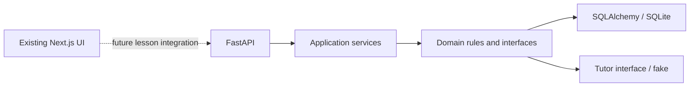
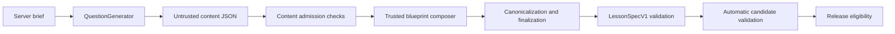

# Codex Session Log - 2026-10-31

Session: `01a18c8a-4fc7-70a0-bf35-3113cfa88f29` | Project: `Trace-v1` | Author: `Soorej S` | GitHub: `SoorejS`

---

[CLAUDE_LOG_ENTRY type=PROMPT num=1 session=01a18c8a-4fc7-70a0-bf35-3113cfa88f29]
timestamp: 2026-10-31T04:55:36.654897+00:00
time: 2026-10-31 10:25
chars: 14
turn_id: "01a1904e-cf89-7043-ae09-6b96a3d138dd"
capture_event: "UserPromptSubmit"
timestamp_source: "hook_capture_time_utc"
model: "gpt-6.1-sol"
cwd: "C:\\Users\\soore\\OneDrive\\Dokumen\\ChatGPT\\Trace-v1"
words: 2
has_code_block: false
has_file_paths: false
has_urls: false
likely_pasted: false

logging check


[CLAUDE_LOG_ENTRY type=RESPONSE num=1 session=01a18c8a-4fc7-70a0-bf35-3113cfa88f29]
timestamp: 2026-10-31T04:56:33.554888+00:00
time: 2026-10-31 10:26
chars: 327
turn_id: "01a1904e-cf89-7043-ae09-6b96a3d138dd"
capture_event: "Stop"
timestamp_source: "hook_capture_time_utc"
model: "gpt-6.1-sol"
cwd: "C:\\Users\\soore\\OneDrive\\Dokumen\\ChatGPT\\Trace-v1"

Your real prompt was **automatically captured** in the [session log](C:/Users/soore/OneDrive/Dokumen/ChatGPT/Trace-v1/.claude-logs/2026-10-31_10-25-36_01a18c8a-4fc7-70a0-bf35-3113cfa88f29.md).

Send `logging check` once more so I can verify this final answer was captured too.

No app code changed. Nothing committed or pushed.


[CLAUDE_LOG_ENTRY type=PROMPT num=2 session=01a18c8a-4fc7-70a0-bf35-3113cfa88f29]
timestamp: 2026-10-31T04:56:44.596706+00:00
time: 2026-10-31 10:26
chars: 14
turn_id: "01a19051-35be-75b3-8dc8-e045b3ca25e9"
capture_event: "UserPromptSubmit"
timestamp_source: "hook_capture_time_utc"
model: "gpt-6.1-sol"
cwd: "C:\\Users\\soore\\OneDrive\\Dokumen\\ChatGPT\\Trace-v1"
words: 2
has_code_block: false
has_file_paths: false
has_urls: false
likely_pasted: false

logging check


[CLAUDE_LOG_ENTRY type=RESPONSE num=2 session=01a18c8a-4fc7-70a0-bf35-3113cfa88f29]
timestamp: 2026-10-31T04:57:43.812454+00:00
time: 2026-10-31 10:27
chars: 386
turn_id: "01a19051-35be-75b3-8dc8-e045b3ca25e9"
capture_event: "Stop"
timestamp_source: "hook_capture_time_utc"
model: "gpt-6.1-sol"
cwd: "C:\\Users\\soore\\OneDrive\\Dokumen\\ChatGPT\\Trace-v1"

**Verified: automatic Codex logging is working.**

The [session log](C:/Users/soore/OneDrive/Dokumen/ChatGPT/Trace-v1/.claude-logs/2026-10-31_10-25-36_01a18c8a-4fc7-70a0-bf35-3113cfa88f29.md) contains two real prompts and my previous final answer, matching exactly. Commentary and tool output are excluded.

No app code changed. Nothing committed or pushed. We’re ready to start coding.


[CLAUDE_LOG_ENTRY type=PROMPT num=3 session=01a18c8a-4fc7-70a0-bf35-3113cfa88f29]
timestamp: 2026-10-31T04:59:58.896591+00:00
time: 2026-10-31 10:29
chars: 94
turn_id: "01a19054-2c56-7cb0-844f-4e833bdb5d05"
capture_event: "UserPromptSubmit"
timestamp_source: "hook_capture_time_utc"
model: "gpt-6.1-sol"
cwd: "C:\\Users\\soore\\OneDrive\\Dokumen\\ChatGPT\\Trace-v1"
words: 19
has_code_block: false
has_file_paths: false
has_urls: false
likely_pasted: false

so will all this be logged in the logs and can i start coding and architect the trace product


[CLAUDE_LOG_ENTRY type=RESPONSE num=3 session=01a18c8a-4fc7-70a0-bf35-3113cfa88f29]
timestamp: 2026-10-31T05:00:14.562210+00:00
time: 2026-10-31 10:30
chars: 508
turn_id: "01a19054-2c56-7cb0-844f-4e833bdb5d05"
capture_event: "Stop"
timestamp_source: "hook_capture_time_utc"
model: "gpt-6.1-sol"
cwd: "C:\\Users\\soore\\OneDrive\\Dokumen\\ChatGPT\\Trace-v1"

**Yes—you can start architecting and coding Trace now.**

Your prompts and my final answers are automatically saved in [`.claude-logs`](C:/Users/soore/OneDrive/Dokumen/ChatGPT/Trace-v1/.claude-logs) in this checkout. Earlier messages from before logging started aren’t backfilled. Internal reasoning, commentary, and tool output are excluded.

The logs stay local until committed and pushed. I’ll include them with any changes you authorize committing; nothing gets committed or pushed without your approval.


[CLAUDE_LOG_ENTRY type=PROMPT num=4 session=01a18c8a-4fc7-70a0-bf35-3113cfa88f29]
timestamp: 2026-10-31T05:43:26.445576+00:00
time: 2026-10-31 11:13
chars: 263
turn_id: "01a1907b-f308-7441-8475-c396d7b7320b"
capture_event: "UserPromptSubmit"
timestamp_source: "hook_capture_time_utc"
model: "gpt-6.1-sol"
cwd: "C:\\Users\\soore\\OneDrive\\Dokumen\\ChatGPT\\Trace-v1"
words: 31
has_code_block: false
has_file_paths: true
has_urls: false
likely_pasted: false


# Files pasted by the user:

## "# TRACE — MODULE 1: ARCHITECTURE AND ENGINEERING FOUNDATION You are the princip…": C:\Users\soore\.codex/attachments/b03ac61a-1091-4025-b649-6bd128f71d9a/Pasted text.txt

Pasted text contains the user's request.

## My request:


[CLAUDE_LOG_ENTRY type=RESPONSE num=4 session=01a18c8a-4fc7-70a0-bf35-3113cfa88f29]
timestamp: 2026-10-31T06:24:06.876861+00:00
time: 2026-10-31 11:54
chars: 2251
turn_id: "01a1907b-f308-7441-8475-c396d7b7320b"
capture_event: "Stop"
timestamp_source: "hook_capture_time_utc"
model: "gpt-6.1-sol"
cwd: "C:\\Users\\soore\\OneDrive\\Dokumen\\ChatGPT\\Trace-v1"

**Module 1 is implemented and verified locally. Nothing was committed or pushed.**

The audit confirmed an existing Next.js 16.4.3 / React 19.3.0 frontend with no backend. I added:

- A Python 3.13 FastAPI backend with validated settings, scoped SQLAlchemy sessions, Alembic migrations, health endpoints, safe errors, controlled CORS, structured logging and request limits.
- A typed AI-provider interface and deterministic fake.
- Generated OpenAPI/TypeScript contracts, frontend testing tools and GitHub Actions.
- Architecture documentation, six ADRs, the proposed data model, API contracts and testing strategy.



The design is preserved. Browser tests exposed an existing reduced-motion hydration bug; a small correction in [code-lens.tsx](C:/Users/soore/OneDrive/Dokumen/ChatGPT/Trace-v1/src/components/code/code-lens.tsx:146) resolved it.

| Validation | Actual result |
|---|---|
| Backend tests | **45 passed**, 97.48% coverage |
| Frontend component tests | **3 passed** |
| Desktop/mobile Chromium tests | **2 passed**, no page errors |
| Logging regression tests | **23 passed** |
| Ruff, formatting, mypy, ESLint, TypeScript, production build | Passed |
| Migrations, schema checks, real Uvicorn health check | Passed |
| OpenAPI/type regeneration | No drift |

**The learning product itself remains unimplemented:** learner sessions, immutable predictions, real notes verification, progress and live Gemini/Claude adapters are documented contracts, not working features yet.

The [full delivery report](C:/Users/soore/OneDrive/Dokumen/ChatGPT/Trace-v1/docs/architecture/module-1-report.md) contains the file inventory, decisions, stack deviations, exact commands/results, limitations and Module 2 plan. Reproducible setup is in [README.md](C:/Users/soore/OneDrive/Dokumen/ChatGPT/Trace-v1/README.md).

Module 2 should establish pseudonymous ownership, pinned lesson versions and immutable predictions, then prove the actual `body` → 422/no-row and `content` → successful-save/fresh-read behaviour.


[CLAUDE_LOG_ENTRY type=PROMPT num=5 session=01a18c8a-4fc7-70a0-bf35-3113cfa88f29]
timestamp: 2026-10-31T06:35:09.859870+00:00
time: 2026-10-31 12:05
chars: 263
turn_id: "01a190ab-50d0-7c70-ab88-5b18c53c09cc"
capture_event: "UserPromptSubmit"
timestamp_source: "hook_capture_time_utc"
model: "gpt-6.1-sol"
cwd: "C:\\Users\\soore\\OneDrive\\Dokumen\\ChatGPT\\Trace-v1"
words: 33
has_code_block: false
has_file_paths: true
has_urls: false
likely_pasted: false


# Files pasted by the user:

## "# TRACE — MODULE 2: CORE LEARNING ENGINE AND FIRST WORKING LESSON You are actin…": C:\Users\soore\.codex/attachments/da42f1e1-9e6d-4d1d-bf28-b18c8cfe26ae/Pasted text.txt

Pasted text contains the user's request.

## My request:


[CLAUDE_LOG_ENTRY type=RESPONSE num=5 session=01a18c8a-4fc7-70a0-bf35-3113cfa88f29]
timestamp: 2026-10-31T07:38:28.817109+00:00
time: 2026-10-31 13:08
chars: 1297
turn_id: "01a190ab-50d0-7c70-ab88-5b18c53c09cc"
capture_event: "Stop"
timestamp_source: "hook_capture_time_utc"
model: "gpt-6.1-sol"
cwd: "C:\\Users\\soore\\OneDrive\\Dokumen\\ChatGPT\\Trace-v1"

Module 2 is implemented and verified locally. The first lesson includes pseudonymous ownership, immutable predictions, preserved attempts, recorded hints, server-controlled completion and history after reload.

Actual verification works:

- `body` → **HTTP 422**, fresh database read confirms **zero rows**.
- `content` → **HTTP 201**, committed row confirmed through a separate database session.

Validation passed:

| Check | Result |
|---|---|
| Backend | 95 tests; 98.82% coverage |
| Frontend | 14 tests |
| Desktop/mobile browser | 4 tests |
| Logging regression | 23 tests |

Lint, formatting, type checks, production build, migrations and generated-contract checks also pass. Marketing UI and logging configuration are preserved. Guidance uses the labelled fixture provider.

See the [delivery report](C:/Users/soore/OneDrive/Dokumen/ChatGPT/Trace-v1/docs/architecture/module-2-report.md) and [startup instructions](C:/Users/soore/OneDrive/Dokumen/ChatGPT/Trace-v1/README.md).

Git status remains separated:

- **Staged:** your five existing logging/instruction files, preserved.
- **Unstaged:** configuration/documentation changes and existing Module 1 edits.
- **Untracked:** backend, learning UI, tests, architecture documents and shared logs.

I did not stage, commit or push anything.


[CLAUDE_LOG_ENTRY type=PROMPT num=6 session=01a18c8a-4fc7-70a0-bf35-3113cfa88f29]
timestamp: 2026-10-31T09:09:55.427566+00:00
time: 2026-10-31 14:39
chars: 263
turn_id: "01a19138-fff9-7a31-bfe6-000c183be3f6"
capture_event: "UserPromptSubmit"
timestamp_source: "hook_capture_time_utc"
model: "gpt-6.1-sol"
cwd: "C:\\Users\\soore\\OneDrive\\Dokumen\\ChatGPT\\Trace-v1"
words: 35
has_code_block: false
has_file_paths: true
has_urls: false
likely_pasted: false


# Files pasted by the user:

## "# Trace — Final Audit, Commit and Push (Modules 1 & 2) You are operating in the…": C:\Users\soore\.codex/attachments/5e782506-f287-4024-ab8c-9063f6644583/Pasted text.txt

Pasted text contains the user's request.

## My request:


[CLAUDE_LOG_ENTRY type=RESPONSE num=6 session=01a18c8a-4fc7-70a0-bf35-3113cfa88f29]
timestamp: 2026-10-31T09:25:22.329038+00:00
time: 2026-10-31 14:55
chars: 2604
turn_id: "01a19138-fff9-7a31-bfe6-000c183be3f6"
capture_event: "Stop"
timestamp_source: "hook_capture_time_utc"
model: "gpt-6.1-sol"
cwd: "C:\\Users\\soore\\OneDrive\\Dokumen\\ChatGPT\\Trace-v1"

Pushed successfully to [feat/trace-module-1-2](https://github.com/Sohaib7932/trace/tree/feat/trace-module-1-2). Local and remote HEAD match, upstream tracking is configured, and `main` remains unchanged.

| Commit | Included |
|---|---|
| [`28274ed`](https://github.com/Sohaib7932/trace/commit/28274ed1c188d200931ff0205b3586f7de85e8da) — `chore(logging): add shared Claude and Codex session capture` | Hooks, adapter, tests, instructions and genuine session records |
| [`77008d2`](https://github.com/Sohaib7932/trace/commit/77008d212ffc5d63160dd94717929c24017a8fa5) — `feat(trace): deliver Modules 1 and 2 learning platform` | Backend, migrations, learning engine/UI, generated contracts, tests, CI and documentation |

Modules 1 and 2 share configuration and API files, so they were committed together.

Fresh local validation:

| Check | Result |
|---|---|
| Backend | **95 passed; 98.82% coverage** |
| Frontend | **14 passed** |
| Desktop/mobile browser | **4 passed** |
| Logging | **24 passed**, including the original 23 |
| Lint, formatting, types, build, migrations, repeated seed, contract generation and HTTP health checks | Passed |

**Remote [GitHub CI](https://github.com/Sohaib7932/trace/actions/runs/41188390873) also completed successfully:** Windows backend, Linux backend and frontend.

The secret audit found only deliberate test credentials. Environment examples are safe; runtime databases, environments, caches and browser artifacts were excluded. No dedicated secret scanner was installed, so verification used pattern scanning and manual review.

The logging audit found four app-generated suggestion records. I preserved and excluded them, added a narrow rejection check, and retained the genuine session log. These originals remain untracked:

- [10:27:48 log](C:/Users/soore/OneDrive/Dokumen/ChatGPT/Trace-v1/.claude-logs/2026-10-31_10-27-48_01a19052-2c65-7861-82f2-12acb6e14b19.md)
- [10:30:20 log](C:/Users/soore/OneDrive/Dokumen/ChatGPT/Trace-v1/.claude-logs/2026-10-31_10-30-20_01a19054-7b29-7630-835e-e121523db828.md)
- [11:54:10 log](C:/Users/soore/OneDrive/Dokumen/ChatGPT/Trace-v1/.claude-logs/2026-10-31_11-54-10_01a190a1-3dcc-7e93-a23b-5dbf2bb46885.md)
- [13:08:38 log](C:/Users/soore/OneDrive/Dokumen/ChatGPT/Trace-v1/.claude-logs/2026-10-31_13-08-38_01a190e5-64b0-74a0-a819-dd4473db443d.md)

At the final check, tracked files and the index were clean. The Stop hook may append this answer afterward, creating a new local log change.

Full details: [final audit report](C:/Users/soore/OneDrive/Dokumen/ChatGPT/Trace-v1/docs/architecture/final-audit-module-1-2.md).


[CLAUDE_LOG_ENTRY type=PROMPT num=7 session=01a18c8a-4fc7-70a0-bf35-3113cfa88f29]
timestamp: 2026-10-31T11:28:33.494217+00:00
time: 2026-10-31 16:58
chars: 263
turn_id: "01a191b7-e867-7dc0-af6c-df8b0f4547fd"
capture_event: "UserPromptSubmit"
timestamp_source: "hook_capture_time_utc"
model: "gpt-6.1-sol"
cwd: "C:\\Users\\soore\\OneDrive\\Dokumen\\ChatGPT\\Trace-v1"
words: 33
has_code_block: false
has_file_paths: true
has_urls: false
likely_pasted: false


# Files pasted by the user:

## "# Trace — Module 3: Transfer Learning & Spaced Retrieval You are the lead engin…": C:\Users\soore\.codex/attachments/a4b4ca98-ade9-4cb1-8372-d3ab22138bee/Pasted text.txt

Pasted text contains the user's request.

## My request:


[CLAUDE_LOG_ENTRY type=RESPONSE num=7 session=01a18c8a-4fc7-70a0-bf35-3113cfa88f29]
timestamp: 2026-10-31T12:14:29.662403+00:00
time: 2026-10-31 17:44
chars: 2861
turn_id: "01a191b7-e867-7dc0-af6c-df8b0f4547fd"
capture_event: "Stop"
timestamp_source: "hook_capture_time_utc"
model: "gpt-6.1-sol"
cwd: "C:\\Users\\soore\\OneDrive\\Dokumen\\ChatGPT\\Trace-v1"

Module 3 is implemented, committed and pushed. I verified [PR #1](https://github.com/Sohaib7932/trace/pull/1) was merged before starting.

Branch: `feat/trace-module-3-transfer-retention`  
Commit: [`f24caca`](https://github.com/Sohaib7932/trace/commit/f24cacaaa55f7cbc2da85125bd4562cc7cfdea82) — `feat(learning): add transfer challenge and spaced retrieval`

[Open the PR comparison against main](https://github.com/Sohaib7932/trace/compare/main...feat/trace-module-3-transfer-retention).

The completed journey now includes:

- **Nested-payload transfer:** an independently versioned task lesson. Flat requests produce real **422/zero-row** evidence; corrected nested requests produce **201**, committed persistence and independent readback.
- **Spaced retrieval:** checkpoints due **1 and 7 UTC days** after transfer completion, with deterministic feedback, preserved responses and persisted completion. Missed checkpoints remain available.
- **Integrated UI and APIs:** transfer navigation, factual phase progress, retrieval controls and reload persistence. Migration `0004_transfer_retrieval` adds three tables.
- **Return access:** a 30-day credential default with protected renewal of still-valid credentials near expiry.

The original lesson and marketing design are preserved.

| Fresh local validation | Result |
|---|---|
| Backend | **128 passed; 98.98% coverage** |
| Frontend | **21 passed** |
| Desktop/mobile browser | **6 passed** |
| Logging | **24 passed** |

Lint, formatting, types, production build, migrations, repeated seeding and generated-contract checks passed. **[Remote CI passed](https://github.com/Sohaib7932/trace/actions/runs/41199935828)** for Windows backend, Linux backend and frontend.

The secret audit found only known dummy test values. Genuine logs are included. Four app-generated suggestion logs remain preserved and untracked: [10:27:48](C:/Users/soore/OneDrive/Dokumen/ChatGPT/Trace-v1/.claude-logs/2026-10-31_10-27-48_01a19052-2c65-7861-82f2-12acb6e14b19.md), [10:30:20](C:/Users/soore/OneDrive/Dokumen/ChatGPT/Trace-v1/.claude-logs/2026-10-31_10-30-20_01a19054-7b29-7630-835e-e121523db828.md), [11:54:10](C:/Users/soore/OneDrive/Dokumen/ChatGPT/Trace-v1/.claude-logs/2026-10-31_11-54-10_01a190a1-3dcc-7e93-a23b-5dbf2bb46885.md), [13:08:38](C:/Users/soore/OneDrive/Dokumen/ChatGPT/Trace-v1/.claude-logs/2026-10-31_13-08-38_01a190e5-64b0-74a0-a819-dd4473db443d.md).

Local and remote HEAD match; tracked files and the index were clean at final inspection. `main` is unchanged. The Stop hook may append this answer afterward.

Live AI, external notifications, account recovery, export/deletion and deployment remain outside scope. Learning outcomes have not been evaluated with learners.

Full details: [Module 3 delivery report](C:/Users/soore/OneDrive/Dokumen/ChatGPT/Trace-v1/docs/architecture/module-3-report.md).


[CLAUDE_LOG_ENTRY type=PROMPT num=8 session=01a18c8a-4fc7-70a0-bf35-3113cfa88f29]
timestamp: 2026-10-31T13:25:05.439154+00:00
time: 2026-10-31 18:55
chars: 263
turn_id: "01a19222-9a56-7092-911e-5a84a9c5fb6d"
capture_event: "UserPromptSubmit"
timestamp_source: "hook_capture_time_utc"
model: "gpt-6.1-sol"
cwd: "C:\\Users\\soore\\OneDrive\\Dokumen\\ChatGPT\\Trace-v1"
words: 32
has_code_block: false
has_file_paths: true
has_urls: false
likely_pasted: false


# Files pasted by the user:

## "# Trace — Module 4: Identity, Authentication & Account Ownership You are the le…": C:\Users\soore\.codex/attachments/6d9557bc-eb9b-48b0-a392-fb4563464fc7/Pasted text.txt

Pasted text contains the user's request.

## My request:


[CLAUDE_LOG_ENTRY type=RESPONSE num=8 session=01a18c8a-4fc7-70a0-bf35-3113cfa88f29]
timestamp: 2026-10-31T14:19:04.057083+00:00
time: 2026-10-31 19:49
chars: 1815
turn_id: "01a19222-9a56-7092-911e-5a84a9c5fb6d"
capture_event: "Stop"
timestamp_source: "hook_capture_time_utc"
model: "gpt-6.1-sol"
cwd: "C:\\Users\\soore\\OneDrive\\Dokumen\\ChatGPT\\Trace-v1"

Module 4 is implemented, committed and pushed on `feat/trace-module-4-account-auth`. Module 3’s PR #2 was verified as merged before work began.

Implemented:

- Supabase Google OAuth and email/password flows, confirmation/resend, recovery, refresh and logout.
- Permanent Trace accounts, trusted roles and audited operator role grants.
- Explicit guest-history claims that preserve learning records and reject conflicting ownership.
- Account pages, Next.js session handling and independent FastAPI JWT verification.
- Migration `0005_account_identity`, generated contracts and setup documentation.

| Validation | Result |
|---|---|
| Backend | 211 passed; 98.94% coverage |
| Frontend | 51 passed |
| Desktop/mobile E2E | 12 passed |
| Shared logging | 24 passed |

Lint, types, formatting, builds, migrations and contract checks passed. **[Final CI passed](https://github.com/Sohaib7932/trace/actions/runs/41209234962)** on Linux, Windows and frontend.

Commits: `4207285` implementation; `4f6a37f` delivery report. Remote HEAD matches, with zero ahead/behind. No PR was created.

**Provider setup remains:** configure your Supabase project, Google OAuth, required email confirmation, signing keys and SMTP using the [setup guide](C:/Users/soore/OneDrive/Dokumen/ChatGPT/Trace-v1/docs/architecture/account-setup.md). Browser tests used a controlled authentication fixture; real Google login and email delivery were not tested.

Genuine logs are included. Four existing suggestion logs remain preserved and untracked; this final answer will append through the native hook after the turn ends.

[Full delivery report](C:/Users/soore/OneDrive/Dokumen/ChatGPT/Trace-v1/docs/architecture/module-4-report.md) · [Compare against main](https://github.com/Sohaib7932/trace/compare/main...feat/trace-module-4-account-auth)


[CLAUDE_LOG_ENTRY type=PROMPT num=9 session=01a18c8a-4fc7-70a0-bf35-3113cfa88f29]
timestamp: 2026-10-31T17:20:51.527152+00:00
time: 2026-10-31 22:50
chars: 1067
turn_id: "01a192fa-7358-7103-8cc0-d4354a44ac5c"
capture_event: "UserPromptSubmit"
timestamp_source: "hook_capture_time_utc"
model: "gpt-6.1-sol"
cwd: "C:\\Users\\soore\\OneDrive\\Dokumen\\ChatGPT\\Trace-v1"
words: 146
has_code_block: false
has_file_paths: true
has_urls: false
likely_pasted: true

Inspect my local Trace repository and help me prepare the environment configuration Sohaib needs to test Module 4 authentication on his machine.

Repository: `C:\Users\soore\OneDrive\Dokumen\ChatGPT\Trace-v1`

Please:

1. Check whether `.env.local` exists in the repository root.
2. Check whether `backend/.env` exists.
3. Inspect `.env.local.example` and `backend/.env.example` to identify the required configuration.
4. Determine which values are already configured and which are missing, without printing any secret values into the terminal, report, chat logs, or Git.
5. Check whether my current configuration points to a real Supabase project or is still blank/test configuration.
6. Prepare safe, shareable environment templates for Sohaib, clearly identifying which values he must obtain from our shared Supabase project and which are machine-specific.
7. Do not invent credentials, change authentication code, modify existing environment files, or commit or push anything.

Report the exact file paths and what is missing. Do not expose actual secret values.


[CLAUDE_LOG_ENTRY type=RESPONSE num=9 session=01a18c8a-4fc7-70a0-bf35-3113cfa88f29]
timestamp: 2026-10-31T17:24:39.018458+00:00
time: 2026-10-31 22:54
chars: 1902
turn_id: "01a192fa-7358-7103-8cc0-d4354a44ac5c"
capture_event: "Stop"
timestamp_source: "hook_capture_time_utc"
model: "gpt-6.1-sol"
cwd: "C:\\Users\\soore\\OneDrive\\Dokumen\\ChatGPT\\Trace-v1"

**Local authentication is unconfigured.** I found no real Supabase project or test-fixture configuration in the inspected env files or inherited overrides.

| File | Finding |
|---|---|
| `C:\Users\soore\OneDrive\Dokumen\ChatGPT\Trace-v1\.env.local` | Does not exist |
| `C:\Users\soore\OneDrive\Dokumen\ChatGPT\Trace-v1\backend\.env` | Exists; 12 development settings configured, Supabase project settings missing |
| [.env.local.example](C:/Users/soore/OneDrive/Dokumen/ChatGPT/Trace-v1/.env.local.example) | Local URLs supplied; Supabase URL and publishable key blank |
| [backend/.env.example](C:/Users/soore/OneDrive/Dokumen/ChatGPT/Trace-v1/backend/.env.example) | Project URL, issuer and JWKS blank; defaults supplied |

Missing for authentication:

- Frontend: `NEXT_PUBLIC_SUPABASE_URL`, `NEXT_PUBLIC_SUPABASE_PUBLISHABLE_KEY`, and the machine-specific `NEXT_PUBLIC_SITE_URL`. The API URL has a fallback.
- Backend: `TRACE_SUPABASE_URL`, `TRACE_SUPABASE_ISSUER`, `TRACE_SUPABASE_JWKS_URL`.

Backend audience, cache duration and loopback-auth settings are absent from your actual file but already use application defaults.

Prepared separate files for Sohaib:

- [Frontend template](C:/Users/soore/OneDrive/Dokumen/ChatGPT/Trace-v1/docs/architecture/sohaib-auth-environment/frontend.env.example)
- [Backend template](C:/Users/soore/OneDrive/Dokumen/ChatGPT/Trace-v1/docs/architecture/sohaib-auth-environment/backend.env.example)
- [Handoff instructions and audit](C:/Users/soore/OneDrive/Dokumen/ChatGPT/Trace-v1/docs/architecture/sohaib-auth-environment/README.md)

He must obtain the shared project URL and publishable key; issuer/JWKS are derived from that URL. Local URLs, ports, CORS and SQLite settings belong to his machine.

No actual credentials were copied or exposed. Existing environment files, examples and authentication code remain unchanged. **Nothing was committed or pushed.**


[CLAUDE_LOG_ENTRY type=PROMPT num=10 session=01a18c8a-4fc7-70a0-bf35-3113cfa88f29]
timestamp: 2026-10-31T17:35:42.672739+00:00
time: 2026-10-31 23:05
chars: 95
turn_id: "01a19308-0f80-7ad3-86fe-df67d50e8694"
capture_event: "UserPromptSubmit"
timestamp_source: "hook_capture_time_utc"
model: "gpt-6.1-sol"
cwd: "C:\\Users\\soore\\OneDrive\\Dokumen\\ChatGPT\\Trace-v1"
words: 17
has_code_block: false
has_file_paths: false
has_urls: false
likely_pasted: false

what are yet to be configured and implemented like supabase google oauth and all tell me those


[CLAUDE_LOG_ENTRY type=RESPONSE num=10 session=01a18c8a-4fc7-70a0-bf35-3113cfa88f29]
timestamp: 2026-10-31T17:36:49.012220+00:00
time: 2026-10-31 23:06
chars: 2971
turn_id: "01a19308-0f80-7ad3-86fe-df67d50e8694"
capture_event: "Stop"
timestamp_source: "hook_capture_time_utc"
model: "gpt-6.1-sol"
cwd: "C:\\Users\\soore\\OneDrive\\Dokumen\\ChatGPT\\Trace-v1"

**The Module 4 authentication code is implemented. The remaining work is provider configuration and testing with real accounts.** Your local checkout currently has no Supabase project configured. I haven’t inspected the shared project’s dashboards, so some dashboard work may already exist.

| Area | Already implemented | Still needs configuration or verification |
|---|---|---|
| **Supabase connection** | Browser/server SDKs and backend integration | Obtain the shared project URL and publishable key; fill the frontend/backend environment files |
| **Google OAuth** | Google button, PKCE flow and callback handling | Configure Google Cloud’s consent screen/Web OAuth client, register Supabase’s callback, and enable Google in Supabase. [Google setup](https://supabase.com/docs/guides/auth/social-sign-in/auth-google) |
| **Email/password** | Registration, login, confirmation, resend and password recovery | Enable email/password and required email confirmation in the shared project |
| **Email delivery** | Confirmation/reset link handling | Configure the email templates and verify delivery. Production needs custom SMTP; Supabase’s default service is restricted. [SMTP guidance](https://supabase.com/docs/guides/auth/auth-smtp) |
| **JWT signing** | Independent FastAPI signature and claims verification | Confirm the project uses ES256 or RS256 and exposes matching public JWKS keys. [Signing keys](https://supabase.com/docs/guides/auth/signing-keys) |
| **Redirect URLs** | Safe callback redirects | Configure Supabase Site URL and allowed callbacks to match each tester’s frontend address |
| **Machine environment** | Safe templates prepared | Create root `.env.local`; add the missing Supabase fields to `backend/.env`; confirm local URLs, CORS and cookie settings |
| **Live testing** | Automated fixture tests passed | Test actual Google consent, delivered email links, password recovery, refresh/logout, guest-history claims and another-device resume |

Permanent Trace identities, learner ownership, conflict protection, roles and the audited role-grant CLI are already implemented.

Further product features **still require implementation**:

- Creator Studio, lesson authoring and publishing.
- Creator/admin management interfaces—the current module provides their authorization foundation.
- A live AI tutor—the current tutor is a deterministic fake.
- Account deletion/data export and combining separate learner histories.
- Different-email account linking.
- Production deployment and operational hardening.

Those future features do **not** block testing Module 4 authentication. Phone/SMS and passwordless OTP/magic-link login were intentionally excluded.

The next practical step is **access to the shared Supabase project**, followed by provider setup, filling the prepared templates, and real-account testing. The exact instructions are in the [setup guide](C:/Users/soore/OneDrive/Dokumen/ChatGPT/Trace-v1/docs/architecture/account-setup.md).


[CLAUDE_LOG_ENTRY type=PROMPT num=11 session=01a18c8a-4fc7-70a0-bf35-3113cfa88f29]
timestamp: 2026-10-31T17:37:38.824817+00:00
time: 2026-10-31 23:07
chars: 39
turn_id: "01a19309-c71e-7693-afac-4bb753a97170"
capture_event: "UserPromptSubmit"
timestamp_source: "hook_capture_time_utc"
model: "gpt-6.1-sol"
cwd: "C:\\Users\\soore\\OneDrive\\Dokumen\\ChatGPT\\Trace-v1"
words: 8
has_code_block: false
has_file_paths: false
has_urls: false
likely_pasted: false

i have not delpoyed the backend right ?


[CLAUDE_LOG_ENTRY type=RESPONSE num=11 session=01a18c8a-4fc7-70a0-bf35-3113cfa88f29]
timestamp: 2026-10-31T17:38:01.882514+00:00
time: 2026-10-31 23:08
chars: 410
turn_id: "01a19309-c71e-7693-afac-4bb753a97170"
capture_event: "Stop"
timestamp_source: "hook_capture_time_utc"
model: "gpt-6.1-sol"
cwd: "C:\\Users\\soore\\OneDrive\\Dokumen\\ChatGPT\\Trace-v1"

Correct—**we haven’t deployed Trace’s backend.**

So far, we’ve run and tested FastAPI locally and pushed the code to GitHub. The SQLite database is also local.

Supabase Auth is a separate service; configuring it won’t deploy your FastAPI backend.

You and Sohaib can test authentication by running the frontend and backend locally on your own machines. **A shared, publicly hosted backend is still pending.**


[CLAUDE_LOG_ENTRY type=PROMPT num=12 session=01a18c8a-4fc7-70a0-bf35-3113cfa88f29]
timestamp: 2026-11-01T07:39:19.339220+00:00
time: 2026-11-01 13:09
chars: 224
turn_id: "01a1960c-65a5-7df3-b53b-b471eb39bda0"
capture_event: "UserPromptSubmit"
timestamp_source: "hook_capture_time_utc"
model: "gpt-6.1-sol"
cwd: "C:\\Users\\soore\\OneDrive\\Dokumen\\ChatGPT\\Trace-v1"
words: 26
has_code_block: false
has_file_paths: true
has_urls: false
likely_pasted: false


# Files pasted by the user:

## "# Trace — Design the Lesson Specification V1 (No Implementation) You are acting…": C:\Users\soore\.codex/attachments/ec52d960-5a3b-4157-b197-186672e65105/Pasted text.txt

## My request:
###


[CLAUDE_LOG_ENTRY type=RESPONSE num=12 session=01a18c8a-4fc7-70a0-bf35-3113cfa88f29]
timestamp: 2026-11-01T08:18:54.837717+00:00
time: 2026-11-01 13:48
chars: 1332
turn_id: "01a1960c-65a5-7df3-b53b-b471eb39bda0"
capture_event: "Stop"
timestamp_source: "hook_capture_time_utc"
model: "gpt-6.1-sol"
cwd: "C:\\Users\\soore\\OneDrive\\Dokumen\\ChatGPT\\Trace-v1"

Created the complete **[Trace Lesson Specification V1](C:/Users/soore/OneDrive/Dokumen/ChatGPT/Trace-v1/docs/architecture/lesson-specification-v1.md)** with all 16 requested sections, architecture diagrams, repository findings and implementation-status labels.

It includes:

- A minimal domain model built around existing abstractions.
- Checkpoint, evaluation, verification and AI boundaries.
- Invite-only authoring and independent admin approval/publication.
- Immutable versioning, compatibility requirements, API/persistence implications and unresolved risks.

Complete examples:

- [Original lesson and pinned transfer definitions](C:/Users/soore/OneDrive/Dokumen/ChatGPT/Trace-v1/docs/architecture/examples/lesson-specification-v1.json)
- [Synthetic learner-attempt and verification journal](C:/Users/soore/OneDrive/Dokumen/ChatGPT/Trace-v1/docs/architecture/examples/lesson-attempt-v1.json)

The recommendation limits Creator V1 to the two approved exercise templates and prevents baseline or preview success from completing a learner’s lesson.

**Validation:** 153 documentation consistency checks passed. Application tests were not run.

Only three documentation files were added. Existing files and user edits were preserved. No implementation, migrations, package installation, configuration changes, commits or pushes.


[CLAUDE_LOG_ENTRY type=PROMPT num=13 session=01a18c8a-4fc7-70a0-bf35-3113cfa88f29]
timestamp: 2026-11-01T10:12:29.869267+00:00
time: 2026-11-01 15:42
chars: 2497
turn_id: "01a19698-a352-7f22-9875-6c95c4f5b639"
capture_event: "UserPromptSubmit"
timestamp_source: "hook_capture_time_utc"
model: "gpt-6.1-sol"
cwd: "C:\\Users\\soore\\OneDrive\\Dokumen\\ChatGPT\\Trace-v1"
words: 341
has_code_block: false
has_file_paths: true
has_urls: false
likely_pasted: true

# TRACE CREATOR MODE V1 — PHASE 0: LEGACY COMPATIBILITY BASELINE

We have approved the implementation roadmap for Trace Creator Mode V1.

Read:\
`docs/architecture/lesson-specification-v1.md`

The objective is to implement Creator Mode while preserving the existing learner application.

Before any implementation, establish a reliable compatibility baseline.

## Existing architecture

Retain the existing:

- Next.js frontend.
- FastAPI backend.
- SQLAlchemy/SQLite persistence.
- Alembic migration history.
- Existing lesson, session and attempt records.
- Deterministic evaluators.
- Trusted verification adapters.
- Account identity, roles and guest-history claiming.
- Transfer and spaced retrieval systems.

## Your task

Perform a repository-level compatibility audit and prepare the Phase 0 test plan.

Inspect the actual source, not just documentation.

Verify and identify:

1. Existing lesson definitions and hashes.
2. Legacy lesson API contracts.
3. Existing session lifecycle and transition rules.
4. Prediction persistence and idempotency.
5. Modification-attempt persistence.
6. Successful and failed verification behaviour.
7. Five existing verification evidence checks.
8. Transfer session behaviour.
9. Retrieval scheduling and answer persistence.
10. Guest-to-account history claiming.
11. Current SQL constraints, foreign keys and triggers.
12. Existing migration upgrade and database integrity procedures.
13. Existing frontend learner routes and API contracts.
14. Relevant backend, frontend and E2E tests.

Identify the minimum regression tests needed before introducing lesson_spec_v1.

## Deliverable

Create a structured report containing:

- Existing implementation and source locations.
- Verified behaviour versus unverified implementation.
- Important invariants that cannot change.
- Existing test coverage.
- Missing regression tests.
- Migration compatibility risks.
- Proposed Phase 0 acceptance criteria.

Provide a dependency-aware checklist for Phase 1.

## Strict restrictions

- Read-only task.
- Do not modify source code.
- Do not modify database files.
- Do not create migrations.
- Do not modify existing migrations.
- Do not install dependencies.
- Do not run destructive commands.
- Do not commit or push.
- Preserve all user edits and `.claude-logs/`.
- Do not claim tests pass unless executed.
- Do not invent implementation details.

Do not proceed to Phase 1 automatically.

We will review and authorize each implementation milestone separately.


[CLAUDE_LOG_ENTRY type=RESPONSE num=13 session=01a18c8a-4fc7-70a0-bf35-3113cfa88f29]
timestamp: 2026-11-01T10:30:40.690970+00:00
time: 2026-11-01 16:00
chars: 22143
turn_id: "01a19698-a352-7f22-9875-6c95c4f5b639"
capture_event: "Stop"
timestamp_source: "hook_capture_time_utc"
model: "gpt-6.1-sol"
cwd: "C:\\Users\\soore\\OneDrive\\Dokumen\\ChatGPT\\Trace-v1"

# Phase 0 compatibility audit

**The audit is complete, but the full runtime baseline is not yet established.** The main blocker is that your configured local database remains at `0004_transfer_retrieval`, while the current source requires `0005_account_identity`.

I inspected the [Lesson Specification V1](C:/Users/soore/OneDrive/Dokumen/ChatGPT/Trace-v1/docs/architecture/lesson-specification-v1.md), application source, migrations, API schemas and test assertions at commit `4f6a37f7790023bbb0de3d6025426bf7d27b89da`.

No files, databases, migrations or dependencies were changed. Nothing was committed or pushed. Phase 1 has not started.

## 1. Checks actually performed

| Check | Result |
|---|---|
| Pure session, evaluator and retrieval-time tests | **26 passed** |
| Generate OpenAPI in memory and compare with the checked-in snapshot | **Identical:** 21 paths, 23 operations |
| Inspect configured [SQLite database](C:/Users/soore/OneDrive/Dokumen/ChatGPT/Trace-v1/backend/trace.db) using an immutable read-only connection | Revision: `0004_transfer_retrieval` |
| SQLite `integrity_check` | **`ok`** |
| SQLite `foreign_key_check` | **Zero violations** |
| Installed legacy triggers versus migration source | **All 33 match**, ignoring whitespace |
| Stored legacy lesson hashes versus source | **Both match** |
| Database preservation | Bytes, size and modification time unchanged; no SQLite sidecars created |
| Repository preservation | All 223 inspected non-log file states unchanged, including environment files and Git index |

The 26 tests ran with bytecode generation, pytest caching and automatic plugin loading disabled.

**Not executed:** backend integration tests, migration upgrades/downgrades, frontend tests, builds or Playwright. These create databases or artifacts. Live Supabase and Google OAuth were also not tested.

## 2. Existing implementation and compatibility contract

### Lesson definitions and hashes

Both lessons are Python-defined, seeded independently and currently use content version `1.0.0`.

| Lesson | SHA-256 |
|---|---|
| `fastapi-payload-mismatch` | `c3231631019829efe5cd1882b361cf22b8bdcdd51caca2a67a60dd73b326707e` |
| `fastapi-nested-payload-transfer` | `c4aefadd5f468da2505db0d14cd4d12bdc1f707282d241a10118cae39c49db0d` |

These values were recomputed from source and independently matched against the stored rows.

[Catalog implementation](C:/Users/soore/OneDrive/Dokumen/ChatGPT/Trace-v1/backend/app/services/catalog.py:35) hashes the five public content fields together with the expected mapping, prediction answer and adapter identifier. Seeding returns an unchanged existing version and rejects changed content under the same lesson/version.

**Invariant:** retain these bytes, hashes, version identities and legacy hashing algorithms. The proposed V1 canonicalization must apply to new definitions without recalculating old records.

### Legacy API contracts

The current contract is defined by the [learning DTOs](C:/Users/soore/OneDrive/Dokumen/ChatGPT/Trace-v1/backend/app/schemas/learning.py), [route handlers](C:/Users/soore/OneDrive/Dokumen/ChatGPT/Trace-v1/backend/app/api/v1/learning.py) and [public projections](C:/Users/soore/OneDrive/Dokumen/ChatGPT/Trace-v1/backend/app/api/presentation.py).

| Contract | Existing behavior |
|---|---|
| `GET /api/v1/lessons/{lesson_id}` | Flat response: `id`, `version_id`, `version`, `title`, `objective`, `scenario`, `outgoing_code`, `schema_code`. Optional version query. |
| `POST /api/v1/sessions` | Accepts lesson slug and optional version, defaulting to `1.0.0`; returns a server-pinned session with HTTP 201. |
| Session reads | Session, progress, prediction, attempts and verifications remain separately readable. |
| Prediction, attempt and hint submissions | Persisted responses use HTTP 201. |
| Verification | Empty request body; server determines outcome and returns saved evidence. |
| Journey and retrieval | Owner-scoped reads; retrieval answers persist separately with HTTP 201. |
| Account claiming | Authenticated, explicit empty-body operation with a UUID retry key. |

Unknown request properties are rejected. Important mutations require UUID `Idempotency-Key` headers. Write-origin/client-header protections and credential handling are centralized.

Errors retain the structured envelope containing `code`, `message`, `request_id` and `details`. Dependency failures are reported separately from authentication failures and learner mistakes.

**Important current behavior:** an unspecified catalog version resolves by creation time. There is no active-publication pointer or format filter yet.

### Session lifecycle

The [domain transition function](C:/Users/soore/OneDrive/Dokumen/ChatGPT/Trace-v1/backend/app/domain/learning.py:23) implements:

```text
awaiting_prediction → ready_for_attempt → verification_pending
                                             ↓
                                  needs_revision → verification_pending
                                             or
                                          completed
```

Any nonterminal session can become `abandoned`. Completion requires verified success. New learner actions cannot reopen completed or abandoned sessions; saved idempotent responses can still replay.

Sessions permanently retain their learner and lesson-version references.

### Predictions and modification attempts

The [learning service](C:/Users/soore/OneDrive/Dokumen/ChatGPT/Trace-v1/backend/app/services/learning.py:48) preserves:

- One original prediction per session, including its exact reasoning.
- Same-key, same-payload prediction replay; conflicting replacements return 409.
- Progress after any valid prediction, including an incorrect prediction.
- Numbered, append-only modification attempts with explanation, retry key and server-recorded hint count.
- Attempt replay without duplication; changed content under the same key conflicts.
- Constrained mappings only: `body/content` or `flat/nested`.
- A three-request guidance limit, including failed requests. Provider failures are recorded without invented guidance.

There is no arbitrary learner-code execution or general persisted investigation response.

### Verification outcomes and five evidence checks

The [verification service](C:/Users/soore/OneDrive/Dokumen/ChatGPT/Trace-v1/backend/app/services/verification.py:30) reserves a run, executes outside the reservation transaction, then finalizes evidence and progression transactionally.

The [notes adapter](C:/Users/soore/OneDrive/Dokumen/ChatGPT/Trace-v1/backend/app/verification/asgi_notes.py) and [tasks adapter](C:/Users/soore/OneDrive/Dokumen/ChatGPT/Trace-v1/backend/app/verification/asgi_tasks.py) execute private FastAPI applications through ASGI. They perform actual persistence and read back run-scoped rows through a separate database context.

| Outcome | Existing meaning |
|---|---|
| `passed` | Correct mapping, HTTP 201, valid response, no validation errors, exactly one matching freshly read row, matching response/database identity. |
| `failed` | Recognized incorrect mapping produces HTTP 422, required missing/extra validation codes and zero rows. |
| `error` | Missing, unavailable, unexpected or contradictory evidence; infrastructure failure is not graded as learner failure. |

The five persisted success checks are:

| Check | Required evidence | Source |
|---|---|---|
| `http_status` | HTTP 201 | `asgi_http` |
| `api_response` | Expected response shape and fixture values | `asgi_http` |
| `validation` | Accepted request, no validation errors | `asgi_http` |
| `row_count` | Exactly one run-scoped row | `fresh_database_read` |
| `stored_values` | Exact values and response/readback ID agreement | `fresh_database_read` |

Execution failures can record an `execution` check instead of fabricating five observations.

Retries preserve important distinctions:

- Active pending verification conflicts.
- Passed/failed verification replays without another runtime write.
- An error can retry under a new key.
- An older finalized result remains replayable while a newer run is pending.
- Stale pending runs are retired after the recovery deadline.

**Compatibility detail:** legacy failure classification accepts the required validation codes as a subset. V1’s proposed stricter profiles must not silently reinterpret historical outcomes.

### Transfer and retrieval

The [learning service](C:/Users/soore/OneDrive/Dokumen/ChatGPT/Trace-v1/backend/app/services/learning.py) unlocks transfer after **any owned completed original session**. Current transfer sessions have no explicit parent-session link.

A nested correction requires prior failed verification of a flat attempt. Submission alone or an infrastructure error does not satisfy that prerequisite.

The [retrieval service](C:/Users/soore/OneDrive/Dokumen/ChatGPT/Trace-v1/backend/app/services/retrieval.py:20) schedules two checkpoints in the transfer-completion transaction:

- Completion +24 hours.
- Completion +168 hours.

[Retrieval definitions](C:/Users/soore/OneDrive/Dokumen/ChatGPT/Trace-v1/backend/app/domain/retrieval.py) currently live in Python and pin question IDs/hashes. Their hash algorithm differs from the lesson hash algorithm.

Questions remain hidden until due. Missed checkpoints remain due. Every answer is preserved; the first correct answer completes the checkpoint once. Exact-key replay remains valid after completion, and due times do not move.

### Account identity and guest-history claiming

The [account service](C:/Users/soore/OneDrive/Dokumen/ChatGPT/Trace-v1/backend/app/services/accounts.py) and [account repository](C:/Users/soore/OneDrive/Dokumen/ChatGPT/Trace-v1/backend/app/db/accounts.py) implement:

- Provider issuer/subject mapping to a separate Trace user identity.
- Database-controlled roles.
- Explicit claiming using a valid guest credential.
- Atomic revocation of guest credentials and attachment of the existing learner to the account.
- Preservation of learner/session/history identities rather than copying history.
- Exact-key claim receipts for safe retries after cookie removal.
- Rejection of cross-account claims and accounts already owning another history.
- Transaction rollback on failed claims.

[Authentication dependencies](C:/Users/soore/OneDrive/Dokumen/ChatGPT/Trace-v1/backend/app/api/dependencies.py) reject invalid supplied Bearer authentication rather than downgrading to guest access.

These implementations exist in source. **Their operation against your current local database is not verified because its Module 4 migration is absent.**

### Frontend learner compatibility

Existing learner entry points remain:

- [Original lesson route](C:/Users/soore/OneDrive/Dokumen/ChatGPT/Trace-v1/src/app/learn/fastapi-payload-mismatch/page.tsx)
- [Transfer lesson route](C:/Users/soore/OneDrive/Dokumen/ChatGPT/Trace-v1/src/app/learn/fastapi-nested-payload-transfer/page.tsx)

The [workspace](C:/Users/soore/OneDrive/Dokumen/ChatGPT/Trace-v1/src/components/learning/workspace.tsx:19) restores server progress using a saved session link or owned journey history. Existing session content comes from its pinned progress response.

The [API client](C:/Users/soore/OneDrive/Dokumen/ChatGPT/Trace-v1/src/lib/api/client.ts) centralizes cookies, Bearer tokens and retry keys. Refresh failures fail closed.

**Compatibility risk:** new starts explicitly submit the version returned by the current flat catalog endpoint. Returning a V1 definition through that endpoint could break the existing workspace.

Creator drafts, preview, invitations, review/publication and a general `lesson_spec_v1` learner workspace are not implemented.

## 3. SQL and migration baseline

The current [SQLAlchemy models](C:/Users/soore/OneDrive/Dokumen/ChatGPT/Trace-v1/backend/app/db/models.py) declare **22 tables**. Your database contains the **16 tables appropriate to revision 0004**, plus Alembic’s version table.

Missing relative to source head:

```text
users
auth_subjects
user_roles
role_grant_events
account_learners
account_action_limits
```

Their nine account guards are also absent because migration 0005 has not run. This is a schema-version mismatch, not evidence of corruption.

Existing constraints and guards include:

| Area | Protection |
|---|---|
| Versions and sessions | Unique lesson/version; immutable version rows; pinned session identity, owner and version; state/completion-time checks. |
| Predictions and attempts | One prediction per session; unique attempt number/retry key; bounded mappings and hint counts. |
| Verification | Same-session composite attempt FK; unique run/check identities; pending-to-final transition protection; five matched checks required during successful finalization. |
| Runtime evidence | One note/task per run; append-only rows; pending-run and lesson-scope guards. |
| Retrieval | Unique transfer/ordinal and answer number/key; frozen schedule; due/completion guards; append-only answers. |
| Accounts at source head | Unique subject mapping and learner ownership; credential revocation/exclusivity; protected ownership and audit history. |

Database guards enforce structural conditions. Deterministic evaluators remain responsible for interpreting response and stored-value evidence.

The migration chain is:

```text
0001_foundation
→ 0002_learning
→ 0003_constraint_names
→ 0004_transfer_retrieval
→ 0005_account_identity
```

Relevant procedures:

- [0003](C:/Users/soore/OneDrive/Dokumen/ChatGPT/Trace-v1/backend/alembic/versions/0003_constraint_names.py) repairs constraint names through SQLite batch rebuilding, restores triggers and checks foreign keys.
- [0004](C:/Users/soore/OneDrive/Dokumen/ChatGPT/Trace-v1/backend/alembic/versions/0004_transfer_retrieval.py) extends mappings and adds transfer/retrieval storage while preserving guards.
- [0005](C:/Users/soore/OneDrive/Dokumen/ChatGPT/Trace-v1/backend/alembic/versions/0005_account_identity.py) adds account storage without rebuilding learning history.
- Startup performs no automatic migration or seeding. [Readiness](C:/Users/soore/OneDrive/Dokumen/ChatGPT/Trace-v1/backend/app/db/health.py) compares actual and expected migration heads.
- Populated downgrade refusals exist for transfer and account history. **An empty-database downgrade test does not establish safe rollback of populated databases:** earlier downgrades drop learning tables.

### Migration compatibility risks

1. **Local schema lag:** establish a verified Module 4 baseline before introducing another schema change.
2. **Baseline/preview semantics:** current runs require a modification attempt, and passed learner verification drives completion. New baseline/authoring contexts require explicit source/purpose constraints.
3. **Slug-specific guards:** new lesson slugs cannot safely reuse adapters merely by supplying JSON.
4. **Catalog selection:** creation-time lookup must not mix legacy and V1 formats.
5. **Historical hashes/questions:** new canonicalization and authored retrieval must leave existing algorithms and question definitions authoritative.
6. **SQLite rebuilding:** preserve FKs, unique constraints and trigger behavior through every table rebuild.
7. **Runtime reproducibility:** current adapter identifiers do not constitute retained immutable runtime manifests.

## 4. Existing test coverage

Only the domain row below was executed during this audit.

| Layer | Existing assertions inspected | Status |
|---|---|---|
| Domain | [Session/notes evaluation](C:/Users/soore/OneDrive/Dokumen/ChatGPT/Trace-v1/backend/tests/unit/test_learning_domain.py), [transfer evaluation and UTC boundaries](C:/Users/soore/OneDrive/Dokumen/ChatGPT/Trace-v1/backend/tests/unit/test_transfer_domain.py) | **26 passed** |
| Learning integration | [Journey/persistence/retries](C:/Users/soore/OneDrive/Dokumen/ChatGPT/Trace-v1/backend/tests/integration/test_learning.py), [failure handling and migration preservation](C:/Users/soore/OneDrive/Dokumen/ChatGPT/Trace-v1/backend/tests/integration/test_learning_failures.py), [older-result replay](C:/Users/soore/OneDrive/Dokumen/ChatGPT/Trace-v1/backend/tests/integration/test_retry_replay.py) | Not executed |
| Transfer/retrieval | [Real nested verification, scheduling rollback, concurrency, due boundaries and answer history](C:/Users/soore/OneDrive/Dokumen/ChatGPT/Trace-v1/backend/tests/integration/test_transfer_retrieval.py) | Not executed |
| Accounts | [Populated upgrade, claiming, rollback, concurrent ownership and second-device resume](C:/Users/soore/OneDrive/Dokumen/ChatGPT/Trace-v1/backend/tests/integration/test_accounts.py) | Not executed |
| Database/API | [Transactions, FK enforcement and schema drift](C:/Users/soore/OneDrive/Dokumen/ChatGPT/Trace-v1/backend/tests/integration/test_database.py), [API/middleware boundaries](C:/Users/soore/OneDrive/Dokumen/ChatGPT/Trace-v1/backend/tests/integration/test_api.py) | Not executed |
| Frontend | Six Vitest/RTL files covering transport/authentication, learner forms, evidence, journey/retrieval and navigation | Not executed |
| Browser | [Original journey](C:/Users/soore/OneDrive/Dokumen/ChatGPT/Trace-v1/tests/e2e/learning.spec.ts), [transfer/retrieval](C:/Users/soore/OneDrive/Dokumen/ChatGPT/Trace-v1/tests/e2e/transfer-retrieval.spec.ts), [accounts](C:/Users/soore/OneDrive/Dokumen/ChatGPT/Trace-v1/tests/e2e/accounts.spec.ts), [homepage](C:/Users/soore/OneDrive/Dokumen/ChatGPT/Trace-v1/tests/e2e/homepage.spec.ts) | Not executed |

Playwright configures desktop Chromium and Pixel 7 projects. Its authentication service is a controlled loopback fixture; those tests do not establish live Supabase/Google behavior.

The [quality workflow](C:/Users/soore/OneDrive/Dokumen/ChatGPT/Trace-v1/.github/workflows/quality.yml) includes backend checks on Windows/Linux, migration/schema checks, generated-contract checks and frontend/browser checks. Backend coverage has an enforced **85% threshold**; no fresh coverage percentage was measured here.

### Minimum missing regression coverage

These are proposed test additions, not changes made during this audit.

| Priority | Required regression |
|---|---|
| P0 | **Fixed hash fixtures:** retain the existing original-lesson literal assertion; add fixed transfer-lesson and both retrieval-question digests. Recomputing expected hashes with the same production function cannot detect all accidental drift. |
| P0 | **Legacy contract fixtures:** freeze normalized legacy request/response shapes, defaults, statuses, error envelopes and private-field exclusions. Preserve the legacy portions when new APIs are added. |
| P0 | **Complete lifecycle/replay matrix:** cover permitted and rejected transitions, terminal behavior, incorrect-but-valid prediction progression and saved-response replay after completion. |
| P0 | **Actual verification races:** concurrent duplicate verification, timeout/recovery, abandoned sessions with late workers and late writes after finalization. Current stale-run tests primarily inject pending records rather than exercising these races. |
| P0 | **Reusable populated migration fixture:** include both lessons, failed/error/pending/successful runs, guidance, retrieval answers, guest history and claimed account ownership. Compare legacy fields, identities, hashes, constraints and guards before/after upgrading. |
| P0 | **Browser version-resume regression:** restore an old pinned session after a newer catalog version exists; retain prediction, attempts, evidence and ownership through reload. |

Existing migration tests already provide valuable preservation coverage. The account test snapshots 13 learning tables across upgrade and claim; it is not a complete schema/guard inventory.

V1 parser, preview isolation and publication tests belong with their respective implementations. They should not be represented as existing legacy capabilities.

## 5. Proposed Phase 0 acceptance criteria

- [x] Inspect actual source and identify compatibility boundaries.
- [x] Record and verify both legacy lesson hashes.
- [x] Verify current database integrity and installed legacy guards without changing it.
- [x] Execute pure domain tests and verify OpenAPI snapshot consistency.
- [ ] Establish a disposable database at `0005_account_identity`, proving populated upgrade preservation first.
- [ ] Execute existing backend integration, authentication and migration suites.
- [ ] Add and execute the missing P0 regressions above.
- [ ] Execute frontend checks and both configured Playwright projects against isolated fixtures.
- [ ] Record successful integrity, FK, schema-drift and guard checks after upgrades.
- [ ] Review results and explicitly authorize Phase 1.

**Current status:** the report is complete; the full compatibility acceptance gate remains open. No upgrade was performed on your local database.

## 6. Dependency-aware Phase 1 checklist

1. **Close Phase 0 first.** Resolve the baseline schema mismatch through separately authorized work and retain reproducible regression fixtures.
2. **Implement definition validation independently.** Add bounded V1 types, reference/topology validation and canonical hash fixtures while retaining legacy loaders.
3. **Define storage and runtime boundaries.** Specify immutable snapshots, retained template bindings, source/purpose relationships and exact transfer/retrieval associations before changing persistence.
4. **Review a forward-only migration.** Preserve migrations 0001–0005, legacy identities/hashes and equivalent guards. Prove compatibility on populated disposable databases.
5. **Add format-aware resolution and projections.** Preserve legacy defaults and flat DTOs; introduce explicit V1 entry/progress contracts.
6. **Enable V1 execution only after its guards exist.** A baseline or preview pass must never complete a learner session. Preserve repair evidence, retry semantics and atomic retrieval scheduling.
7. **Keep authoring/publication gated by those foundations.** Draft ownership, isolated preview and independent review must precede any Creator publication.

Each implementation milestone remains subject to separate review and authorization.


[CLAUDE_LOG_ENTRY type=PROMPT num=14 session=01a18c8a-4fc7-70a0-bf35-3113cfa88f29]
timestamp: 2026-11-01T10:33:50.329523+00:00
time: 2026-11-01 16:03
chars: 263
turn_id: "01a196ac-2fa3-7253-b1ab-4c825bcb752a"
capture_event: "UserPromptSubmit"
timestamp_source: "hook_capture_time_utc"
model: "gpt-6.1-sol"
cwd: "C:\\Users\\soore\\OneDrive\\Dokumen\\ChatGPT\\Trace-v1"
words: 31
has_code_block: false
has_file_paths: true
has_urls: false
likely_pasted: false


# Files pasted by the user:

## "# TRACE — PHASE 0 COMPLETION: REGRESSION AND MIGRATION VALIDATION We have compl…": C:\Users\soore\.codex/attachments/c9595d9e-a8fb-4901-998d-57c92eb29b1b/Pasted text.txt

Pasted text contains the user's request.

## My request:


[CLAUDE_LOG_ENTRY type=RESPONSE num=14 session=01a18c8a-4fc7-70a0-bf35-3113cfa88f29]
timestamp: 2026-11-01T11:12:24.146931+00:00
time: 2026-11-01 16:42
chars: 6697
turn_id: "01a196ac-2fa3-7253-b1ab-4c825bcb752a"
capture_event: "Stop"
timestamp_source: "hook_capture_time_utc"
model: "gpt-6.1-sol"
cwd: "C:\\Users\\soore\\OneDrive\\Dokumen\\ChatGPT\\Trace-v1"

**Phase 0 is ready for review and approval.** All requested validation passed using isolated databases. Your real `backend/trace.db` remains unchanged at revision `0004_transfer_retrieval`.

## Executed tests and checks

| Validation | Result |
|---|---|
| Existing backend suite | **211 passed** |
| New backend regressions | **93 passed** |
| Final combined backend suite | **304 passed; 99.49% coverage** |
| Frontend tests | **51 passed** |
| Desktop Chromium | **7 passed** |
| Pixel 7 Chromium emulation | **7 passed** |
| Browser retries | **Zero** |
| Frontend lint, type checking and production build | **Passed** |
| Backend lint, formatting and mypy | **Passed** |
| Regenerated OpenAPI and TypeScript contracts | **Byte-for-byte unchanged** |

All execution used this disposable project copy, with environment files and the developer database excluded:

```powershell
$validationRoot = 'C:\Users\soore\.codex\visualizations\2026\10\30\01a18c8a-4fc7-70a0-bf35-3113cfa88f29\trace-phase0-validation-e8a19c33'
Set-Location -LiteralPath $validationRoot
```

The successful backend commands were:

```powershell
.\backend\.venv\Scripts\python.exe -B -m pytest backend/tests --basetemp "$validationRoot\test-results\backend-existing-sockets" -p no:cacheprovider -o faulthandler_timeout=30 -q
```

```powershell
.\backend\.venv\Scripts\python.exe -B -m pytest backend/tests/unit/test_legacy_baseline.py backend/tests/integration/test_legacy_contracts.py backend/tests/integration/test_legacy_replays.py backend/tests/integration/test_phase0_verification.py backend/tests/integration/test_phase0_migration.py --basetemp "$validationRoot\test-results\backend-new" -p no:cacheprovider -o "addopts=--allow-hosts=127.0.0.1,::1 --allow-unix-socket" -o faulthandler_timeout=30 --tb=short -q
```

```powershell
.\backend\.venv\Scripts\python.exe -B -m pytest backend/tests --basetemp "$validationRoot\test-results\backend-final" -p no:cacheprovider -o faulthandler_timeout=30 --junitxml test-results/backend-final.xml -q
```

Frontend and browser commands:

```powershell
npm.cmd test
npm.cmd run lint
npm.cmd run typecheck
npm.cmd run build
node .\node_modules\@playwright\test\cli.js test --project=desktop-chromium --project=mobile-chromium --retries=0 --reporter=list,junit
```

Build/browser execution used the controlled loopback configuration and existing installed Chromium binaries. Dependency synchronization and downloads were disabled.

## Regression coverage added

| Coverage | Source |
|---|---|
| Literal hashes for both lessons and retrieval questions; 72 transition combinations | [Legacy baseline tests](C:/Users/soore/OneDrive/Dokumen/ChatGPT/Trace-v1/backend/tests/unit/test_legacy_baseline.py:25) |
| Frozen API schemas, actual responses, error snapshots and private-field exclusions | [Contract tests](C:/Users/soore/OneDrive/Dokumen/ChatGPT/Trace-v1/backend/tests/integration/test_legacy_contracts.py:72) |
| Terminal replay, conflicting retries and abandonment at every nonterminal stage | [Replay tests](C:/Users/soore/OneDrive/Dokumen/ChatGPT/Trace-v1/backend/tests/integration/test_legacy_replays.py:11) |
| Concurrent verification, actual ASGI timeout, stale recovery and late workers for both adapters | [Verification tests](C:/Users/soore/OneDrive/Dokumen/ChatGPT/Trace-v1/backend/tests/integration/test_phase0_verification.py:110) |
| Populated pre-0005 upgrade and subsequent history claiming | [Migration test](C:/Users/soore/OneDrive/Dokumen/ChatGPT/Trace-v1/backend/tests/integration/test_phase0_migration.py:87) |
| Browser restoration of a pinned 1.0.0 session after catalog changes | [Browser regression](C:/Users/soore/OneDrive/Dokumen/ChatGPT/Trace-v1/tests/e2e/legacy-version.spec.ts:5) |

Supporting fixtures were added. The only existing file edited was [Playwright configuration](C:/Users/soore/OneDrive/Dokumen/ChatGPT/Trace-v1/playwright.config.ts:22): it now uses the disposable catalog-control fixture and disables dependency synchronization.

## Migration validation

The new test built a disposable database directly at `0004_transfer_retrieval`, containing:

- Both lessons and multiple guest histories.
- Original and transfer sessions.
- Passed, failed, error and pending verification records.
- Modification attempts and guidance.
- Retrieval schedules and saved answers.

The forward upgrade to `0005_account_identity` passed these assertions:

- All existing rows, IDs, ownership references and lesson/question hashes remained unchanged.
- Existing sessions and progress remained accessible.
- Existing table, index and trigger definitions remained present.
- All six account tables and nine account guards were created.
- Foreign keys remained enabled.
- SQLite integrity returned `ok`; foreign-key violations remained zero.
- Claiming one guest history preserved its learning records and left the other guest history unchanged.
- Exact claim retries remained stable; the claimed guest credential stopped working.

Populated downgrade **refusals** were tested for transfer and account history. No claim is made that destructive populated downgrades are safe.

The pre-0005 fixture temporarily uses the historical credential lookup while creating old-schema data. Current authentication is restored before post-upgrade validation.

## Failures, defects and exclusions

**No application assertion failures remain, and no application defect was discovered.**

An initial runner attempt produced 55 passes and 156 setup errors because its temporary-directory parent was missing. Subsequent sandbox attempts stalled during Windows loopback initialization. Corrected execution with local socket access passed. The restricted build also stalled; the normal build passed with network access.

Not executed, intentionally:

- Migrations against the real developer database.
- Live Supabase or Google OAuth testing.
- Linux CI execution.

Playwright cleaned the shared disposable output directory, removing the earlier backend JUnit file. The backend result above comes from its completed pytest output; the browser JUnit report remains available.

The optional Next.js feedback check could not reach its service after a network retry. No feedback was submitted.

## Preservation and approval status

Final comparisons confirmed:

- Application source and migrations unchanged.
- Real database bytes, size and modification time unchanged.
- Environment files, existing user edits, Git index and HEAD unchanged.
- No manual deletion or reorganization of `.claude-logs/`.
- No dependency installation, commit or push.

**No requested fixture validation remains unexecuted. The remaining Phase 0 gate is your review and approval. Phase 1 has not started.**


[CLAUDE_LOG_ENTRY type=PROMPT num=15 session=01a18c8a-4fc7-70a0-bf35-3113cfa88f29]
timestamp: 2026-11-01T11:20:37.945578+00:00
time: 2026-11-01 16:50
chars: 2725
turn_id: "01a196d7-0743-7ab1-b709-ff971e0b49a2"
capture_event: "UserPromptSubmit"
timestamp_source: "hook_capture_time_utc"
model: "gpt-6.1-sol"
cwd: "C:\\Users\\soore\\OneDrive\\Dokumen\\ChatGPT\\Trace-v1"
words: 377
has_code_block: false
has_file_paths: true
has_urls: false
likely_pasted: true

# TRACE CREATOR MODE V1 — PHASE 1.1: TYPED LESSON SPECIFICATION ENGINE

Phase 0 has been reviewed and is ready for approval.

Begin Phase 1 with the first bounded deliverable: the Lesson Specification V1 domain model and strict validator.

Read:

- docs/architecture/lesson-specification-v1.md
- Existing backend domain models, Pydantic schemas and validation patterns.
- Existing lesson catalog and legacy hashing implementation.
- AGENTS.md and all applicable coding instructions.

## Objective

Implement a strict, typed Python representation of the proposed lesson_spec_v1 definition.

Cover:

- Lesson metadata.
- Version and specification identifiers.
- Learning objectives.
- Scenario and source artifacts.
- Prediction checkpoint.
- Investigation checkpoint.
- Modification checkpoint.
- Verification checkpoint.
- Transfer checkpoint.
- Retrieval checkpoints.
- Hints.
- Explanations.
- Misconceptions.
- Completion and tutor policies.
- Private evaluator and verification configuration.

Use discriminated unions for checkpoint variants.

Enforce the specification's fixed V1 topology, bounded inputs, unique local IDs, reference integrity and supported template constraints.

## Important boundaries

1. This first deliverable must be a pure domain/schema implementation.
2. Do not create or run database migrations.
3. Do not change existing database models.
4. Do not change legacy lesson definitions, versions or hashing.
5. Do not change existing learner APIs.
6. Do not introduce arbitrary evaluator expressions or executable creator content.
7. Do not implement Creator Workspace or publication.
8. Do not alter frontend files.

Place the implementation in an appropriate new domain module, following existing repository conventions.

Add comprehensive tests for:

- Valid notes lesson.
- Valid transfer-only task lesson.
- Missing required fields.
- Unknown fields.
- Duplicate IDs.
- Invalid checkpoint ordering.
- Invalid references.
- Invalid version identifiers.
- Invalid template configuration.
- Payload and text limits.
- Private versus public definition data.

Use the supplied example JSON files as reference fixtures. Validate their consistency rather than changing them silently.

## Acceptance criteria

- Existing 304 backend test baseline remains passing.
- New validator tests pass.
- Existing lesson hashes remain unchanged.
- Existing legacy API and database contracts remain unchanged.
- No frontend or migration changes.
- No secrets or answer keys appear in learner-facing projections.

Run appropriate tests and report exact evidence.

Do not commit or push.

Stop after this deliverable. Definition canonicalization and database persistence require separate review and authorization.


[CLAUDE_LOG_ENTRY type=RESPONSE num=15 session=01a18c8a-4fc7-70a0-bf35-3113cfa88f29]
timestamp: 2026-11-01T11:56:41.801396+00:00
time: 2026-11-01 17:26
chars: 1641
turn_id: "01a196d7-0743-7ab1-b709-ff971e0b49a2"
capture_event: "Stop"
timestamp_source: "hook_capture_time_utc"
model: "gpt-6.1-sol"
cwd: "C:\\Users\\soore\\OneDrive\\Dokumen\\ChatGPT\\Trace-v1"

Implemented Phase 1.1 in the new [lesson_spec domain package](C:/Users/soore/OneDrive/Dokumen/ChatGPT/Trace-v1/backend/app/domain/lesson_spec/definition.py:105).

It provides strict, immutable models, discriminated checkpoint/rule unions, topology and reference validation, template constraints, bounded JSON parsing and an initial learner projection that excludes private rules, digests and unreleased content.

Both definition examples and the attempt journal were checked and left unchanged.

| Validation | Result |
|---|---|
| Full backend suite | **711 passed: 304 baseline + 407 new cases** |
| Coverage | **98.88%** |
| Mypy | **76 source files passed** |
| Ruff lint/format | **Passed** |
| Legacy OpenAPI | **Identical: 21 paths, 23 operations** |
| Failures/errors/skips | **0 / 0 / 0** |

[Validator tests](C:/Users/soore/OneDrive/Dokumen/ChatGPT/Trace-v1/backend/tests/unit/test_lesson_spec_v1.py) · [JUnit evidence](C:/Users/soore/.codex/visualizations/2026/10/30/01a18c8a-4fc7-70a0-bf35-3113cfa88f29/trace-phase0-validation-e8a19c33/phase1-1-results/backend.xml)

Defensive limits include 64 KiB UTF-8 definitions, JSON nesting of 32, and bounded declarative retrieval-schema examples without executable statements.

**Digests are format-checked only.** Canonicalization, hash verification, external target resolution and persistence remain deferred.

No existing files changed during this milestone. Frontend, legacy definitions/hashing, APIs, database models, migrations, environment files and the real database remain unchanged. Only the approved existing disposable test-fixture migrations ran. No commit or push was made.


[CLAUDE_LOG_ENTRY type=PROMPT num=16 session=01a18c8a-4fc7-70a0-bf35-3113cfa88f29]
timestamp: 2026-11-01T11:59:36.540462+00:00
time: 2026-11-01 17:29
chars: 2725
turn_id: "01a196fa-b702-7632-a11a-ce590e0534c5"
capture_event: "UserPromptSubmit"
timestamp_source: "hook_capture_time_utc"
model: "gpt-6.1-sol"
cwd: "C:\\Users\\soore\\OneDrive\\Dokumen\\ChatGPT\\Trace-v1"
words: 369
has_code_block: false
has_file_paths: true
has_urls: false
likely_pasted: true

# TRACE — NEXT MILESTONE: AI GENERATION CONTRACT V1

We have completed Phase 0 and implemented Phase 1.1.

The new package is:\
`backend/app/domain/lesson_spec/`

We have changed Trace's immediate product direction from human Creator Mode to AI-generated coding practice with hybrid delivery.

## Product decisions

- Daily shared coding challenges.
- Personalized coding challenges based on factual learner evidence.
- AI generates educational content.
- Trusted Trace code supplies executable fixtures, expected answers, evaluators and verification contracts.
- Every generated challenge must pass automatic validation before release.
- Existing Notes and Nested Tasks templates are the initial supported families.
- Human creators, invitation workflows and publication dashboards are deferred.

## Task

Inspect the new lesson_spec package and design a separate typed AI generation output contract.

The AI must be able to generate:

- Challenge title and description.
- Learning objectives.
- Scenario narrative.
- Prediction prompts and choices.
- Investigation prompts.
- Modification instructions.
- Progressive hints.
- Explanations.
- Misconception descriptions.
- Contextual variations within approved template parameters.

The AI must NOT generate:

- Answer keys.
- Correct mappings.
- Verification rules.
- Evaluator implementations or expressions.
- Database queries or table names.
- Executable Python, shell or unrestricted source code.
- Trusted runtime configuration.
- Completion decisions.

The server must compose the generated educational content with a trusted template definition.

## Architecture boundaries

Keep the QuestionGenerator separate from the existing TutorProvider.

Design:

1. GeneratedChallengeContent schema.
2. Provider-independent QuestionGenerator interface.
3. Deterministic fake provider for tests.
4. Template-aware content validation.
5. Trusted server-side definition composition.
6. Provenance and generation-version requirements.
7. Public learner projection safeguards.

Inspect how the generated content can be composed into the existing Phase 1.1 lesson_spec models without weakening their strict validation.

Identify any fields in the existing model that should remain exclusively server-controlled.

## Strict instructions

DESIGN ONLY. Do not modify source code yet.

Do not continue human Creator Mode implementation.\
Do not create migrations.\
Do not change existing lesson definitions or hashes.\
Do not modify frontend code.\
Do not introduce arbitrary code execution.\
Do not commit or push.\
Preserve Phase 0 tests, Phase 1.1 work, user changes and .claude-logs.

Produce a technical design and a small implementation plan for this milestone. Stop for review.


[CLAUDE_LOG_ENTRY type=RESPONSE num=16 session=01a18c8a-4fc7-70a0-bf35-3113cfa88f29]
timestamp: 2026-11-01T12:14:27.850009+00:00
time: 2026-11-01 17:44
chars: 14580
turn_id: "01a196fa-b702-7632-a11a-ce590e0534c5"
capture_event: "Stop"
timestamp_source: "hook_capture_time_utc"
model: "gpt-6.1-sol"
cwd: "C:\\Users\\soore\\OneDrive\\Dokumen\\ChatGPT\\Trace-v1"

The proposed boundary is: **AI generates educational copy; Trace constructs and validates the challenge. Never request a complete `LessonSpecV1` from the model.**

This design preserves Phase 1.1 and defers human Creator Mode workflows.

## 1. What the existing implementation supports

Inspection confirmed:

- [Value types](C:/Users/soore/OneDrive/Dokumen/ChatGPT/Trace-v1/backend/app/domain/lesson_spec/fields.py) already provide strict, immutable models and bounded text.
- [Definition validation](C:/Users/soore/OneDrive/Dokumen/ChatGPT/Trace-v1/backend/app/domain/lesson_spec/definition.py:105) enforces topology, references, template mappings, profiles and evidence requirements.
- [Template constraints](C:/Users/soore/OneDrive/Dokumen/ChatGPT/Trace-v1/backend/app/domain/lesson_spec/templates.py) fix executable source and fixture values.
- [The initial learner projection](C:/Users/soore/OneDrive/Dokumen/ChatGPT/Trace-v1/backend/app/domain/lesson_spec/definition.py:461) excludes private configuration and unreleased content.
- [TutorProvider](C:/Users/soore/OneDrive/Dokumen/ChatGPT/Trace-v1/backend/app/ai/interface.py) concerns assistance during learning. Generation should remain a separate capability.

**Current variation is limited to narrative and instructional content.** Notes and Tasks inputs are literals, and source artifacts must match trusted strings exactly. Changing fixture values or receiving schemas requires a separately reviewed template revision.

## 2. `GeneratedChallengeContent`

This should be a separate model, not a subclass or partial serialization of `LessonSpecV1`.

Recommended properties:

- Strict types, frozen nested values and `extra="forbid"`.
- Required contract version.
- Duplicate JSON-property rejection.
- Maximum **16 KiB UTF-8** output.
- Plain text without HTML, URLs, code blocks or executable content.
- No unrestricted metadata dictionary.

Proposed contract:

| Field | Proposed type/bound | Meaning |
|---|---|---|
| `contract_version` | Literal `"1.0.0"` | Generation output format |
| `title` | Text, 120 characters | Challenge title |
| `description` | Text, 600 characters | Maps to definition summary |
| `context_variant` | An ID permitted by the request | Narrative variation only |
| `objectives` | 1–3 `ObjectiveCopy` values | Requested objective slots and statements |
| `scenario_narrative` | Text, 2,000 characters | Framing consistent with the fixed exercise |
| `prediction.prompt` | Text, 1,000 characters | Prediction instructions |
| `prediction.choice_wording` | Three fixed outcome slots | Approved wording selections |
| `investigation_prompt` | Text, 1,000 characters | Directs examination of supplied artifacts |
| `modification_instructions` | Text, 1,000 characters | Describes the constrained editing activity |
| `hints` | Three named slots, 500 characters each | Orient, compare, investigate evidence |
| `explanations` | Concept/evidence framing, 1,000 characters each | Released after server-controlled events |
| `misconceptions` | 0–3 permitted misconception slots | General descriptions and feedback |

Slot references identify **copy destinations**, not checkpoint IDs, evaluation rules or correctness decisions.

For example, an objective contains:

```text
ObjectiveCopy:
    slot_key: permitted objective slot
    statement: bounded plain text
```

Trace supplies its actual objective ID and evidence-checkpoint associations.

### Prediction choices

Keep the outcome slots server-owned:

```text
rejected
saved
server_error
```

For V1, the generator selects wording from an approved set for each slot. Trace renders the IDs and final labels.

This prevents a model from attaching “a record will be saved” to the `rejected` option while still producing structurally valid JSON. Freeform choice labels should wait for a stronger semantic-validation policy.

### Explanations

AI may generate pedagogical framing. **Specific technical explanations of the correct mapping come from trusted template fragments.**

The server combines those fragments with accepted generated copy. The model neither supplies nor establishes the correction.

### Misconceptions

AI supplies descriptions for requested, registered slots. Trace supplies their indicators.

The current model supports `mapping_selected` indicators only. It cannot support a new inferred diagnosis merely because AI supplies a plausible description.

## 3. Separate `QuestionGenerator` interface

Proposed provider-independent interface:

```python
class QuestionGenerator(Protocol):
    def generate(
        self,
        request: GenerationRequest,
    ) -> GenerationCompletion: ...
```

These are proposed interfaces, not implemented code.

**`GenerationRequest`** contains a server-built brief:

- Requested contract version.
- Selected template family and copy-slot specification.
- Permitted narrative variants.
- Approved prediction wording choices.
- Requested objective and misconception slots.
- Allowed instructional facts.
- Optional minimized factual evidence summaries.

Exclude credentials, database details, private answer keys, raw learner reasoning and arbitrary user instructions.

**`GenerationCompletion`** contains:

- Raw JSON output.
- Transport-observed provider/model metadata.
- Completion status, including refusal or truncation.

Raw JSON allows the server to enforce byte limits and detect duplicate properties before typed parsing. Provider-side structured output is helpful but does not replace server validation.

Keep `TutorProvider` unchanged. Shared provider transport may be reusable later, but generation and tutoring retain separate requests, permissions and contexts.

### Deterministic fake

Add a separate proposed `FakeQuestionGenerator`:

- Identical brief and fixture revision produce identical content.
- Supports both initial template families.
- No network, clock, randomness or learner-record access.
- Clearly marked `test_fixture` through server-controlled metadata.
- Separate failure fixtures exercise refusal, malformed output, truncation and prohibited fields.

A failed live request must not silently become fake content labeled as real AI generation.

## 4. Server-controlled fields

The generator must never own these existing definition fields:

| Area | Exclusively server-controlled |
|---|---|
| Identity | Lesson ID, version UUID, content version, specification version, digest |
| Structure | Entry mode, checkpoint IDs/types/order/dependencies, objective associations |
| Runtime | Template binding, revision, source artifacts, fixture inputs and initial mapping |
| Correctness | Answers, correct mappings, evaluation rules and policy revisions |
| Verification | Profiles, statuses, validation codes, expected rows/values, identity checks and timeout |
| Guidance | Hint IDs/levels/targets and explanation release events |
| Misconceptions | Indicator kind, checkpoint and mapping value |
| Journey | Transfer target and its pinned identity/digest |
| Retrieval | Question pack, payload, schema display, options, keys, feedback associations and schedules |
| Progress | Completion policies, grades, session transitions and completion decisions |

The existing `authored_only` tutor policy can continue to mean **pre-generated static guidance**. AI origin belongs in provenance; it should not be mislabeled as human authorship.

The current learner service still delivers fake-provider hints. Composing generated hints into a definition does **not** make them available through that service automatically.

## 5. Trusted composition

Use explicit field assignment, not dictionary merging.



The composer receives:

1. A server-selected trusted blueprint.
2. Validated generated content.
3. Server-owned identity/version information.
4. Trusted transfer and retrieval bindings.

It fills only designated educational-copy slots. Everything else comes from the blueprint.

Examples:

| Generated content | Composition destination |
|---|---|
| Title/description | `title`, `summary` |
| Objective statements | Server-created objective records |
| Scenario narrative | `scenario.context` |
| Core instructions | Corresponding checkpoint prompts |
| Hints | Server-created hint records and associations |
| Explanation framing | Combined with trusted factual explanation blocks |
| Misconception descriptions | Server-created records with trusted indicators |

Then call the existing strict validator. Do not make fields optional or bypass validation through `model_construct()`.

### Canonicalization remains a dependency

Phase 1.1 checks digest **format**, not digest correctness.

General composition therefore cannot honestly produce a finalized, releasable definition until canonicalization is implemented and approved. Do not insert zero, fabricated or reused digests merely to satisfy the required field.

The initial generation-contract implementation can produce an internal composition body or plan. Finalization remains blocked until that dependency exists.

## 6. Automatic validation before release

Use separate gates:

1. **Output validation:** strict schema, limits, duplicate properties and prohibited fields.
2. **Template validation:** requested slots and variants only; no incompatible technical claims.
3. **Composition validation:** trusted fields unchanged; final size and references valid.
4. **Definition validation:** existing `validate_lesson_spec`.
5. **Trusted runtime validation:** expected baseline, incorrect repair and correct repair cases.
6. **Release eligibility:** exact definition, runtime and validation versions bound together.

Runtime validation should establish:

- Baseline: expected 422 and zero rows.
- Incorrect repair: recognized failure.
- Correct repair: all five evidence checks pass.
- Infrastructure failure: validation error, never learner failure.

### Important semantic limit

Schema validation cannot prove arbitrary prose is accurate or free of indirect answer leakage.

For initial automatic release, use registered technical fact blocks and controlled wording for answer-sensitive prompts/options. Reject uncertain content and fall back to an already validated challenge. A second AI reviewer may flag problems, but it must not become correctness authority.

If unrestricted technical prose is required, its admission policy needs separate review rather than a claim that text scanning guarantees correctness.

### Validation must not create learner history

[Current verification persistence](C:/Users/soore/OneDrive/Dokumen/ChatGPT/Trace-v1/backend/app/db/models.py:197) requires learner-session and modification-attempt references. Its service also advances learner completion.

Generation therefore needs a separate validation context/runner. Do not validate candidates by creating production learner sessions, completions or retrieval schedules.

That runner and V1 execution/persistence integration remain later implementation work.

## 7. Daily and personalized delivery

Both delivery modes consume the same generation contract.

| Mode | Server responsibility |
|---|---|
| Daily shared | Select one accepted immutable version for a configured challenge date/scope |
| Personalized | Select eligible practice using a pinned snapshot of factual learner evidence |

Suitable personalization evidence includes:

- Recorded prediction outcomes.
- Modification counts and observed mapping actions.
- Guidance requests/delivery.
- Retrieval responses.
- Completed prerequisites.

Exclude infrastructure failures from learner-error signals. Do not infer mastery, intelligence, motivation or external independence.

Requests should reuse accepted results on reload/retry. Changing generated wording creates a new candidate/version; it never edits an existing learner’s pinned challenge.

Retain existing prerequisites. A personalized request cannot grant completion or bypass transfer eligibility.

For the first slice, keep transfer targets and retrieval packs server-supplied. AI-generated retrieval keys or schema code are outside this contract.

## 8. Provenance and public safeguards

Provenance belongs in a **server-created envelope**, outside AI output.

Record:

- Generation request/attempt IDs.
- Daily or personalized origin.
- Contract, prompt, adapter, composer and validation-policy versions.
- Requested and observed provider/model identifiers.
- Template/blueprint identity and revision.
- Evidence snapshot reference for personalization.
- Accepted definition identity/digest and validation certificate.
- Timestamps, failure codes and fallback origin.

Do not record credentials, chain-of-thought or unnecessary learner text.

Never return raw `GeneratedChallengeContent` directly to learners: it contains unreleased hints and explanations. Use the existing initial projection, followed later by separate server-authorized staged projections.

Do not expose private digests, provenance containing learner evidence, future retrieval content or validation-run internals.

## 9. Small implementation plan

The next bounded implementation should be:

1. **Contract and port:** separate generation models, safe brief, completion envelope and `QuestionGenerator`.
2. **Fake and admission validator:** deterministic fixtures for both families; template-aware slot and content checks.
3. **Pure composition:** explicit educational-field mapping, trusted-field preservation and provenance construction.
4. **Tests and review:** preserve the current 711-case baseline and add generation-specific coverage.

Required tests should cover:

- Unknown/prohibited fields at every nesting level.
- Incorrect option-slot wording, unsupported variants and incompatible copy.
- Attempts to replace trusted fields.
- Fake-provider determinism and failure handling.
- Reference-fixture consistency.
- Public-projection leakage.
- Rejection of release without finalization and trusted validation.

Stop that implementation before live providers, canonicalization, persistence, scheduling or learner delivery. Human creators, invitations and publication dashboards remain deferred.

**This pass changed no files.** All 239 protected file states, the real database, Git index and HEAD remained unchanged. Tests were not rerun during this design-only task.


[CLAUDE_LOG_ENTRY type=PROMPT num=17 session=01a18c8a-4fc7-70a0-bf35-3113cfa88f29]
timestamp: 2026-11-01T12:24:36.166777+00:00
time: 2026-11-01 17:54
chars: 263
turn_id: "01a19711-9909-76f2-b02e-ae59e6871164"
capture_event: "UserPromptSubmit"
timestamp_source: "hook_capture_time_utc"
model: "gpt-6.1-sol"
cwd: "C:\\Users\\soore\\OneDrive\\Dokumen\\ChatGPT\\Trace-v1"
words: 31
has_code_block: false
has_file_paths: true
has_urls: false
likely_pasted: false


# Files pasted by the user:

## "# Trace — Phase 2.1: Generation Contract and Provider Interface Implement the f…": C:\Users\soore\.codex/attachments/57f459b5-fc3b-4853-9412-232aea9688f4/Pasted text.txt

Pasted text contains the user's request.

## My request:


[CLAUDE_LOG_ENTRY type=RESPONSE num=17 session=01a18c8a-4fc7-70a0-bf35-3113cfa88f29]
timestamp: 2026-11-01T12:47:11.097534+00:00
time: 2026-11-01 18:17
chars: 2347
turn_id: "01a19711-9909-76f2-b02e-ae59e6871164"
capture_event: "Stop"
timestamp_source: "hook_capture_time_utc"
model: "gpt-6.1-sol"
cwd: "C:\\Users\\soore\\OneDrive\\Dokumen\\ChatGPT\\Trace-v1"

Implemented Phase 2.1. **Five files created; no existing files modified.**

Files created:

- [generation.py](C:/Users/soore/OneDrive/Dokumen/ChatGPT/Trace-v1/backend/app/schemas/generation.py)
- [question_generator.py](C:/Users/soore/OneDrive/Dokumen/ChatGPT/Trace-v1/backend/app/ai/question_generator.py)
- [generation_fixtures.py](C:/Users/soore/OneDrive/Dokumen/ChatGPT/Trace-v1/backend/tests/generation_fixtures.py)
- [test_generation.py](C:/Users/soore/OneDrive/Dokumen/ChatGPT/Trace-v1/backend/tests/unit/test_generation.py)
- [test_question_generator.py](C:/Users/soore/OneDrive/Dokumen/ChatGPT/Trace-v1/backend/tests/contract/test_question_generator.py)

The strict, immutable models are:

- **Content:** `GeneratedChallengeContent`, `ObjectiveCopy`, `MisconceptionCopy`, `PredictionCopy`, `PredictionChoiceWording`, `ProgressiveHints`, `ExplanationCopy`.
- **Request:** `GenerationRequest`, `ApprovedWordingOption`, `ApprovedPredictionWording`, `LearnerEvidenceSummary`.
- **Completion:** `GenerationCompletion`, `ProviderMetadata`, `ModelMetadata`, `TransportMetadata`.

`QuestionGenerator.generate(request) -> GenerationCompletion` is a separate Protocol. Existing tutor behavior remains unchanged.

Content uses contract version `1.0.0`, bounded copy, fixed prediction slots, unique references, and syntax guards against markup, URLs and common executable syntax. Parsed content has a **16 KiB UTF-8 limit**. The completion envelope preserves raw output verbatim under a separate 64 KiB capture ceiling.

Verification:

- New tests: **247 passed**.
- Focused new and existing domain/AI tests: **761 passed**.
- Full backend suite: **958 passed**, zero failures/errors/skips; **98.82% coverage**.
- Ruff lint and formatting passed; mypy passed for **78 source files**.
- OpenAPI matched exactly: **21 paths, 23 operations**.

All 239 protected pre-existing file states remained unchanged, including Phase 1.1, environment files, the real database and Git index. Frontend, migrations, legacy lessons, APIs and logs were preserved. No providers or network execution were added. Nothing was committed or pushed.

Later admission work still needs to enforce approved-reference membership, original wire-size limits, duplicate JSON properties and semantic validity. These contracts do not approve content for release.

Stopped at Phase 2.1.


[CLAUDE_LOG_ENTRY type=PROMPT num=18 session=01a18c8a-4fc7-70a0-bf35-3113cfa88f29]
timestamp: 2026-11-01T13:03:08.408630+00:00
time: 2026-11-01 18:33
chars: 263
turn_id: "01a19734-e063-7f71-8106-18e0420a40fe"
capture_event: "UserPromptSubmit"
timestamp_source: "hook_capture_time_utc"
model: "gpt-6.1-sol"
cwd: "C:\\Users\\soore\\OneDrive\\Dokumen\\ChatGPT\\Trace-v1"
words: 29
has_code_block: false
has_file_paths: true
has_urls: false
likely_pasted: false


# Files pasted by the user:

## "# Trace — Phase 2.2: FakeQuestionGenerator and Content Admission Implement Phas…": C:\Users\soore\.codex/attachments/86b51dcd-5679-42bb-9d24-2946ed2062fd/Pasted text.txt

Pasted text contains the user's request.

## My request:


[CLAUDE_LOG_ENTRY type=RESPONSE num=18 session=01a18c8a-4fc7-70a0-bf35-3113cfa88f29]
timestamp: 2026-11-01T13:24:43.961743+00:00
time: 2026-11-01 18:54
chars: 3447
turn_id: "01a19734-e063-7f71-8106-18e0420a40fe"
capture_event: "Stop"
timestamp_source: "hook_capture_time_utc"
model: "gpt-6.1-sol"
cwd: "C:\\Users\\soore\\OneDrive\\Dokumen\\ChatGPT\\Trace-v1"

Phase 2.2 is complete. **Seven files added; existing source files preserved.**

Files created:

- [fake_question_generator.py](C:/Users/soore/OneDrive/Dokumen/ChatGPT/Trace-v1/backend/app/ai/providers/fake_question_generator.py) — deterministic `FakeQuestionGenerator`.
- [question_fixtures.py](C:/Users/soore/OneDrive/Dokumen/ChatGPT/Trace-v1/backend/app/ai/providers/question_fixtures.py) — fixed Notes and Nested Tasks educational copy.
- [generation_copy.py](C:/Users/soore/OneDrive/Dokumen/ChatGPT/Trace-v1/backend/app/domain/generation_copy.py) — reviewed family-specific copy destinations.
- [generation_admission.py](C:/Users/soore/OneDrive/Dokumen/ChatGPT/Trace-v1/backend/app/schemas/generation_admission.py) — typed acceptance, rejection and failure codes.
- [challenge_content_admission.py](C:/Users/soore/OneDrive/Dokumen/ChatGPT/Trace-v1/backend/app/services/challenge_content_admission.py) — admission pipeline.
- [test_fake_question_generator.py](C:/Users/soore/OneDrive/Dokumen/ChatGPT/Trace-v1/backend/tests/contract/test_fake_question_generator.py) and [test_generation_admission.py](C:/Users/soore/OneDrive/Dokumen/ChatGPT/Trace-v1/backend/tests/unit/test_generation_admission.py) — new tests.

The fake supports both families and all requested deterministic failure fixtures. Its metadata explicitly identifies test-fixture generation. It uses no network, database, file, clock or randomness access.

Admission runs through these stages:

| Stage | Checks and stable failure codes |
|---|---|
| A — Completion | `completion_refused`, `completion_truncated`, `completion_unsuccessful`, `missing_output` |
| B — Original UTF-8 size | Enforces 16 KiB before parsing: `raw_output_too_large` |
| C — Strict JSON | `invalid_utf8`, `invalid_json`, `duplicate_json_property`, `non_standard_json_number`, `json_root_not_object`, `json_depth_exceeded` |
| D — Phase 2.1 contract | `contract_invalid` |
| E — Request-bound references | `template_reference_mismatch`, `context_variant_not_permitted`, `objective_slots_mismatch`, `prediction_wording_not_permitted`, `fixed_slots_mismatch`, `misconception_slots_mismatch` |
| F — Final syntax gate | `content_restricted` |

Rejections contain constant, bounded diagnostics without generated input or exception traces. Acceptance includes contract and policy versions, validated content, the server-selected family, and **`release_eligible=False`**.

Verification:

- New tests: **134 passed**.
- Combined focused regressions: **895 passed**.
- Full backend: **1,092 passed**, zero failures/errors/skips.
- Coverage: **98.65%**, compared with the historical 98.82%.
- Ruff lint and formatting passed; mypy passed for **83 source files**.
- OpenAPI matched exactly: **21 paths, 23 operations**.

All **244 pre-existing protected file states** remained unchanged. Phase 1.1, Phase 2.1, the real database, environment files, migrations, frontend, learner APIs, tutor behavior and existing work were preserved. No logs were deleted. Nothing was committed or pushed.

The existing model already rejects prohibited text and invalid fixed slots during Stage D; those checks remain intact. Byte inputs and missing successful output are rejected by the existing completion contract. Family binding uses reviewed copy IDs; additional destinations require a policy update. Admission cannot establish semantic truth, technical correctness or freedom from indirect answer leaks.

Stopped after Phase 2.2.


[CLAUDE_LOG_ENTRY type=PROMPT num=19 session=01a18c8a-4fc7-70a0-bf35-3113cfa88f29]
timestamp: 2026-11-01T13:41:04.337336+00:00
time: 2026-11-01 19:11
chars: 243
turn_id: "01a19757-9aad-7df0-899c-37b498f28469"
capture_event: "UserPromptSubmit"
timestamp_source: "hook_capture_time_utc"
model: "gpt-6.1-sol"
cwd: "C:\\Users\\soore\\OneDrive\\Dokumen\\ChatGPT\\Trace-v1"
words: 27
has_code_block: false
has_file_paths: true
has_urls: true
likely_pasted: true

[https://github.com/Sohaib7932/trace/pull/4](https://github.com/Sohaib7932/trace/pull/4)

integrate this with this current merged code of sohaib and then push this code with proper implementation and merge with the codex logs for everything .


[CLAUDE_LOG_ENTRY type=RESPONSE num=19 session=01a18c8a-4fc7-70a0-bf35-3113cfa88f29]
timestamp: 2026-11-01T14:03:24.736208+00:00
time: 2026-11-01 19:33
chars: 803
turn_id: "01a19757-9aad-7df0-899c-37b498f28469"
capture_event: "Stop"
timestamp_source: "hook_capture_time_utc"
model: "gpt-6.1-sol"
cwd: "C:\\Users\\soore\\OneDrive\\Dokumen\\ChatGPT\\Trace-v1"

Pushed the integrated code to `codex/integrate-ai-generation-pr4` and opened **[PR #5](https://github.com/Sohaib7932/trace/pull/5)**. It is open and mergeable, as requested.

Combined Sohaib’s PR #4 with your Phase 0–2.2 work and shared logs. Fixed the auth callback, asynchronous Google-auth test, and legacy browser-test compatibility/isolation.

Verified:

- Backend: **1,092 passed**
- Frontend: **78 passed**
- Browser: **23 passed, 1 existing skip**
- Logging: **24 passed**
- Lint, type checks and production build passed

Real environment files and your database are untouched. GitHub/Vercel checks are still running.

Genuine logs are committed; four old suggestion-only artifacts remain preserved locally. This final reply can only be captured after sending, so it isn’t included in this push.


[CLAUDE_LOG_ENTRY type=PROMPT num=20 session=01a18c8a-4fc7-70a0-bf35-3113cfa88f29]
timestamp: 2026-11-01T14:23:29.751810+00:00
time: 2026-11-01 19:53
chars: 263
turn_id: "01a1977e-71a0-7511-bf05-b711d0f159ed"
capture_event: "UserPromptSubmit"
timestamp_source: "hook_capture_time_utc"
model: "gpt-6.1-sol"
cwd: "C:\\Users\\soore\\OneDrive\\Dokumen\\ChatGPT\\Trace-v1"
words: 29
has_code_block: false
has_file_paths: true
has_urls: false
likely_pasted: false


# Files pasted by the user:

## "# Trace — Phase 2.3: Trusted Blueprint Composition and Canonicalization Impleme…": C:\Users\soore\.codex/attachments/e2b4f7c9-77fc-4dbb-9f4c-d2a1eca3d477/Pasted text.txt

Pasted text contains the user's request.

## My request:


[CLAUDE_LOG_ENTRY type=RESPONSE num=20 session=01a18c8a-4fc7-70a0-bf35-3113cfa88f29]
timestamp: 2026-11-01T14:44:20.062769+00:00
time: 2026-11-01 20:14
chars: 2944
turn_id: "01a1977e-71a0-7511-bf05-b711d0f159ed"
capture_event: "Stop"
timestamp_source: "hook_capture_time_utc"
model: "gpt-6.1-sol"
cwd: "C:\\Users\\soore\\OneDrive\\Dokumen\\ChatGPT\\Trace-v1"

Implemented Phase 2.3 on `feat/phase-2-3-trusted-composition`, based on merged PR #5. **No commits or pushes.**

Six files created:

- [canonical.py](C:/Users/soore/OneDrive/Dokumen/ChatGPT/Trace-v1/backend/app/domain/lesson_spec/canonical.py) — canonical bytes, digest calculation, finalization and verification.
- [lesson_composition.py — schemas](C:/Users/soore/OneDrive/Dokumen/ChatGPT/Trace-v1/backend/app/schemas/lesson_composition.py) — `TrustedLessonBlueprint`, `CompositionIdentity`, `CompositionMetadata`, `ComposedLessonCandidate`.
- [lesson_composition.py — service](C:/Users/soore/OneDrive/Dokumen/ChatGPT/Trace-v1/backend/app/services/lesson_composition.py) — pure composition.
- [composition_fixtures.py](C:/Users/soore/OneDrive/Dokumen/ChatGPT/Trace-v1/backend/tests/composition_fixtures.py) — explicitly test-only complete blueprints.
- [test_lesson_spec_canonical.py](C:/Users/soore/OneDrive/Dokumen/ChatGPT/Trace-v1/backend/tests/unit/test_lesson_spec_canonical.py)
- [test_lesson_composition.py](C:/Users/soore/OneDrive/Dokumen/ChatGPT/Trace-v1/backend/tests/unit/test_lesson_composition.py)

Canonicalization uses sorted, compact UTF-8 JSON with unescaped Unicode and no NaN or unsupported numeric types. Text and array order remain unchanged. SHA-256 covers **every definition field except the root `content_sha256`**, including private configuration and pinned target digests. Finalization replaces the supplied digest, revalidates the complete definition, and verifies the computed digest. The complete definition must fit 64 KiB.

Composition changes only the permitted educational copy and explicitly supplied identity. Prediction labels come from approved request wording. Trusted factual explanations remain verbatim before generated framing; overflow is rejected. Structural IDs, source bytes, private rules, fixtures, policies, transfer references and retrieval data remain unchanged.

Results are immutable **`composed_unverified`** candidates with **`release_eligible=False`**. Missing transfer-target definitions are reported as unavailable while their pinned references remain intact.

Verification:

- New tests: **123 passed**
- Combined Phase 1.1–2.3 tests: **911 passed**
- Full backend: **1,215 passed**, **97.82% coverage**
- Ruff lint/format passed; mypy passed for **86 source files**
- OpenAPI unchanged: **21 paths, 23 operations**

All **268 protected pre-existing file states** remained unchanged. No real database, migration, frontend, learner API or existing contract changed. Logs and the old integration branch were preserved. Composition performs no external I/O.

**Production-blueprint gap remains:** no authoritative complete production blueprints exist. The reusable interfaces are implemented and tested with explicit fixtures, but no production registry or caller is wired. Digest verification establishes integrity, not review authority or runtime correctness.

Stopped after Phase 2.3.


[CLAUDE_LOG_ENTRY type=PROMPT num=21 session=01a18c8a-4fc7-70a0-bf35-3113cfa88f29]
timestamp: 2026-11-01T15:00:30.547853+00:00
time: 2026-11-01 20:30
chars: 263
turn_id: "01a197a0-5492-7a11-94f3-2393abe35bb2"
capture_event: "UserPromptSubmit"
timestamp_source: "hook_capture_time_utc"
model: "gpt-6.1-sol"
cwd: "C:\\Users\\soore\\OneDrive\\Dokumen\\ChatGPT\\Trace-v1"
words: 34
has_code_block: false
has_file_paths: true
has_urls: false
likely_pasted: false


# Files pasted by the user:

## "# Trace — Phase 2.4: Automatic Candidate and Runtime Validation Implement **Pha…": C:\Users\soore\.codex/attachments/acfbf514-557a-4464-b727-d6634a0cbc85/Pasted text.txt

## My request:
raise the pr for this and go for phase 2.4


[CLAUDE_LOG_ENTRY type=RESPONSE num=21 session=01a18c8a-4fc7-70a0-bf35-3113cfa88f29]
timestamp: 2026-11-01T15:41:12.454344+00:00
time: 2026-11-01 21:11
chars: 3446
turn_id: "01a197a0-5492-7a11-94f3-2393abe35bb2"
capture_event: "Stop"
timestamp_source: "hook_capture_time_utc"
model: "gpt-6.1-sol"
cwd: "C:\\Users\\soore\\OneDrive\\Dokumen\\ChatGPT\\Trace-v1"

Opened **[PR #6](https://github.com/Sohaib7932/trace/pull/6)** for Phase 2.3, including genuine shared logs.

**Phase 2.4 is implemented locally and remains uncommitted and unpushed.**

The new `CandidateValidationService` provides four stages:

1. **Integrity:** fresh schema validation, canonical digest/bytes verification, candidate state and reserved identity checks.
2. **References:** validates component relationships and exact pinned transfer targets. Missing targets return unavailable.
3. **Preservation:** independently compares protected fields against the trusted blueprint, then checks the original composition inputs.
4. **Runtime:** reuses the existing ASGI applications and evaluators. Both baseline rejection and successful repair must satisfy all five evidence categories.

Results distinguish `invalid`, `runtime_failed`, `unavailable` and `validated`. They report stage outcomes and runtime execution/completion flags with bounded diagnostics. **Every result retains `release_eligible=False`.**

Each runtime profile uses fresh in-memory SQLite storage containing only exercise tables. No learner sessions, attempts, progress, retrieval records or real database data are created.

New files:

- [Gate](C:/Users/soore/OneDrive/Dokumen/ChatGPT/Trace-v1/backend/app/services/candidate_validation.py), [result schemas](C:/Users/soore/OneDrive/Dokumen/ChatGPT/Trace-v1/backend/app/schemas/candidate_validation.py), [isolated runtime](C:/Users/soore/OneDrive/Dokumen/ChatGPT/Trace-v1/backend/app/verification/candidate_runtime.py).
- [Runtime port](C:/Users/soore/OneDrive/Dokumen/ChatGPT/Trace-v1/backend/app/repositories/candidate_validation.py), [exercise-storage port](C:/Users/soore/OneDrive/Dokumen/ChatGPT/Trace-v1/backend/app/repositories/exercise.py).
- [Unit tests](C:/Users/soore/OneDrive/Dokumen/ChatGPT/Trace-v1/backend/tests/unit/test_candidate_validation.py), [contract tests](C:/Users/soore/OneDrive/Dokumen/ChatGPT/Trace-v1/backend/tests/contract/test_candidate_runtime_port.py), [integration tests](C:/Users/soore/OneDrive/Dokumen/ChatGPT/Trace-v1/backend/tests/integration/test_candidate_runtime.py), [test fixtures](C:/Users/soore/OneDrive/Dokumen/ChatGPT/Trace-v1/backend/tests/candidate_validation_fixtures.py).

Four existing files changed only in repository imports/type annotations: [notes.py](C:/Users/soore/OneDrive/Dokumen/ChatGPT/Trace-v1/backend/app/services/notes.py), [tasks.py](C:/Users/soore/OneDrive/Dokumen/ChatGPT/Trace-v1/backend/app/services/tasks.py), [asgi_notes.py](C:/Users/soore/OneDrive/Dokumen/ChatGPT/Trace-v1/backend/app/verification/asgi_notes.py), [asgi_tasks.py](C:/Users/soore/OneDrive/Dokumen/ChatGPT/Trace-v1/backend/app/verification/asgi_tasks.py).

Verification:

- New tests: **128 passed**
- Combined Phase 1.1–2.4: **1,039 passed**
- Full backend: **1,343 passed**, **96.99% coverage**
- Ruff lint/format passed; mypy passed for **91 source files**
- OpenAPI unchanged: **21 paths, 23 operations**

Real database/environment files, application schema, migrations, frontend, Phase 2.3 contracts and logs were preserved.

Work remains on `feat/phase-2-3-trusted-composition` under the supplied dirty-tree rule, with nothing staged. Production enablement still needs authoritative blueprints, server pipeline wiring and the separately authorized provider work. Fixture-based success does not establish production approval.

Stopped after Phase 2.4; Phase 3.1 was not started.


[CLAUDE_LOG_ENTRY type=PROMPT num=22 session=01a18c8a-4fc7-70a0-bf35-3113cfa88f29]
timestamp: 2026-11-01T15:44:29.373526+00:00
time: 2026-11-01 21:14
chars: 93
turn_id: "01a197c8-988c-7be2-8172-d11bc9a848ab"
capture_event: "UserPromptSubmit"
timestamp_source: "hook_capture_time_utc"
model: "gpt-6.1-sol"
cwd: "C:\\Users\\soore\\OneDrive\\Dokumen\\ChatGPT\\Trace-v1"
words: 16
has_code_block: false
has_file_paths: false
has_urls: false
likely_pasted: false

commit and push phase 2.4 now
and give me the architecture of the current trace project/repo

