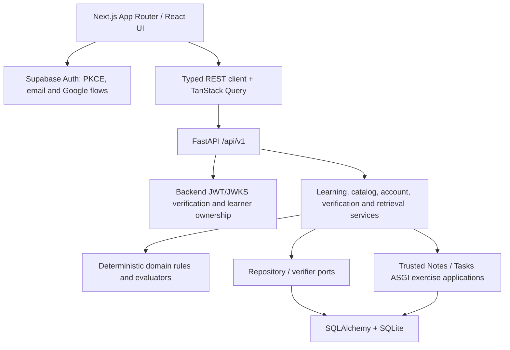

# OpenAI Codex delegated activity — reconstructed

Native task/coordination dispatches are established by source record, call ID, sender and target. Their message arguments are opaque encrypted-looking values, not available plaintext; those values are withheld. No SUBAGENT_PROMPT text is invented. Actual child final reports follow separately; event numbering does not imply request/report pairing. Inherited history, reasoning, system/developer instructions and raw tool results are excluded.

## Verified dispatch metadata — request body unavailable

| UTC timestamp | Method | Actual sender session | Source turn | Source call | Source file/line |
| --- | --- | --- | --- | --- | --- |
| 2026-11-01T15:44:59.977Z | spawn_agent | 01a18c8a-4fc7-70a0-bf35-3113cfa88f29 | 01a197c8-988c-7be2-8172-d11bc9a848ab | call_89099bc943774db7aeca9cc3f885a504 | <CODEX_HOME>/sessions/2026/10/31/rollout-2026-10-31T23-07-33-01a18c8a-4fc7-70a0-bf35-3113cfa88f29_01a19309-c4b5-73f2-908a-9d852a4d1403.jsonl:3660 |

## Actual emitted child final reports

[CLAUDE_LOG_ENTRY type=SUBAGENT_RESPONSE num=1 session=01a18c8a-4fc7-70a0-bf35-3113cfa88f29 agent=01a197c9-14ee-7903-8d68-70f62755d08a]
timestamp: 2026-11-01T15:47:47.370Z
time: 2026-11-01 21:17
chars: 6777
turn_id: "01a197c9-18eb-7f61-a9e9-0d2d02cb5885"
model: "gpt-6.1-sol"
source_scope: "delegated_agent_final_report"
source_session_id: "01a197c9-14ee-7903-8d68-70f62755d08a"
provenance: {"source_file": "<CODEX_HOME>/sessions/2026/11/01/rollout-2026-11-01T21-15-00-01a197c9-14ee-7903-8d68-70f62755d08a.jsonl", "source_line": 783, "source_record_type": "response_item.message.assistant.final_answer", "source_session_id": "01a197c9-14ee-7903-8d68-70f62755d08a", "source_turn_id": "01a197c9-18eb-7f61-a9e9-0d2d02cb5885", "source_call_id": null}
reconstructed: true

Current Trace is a **Next.js frontend plus a FastAPI modular monolith**, with a separate internal candidate-generation/validation pipeline.

A useful diagram:

Key source evidence:

| Area | Implementation |
|---|---|
| Frontend shell | `src/app/layout.tsx`; `next.config.ts` enables Cache Components, partial prefetching, React Compiler and Turbopack. |
| Frontend routes | `/`, `/learn`, two fixed lesson routes, `/account`, sign-in/up, password recovery/reset and `/auth/callback`. |
| Learning UI | `src/components/learning/workspace.tsx:17` creates a local TanStack Query cache; predictions, attempts, hints and verification use the backend. Local storage remembers session IDs, not authoritative progress. `hub/lessons-hub.tsx` renders server-backed journey state. |
| API boundary | `src/lib/api/client.ts` calls FastAPI directly, includes credentials, optional Bearer token, request timeout and idempotency keys. `src/lib/api/schema.d.ts` is generated from `backend/openapi.json`. This is not a Next.js BFF/reverse-proxy API architecture. |
| Frontend authentication | `src/lib/supabase/browser.ts:6` uses Supabase SSR browser client with PKCE. `server.ts:7`, `src/proxy.ts:5`, and `src/app/auth/callback/route.ts` handle SSR cookies, refresh and safe callback redirects. `use-auth.ts` is UI state only. |
| Backend bootstrap | `backend/app/main.py:20` creates the FastAPI app, database lifespan, settings, JWT verifier, middleware and health/learning/account routers. `api/dependencies.py` wires service/repository implementations. |
| Backend layers | `api/` routes/presentation → `services/` orchestration → `domain/` deterministic rules → `repositories/` protocols → `db/` SQLAlchemy implementations. Runtime adapters are in `verification/`; AI ports/adapters are in `ai/`. |
| Identity | Backend independently verifies Supabase asymmetric JWTs through configured JWKS (`auth/jwt.py`); account subjects/roles/learner ownership live in SQLite. Supabase supplies authentication, **not the current Trace learning-data database**. |
| Guest ownership | `services/identity.py` uses an HttpOnly `trace_learner` credential whose digest is stored. `services/accounts.py` explicitly claims guest history, uses receipts/rate limits, and rejects conflicting ownership without rewriting histories. Roles are server-owned, not trusted from browser UI state. |
| Current learner engine | `services/catalog.py` idempotently seeds the two legacy versioned lessons. `services/learning.py` pins sessions to lesson versions, locks the original prediction, preserves numbered attempts and implements idempotency/transition rules. |
| Real verification | `services/verification.py:43` reserves learner verification runs, invokes `AsgiNotesVerifier`/`AsgiTasksVerifier`, checks real API responses plus fresh committed-state reads, stores five evidence categories and updates completion. Mapping text alone never establishes success. |
| Transfer/retrieval | Notes completion unlocks Tasks. Successful transfer schedules persisted retrieval checkpoints at **+1/+7 days** (`domain/retrieval.py`, `services/retrieval.py:20`). This is request-driven scheduling/state, not a cron/queue system. Retrieval answers, retries and completion are persisted. |
| Persistence | `db/models.py` holds learners/credentials, accounts/auth subjects/roles/ownership, lessons/versions, sessions, predictions, attempts, tutor interactions, runs/checks/events, runtime notes/tasks, retrieval checkpoints/attempts. `db/session.py:14` uses SQLite transactions and enabled foreign keys. |
| Migrations | Alembic `0001`–`0005_account_identity`; constraints and triggers enforce immutable histories, pinned versions, allowed transitions and evidence-backed completion. |
| Tutor | Existing `TutorProvider` is separate from `QuestionGenerator`; `api/dependencies.py:52` currently wires only `FakeTutorProvider`. No live tutor/provider should be claimed. |

The new pipeline should be shown separately:

```mermaid
flowchart LR
    BRIEF["Server GenerationRequest"] --> GEN["QuestionGenerator port / deterministic fake"]
    GEN --> RAW["GenerationCompletion: raw untrusted JSON"]
    RAW --> ADMIT["ChallengeContentAdmission"]
    ADMIT --> COMPOSE["Trusted blueprint + explicit identity composition"]
    COMPOSE --> HASH["Canonical LessonSpecV1 + SHA-256"]
    HASH --> GATE["CandidateValidationService"]
    GATE --> RT["Existing ASGI apps/evaluators + disposable exercise-only SQLite"]
    RT --> RESULT["Validation receipt: release_eligible=false"]
```

Locations: `schemas/generation.py`, `ai/question_generator.py`, `services/challenge_content_admission.py`, `services/lesson_composition.py:99`, `domain/lesson_spec/canonical.py`, `services/candidate_validation.py:222`, and `verification/candidate_runtime.py:251`.

**Critical distinction:** the main app/dependency wiring does not register or call the QuestionGenerator, admission, composition or candidate-validation pipeline. It is implemented as internal reusable interfaces and tested against explicit test-only complete blueprints. No authoritative production blueprint registry, live AI provider, generated-challenge persistence, publication/assignment, daily/personalized challenge scheduler or learner frontend integration exists. Its in-memory runtime tables are separate from the learner database; it never invokes the learner verification workflow or creates learner history.

Tests and operations:

- `backend/tests/`: unit, contract, integration, migration/replay/integrity coverage.
- `tests/components/`: Vitest/Testing Library; `tests/e2e/`: Playwright desktop/mobile against controlled local fixtures.
- `.github/workflows/quality.yml`: backend Windows/Linux checks, Ruff/mypy/pytest/Alembic/OpenAPI, logging tests; frontend lint/types/tests/generated API/build/E2E.
- `.codex/hooks.json` + `scripts/codex_session_log.py`: native prompts/final responses into shared `.claude-logs/`; Claude-specific hooks remain separate.
- No deployment or live configuration health was inspected or asserted. No files modified, databases opened, tests run, or network/Git mutations performed in this audit.
