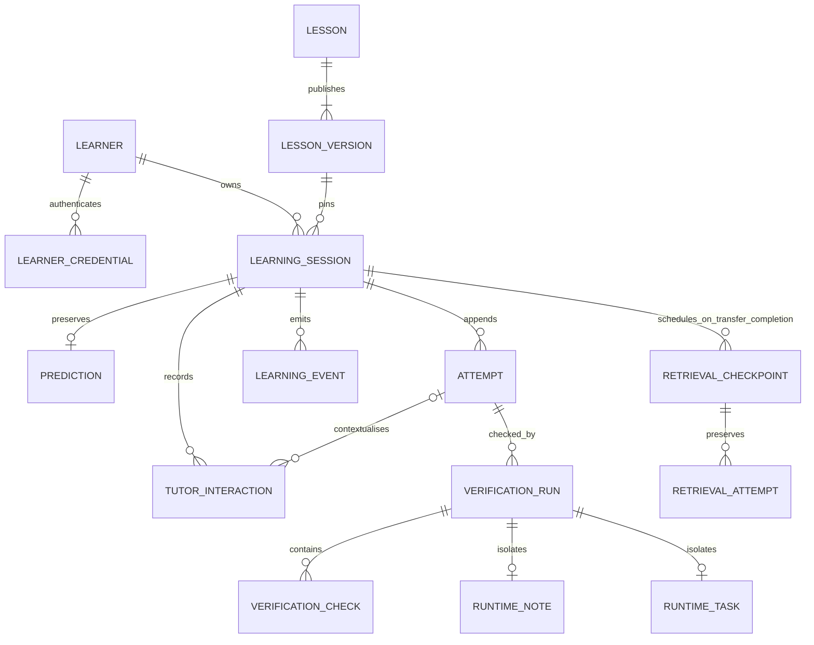

# Data architecture — implemented Modules 2–4

There are 22 product/infrastructure tables plus Alembic's revision table. UUIDs
identify rows except the lesson slug and singleton integer write gate. Timestamps
are UTC-aware through the SQLAlchemy UTC type, including after SQLite readback.

## Module 4 identity tables

| Table | Responsibility/invariants |
|---|---|
| users | Permanent Trace UUID, active/disabled status, created/updated time |
| auth_subjects | Unique issuer/subject to user FK; immutable mapping, created/last-seen; no email identity key |
| user_roles | User/role PK; learner/creator/admin only, multiple grants; default learner |
| role_grant_events | Append-only elevated grant audit: user, role, operator, reason, creation time |
| account_learners | User PK/FK, unique learner FK, creation; optional paired claim credential FK/retry key; immutable ownership |
| account_action_limits | User/action PK; minute window and count for account inspection/claim limits |

Migration `0005_account_identity` adds tables without rebuilding learning tables.
Each learner has guest authority or one account owner. Account attachment requires
all guest credentials revoked; guards forbid adding, reactivating or moving account
credentials. Guest lookup also excludes account learners. Session owners and all
evidence FKs remain unchanged; ownership follows the existing learner UUID.

Bootstrap/claim reserve the existing write gate before reads. Inspection allocates
no learner; first authenticated learning does unless history was claimed first.
Claim rechecks the guest, revokes every guest credential and attaches ownership
atomically. The paired receipt permits exact same-user/key retries after cookie
deletion, never a new transfer. Existing learners conflict instead of merging.
Downgrade refuses if users exist before dropping any table. See
[ADR 009](adr/009-supabase-account-identity.md).

| Table | Relationships and invariants |
|---|---|
| learners | Pseudonymous UUID and creation time; no name/email/profile |
| learner_credentials | Owner FK, unique SHA-256 digest, expiry and revocation; no raw token |
| lessons | Stable slug; original and nested-transfer lessons are seeded independently |
| lesson_versions | Unique lesson/version; immutable public content, internal evaluator fields and canonical SHA-256 hash; creation is publication |
| learning_sessions | Owner FK, pinned version FK, state/completion time; unique owner/idempotency key; identity/version cannot change |
| predictions | Unique session FK, original selection/reasoning, retry key and timestamp; append once |
| attempts | Session FK, unique session/number and session/key; bounded field choice, explanation, guidance requests before submission |
| tutor_interactions | Session FK, optional same-session attempt FK, unique session/sequence and session/key; maximum three requests; fixture provenance, text or explicit error |
| verification_runs | Same-session attempt FK, unique attempt/key; pending then exactly one final passed/failed/error result; feedback/timing |
| verification_checks | Unique run/check code; expected and observed rendered evidence, match flag, source/timestamp |
| runtime_notes | Unique run FK; actual committed note title/content; other runs' rows never count |
| runtime_tasks | Unique run FK; committed title/priority; only pending transfer runs may insert; note runs cannot substitute |
| retrieval_checkpoints | Completed transfer session FK, unique source/ordinal (1 or 2), immutable question ID/hash and UTC due/creation dates; completion can be set once after a correct saved response |
| retrieval_attempts | Checkpoint FK, unique checkpoint/number and checkpoint/key; immutable selected option/reasoning/outcome/feedback/time |
| learning_events | Append-only session facts with server timestamp and optional server-generated reference |
| write_gate | One row used to reserve SQLite's writer before transactional decisions |

## Immutable evidence and relational scope

Predictions, attempts, published versions, tutor interactions, checks, learning
events and runtime notes reject UPDATE/DELETE through SQLite triggers. Final runs
cannot be rewritten/deleted; checks must precede finalization. A passed run requires
all mandatory matching checks, and a completed session requires a passed run.
State transitions and the session's pinned owner/version are also guarded.

Application services enforce these same rules before writes, including owner scope
and the current attempt. Composite FKs prevent linking attempts/runs/hints from
another session. Explicit transactions plus the write gate serialize concurrent
submissions, while uniqueness constraints independently enforce numbering and retries.
All normal writes are parameterized SQLAlchemy operations.

Attempts are immutable; verification status lives in linked run rows, not an edited
attempt. Failed and successful corrections both remain. Verification checks are
separate relational records; JSON API/error snapshots are rendered into bounded
check text for inspection, never a replacement for relational history. Only variable
published lesson content uses a JSON column. Hidden expected mapping/prediction
configuration is stored separately and never included in the public lesson projection.

Guidance records count requests (including explicit provider errors); delivered
fixture hints are counted separately. `hints_before` is derived on the server.
Original and transfer phases use separate pinned lesson sessions. Their availability,
completion and counts are projected from those records, without a duplicate mutable
phase-status table. Attempts permit body/content only for the original and flat/nested
only for transfer; both application policy and DB guards enforce the lesson scope.
The transfer session requires original completion and follows the same terminal-state
rules. Retrieval checkpoints are distinct scheduled activities, not new session states.

Transfer completion and both checkpoint inserts commit atomically. Ordinals map to
central +1/+7-day UTC durations, anchored to the saved completion time. Replays do not
duplicate checkpoints; genuine separate transfer sessions retain separate schedules.
Upcoming/due/completed is calculated from server time and the saved completion date.
Missed dates remain due. Checkpoint responses append under the existing write gate;
the first correct response sets completion in that same transaction. Earlier failed
responses and explanations are preserved. Question content is a versioned immutable
code registry with a hash stored in each checkpoint; changing it requires a new ID.

## Migrations and initialization

- 0001_foundation establishes Alembic's baseline.
- 0002_learning creates the actual tables, constraints, gate row and history guards.
- 0003_constraint_names normalizes legacy draft composite-constraint names while
  preserving populated records and triggers. Fresh 0002 installations already have
  canonical names. A full foreign-key integrity check precedes ending temporary FK
  deferral; foreign-key enforcement remains enabled. The populated-history regression
  covers a real completed session before/after this repair.
- 0004_transfer_retrieval widens the constrained mapping set with a data-preserving
  SQLite batch rebuild, restores all previous triggers and checks FK integrity, then
  adds tasks/checkpoints/responses and their guards. Populated original history is
  tested through downgrade-to-0003/upgrade-to-head. Empty-schema down/up remains
  supported; a populated transfer history deliberately prevents destructive downgrade.

No automatic startup DDL or seeding. Use Alembic then the idempotent seed CLI.
A changed published content/evaluator hash is a conflict, not an overwrite. Publish
new versions for material content/evaluator changes; existing sessions keep the old UUID.

## Retention and privacy limitations

Credential expiry/revocation removes access, not history. Ordinary append-only
protection does not mean data must be retained forever. A deliberate deletion/export
and backup-expiry policy is still required before production participant collection.
Do not introduce destructive migration shortcuts to clear data. Local databases and
cookies stay out of Git; development transcripts stay in the tracked shared
`.claude-logs/`, separate from learner evidence. Playwright and pytest use isolated
fixture databases, not the development file. No raw credentials appear in application
logs, database rows, JSON responses or frontend storage.

Module 3 adds task fixtures, source-linked schedules, question identity/hash and
selected retrieval answers, optional reasoning, deterministic outcomes and dates.
They are retained to inspect factual transfer/revisit activity. No retention percentage
or empirical improvement is inferred. The default credential life is 30 days with
protected renewal of still-valid near-expiry credentials; explicit shorter TTLs,
expiry/revocation and cookie loss can still prevent returning. No recovery, export,
deletion API, backup-expiry policy or automatic deletion guarantee is implemented.
