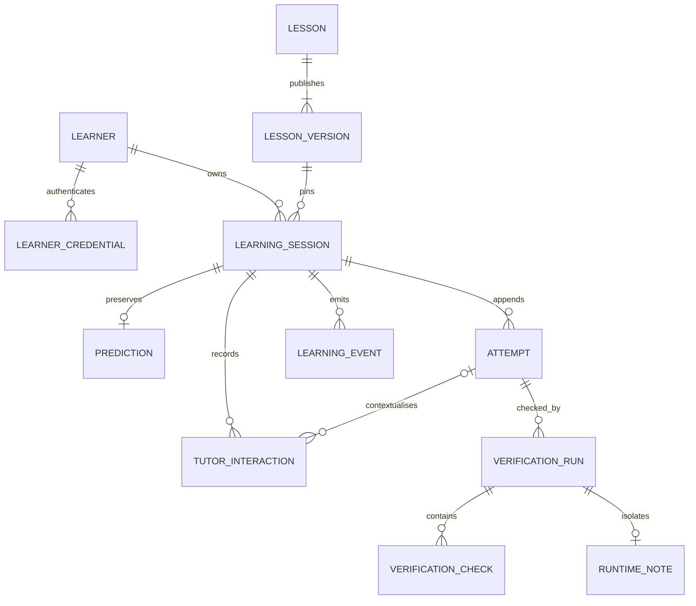

# Data architecture — implemented Module 2

There are 13 product/infrastructure tables plus Alembic's revision table. UUIDs
identify rows except the lesson slug and singleton integer write gate. Timestamps
are UTC-aware through the SQLAlchemy UTC type, including after SQLite readback.

| Table | Relationships and invariants |
|---|---|
| learners | Pseudonymous UUID and creation time; no name/email/profile |
| learner_credentials | Owner FK, unique SHA-256 digest, expiry and revocation; no raw token |
| lessons | Stable slug; only the first lesson is seeded |
| lesson_versions | Unique lesson/version; immutable public content, internal evaluator fields and canonical SHA-256 hash; creation is publication |
| learning_sessions | Owner FK, pinned version FK, state/completion time; unique owner/idempotency key; identity/version cannot change |
| predictions | Unique session FK, original selection/reasoning, retry key and timestamp; append once |
| attempts | Session FK, unique session/number and session/key; bounded field choice, explanation, guidance requests before submission |
| tutor_interactions | Session FK, optional same-session attempt FK, unique session/sequence and session/key; maximum three requests; fixture provenance, text or explicit error |
| verification_runs | Same-session attempt FK, unique attempt/key; pending then exactly one final passed/failed/error result; feedback/timing |
| verification_checks | Unique run/check code; expected and observed rendered evidence, match flag, source/timestamp |
| runtime_notes | Unique run FK; actual committed note title/content; other runs' rows never count |
| learning_events | Append-only session facts with server timestamp and optional server-generated reference |
| write_gate | One row used to reserve SQLite's writer before transactional decisions |

## Immutable evidence and relational scope

Predictions, attempts, published versions, tutor interactions, checks, learning
events and runtime notes reject UPDATE/DELETE through SQLite triggers. Final runs
cannot be rewritten/deleted; checks must precede finalization. A passed run requires
all mandatory matching checks, and a completed session requires a passed run.
State transitions and the session's pinned owner/version are also guarded.

Application services enforce these same rules before writes, including owner scope
and the current attempt. Composite FKs prevent linking attempts/runs/hints from
another session. Explicit transactions plus the write gate serialize concurrent
submissions, while uniqueness constraints independently enforce numbering and retries.
All normal writes are parameterized SQLAlchemy operations.

Attempts are immutable; verification status lives in linked run rows, not an edited
attempt. Failed and successful corrections both remain. Verification checks are
separate relational records; JSON API/error snapshots are rendered into bounded
check text for inspection, never a replacement for relational history. Only variable
published lesson content uses a JSON column. Hidden expected mapping/prediction
configuration is stored separately and never included in the public lesson projection.

Guidance records count requests (including explicit provider errors); delivered
fixture hints are counted separately. `hints_before` is derived on the server.
The first lesson has only original attempts; transfer/revisit phases and schedules
are future schema changes, not currently implemented entities.

## Migrations and initialization

- 0001_foundation establishes Alembic's baseline.
- 0002_learning creates the actual tables, constraints, gate row and history guards.
- 0003_constraint_names normalizes legacy draft composite-constraint names while
  preserving populated records and triggers. Fresh 0002 installations already have
  canonical names. A full foreign-key integrity check precedes ending temporary FK
  deferral; foreign-key enforcement remains enabled. The populated-history regression
  covers a real completed session before/after this repair.

No automatic startup DDL or seeding. Use Alembic then the idempotent seed CLI.
A changed published content/evaluator hash is a conflict, not an overwrite. Publish
new versions for material content/evaluator changes; existing sessions keep the old UUID.

## Retention and privacy limitations

Credential expiry/revocation removes access, not history. Ordinary append-only
protection does not mean data must be retained forever. A deliberate deletion/export
and backup-expiry policy is still required before production participant collection.
Do not introduce destructive migration shortcuts to clear data. Local databases and
cookies stay out of Git; development transcripts stay in the tracked shared
`.claude-logs/`, separate from learner evidence. Playwright and pytest use isolated
fixture databases, not the development file. No raw credentials appear in application
logs, database rows, JSON responses or frontend storage.
