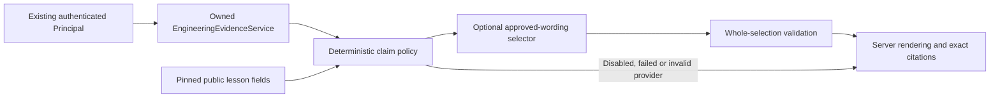

# Evidence-grounded feedback V1 — Phase 3.5B

## Prerequisite, publication and scope

Phase 3.5A was preserved, reviewed and published as
`e319f1e159e6b7297cd7863ae7cf2d6bec529361` on
`feat/phase-3-5a-engineering-evidence`, following the user's explicit instruction
to commit/push the completed work before beginning this milestone. The genuine
shared log was included; the four pre-existing suggestion-only log artifacts
were preserved and excluded. Remote branch identity was checked. No PR was
created or merged. Phase 3.5B continues on that branch and remains uncommitted.

Before implementation, the exact Phase 3.5A application/test snapshot was freshly
reproduced: **2,303 backend tests passed in 257.24 seconds, 97.35% coverage**;
its **378 focused evidence tests passed in 40.51 seconds**. The implementation
and source map in `engineering-evidence-v1.md` and
`engineering-evidence-sources.md` remain authoritative and unchanged.

This milestone prepares an internal provider-independent capability. It adds no
learner endpoint, frontend screen, persistence, migration, learner grade, skill
score, mastery threshold or adaptation policy. Existing hint behavior, daily
assignment policy, +1/+7 retrieval and candidate release restrictions remain
unchanged. There are no SDK installations, provider credentials or live/paid AI
requests. All AI-related tests use explicit deterministic fixtures.

## Architecture and authority

`EvidenceFeedbackService.feedback(principal, query)` is the internal entry point.
The principal is obtained through established authentication, not a client body.
The query accepts only request/session IDs and explicit UTC cohort bounds with a
record cap of 1–64. There is no client input for evidence, competence labels,
correctness, verification, lesson versions or provider instructions.

The service checks principal expiry and credential/account snapshot validity,
delegates source ownership and integrity to `EngineeringEvidenceService`, and
obtains only the exact pinned legacy public lesson fields in a second short
owner-scoped read. Both session identity and owner/version are checked again.
Those fields must equal the approved actual catalog content. Full lesson versions,
private answer keys, evaluator configuration and raw learner inputs are never
serialized into a provider request.

All repository contexts close before the provider is invoked. Authentication
expiry is checked again after provider execution and before returning a result.
The service uses no repository write port, produces no new evidence and never
changes sessions, predictions, attempts, checks, tutor reservations or completion.

The pure policy builds a bounded `FeedbackRequest` from canonical Phase 3.5A
objects. It authorizes every claim, two equivalent wording variants at most,
section, and exact evidence/lesson/coverage citations before provider execution.
The provider receives a detached copy; it cannot mutate the policy snapshot used
for validation/rendering.

## Contracts

All new values in `backend/app/schemas/evidence_feedback.py` inherit the existing
frozen strict value pattern, reject unknown fields and hide input values in
validation errors.

- `FeedbackQuery`: stable request UUID, session UUID, aware/UTC-normalized event
  window, `as_of`, explicit bounded record limit.
- `LessonReference`: one of the catalog's five public field IDs, exact lesson
  pin, bounded public text and SHA-256 of the exact UTF-8 bytes.
- `FeedbackClaim` / `FeedbackWording`: authorized fact, limitation or next step;
  optional canonical competency; exact citations; approved `plain`/`concise` copy.
- `FeedbackRequest`: schema `evidence-feedback-v1`, policy
  `evidence-feedback-policy-v1`, canonical `EngineeringEvidenceBatch`, derived
  focus source, grounding state, all five pinned public references and at most
  16 claims. It permits at most 64 canonical records and 65,536 UTF-8 bytes.
- `FeedbackSelection` / `FeedbackChoice`: provider wire schema
  `evidence-feedback-selection-v1`; echoes scope/state/pin and selects a wording
  ID for each authorized claim. It has no prose, score, new fact or evaluator
  configuration field.
- `FeedbackCompletion`: bounded transport outcome with fixture provenance and
  sanitized error metadata, without provider authority over correctness.
- `FeedbackReply`, `FeedbackSection`, `FeedbackStatement`, `EvidenceReference`
  and `LessonCitation`: presentation-ready server text and precise original
  citations, plus explicitly separate delivery/fallback diagnostics.

The reply's four optional content sections are `demonstrated`,
`needs_improvement`, `why` and `next`; the fifth part consists of evidence,
lesson and coverage references. There is exactly one authorized actionable next
step for usable feedback. Missing competency observations never become failure
claims. Instrumentation limitations remain neutral explanations in `why`.

Internal typed requests are refreshed through recursive Python dumps and strict
Python validation, preserving datetime/UUID/enum types and rejecting forged
`model_copy`/`model_construct` values. Provider output uses a separate strict JSON
wire contract. This distinction avoids canonical nested timestamp JSON parsing
issues and prevents a forged boolean limit being serialized as the integer `1`.
No Phase 3.5A contract was changed to support this boundary.

## Grounding states and delivery

Feedback state describes support for the feedback, not whether a learner passed,
their intelligence, skill level or mastery:

| State | Deterministic meaning |
| --- | --- |
| `supported` | The selected factual claims have authoritative evidence. A fully observed failed verification can produce supported feedback about that failure. Unmeasured competencies remain unproven. |
| `partially_supported` | An action is recorded, but execution for the selected attempt remains unproven or unavailable. No learner failure is inferred from infrastructure errors. |
| `insufficient_evidence` | The cohort contains no canonical competency observations. Auxiliary hint/recall records can be described without becoming competency judgments. The provider is not called. |
| `unavailable` | Trusted source evidence/material could not be established, including dependency, integrity or context-limit failure. No conclusions or citations are returned. Ownership/authentication errors retain their existing errors. |

Delivery is separately `mock`, `deterministic` or `unavailable`. Disabled, timed
out, refused, malformed or otherwise failed providers produce a visible
deterministic fallback from the original authorized bundle, keeping its grounding
state and exact claims/citations. `fallback_reason` records why. This does not
retain any conclusion from rejected provider content. Source failure returns a
constant safe diagnostic with state/delivery unavailable.

## Deterministic policy and lesson coverage

`backend/app/services/evidence_feedback_policy.py` owns substantive claims.
Timestamp/UUID ordering selects a record deterministically; wording says
"selected" because equal timestamps do not establish a real-world ordering.

| Source fact | Authorized feedback and limits |
| --- | --- |
| Original prediction success/failure | Confirm only the recorded prediction accuracy against the pinned legacy outcome. Do not compare it with an arbitrary later repaired execution or diagnose the learner's reasoning. |
| Finite mapping submission | Report the submission, with execution and independent code authorship remaining separate claims. No submitted source patch is invented. |
| Passed verification | State exactly the five recorded categories: HTTP status, API response, validation, row count and stored values. Attribute the latter two to independent fresh readback. |
| Failed verification | Describe the selected attempt's recorded discrepancy, including receiving-schema validation when its actual check did not match. No fabricated raw HTTP number, validation code or submitted mapping value is included. |
| Unavailable verification | Explain unavailable/inconsistent execution evidence without turning it into learner failure. |
| Failed/changed/passed sequence | Report observed recovery chronology; diagnosis and general debugging mastery remain unproven. |
| Delivered guidance before an action | Attribute recorded tutor assistance from that action's canonical provenance, including valid earlier hints outside the selected cohort. |
| Reservation or unknown assistance | A reservation alone does not establish delivery. A finalization absent from this window does not prove actual nondelivery. Unknown assistance never proves independent work. |
| Tasks transfer completion | Report the actual Tasks result and explicitly preserve the missing exact originating Notes-session relationship. |
| Missing investigation/code-patch/diagnosis data | Abstain from those assessments and expose the existing coverage limitations. |
| Retrieval answers | Preserve the auxiliary recall fact without relabeling it as prediction, investigation, implementation or transfer competence. |

Notes (`fastapi-payload-mismatch`) scenarios cover incorrect prediction,
receiving Pydantic-schema rejection, finite modification, successful correction,
actual HTTP-response categories and independent database readback. Tasks
(`fastapi-nested-payload-transfer`) scenarios cover actual flat failure, nested
correction, verified execution and transfer completion. Exact legacy `1.0.0`
pins/digests are retained; unassigned `1.1.0` blueprint candidates are not used.

The evidence projection deliberately omits raw selected answers, submitted
mapping values and observed HTTP payloads. Feedback explains its exact check
categories/outcomes using approved public schema/code; it does not invent those
omitted details. No individual misconception diagnosis is recorded. The one next
step asks the learner to trace outgoing values into the pinned receiving schema,
without returning private repair mappings or evaluator keys.

## Provider, application lifecycle and security

`EvidenceFeedbackProvider.explain` is separate from `TutorProvider`,
`LessonAssistant`, `QuestionGenerator` and `SupportAssistant`.
`FakeEvidenceFeedbackProvider` provides deterministic valid selections and
scripted errors/output for tests. `BoundedEvidenceFeedbackProvider` uses the
existing shared client with the additive internal `feedback` capability.

`AIResources.evidence_feedback_provider` caches one adapter per application
lifespan. The internal dependency getter composes the stateless service with
the existing repository and that cached provider. It creates no new client or
public route. Existing conversational-model configuration, timeout, input/output,
rate, retry, budget and cleanup behavior apply. No environment variable or model
ID is added. Disabled mode constructs no transport and selects no fake provider.
The learner hint dependency remains the existing deterministic fake tutor.

The adapter explicitly selects provider context: request ID, policy/state/lesson
pin, authorized wording choices and their exact citation IDs, plus only the used
approved public lesson fields. It excludes learner/session/account identities,
raw source-row IDs, reasoning, submitted code/explanations, hint text, private
evaluation configuration and support documents. The owner-derived rate subject
remains internal to the shared client. Source text is reference data, never an
instruction or executable content.

`evidence_feedback_validation.py` validates the entire provider output:

- Strict JSON object, at most 8,192 UTF-8 bytes; duplicate keys, excess depth,
  nonfinite/malformed content, unknown fields and schema/version mismatches fail.
- Exact request identity, policy, lesson pin/digest and grounding state.
- Exactly one known wording choice for every authorized claim; no dropped,
  duplicated, conflicting or invented claims.
- Exact citations **per claim**, including evidence, public lesson and coverage
  references. Substituting a globally valid but unrelated evidence ID fails.
- No provider-authored prose, scores, correctness fields, links, document paths
  or private evaluator fragments can be accepted by the wire schema.

The server renders the original approved wording and references, even when a
provider chooses a concise variant. Invalid citations cause rejection of the
whole selection and an explicitly labeled deterministic fallback. Nested source
references retain genuine out-of-window assistance/recovery provenance without
inventing an evidence UUID for each original source row.

The expanded type analysis exposed a PEP 695 alias incompatibility at the shared
`TypeAdapter` constructor. Explicitly unwrapping its existing `ClientErrorCode`
literal value preserves the same strict validator and unknown-code fallback;
no cast, ignore, additional error value or runtime auth-policy change was added.

Existing shared timeouts bound transport requests and reject late results. They
cannot preempt an arbitrarily blocked synchronous callback. A future approved
live transport must enforce its I/O deadlines; no hard-cancellation guarantee is
claimed by this provider-independent milestone.

## Evaluation and future integration

The deterministic evaluation fixture is
`backend/tests/fixtures/evidence_feedback_cases.json`. Its named pass/fail
properties cover evidence-reference validity, unsupported-claim rejection,
assistance attribution, abstention, lesson-version consistency, verification
consistency and privacy-leakage rejection. There is no weighted quality score or
learner competency score.

Prompt-injection cases include stored learner instructions, malicious provider
prose/extra fields and requests for private evaluator data or arbitrary documents.
Raw learner instructions never enter this context, and provider output cannot
introduce new prose. This is an enforced selection contract rather than a
semantic claim that arbitrary generated text can be made truthful by regex.

Future public integration requires a separately reviewed authenticated API
contract, credential/account revalidation policy and hint/answer visibility
policy. The existing progress API withholds prediction correctness before an
attempt; this internal capability does not change that behavior. No API is added
to demonstrate DI. Provider selection, credentials/model IDs/spending approval,
live transport/SDKs, new instrumentation, mastery/progression and Phase 3.5C/3.5D
remain separate work.

## File inventory

New application files:

- `backend/app/schemas/evidence_feedback.py`
- `backend/app/ai/evidence_feedback.py`
- `backend/app/ai/providers/bounded_evidence_feedback.py`
- `backend/app/ai/providers/fake_evidence_feedback.py`
- `backend/app/services/evidence_feedback_policy.py`
- `backend/app/services/evidence_feedback_validation.py`
- `backend/app/services/evidence_feedback.py`

Modified integration files:

- `backend/app/schemas/ai_client.py`
- `backend/app/ai/client.py`
- `backend/app/ai/resources.py`
- `backend/app/api/dependencies.py`

New test/fixture files:

- `backend/tests/feedback_fixtures.py`
- `backend/tests/fixtures/evidence_feedback_cases.json`
- `backend/tests/unit/test_evidence_feedback_contracts.py`
- `backend/tests/unit/test_evidence_feedback_policy.py`
- `backend/tests/unit/test_evidence_feedback_providers.py`
- `backend/tests/unit/test_evidence_feedback_service.py`
- `backend/tests/unit/test_evidence_feedback_validation.py`
- `backend/tests/unit/test_evidence_feedback_evaluation.py`
- `backend/tests/integration/test_evidence_feedback.py`
- `backend/tests/integration/test_evidence_feedback_lifecycle.py`

New documentation: this report. No database table or migration is introduced.

## Executed validation

| Gate | Result |
| --- | --- |
| Fresh Phase 3.5A full baseline | 2,303 passed in 257.24 seconds; 97.35% coverage |
| Fresh Phase 3.5A focused baseline | 378 passed in 40.51 seconds |
| New focused feedback suite | 331 passed in 12.18 seconds |
| Additional shared-client/default-limit Tasks integration | 1 passed in 1.65 seconds |
| Ruff / formatting | Passed for all 203 Python files |
| Mypy | Passed for all 134 source files |
| OpenAPI | Exact stored-contract match: 21 paths, 23 operations |
| Full backend regression / coverage | 2,635 passed in 2,673.05 seconds; zero failures, errors or skipped tests; 97.39% coverage, up 0.04 percentage points |
| Legacy ASGI timeout outlier follow-up | Both unchanged Notes/Tasks timeout cases passed in 2.16 seconds; the slowdown did not reproduce |
| Auxiliary-only citation follow-up | Two hint/recall rendering and provenance checks passed; neither creates a competency assessment |
| Preservation / final Git state | Final audit recorded below; no Phase 3.5B commit/push is authorized |

Validation uses an isolated archive of the published prerequisite commit plus
only intentional feedback source/tests, with the already installed locked Python
environment. Real environment/database files are absent. All migration and
runtime data is restricted to disposable fixtures. No dependency installation or
network AI call is part of validation. The isolated `feedback-results/` contains
the focused JUnit/output, the additional application-client result, and the full
JUnit/output and coverage report when complete. Initial negative tests exposed
and now protect typed-query coercion, malformed-principal handling and second-read
scope checks; existing assertions and coverage requirements are retained.

The complete suite includes 332 new feedback cases. Their combined JUnit case
time was 16.61 seconds. One pre-existing
`test_real_asgi_timeout_records_error_and_new_key_can_retry[notes]` case accounted
for 2,380.28 seconds of the full run, while passing. Its Notes/Tasks targeted
rerun completed in 2.16 seconds without changing the test or runtime. The exact
cause of that one duration outlier is not established; it is not reported as a
proven application performance change. All full-suite results remain actual
executed results. The extra follow-ups did not alter production or test sources.

The seven new feedback source modules have full-suite coverage between 89.89%
and 100%, with the complete application coverage improving to 97.39%. Existing
migration, ownership, security, tutor transaction/concurrency, Notes/Tasks runtime
and Phase 3.5A evidence integrity tests all passed in the full run. No tests were
skipped, weakened or removed, and coverage/lint/type-check requirements remain
unchanged.

Implementation status: **complete for Phase 3.5B's internal provider-independent
foundation**. Deterministic backend facts, mock-selected approved wording and
explicit abstention/fallback remain separate. Live provider integration,
learner-facing feedback and Phase 3.5C/3.5D are not implemented.

## Final preservation and Git audit

The final 21 executable source/test/fixture files match the validated isolated
snapshot byte for byte. The five authoritative Phase 3.5A source/test modules
match their prerequisite snapshot exactly. Existing lesson catalogs, evaluators,
learning services, database models, migration files and frontend have no changes.
Real `.env.local`, `backend/.env` and `backend/trace.db` retain their prior
SHA-256, size and modification timestamp. Shared logs and the four existing
suggestion artifacts are preserved; native log capture remains local.

Phase 3.5B comprises 18 new files and four modified integration files listed
above. Nothing is staged. HEAD and remote Phase 3.5A branch remain at
`e319f1e159e6b7297cd7863ae7cf2d6bec529361`. No Phase 3.5B commit, push, PR or
merge was made. No live provider, real provider credential, SDK installation,
paid AI request, new database persistence or real database migration was used.
