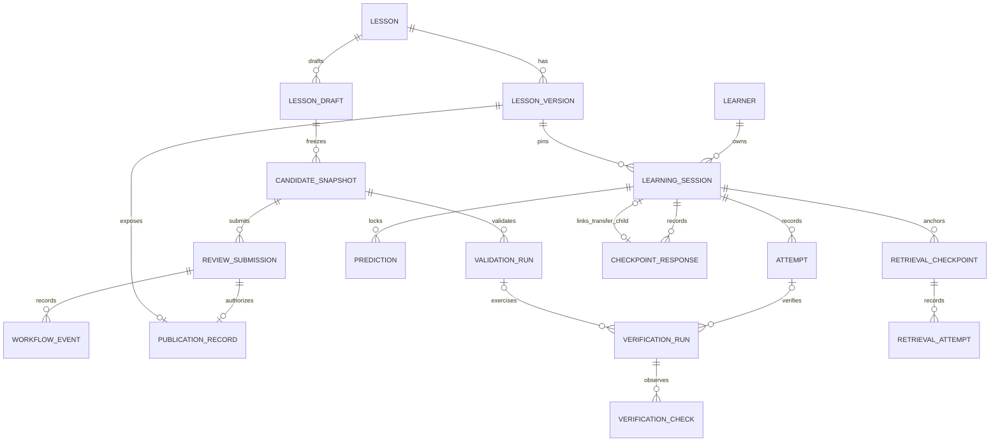
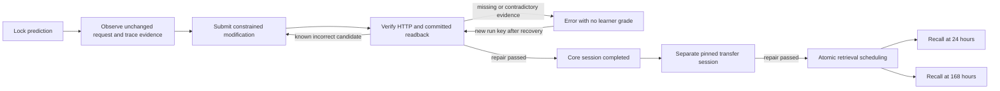
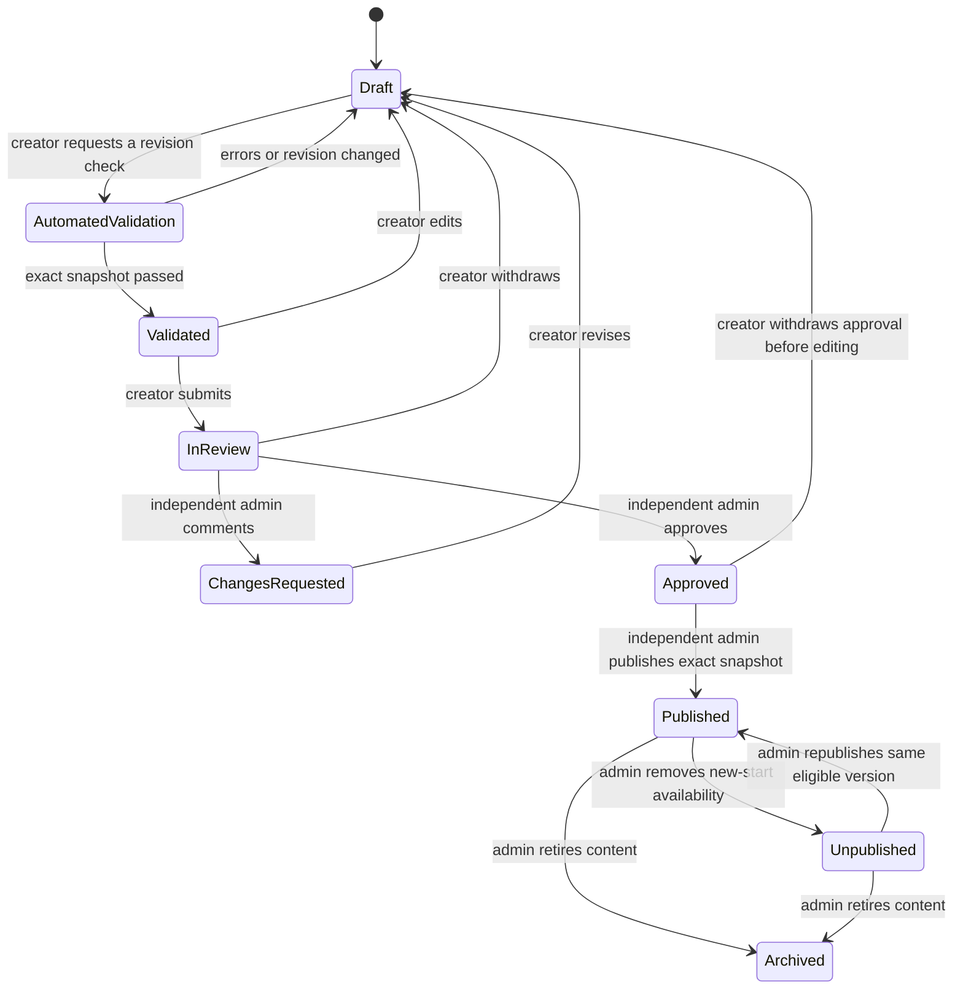

# Trace Lesson Specification V1

**Design proposal, 1 November 2026. No implementation is included.**

Audience: the engineers and designers building invite-only Creator Mode V1.
This proposal describes the contract to implement; it does not change the current
lesson API, database, runtime, permissions or publication behavior.

## 1. Executive Summary

A Trace lesson is a versioned learning definition that connects a prediction,
evidence investigation, a constrained application change and verified behavior.
It may link one independent transfer lesson and schedule two later retrieval
activities. Correctness comes from deterministic rules and trusted application
observations. Learner prose and AI explanations are not evidence of a committed
write or independent understanding.

V1 should extend the two working exercise families: note-field mapping and nested
task mapping. Creators author the scenario, learning objective, evidence prompts,
hints, explanations and retrieval questions around an approved exercise template.
They cannot upload an executor, change a receiving schema, choose an arbitrary
endpoint, write SQL or weaken a template's mandatory verification checks.

Keep one bounded definition snapshot per published `LessonVersion`; retain the
existing relational learner, session, prediction, attempt and verification records.
Add authoring/review records and the missing investigation/transfer associations
around those abstractions. A new general execution engine, full event sourcing,
arbitrary checkpoint graphs and a table for every paragraph are unnecessary.

The essential publication rule is: **an active admin other than the author must
approve the exact validated revision; an active admin other than the author may
publish that approved revision.** Being both creator and admin never permits
self-approval or self-publication. Published definitions, their runtime bindings
and the version references in existing learner history never change silently.

Status labels used throughout:

| Label | Meaning |
|---|---|
| Already implemented | Present in inspected source; this is not a claim that tests were rerun |
| Partially implemented | A working narrower abstraction exists and needs the specified extension |
| New work required | Proposed functionality with no current end-to-end implementation |
| Deliberately deferred | Excluded from Creator Mode V1 |

## 2. Existing Architecture Assessment

The inspected source base is commit
`4f6a37f7790023bbb0de3d6025426bf7d27b89da`, with pre-existing local environment,
ignore-file, handoff-document and native-log changes left intact. Source and
assertions, rather than historical ADR status wording, establish the following facts.

| Area | Observed implementation | Status and implication |
|---|---|---|
| Lesson definitions | Two Python-seeded lessons, each at content version 1.0.0. `LessonVersion` holds five public text fields, expected mapping, prediction answer and content hash. | Partially implemented: immutable versions exist; the full V1 definition does not. |
| Persistence | 22 application/infrastructure tables, SQLAlchemy/SQLite, explicit repository transactions and a singleton write gate. | Already implemented; retain these boundaries. |
| Session workflow | `awaiting_prediction → ready_for_attempt → verification_pending → needs_revision/completed`; abandonment is terminal. | Already implemented for current lessons; no general checkpoint interpreter. |
| Prediction | One immutable choice/reasoning per session; prediction submission unlocks attempts even when the prediction is wrong. | Already implemented. |
| Investigation | Source panels are visible. Transfer requires a verified failed flat request before a nested correction. There is no persisted general investigation response. | Partially implemented. |
| Modification | Structured `body/content` or `flat/nested` selections, append-only attempts, explanation and hint count. No submitted Python is executed. | Already implemented for two fixed families. |
| Evaluation | Pure `evaluate` and `evaluate_transfer` functions distinguish passed, failed and error. | Already implemented; they are not configurable authoring evaluators. |
| Verification | Private real FastAPI/Pydantic `/notes` and `/tasks` ASGI applications commit run-scoped rows; a separate SQLAlchemy context reads them back. | Already implemented; retain actual HTTP validation and independent readback. |
| Evidence | Five named checks, runtime rows, finalized runs and factual events are persisted. A matching response alone cannot pass. | Already implemented. |
| Transfer | Separate lesson/version/session, unlocked by any owned completion of the original lesson. Dispatch and several SQL guards use fixed lesson slugs. | Partially implemented: no exact parent-session/target-version link. |
| Retrieval | Two code-defined questions, pinned IDs/hashes, +1/+7 UTC days after each completed transfer; append-only answers; questions hidden until due. | Partially implemented: questions are not authored/pinned inside lesson definitions. |
| AI boundary | `TutorProvider` defines hint, explanation and misconception interpretation. The configured adapter is a deterministic fake; the learner service currently requests hints only. | Partially implemented: live AI and authored hint delivery are not wired. |
| Identity | Supabase JWT verification, separate Trace UUID, DB roles, guest credentials and atomic guest-history claim. | Already implemented as account foundations; live provider setup is a separate operational dependency. |
| Creator authorization | Learner/creator/admin roles and an audited operator grant CLI. | Partially implemented: no invitations, author ownership checks, creator/admin workspace or review APIs. |
| Publication | Seed inserts immutable versions directly. Latest catalog lookup sorts by creation time; session input defaults to 1.0.0. No draft/review/active-release model. | New work required for editorial publication and latest-published selection. |

Source map:

- [Models](../../backend/app/db/models.py), [repository transactions](../../backend/app/db/learning.py), [repository port](../../backend/app/repositories/learning.py).
- [Seed definitions and hashes](../../backend/app/services/catalog.py), [current API DTOs](../../backend/app/schemas/learning.py), [public projection](../../backend/app/api/presentation.py).
- [Learning orchestration](../../backend/app/services/learning.py), [notes evaluator](../../backend/app/domain/learning.py), [transfer evaluator](../../backend/app/domain/transfer.py).
- [Verification orchestration](../../backend/app/services/verification.py), [notes verifier](../../backend/app/verification/asgi_notes.py), [tasks verifier](../../backend/app/verification/asgi_tasks.py), [verifier ports](../../backend/app/repositories/verification.py).
- [Retrieval definitions](../../backend/app/domain/retrieval.py), [retrieval orchestration](../../backend/app/services/retrieval.py), [retrieval projection](../../backend/app/api/retrieval_presentation.py).
- [Tutor port](../../backend/app/ai/interface.py), [tutor contracts](../../backend/app/schemas/tutoring.py), [fake tutor](../../backend/app/ai/providers/fake.py).
- [Principal dependencies](../../backend/app/api/dependencies.py), [account roles](../../backend/app/domain/accounts.py), [role-grant CLI](../../backend/scripts/grant_role.py).
- Migrations [0002](../../backend/alembic/versions/0002_learning_learning_engine.py), [0003](../../backend/alembic/versions/0003_constraint_names.py), [0004](../../backend/alembic/versions/0004_transfer_retrieval.py), [0005](../../backend/alembic/versions/0005_account_identity.py).

Relevant assertions were inspected in [domain evaluation tests](../../backend/tests/unit/test_learning_domain.py),
[transfer tests](../../backend/tests/unit/test_transfer_domain.py),
[learning integration tests](../../backend/tests/integration/test_learning.py),
[retry replay tests](../../backend/tests/integration/test_retry_replay.py),
[transfer/retrieval integration tests](../../backend/tests/integration/test_transfer_retrieval.py)
and [account tests](../../backend/tests/integration/test_accounts.py). These were read,
not executed for this design. Historical delivery counts are not fresh validation.

The current learner UI uses TanStack Query, generated API types and fixed lesson
routes/components. A future Creator Workspace should reuse this transport/design
system. Installed Next 16.4.3 server/client and cookie guides were inspected: keep
trusted reads and page protection on the server, interactive draft editing on the
client, and request-time authentication under the existing Suspense boundary.
Frontend controls never replace backend role/owner checks. No Next files change here.

## 3. Domain Model

### 3.1 Identity, aggregates and common validation

`spec_version` versions the definition format; `version` versions a particular
lesson's educational/technical content. Both use `MAJOR.MINOR.PATCH`, with no
prerelease syntax in V1. A UUID identifies a version independently of either label.
Changing text, answers, timing, template binding or a transfer target requires a new
published content version. Labels alone do not establish immutability.

Unless stated otherwise, required strings are nonblank; unknown fields and
duplicate JSON keys are rejected. Local IDs match `[a-z][a-z0-9-]{0,63}` and are
unique within their collection. Lesson slugs retain `[a-z0-9-]{1,80}`. UUIDs are
canonical lowercase strings. Times are server-generated aware UTC timestamps.
Definitions are at most 64 KiB in UTF-8; prose fields at most 4,000 characters,
source artifacts at most 8,000 each. Learner reasoning/explanations remain at most
2,000 characters. No field accepts HTML, executable expressions or external URLs.

The V1 topology is fixed: exactly one prediction, investigation, modification and
verification in that order; a catalog lesson additionally has one transfer and two
retrieval checkpoints. A transfer-only lesson has the four core checkpoints and no
further transfer/retrieval children. There are one to three objectives. `depends_on`
must match this topology; it is not an arbitrary workflow language.

### 3.2 Definition entities and value objects

All rows below describe definition data. Embedded values have no independent
database identity or lifecycle; they become immutable with the version snapshot.

| Concept and status | Purpose and required fields | Optional fields | Relationships and validation |
|---|---|---|---|
| **Lesson — partially implemented** | Stable catalog identity: `lesson_id`, creator `owner_user_id` for new authored lessons, creation time. | Active published-version pointer; archival time/reason. Legacy seeds may have no human owner. | Owns versions/draft. Owner must be an internal user, never email or provider metadata. Visibility/owner metadata is outside content JSON and audited. |
| **LessonVersion — partially implemented** | Immutable definition: `spec_version`, `lesson_id`, `version_id`, `version`, `entry_mode`, title/summary, objectives, scenario, checkpoints, hints, explanations, misconceptions, completion/tutor policies, private contracts, `content_sha256`. Publication additionally binds a retained runtime manifest. | No arbitrary extension bag. Empty hint/explanation/misconception collections are allowed subject to review. | Unique lesson/version; `entry_mode` is `catalog` or `transfer_only`. Every local reference resolves. Once submitted as a candidate, that snapshot is immutable; published rows never edit. |
| **LearningObjective — partially implemented** | Embedded `id`, observable `statement`, `evidence_checkpoint_ids`. | None. | At least one evidence checkpoint; each linked checkpoint includes this objective ID. Objectives describe observable work, not a claimed mastery percentage. |
| **Scenario + InitialState — partially implemented** | One embedded `scenario`: context, input values and generated source artifacts. Private verification fixture supplies ID, unchanged mapping and run-isolated initial state. | None in V1. | Scenario/artifact data must match the approved template. Initial rows are zero **for this run**, not a claim that the whole DB is empty. Keep the narrative and execution fixture consistent. |
| **Checkpoint — partially implemented** | Typed embedded `id`, `type`, title/prompt, objective IDs, dependencies, hint IDs, evaluation-rule ID, plus the type-specific fields in section 4. | No generic conditions/scripts. | One discriminated union, not six independent tables. Fixed topology and bounded response shapes. |
| **Prediction / InvestigationTask / ModificationTask — partially implemented** | The corresponding checkpoint variants; their task settings are definition values. | Modification explanation may be optional; prediction reasoning is required. | Their runtime responses are separate append-only records; never put answers into the definition. |
| **VerificationContract — partially implemented** | Private `timeout_seconds`, fixture ID/input values/initial mapping, `initial_failure` and `repair` profiles. Each profile has purpose, status, response shape, validation codes, row count, stored values, identity-match requirement and five mandatory checks. | None for these two templates. | Checkpoint references a profile. Values are generated/locked by the selected template, not arbitrary creator assertions. |
| **EvaluationSpecification — partially implemented** | Private policy ID/revision and a named rule map. | None. | Each rule is one of the finite types in section 6. No SQL, Python, regex grader, prompt grader or general JSON-expression DSL. |
| **Hint — partially implemented** | Embedded ID, level 1–3, text, allowed checkpoint IDs. | None. | At most one hint per level per core lesson; references resolve; progressive release and a session-wide three-request budget. Delivery is a separate runtime interaction. |
| **Explanation — new work required for authored delivery** | Embedded ID/title/text, release checkpoint ID and release event (`core_verification_passed` or `retrieval_response_saved`). | None. | The public projection releases only when the corresponding server event exists. |
| **Misconception — partially implemented boundary** | Embedded ID, statement, indicator checkpoint/value and suggested feedback. | None. | Only a possible interpretation of an observed action. V1 indicators are `mapping_selected`; they do not grade a person's belief or prose. |
| **TransferChallenge — partially implemented** | A `transfer` checkpoint with exact target lesson ID, version UUID, content version and private content digest. | None. | Target is a separate transfer-only definition. No `latest` reference, nested transfer, cycle or target-self-reference. Runtime child sessions must share the parent learner. |
| **RetrievalCheckpoint definition — partially implemented** | A `retrieval` checkpoint: ordinal, +1/+7-day schedule anchored to transfer, versioned question ID, prompt/payload/schema, three uniquely identified options and feedback release. | Learner reasoning is optional. | Exactly ordinals 1 and 2, delays 1 and 7, same transfer anchor. Answers live only in private rules. Runtime schedule instances remain separate. |

### 3.3 Runtime entities

These are learner/runtime data, never authored definition fields. Existing
immutable history remains immutable; a later response is a new row, not an edit.

| Runtime concept and status | Required fields and purpose | Optional fields | Relationships, validation and mutability |
|---|---|---|---|
| **LessonAttempt — already implemented as `learning_sessions`** | Session UUID, learner UUID, exact lesson-version UUID, state, creation time, retry identity. | Completion time until core completion. | Aggregate of responses/candidates/evidence. Version/owner never changes. State changes only through allowed transitions. This is not a new duplicate `learner_attempts` table. |
| **Prediction — already implemented** | ID, session, choice, nonblank reasoning, retry key, server time. | None. | One original prediction/core session. Immutable. Correctness is diagnostic; submission, not a correct answer, gates progress. |
| **Investigation response — new work required** | ID, session/checkpoint key, outgoing field, required JSON pointer, baseline-run reference, evidence annotations, retry identity and time. | None; annotation prose must be nonblank. | A typed `checkpoint_responses` record. Each annotation references valid source lines or an owned baseline check. Immutable revisions; only a deterministically valid trace satisfies the checkpoint. |
| **ModificationAttempt — already implemented narrowly** | Existing attempt ID/session/number, mapping value, optional explanation (possibly empty), hints-before count, retry key/time. | Explanation text is ungraded. | One immutable candidate, scoped to its definition's modification checkpoint. V1 keeps the two existing mapping sets; no generic source patch. |
| **VerificationRun + Check — partially implemented** | Run ID, source context, purpose, profile, template/runtime binding, server input, reservation/lease and terminal result; five uniquely named checks with expected/observed/source. | Attempt ID only when no candidate exists, such as baseline or preview; error code/details when unavailable. | Exactly one source context: learner session or authoring validation/preview. Repair requires a same-session candidate. Finalized records never change. Extending current non-null session/attempt FKs is new work, not an existing capability. |
| **Transfer link — new work required** | Parent session/checkpoint, child session/version, link ID/time/retry identity. | None. | A relationally constrained `checkpoint_responses` transfer variant with a child-session FK. Same learner and exact pinned target; each child belongs to one parent link. No duplicated answer/history blob. |
| **Scheduled RetrievalCheckpoint — already implemented narrowly** | Existing instance ID/source transfer/ordinal/due time/question hash; V1 adds parent definition-version/checkpoint key and parent-session association. | Completion time until correct response. | Unique parent/checkpoint and source-transfer/ordinal. Frozen source/question/schedule. Definition lookup uses the pinned parent version, not today's global question list. |
| **RetrievalAttempt — already implemented** | Instance ID, numbered selected option/reasoning, correctness/feedback, retry identity/time. | Reasoning may be empty. | Owner-scoped append-only answers. First correct response sets completion once; later exact-key replay returns the original row. |
| **TutorInteraction + LearningEvent — already implemented** | Server source context, delivered/error status, level/provider/content provenance and time; events link to existing facts. | Text may be absent on error; same-session attempt reference may be absent. | Preserve requests separately from candidates. Add authored-hint provenance without rewriting fake-provider history. No fabricated external-assistance or understanding claim. |

### 3.4 Authoring and governance entities

All of these workflows are **new work required**, except the existing role store
and operator audit foundation. They are separate from learner attempts.

| Entity | Required fields | Optional fields, relationships and rules |
|---|---|---|
| CreatorInvitation | ID, target internal user, inviting admin, reason, expiry, state, creation time. | Accepted/revoked time. Target must already have a Trace account. One active invitation/target; only its target accepts. Role grant and audit commit atomically. No email/token invitation system is needed for V1. |
| LessonDraft | ID, lesson/owner, revision integer, target content version, definition JSON, workflow state, created/updated time. | Base published version for revisions. One open draft/lesson; optimistic concurrency. Editable only in draft/changes-requested/validated state; editing invalidates validation. |
| CandidateSnapshot | ID, draft ID/revision, reserved version UUID, canonical JSON/hash, resolved runtime manifest digest, creation time. | None. Immutable from capture. Each draft revision gets a new snapshot/version UUID; only one accepted publication can claim a lesson/content-version label. |
| ValidationRun | ID, candidate, mode (`automated` or `preview`), initiator, status, manifest, ordered diagnostics/technical run references, start time. | End time/result while pending; preview expiry. Immutable result after finalization. Live preview evidence never becomes production learner progress. |
| ReviewSubmission | ID, candidate, successful automated-validation ID, submitting creator, state, time. | Closing decision/time. At most one active submission/draft; pending content is read-only. Approvals reference the exact candidate/hash/manifest. |
| WorkflowEvent | ID, actor internal user, resource/submission/version, event type, reason, time. | Structured review comments with checkpoint/artifact anchors. Append-only review, withdrawal, permission and publication audit, not full event sourcing of all content. |
| PublicationRecord | Version ID, approved submission, approving/publishing admins, immutable approval/hash/manifest provenance; current availability. | Unpublish/archive reason/time and an emergency execution block. Content remains in immutable LessonVersion; availability is audited metadata, never a content edit. |

Do not pretend that historical seed versions had creator submissions or reviews.
Existing operator creator grants remain trusted legacy grants; do not invent
invitation acceptances for them. New Creator Mode enrollment uses invitations.
Invitation states are pending, accepted, revoked or expired. Propose a seven-day
expiry, checked against server UTC at acceptance; only pending invitations can be
accepted/revoked. Existing accepted membership is revoked through the separate
audited creator-membership operation, not by erasing an invitation or grant event.

The server assigns a fresh reserved version UUID when creating a new draft
revision; it is not an editable author field. Repeated validation of that unchanged
revision reuses its immutable candidate snapshot, while each validation execution
has its own run ID. Source identities, ownership, hashes, state and approval fields
are server-controlled even when an editor can inspect exported JSON.

The run source relationships are alternatives, not simultaneous ownership. These
are logical entities; section 12 constrains their physical implementation.

## 4. Canonical Lesson JSON Structure

The full machine-readable design examples are
[the two reference definitions](examples/lesson-specification-v1.json) and
[the illustrative learner attempt](examples/lesson-attempt-v1.json).
They are documentation fixtures, not seed inputs, registered runtimes or deployed
lesson versions. Each `lesson_versions` element is one complete canonical definition.
The surrounding reference bundle is a documentation container, not a proposed API.

### 4.1 Required top-level fields

| Field | Type and constraint |
|---|---|
| `spec_version` | Literal `1.0.0` for this contract |
| `lesson_id`, `version_id`, `version` | Stable slug, immutable version UUID and content version |
| `entry_mode` | `catalog` or `transfer_only` |
| `title`, `summary` | Nonblank text; title at most 120 characters, summary at most 600 |
| `objectives` | 1–3 objects: ID, statement, evidence checkpoint IDs |
| `scenario` | Nonblank context and `initial_state_description`, template-owned `input_values`, two generated code artifacts: ID/label/language/content |
| `checkpoints` | Four core checkpoints; catalog lessons additionally contain one transfer and two retrieval checkpoints |
| `hints` | 0–3 ID/level/text/checkpoint-ID objects; empty means no requested guidance is available |
| `explanations` | Objects with ID/title/text/checkpoint/release event; the example includes core and retrieval feedback |
| `misconceptions` | 0–8 authored possible interpretations with finite mapping-selected indicators |
| `completion_policy` | Exact `core_checkpoint_ids`, `transfer_checkpoint_ids`, `retrieval_checkpoint_ids` arrays |
| `tutor_policy` | `mode: authored_only`, `max_requests_per_core_session: 3`, prediction checkpoint gate |
| `private` | Runtime binding, typed evaluation rules, trusted verification fixture/profiles |
| `content_sha256` | Lowercase 64-hex digest of the normalized definition excluding this field |

Empty arrays are explicit. Arbitrary custom fields are rejected. Optional human
workflow metadata belongs outside this object, not in a creator-defined extension.

### 4.2 Checkpoint discriminators

All checkpoints require `id`, `type`, `title`, `prompt`, `objective_ids`,
`depends_on`, `hint_ids`, `evaluation_rule_id`.

| Type | Additional required fields | Response shape |
|---|---|---|
| prediction | Three labeled outcome choices; `reasoning_required: true` | Choice ID + nonblank reasoning |
| investigation | `artifact_ids`, `baseline_profile_id`, `baseline_evidence_artifact_id` | Outgoing field + required JSON pointer + baseline run + annotations |
| modification | `change_type`, labeled template choices, `explanation_required: false` | Allowed mapping + optional explanation |
| verification | `modification_checkpoint_id`, `profile_id` | Empty trigger request; server persists result |
| transfer | `target_version` with exact lesson/version/hash | Server-created child-session link |
| retrieval | Ordinal, anchor/delay schedule, versioned question, `feedback_after: saved_response` | One option ID + optional reasoning |

Code artifacts use local IDs. An investigation's `baseline_evidence_artifact_id`
declares a dynamic artifact populated by its owned baseline run; it is not a
creator-supplied transcript. All references resolve within this version except the
single exact transfer target. Code-line annotations have inclusive 1-based line
bounds within the pinned artifact; check annotations identify an owned run/check.
Limit an investigation response to six annotations, with nonblank notes of at most
1,000 characters each; require coverage of sender, receiver and baseline evidence.
The two V1 destination pointers (`/content`, `/metadata/priority`) are template
labels, not a general creator-programmable path expression.

Private profile `response_shape` is one of `validation_errors`, `saved_note` or
`saved_task`; row count is the template's fixed 0 or 1. Profile object names are
exactly `initial_failure` and `repair`. Their five `required_checks` names are a
set equal to the list in section 7; no extra or missing check can make a profile
valid. Fixture input values, mapping allowlists, initial mapping and correct mapping
must all agree with the registered template, even if submitted JSON attempts to
override them.

### 4.3 Canonicalization and version pinning

At draft save/validation, normalize text to Unicode NFC and source newlines to LF.
Require ASCII object property names, integer JSON numbers only, no NaN/Infinity,
and no duplicate properties. The canonical bytes are UTF-8 JSON with recursively
sorted object keys, preserved array order, no insignificant spaces and unescaped
Unicode. `content_sha256` is SHA-256 over those bytes with only the top-level digest
field omitted. Missing versus explicitly present optional fields are not silently
equated; the candidate snapshot is the exact normalized value approved.

Transfer targets include a content digest. The target's digest is computed first;
there is no back-reference from its definition to its parent, so the reference
graph is acyclic. Publishing a catalog lesson requires its pinned target already
published/available. The example uses proposed **2.0.0** content versions; it never
replaces either existing 1.0.0 seed or its original hash.
It also grants no creator ownership of those seed slugs. Legacy seed ownership
must remain operator-controlled unless an admin explicitly assigns an author with
audit before a Creator Mode revision. Ordinary creators start their own lesson
identities; they cannot take over a seed by submitting its slug.

A production publication also binds a trusted immutable runtime manifest: template
ID/revision, evaluator policy/revision, source artifact/commit digests, locked
dependencies, Python/platform identity and normalization policy. An ID/revision
must never be remapped to new behavior. Retain the actual source/dependency/runtime
artifacts needed to recreate it; Git hashes without retrievable artifacts are not
sufficient. This sealing/retention mechanism is new work, not provided by these JSON
examples. Reproducibility means the same semantic checks for the same inputs;
random run/row UUIDs and real timestamps are deliberately different.

A scheduled retrieval's `question_hash` uses the same canonical-byte algorithm
over a three-property object: `question` contains the complete question object,
`rule` its referenced private rule, and `explanation` the referenced explanation
object. It covers the answer and feedback as well as the prompt. Like the full private
definition digest, this hash remains internal and is not a learner-facing answer
oracle. The runtime lookup must verify the pinned value before accepting a response.

### 4.4 Serialization boundaries

The canonical object is for trusted authoring/review/storage. **Never return it
wholesale to a learner or tutor.** A dedicated public DTO includes identity,
visible objectives/scenario, unlocked task prompts/choices and only permitted
released feedback. It excludes private rules, answer keys, future retrieval
content, unreleased hints/explanations and workflow data.

Do not expose the full private definition digest or a hash of a small answer key
to learners: enumerating a few possible answers can turn that into an answer
oracle. A learner-facing ETag, if needed, hashes only the already-visible public
projection. Session version UUIDs still pin the complete server-side definition.

## 5. Checkpoint Specification

### 5.1 Prediction

**Partially implemented** as a configurable checkpoint; immutable capture exists.
Inputs are the scenario and generated request/schema panels. The learner chooses
`rejected`, `saved` or `server_error` and explains why. Persist the original
selection/reasoning once before exposing run evidence or hints. A prediction is
complete when a valid response is saved; an incorrect prediction never blocks
investigation. Deterministic comparison to the rule's answer is diagnostic and
revealed only after evidence is available. Prose is preserved, not graded for
meaning. A malformed/blank response is a validation error; a save failure leaves
the prediction unlocked and the client draft intact.

### 5.2 Investigation

**New work required** for structured persistence and baseline purpose.
After prediction, “Run unchanged request” executes the fixed initial mapping in a
new run. The learner inspects sender lines, receiving-model lines and normalized
validation/readback evidence, then records the outgoing field, required JSON
pointer and annotations covering all three artifacts.

Persist a new investigation response per revision, including baseline run/check
references. Its rule requires an owned `baseline` run that observed the complete
expected-failure profile, correct structured field/path values and valid nonblank
annotations. It checks reference coverage and typed field tracing, **not whether
the prose proves understanding or a panel was truly read**. Invalid references or
a wrong trace need revision with specific feedback. Baseline execution failure
shows infrastructure error and offers retry; it never counts as a wrong diagnosis.

The baseline's expected 422/zero rows may satisfy investigation. It cannot satisfy
repair verification or complete the core session. Progressive hints direct
attention to flow, field names and schema shape rather than writing a solution.

### 5.3 Modification

**Partially implemented.** Investigation completion unlocks a narrow editing
control that renders the resulting request shape. Notes accept only the two field
mappings; tasks accept only flat/nested placement. The learner submits a mapping
and optional explanation; persist an immutable numbered candidate with server-side
guidance counts. The text is ungraded.

A structurally valid choice becomes `submitted`, ready to verify; it is not yet
correct or completed. An unsupported/incomplete body is rejected without inventing
a graded attempt. A valid but incorrect mapping is saved and evaluated against
actual behavior. Failure permits a **new** candidate; old candidates remain.
Modification and verification become completed together only after a passing repair.

### 5.4 Verification

**Partially implemented** as a versioned contract; existing repair verification is
the foundation. Input is a server-owned candidate ID in the current session and
an idempotency key, not a client success report. Reserve a run, execute the trusted
adapter outside the short reservation transaction, then persist typed checks,
terminal outcome and any core completion atomically.

A successful repair requires all five checks and exact response/readback identity.
Wrong mapping with its known 422/no-write profile returns `failed` and keeps the
learner in revision. Missing, unexpected or contradictory evidence returns `error`.
Store all real observations available; absence is `unavailable`, never fabricated
zero rows. Show expected/observed comparisons and their sources. Release the core
explanation after a successful repair; hints remain explicitly requested assistance.

### 5.5 Transfer

**Partially implemented.** After core verification, start an independently pinned
transfer-only lesson with a different context and structural problem. It uses the
same four core interactions; changing a flat `priority` to `metadata.priority`
requires more than repeating the original `body → content` rename.

The server creates a same-learner parent/child link from the parent's pinned
target. Starting is not completion; only a passed child repair satisfies transfer.
Child history, hints and errors stay separate. Retries return the existing active
child link. If a child is abandoned, a deliberate restart creates another linked
session; the first successful child is the immutable completion/scheduling anchor.
Once transfer is satisfied, new child starts for that parent checkpoint are refused.

The first child completion and the two retrieval instances commit together. Failure
to schedule rolls back that completion transaction. The parent's original
`learning_sessions.completed_at` remains its core-completion time; transfer
completion is a separate derived fact, not a rewrite of the original result.

### 5.6 Retrieval

**Partially implemented.** Anchor two immutable schedule instances to first transfer
completion +24 and +168 hours in UTC. Their definition/question comes from the
parent's pinned version, not the current catalog or global question list. Question
content is hidden until due; both can remain due when a learner returns late.

Each asks for a diagnosis in another context (shipping/report examples), a choice
and optional reasoning. Preserve every answer. Deterministic choice comparison
decides correctness; reasoning is not semantically scored. Reveal feedback only
after a saved response; no tutor answer/hint or original worked solution is supplied
before that first response. The first correct response sets completion once.
An earlier wrong response remains visible and qualifies later success as revision.
The seven-day checkpoint does not require finishing the one-day checkpoint first.

No scheduler/notification delivery is necessary: reads derive upcoming/due/completed
from server time. Failed saves keep client drafts and retry keys. Wrong answers
are feedback opportunities, not infrastructure errors or inferred retention scores.

### 5.7 Connected progress and assistance

Core session completion, transfer completion and retrieval completion are separate
facts. A whole journey can be complete only when all required activities are done,
but a learner must not wait seven days to receive core lesson completion. Neither
label claims durable mastery. Show first responses, revisions, Trace hints and
technical errors separately. External assistance remains unknown.

## 6. Evaluation Contract

**Partially implemented.** Preserve pure evaluator functions behind a versioned,
finite policy rather than generating executable rules from creator text.

Conceptual input is `(pinned_definition, typed_response_or_candidate,
server_verified_evidence, server_context)`. Output is a deterministic assessment
with checkpoint/purpose, result, reason code, check references and feedback IDs.
No network, database, random value, wall clock or AI call occurs inside evaluation;
necessary due/auth facts arrive as trusted server context.

| Rule kind | Allowed configuration | Deterministic meaning |
|---|---|---|
| `outcome_diagnostic` | One of three prediction choice IDs | Save-valid-response gates progress; answer comparison is diagnostic only. |
| `field_trace` | Template's outgoing field, required JSON pointer, required artifact IDs | Owned expected-failure baseline + correct structured trace + valid annotation coverage. No NLP grading. |
| `allowed_mapping` | Template's complete allowlist and correct mapping | Reject out-of-shape input; save an allowed candidate. Correctness still requires verification. |
| `verified_repair` | No creator-supplied executable predicates | A matching repair-purpose run must meet the template's five mandatory checks. |
| `linked_session_completion` | No arbitrary learner/session target | Correct server link + child core completed through pinned repair evidence. |
| `single_choice` | One existing question option ID, authored explanation reference | Compare saved option; preserve optional ungraded reasoning and prior answers. |

Expected mapping, fixture schema and technical expected outcomes are generated from
the approved template. Creators can configure retrieval answers and pedagogical
text, but cannot declare the broken mapping correct or change persistence checks
to accept zero rows. Human review checks authored question keys for factual accuracy.
Prediction `gate` is the fixed literal `valid_submission`, not another creator
setting. The rule's `answer` is an option ID and cannot make correctness a progress
prerequisite.

For verification, retain persisted `pending/passed/failed/error` outcomes and add
an explicit purpose. On a **baseline** run, `passed` means the expected initial
failure was observed; on **repair**, it means the application correction was
verified. Only repair can complete a core session. Existing legacy runs keep their
original semantics; never reinterpret an old failed baseline-like attempt as passed.

| Situation | Result and progression |
|---|---|
| Complete known 422/no-row baseline evidence | Baseline passed; investigation may complete; core remains open |
| Complete valid correction: 201, exact response, no validation errors, one matching fresh row | Repair passed; modification/verification and core session complete |
| Allowed wrong mapping with its known 422/no-row behavior | Repair failed; new modification permitted |
| Missing field, unsupported mapping, source code or client-supplied result | Reject input (422); no fabricated graded result |
| Correct mapping unexpectedly produces 422 | Error: template/runtime inconsistency; no learner grade |
| Broken mapping unexpectedly returns 2xx | Error: unexpected success; do not pass by status or guess the cause |
| 201 with zero, extra, mismatched or unrelated rows | Error: contradictory persistence evidence |
| Known 422 with a stored row | Error: contradictory side effect |
| HTTP 5xx, unexpected 4xx, transport error, malformed response | Error; do not label the learner incorrect |
| Commit/readback unavailable or readback not independent | Error; unavailable evidence is not an empty table |
| Timeout/interruption/late worker | Error or stale pending until recovery; never infer failure/success from silence |
| Candidate's older final result requested again | Return that result, even while a newer run is pending |

`false` means an observation contradicts an expected check; `unavailable` means no
observation exists. Those are distinct values. A failed check alone does not imply
learner failure: the result classifier must recognize the complete known incorrect
candidate profile; other inconsistencies are errors.

## 7. Verification Contract

### 7.1 Runtime authority

**Partially implemented.** An operator-maintained registry exposes exactly two
approved template revisions initially: `notes-v1` and `tasks-nested-v1`. Creators
select a template card; the server supplies its code artifacts, fixture, structured
input type, profiles, supported check names and sealed runtime binding. Registering
a new schema/adapter requires an engineering change and review, outside creator UI.
Versioned registry records/manifests are new work; current dispatch is by lesson slug.

Conceptual verifier request fields are run ID, server-owned source context,
template revision/manifest, purpose/profile and bounded structured mapping. Clients
never submit HTTP status, row IDs, expected values, SQL, URLs or a runtime revision.
Reuse the current `observe(run_id, mapping)` adapters as observation sources;
extending orchestration for baseline/preview contexts is explicit new work.

### 7.2 Mandatory evidence

| Check | Baseline profile | Repair profile | Provenance |
|---|---|---|---|
| `http_status` | Exactly 422 | Exactly 201 | Actual private ASGI response |
| `api_response` | Valid normalized validation-error structure | Saved-record schema with permitted exact values and a valid ID | Actual response; no synthetic success |
| `validation` | Exact template-normalized missing/extra-field code set | Empty code set | Actual Pydantic error locations/types |
| `row_count` | Exactly zero for this run | Exactly one for this run | Separate SQLAlchemy session/transaction after the request |
| `stored_values` | No persisted side effect for this run | Exact fixture fields; response ID equals freshly read row ID | Independent fresh read, not response echo |

The example uses `missing:content` / `extra_forbidden:body`, then transfer's
`missing:metadata` / `extra_forbidden:priority`. Normalize error type/location,
not unstable framework message wording or whole error strings. Pin the normalization
revision with the runtime. None of the five checks is creator-optional.

All runtime writes/readbacks are scoped to a server-generated run UUID. A new run
starts with zero rows in that scope. An existing row in another session, candidate,
preview or runtime table cannot satisfy a check. Notes and task data remain distinct.
No production user data is queried by creator-selected field names or filters.

The normalized observation record contains an integer-or-unavailable `http_status`,
sanitized `response_body`, a unique normalized validation-code list, nullable
`response_row_id` and readback with `state`, independent-transaction provenance and
typed rows. `available` with `rows: []` is distinct from `unavailable` with no rows
observation. Each check records code, expected/observed typed values, source,
observation state and match flag. The synthetic journal illustrates available
evidence; a server error must retain an unavailable value rather than substitute
the available empty-array case.

### 7.3 Transactions, retries and failure containment

Reserve under the existing DB write gate, then release the transaction before
running HTTP/DB exercise work. On finalization, recheck ownership/version/current
candidate and the reservation lease. Insert checks, finalize once and advance only
the appropriate purpose in one transaction. Transfer scheduling belongs in that
same completion transaction. An abandoned core session never becomes completed
from a late result; retain its run evidence without reopening it.

Same key/same semantic input returns the same record; changed input under a key
conflicts. Use operation/resource-scoped UUID retry keys. Active verification
conflicts; a passed/failed candidate replays without executing again. An error can
retry under a new key with a new run UUID. The prior error remains canonical for
its key even if another run is active. Baseline retries obey the same rule.

Use a bounded template deadline (10 seconds in the examples; creator cannot raise
the platform maximum). Retain the current recovery deadline of at least 60 seconds
or three times the execution budget until a separately tested replacement exists.
A timeout does not prove that a synchronous worker stopped or its commit rolled
back. Mark late/stale runs unavailable, prevent further writes once finalized and
quarantine any already-committed run-scoped fixture row. Never reuse it for retry.
Do not delete evidence to make a contradiction disappear.

### 7.4 Validation and preview

**New work required.** A candidate validation runs its declared initial mapping
and every allowed candidate through the trusted adapter. It requires the known
wrong case to fail repair and the correct case to pass repair, using fresh run
scopes. It also verifies baseline behavior and all mandatory check sources. This
is a finite test matrix, not creator-provided test code.

Interactive preview uses the same definition interpreter, evaluator and adapters
in a server-owned authoring context. It reads an immutable candidate, never a
mutable draft mid-run. Preview runs have no real learner ownership and do not
create production predictions, completions or due checkpoints. A separate owner
scope authorizes the creator/reviewer. Extend verification source FKs/guards as
described in section 12; the current learner-only run model cannot do this as-is.
Preview results are labeled and cannot be promoted into learner evidence or an
automated validation certificate.
Persist interactive preview state only under its authoring context: the same typed
response shapes, capped at 50 responses and 20 modification candidates per preview,
with a 30-minute expiry. Keep it separate from production learner tables and from
immutable release-validation diagnostics. A capped/expired preview must restart;
it is never silently continued as a real learner attempt.

## 8. AI Tutor Boundaries

**Already implemented boundary; authored delivery is new work; live models are
deliberately deferred as a V1 dependency.** Start with reviewed authored hints and
explanations. `authored_only` in the examples is an intentional proposed mode; the
current service accepts only its configured fake fixture.

The tutor may explain a server-finalized outcome, point to visible artifacts,
rephrase an authored hint, or suggest a labeled possible misconception. A creator
may use AI outside Trace to draft text, but must review it as their own submission.
In-product AI drafting/live tutoring can be added later without changing who owns
correctness.

The tutor must never return or write `passed`, completion, scores, role grants,
publication approvals, answer keys or trusted evidence. It cannot change a response,
mapping or verification profile, call arbitrary tools, query learner databases or
see future retrieval questions. Explanations of supplied results remain
`interpretation_only`; model confidence is not an evaluator input.

Build tutor context from an explicit allowlist: current released prompt/artifacts,
the learner's submitted bounded text, delivered authored hints and safe finalized
check summaries. Do not send the full private definition, unpublished other
creators' drafts, auth/session tokens or arbitrary fetched documents. Treat lesson
text and learner prose as untrusted data, including instructions embedded in them.

Record source, definition/prompt revision, level, delivered/error status and time.
An unavailable model must fall back to reviewed authored guidance or report
unavailable assistance; it cannot alter technical outcomes. Count requested and
delivered help separately. V1 retains the current three-request budget, including
failed requests, so a failure does not silently provide additional assistance.
Before a first retrieval answer, no hint/answer-revealing tutor operation is allowed.

## 9. Creator Authoring Workflow

**New work required.** Use one guided editor, not a raw schema editor as the main UI.

1. **Invitation and access.** A signed-in learner receives an admin-issued in-app
   invitation to their Trace account. Acceptance grants creator and records the
   actor/target/reason. Admin role itself remains operator-controlled. Revoking
   creator access blocks authoring/submission immediately; it does not erase
   published content/history. Publication availability is a separate admin decision.
2. **Select a template.** Show “Field-name contract” and “Nested JSON contract”,
   their capabilities and fixed code/fixture preview. Creators can author another
   lesson around those contracts; new schemas or fixture values require an approved
   new template revision. Do not imply arbitrary-code lesson authoring.
3. **Write the learning goal and scenario.** Ask what the learner will trace and
   what observation will establish the goal. Generated code/input panels remain
   tied to the template; the editor explains any narrative/fixture inconsistency.
4. **Author checkpoint prompts.** Show the fixed sequence and context-specific
   prompt fields. Prediction includes reasoning; investigation asks for annotated
   field tracing; modification uses a request-shape control, not another quiz.
5. **Review technical settings.** Expand a “What counts as evidence” panel listing
   exact baseline/repair statuses, fixed values and independent readback. The
   creator confirms the chosen template; cannot toggle mandatory checks off.
6. **Add guidance.** Write up to three progressive hints, a post-verification
   explanation and possible misconceptions. Preview when each will be visible.
7. **Choose transfer.** Select one already-published transfer-only version using a
   permission-aware picker. Display exact version, objective alignment and change
   of context. A missing suitable target is a content dependency, not an automatic
   generated challenge. Do not offer `latest` as a stored binding.
8. **Write retrieval prompts.** Author two different contexts/options/answer keys
   with explanations. V1 shows fixed one/seven-day timing. Before-response preview
   must hide the answer/explanation and original worked solution.
9. **Save and preview.** Save a draft revision using optimistic concurrency. Preview
   a frozen revision as a learner in a visibly labeled authoring environment.
   Switching role in the browser is not permission to preview another draft.
10. **Validate and submit.** Show actionable diagnostics anchored to checkpoint or
    field: broken reference, incompatible template, ambiguous question, missing
    evidence, inaccessible copy or failed technical case. Only a successful
    validation of the exact revision permits submission.
11. **Revise after review.** Review comments show author/time/anchor and requested
    change. A new revision preserves prior submitted snapshots and feedback. Editing
    invalidates old validation/approval; resubmission creates a new review record.

Automated gates check typed shape/limits, topology/references, source-template
consistency, case outcomes, runtime retention/availability, answer-key option
membership, no answer exposure in learner/tutor projections, independent evidence,
valid transfer references and idempotent retrieval scheduling. Human reviewers check
pedagogical clarity, factual answers, transfer distance, misleading claims,
accessibility, attribution and potentially answer-revealing prose. Automated checks
cannot prove an explanation is clear or that a creator's question teaches transfer.

## 10. Publication and Versioning

**New work required** beyond existing immutable versions.

This is a workflow view, not a mandate to store a duplicate status on every entity.
Draft/candidate/submission/publication records own their respective state and audit.

| Transition | Actor | Preconditions and effects |
|---|---|---|
| Create/edit draft | Active creator owning the lesson | Valid invitation/legacy creator grant; allowed draft state; matching revision/ETag; increment revision |
| Automated validation | Server, requested by owner | Freeze candidate and runtime binding; run finite cases; stale results never validate a newer draft |
| Validated → in review | Owner creator | Current exact candidate/hash/manifest has successful automated validation; freeze submission |
| In review → changes requested | Active admin other than author | Anchored reason/comments; preserve submitted snapshot; return authoring access |
| In review → approved | Active admin other than author | Human checklist passed; record candidate/hash/manifest and validation ID |
| Withdraw submitted/approved | Owner creator | Invalidate pending approval atomically; record reason; edit only after withdrawal succeeds |
| Approved → published | Active admin other than author | Same approved candidate, current author entitlement, available pinned target/runtime, unique content-version label; publish atomically |
| Published → new draft | Owner creator | Clone to a new content-version label and new candidate UUID; existing release is unchanged |
| Unpublish/archive | Active admin | Reason, affected dependencies and continuation policy shown; no deletion of definitions/history |
| Republish | Active admin other than original author | Exact previously approved definition and available retained runtime/target; append an event; never silently replace the current latest pointer |

The approver and publisher may be the same independent admin. If the sole admin is
also the author, that submission is blocked until another authorized admin exists;
there is no self-publication bootstrap exception. Validate roles again inside the
publishing transaction, not only when the page loaded or approval was granted.

Publishing inserts the immutable LessonVersion, release provenance and workflow
event, then updates the lesson's current published-version pointer in one write
transaction. Competing publications use a revision precondition; an older approved
candidate cannot silently overwrite a newer active release. Publishing new content
uses a strictly higher content-version tuple. Relisting an older version leaves
the active pointer unchanged unless an admin explicitly requests an audited rollback.

New root sessions resolve that pointer and availability on the server under the
same transaction that pins the version. Client-supplied version IDs are not
permission to start a candidate, unavailable release or another creator's preview.
Existing sessions never resolve `latest` again, including transfer/retrieval.

For legacy versions, preserve recorded seed provenance rather than inventing an
approved submission, reviewer or runtime manifest. Availability records may have
`legacy_seed` provenance with absent historical approval fields **only** for rows
already stored in legacy format at adoption. New V1 rows always require full
independent approval. Clients cannot choose provenance or use this exception to
publish unreviewed content. Explicit unpublish/archive restrictions also apply to
legacy new starts; a global lesson archive covers both formats.

Soft unpublish/archive removes discovery/new root starts, but preserves authorized
continuation of existing pinned journeys, including their later transfer child and
retrieval work. If a transfer target becomes unavailable, dependent catalog lessons
also become ineligible for new root starts until their dependency is restored or
a new parent revision is published. Their definition/status is not silently edited.

For an actual security/content emergency, an explicit audited **execution block**
stops both new and continuing runtime execution for that version/template. Keep
history readable; return an unavailable/suspended result without learner failure.
Do not upgrade an old attempt automatically to a safer but different version.
Archived releases are retained for readback and reproducibility, not hard-deleted.
Archival is terminal for that release in V1; bringing its content back to new
learners requires a newly reviewed version. It does not erase or reopen prior work.

## 11. Complete Example Lesson

The complete definition bundle is [lesson-specification-v1.json](examples/lesson-specification-v1.json).
It includes both the notes reference lesson and its independently versioned nested
task transfer. The child can be reviewed/published first because it has no parent
definition dependency; only entry through a valid parent link is permitted.

| Stage | Complete example behavior |
|---|---|
| Objective | Trace JSON field names/shape through the receiving model and prove the resulting persisted state |
| Initial state | Note inputs are `Trace verification note` / `Understanding request validation`; sender maps text to `body`; model requires `content`; new run has zero notes |
| Prediction | Learner predicts a save and explains why; the wrong prediction is locked without blocking |
| Investigation | Real unchanged request produces normalized 422 missing-content/extra-body evidence and zero rows; learner records `/content` and annotated sources |
| First modification | Learner retains `body`; its repair run fails with the known 422/no-row profile; no completion |
| Guidance/revision | One authored hint is delivered; a new candidate selects `content` |
| Repair evidence | Real 201 response, empty validation codes, exactly one independently read note with matching ID/title/content; all five checks match |
| Explanation | Field presence is insufficient when the receiver expects another name; status and committed readback have different roles |
| Misconception | Selecting the old mapping can suggest “submitted means saved”; it does not diagnose a belief or grade prose |
| Transfer | New task context has flat `priority`, nested receiving `metadata.priority`; observe flat 422/no tasks, then submit nested mapping and verify one matching committed task |
| Revisit | Shipping-contract question at +1 day and report-mapping question at +7 days; prompts differ from the original fields |

[lesson-attempt-v1.json](examples/lesson-attempt-v1.json) is a **synthetic internal
read model**, not captured learner data or a public DTO. It includes original and
child sessions, locked predictions, investigation responses, distinct candidates,
baseline/repair runs, assistance, transfer association and both delayed answers.
Its hypothetical UTC timeline begins on 1 November and revisits on 2/8 November
2026; it is not a claim that future activity occurred.

Completion follows the stored evidence chain: original repaired candidate → passed
repair run → core completion; pinned child passed repair → transfer completion and
one schedule pair; first correct saved answer per due instance → retrieval
completion. A baseline pass, explanatory text, a hint, a transfer start or a lone
201 cannot short-circuit that chain. Two correct delayed choices are recorded
retrieval performance, not proof of lasting independent mastery.

## 12. API and Persistence Implications

### 12.1 Proposed API surface

All paths below are **new work required** unless marked extension. They are design
contracts, not endpoints added to the current OpenAPI. Keep FastAPI authoritative
and generate public TypeScript DTOs only when implementation is authorized.

| Operation | Request/authority | Result |
|---|---|---|
| POST `/api/v1/creator/lessons` | Verified creator; bounded title/template selection | Owned lesson + initial draft |
| GET/PUT `/api/v1/creator/lessons/{id}/draft` | Owner; PUT uses `If-Match` revision; full typed draft | Draft/revision/ETag; no silent overwrite |
| POST `/api/v1/creator/lessons/{id}/validations` | Owner + expected revision + UUID retry key | Candidate-scoped validation result |
| POST `/api/v1/creator/lessons/{id}/previews` | Owner or authorized reviewer + candidate reference | Isolated preview context; never a learner completion |
| POST `/api/v1/creator/lessons/{id}/submissions` | Owner + validated candidate + retry key | Locked review submission |
| POST `/api/v1/creator/submissions/{id}/withdraw` | Owner + reason + state precondition | Approval invalidated; new draft editing permitted |
| GET `/api/v1/admin/lesson-submissions` | Verified admin | Paginated review queue |
| POST `/api/v1/admin/lesson-submissions/{id}/decisions` | Independent admin + approve/changes-requested + comments + precondition | Audited decision for exact snapshot |
| POST `/api/v1/admin/lesson-submissions/{id}/publish` | Independent admin + expected active-release revision + retry key | Atomic immutable release + active pointer |
| POST `/api/v1/admin/lesson-versions/{id}/availability` | Admin + unpublish/archive/republish/suspend + reason + precondition | Audited availability change |
| POST `/api/v1/admin/creator-invitations` | Admin + existing target Trace UUID + reason/expiry | In-app invitation, no arbitrary account role input |
| POST `/api/v1/account/creator-invitations/{id}/accept` | Authenticated invitation target + retry key | Atomic creator role grant/audit |
| POST `/api/v1/admin/creator-memberships/{user_id}/revoke` | Admin + reason + retry key | Revoke creator only; published history remains |
| GET `/api/v1/lesson-catalog` | Public eligible metadata only | Version/format and appropriate learner entry route; no drafts/private digests |
| GET `/api/v1/lesson-definitions/{lesson_id}` | Active published V1 public projection only | Initial visible checkpoints/content; private authoring definitions never serialize here |
| POST `/api/v1/sessions` — extension | Explicit V1 input variant + server-resolved learner + lesson slug | Atomically resolve/pin active published V1 version |
| GET `/api/v1/sessions/{id}/lesson-progress` | Owner of a V1 session | Pinned V1 definition projection, checkpoints and factual activity; no latest-version lookup |
| POST `/api/v1/sessions/{id}/checkpoints/{key}/baseline` | Owner + empty body + retry key | Trusted baseline run/evidence |
| POST `/api/v1/sessions/{id}/checkpoints/{key}/responses` | Owner + discriminated investigation response + retry key | Append-only response |
| POST `/api/v1/sessions/{id}/checkpoints/{key}/transfer` | Owner + empty body + retry key | Pinned child link, never a submitted target learner ID |
| Prediction/candidate/verification/retrieval/progress — extensions | Existing owner and retry rules | Typed pinned-definition behavior; existing DTOs remain supported for legacy versions |

The new session input variant is
`{"definition_format":"lesson_spec_v1","lesson_id":"fastapi-payload-mismatch"}`.
Its response remains a server-pinned session; it cannot select a candidate, private
hash or unpublished UUID. An existing legacy input with `lesson_id` and optional
`version` keeps its current default and resolves only legacy versions. Do not
silently reinterpret a legacy 1.0.0 start as a Creator V1 session.

The existing flat `GET /lessons/{id}` and legacy progress/journey projections
continue to serve legacy format data; their latest lookup must filter by that
format after V1 storage is introduced. The new lesson-definition/progress DTOs
carry a `definition_format: lesson_spec_v1` discriminator. Avoid forcing the new
nested scenario/checkpoints into the old five-text-field `LessonResponse`.
Legacy progress requests for V1 sessions return a typed unsupported-format conflict
with the appropriate owner-scoped progress route, never an incomplete legacy view.

Propose new pages `/creator/lessons/{id}`, `/admin/lesson-submissions` and
`/learn/lessons/{lesson_id}` for these workspaces. Existing fixed learning routes
continue to resume legacy history. The new workspace keys convenience links/query
state by owner, format and lesson; a local ID alone still grants no access.

Preview also needs owner-scoped read/response/verification operations under its
preview resource. They use the same fixed checkpoint semantics and a separate
authoring authority; do not accept a client `preview=true` switch on learner APIs.

Missing/invalid auth is 401; absent role is 403; foreign/missing owned resources are
404. A stale `If-Match` is 412, incompatible workflow/retry payload is 409, invalid
shape is 422, excessive payload is 413, rate limit is 429 and unavailable trusted
runtime is 503. Never echo credentials, raw server exceptions or private keys.

Keep exact Origin, `X-Trace-Client`, credential and Authorization protections.
Current CORS permits GET/POST only; draft PUT will need an explicit additional
method when implemented, not a wildcard or removal of origin checks. Page-level
Next claims checks and hidden buttons do not authorize an API operation.

### 12.2 Storage plan and compatibility

**New work required; no migration is supplied or run here.** Store genuinely
variable bounded definitions as JSON, and important owners/version/run/child links
as constrained relational FKs. Do not copy all learner history into one JSON column.

- Extend lesson metadata with author and active-release pointer. Store V1 snapshot
  format/payload/hash and immutable runtime binding on new LessonVersion rows.
  Keep legacy columns/loader and old hash algorithms authoritative for old rows.
- Add draft, candidate, validation, submission, workflow-event, publication and
  invitation records described in section 3; they are a small explicit workflow,
  not a generic CMS/plugin/event-sourcing framework.
- Add checkpoint responses for investigation and relational child links. The
  progress read model projects existing predictions/candidates/retrieval answers
  alongside them; it does not duplicate those existing records.
- Extend verification runs to discriminate learner/authoring sources and
  baseline/repair purposes. Exactly one source FK group must be populated. A
  learner baseline has session but no modification attempt; a learner repair has
  a same-session candidate. Authoring execution has validation/preview authority,
  candidate snapshot and fixed input, with no learner association. Existing
  learner-repair rows retain their original IDs/source semantics.
- Store a bounded typed normalized observation on V1 runs. Keep the existing
  expected/observed display strings on check rows for legacy compatibility; the
  V1 read model derives typed check values and availability from the pinned
  contract and normalized observation. The example journal is that read model,
  not a literal insert into today's string-valued check columns. Do not parse
  arbitrary rendered strings back into authoritative evidence.
- Keep runtime note/task FKs tied to verification run IDs. Source/purpose/template
  checks must replace slug-only guards **for V1 runs**, with legacy branches
  preserved. Finalization and completion guards must require matching repair
  purpose/checkpoint/version, not any passing baseline or preview.
- Preserve the coarse session states. Baseline execution/responses occur while
  `ready_for_attempt`; only a real modification enters `verification_pending`.
  Derived checkpoint progress provides finer detail. A baseline pass cannot invoke
  the current generic “passed → completed” branch.
- Extend retrieval instances with parent session, definition version and checkpoint
  key. Keep existing transfer/ordinal uniqueness, plus parent/checkpoint uniqueness.
  Freeze due time/question digest and exact source transfer. Repeated completion
  and late results cannot duplicate or move the schedule.
- Reuse trusted user roles. New permission changes must record the acting internal
  user and grant/revoke action while retaining historical operator audit strings.
  Do not fabricate internal actors or invitation events for historical grants.

Current SQL guards restrict mappings and runtimes by two lesson slugs, require five
matched checks, and protect session/version/terminal history. A new slug cannot use
these adapters simply by changing a JSON file. Future migrations must preserve
equivalent guards by format/template/source/purpose. Never disable FKs/triggers as a
shortcut. Follow the existing SQLite batch/constraint repair pattern, restore all
guards and run integrity checks. Do not alter migrations 0001–0005 retroactively.

Future migration acceptance must populate both current lessons, completed/error
runs, transfer/retrieval data and an account claim; upgrade without changing row
identity/ownership/hashes; exercise new V1 flows; and refuse downgrade if new data
would be discarded. Keep startup free of DDL/migration/seed side effects.

### 12.3 Required implementation acceptance tests

These are future test requirements, not executed results:

| Boundary | Minimum evidence required before shipping |
|---|---|
| Definition parser | Missing/unknown/duplicate fields, all limits, finite variants, broken references/topology, bad choices and canonical hash fixtures |
| Legacy compatibility | Original published hashes, session DTOs, retry/terminal guards and transfer/retrieval histories unchanged |
| Verification | Baseline 422 passes investigation only; a repair pass requires five exact observations; forged status, extra/wrong rows, timeout, late write and missing/contradictory evidence cannot complete |
| Authoring | Revision conflicts, stale validation, edit-after-submit rejection, withdrawal and immutable resubmissions |
| Roles/review | Learner cannot author; creator cannot inspect foreign draft or publish; admin-author cannot self-approve/publish; revoked roles invalidate pending actions |
| Preview | Same evaluator/adapter logic, strict candidate scope, no learner completion/checkpoint pollution, no promotion of preview evidence |
| Publication | Approval bound to hash/manifest, competing publishers, active pointer selection, dependency eligibility, unpublish/archive continuation and emergency block |
| Transfer/retrieval | Same owner/pinned target, no client-chosen target, abandonment/restart, one first-success anchor, atomic +24/+168-hour scheduling, hidden questions/keys, exact-key replay and late returns |
| Tutor/public projection | No private keys/digests/future prompts, staged release, prompt-injection input treated as data, authored assistance provenance, zero effect on evaluation |
| Browser | Creator draft/validation/review workflow, learner prediction/evidence/edit/readback, reload persistence and mobile/keyboard use; real provider testing remains separate |

## 13. Security and Data Integrity

**Partially implemented foundations; new authoring protections are required.**
Reuse Trace UUID ownership, verified JWTs, DB roles, guest cookie/claim logic and
owner-scoped repositories. Guests retain access to published learning; creators
and admins require authenticated accounts. Account claims continue to attach the
same learner record, carrying every version/link/checkpoint association intact.

Only the registry can choose execution code, fixture schemas, readback tables,
network policy and resource limits. Source examples are text, not executable
submissions. Reject creator-selected URLs, SQL, shell, imports, filesystem paths,
arbitrary code/HTML and predicate expressions. No private runtime route is mounted
on the public API. New exercise types need a separate engineering/security review.

Server-resolve all actor/learner IDs. Use composite FKs/guards for same-session
candidate/run associations and same-learner parent/child links. Use write-gate
transactions and DB constraints for optimistic revisions, one original prediction,
unique retry identity, publish decisions, first-success transfer and schedules.
Process-local locks alone are insufficient across workers.

Creators/reviewers see only their permitted candidate/preview/review data, not
arbitrary production learner reasoning. Learners never receive raw private
definitions. Publishing rights cannot be supplied in frontend state, an email
match, user metadata or a `role` request body. Audit approver, publisher, target,
reason and hash/manifest without writing auth tokens or learner prose into logs.

Preserve learner responses as educational data with bounded input; render escaped
text. Define access/retention, preview expiry and operational deletion/backup policy
before broad collection. Proposed preview sessions expire after 30 minutes and
cannot schedule reminders; retained authoring validation/approval provenance stays
with a release. Exactly how physical cleanup interacts with run-row audit retention
is a decision to settle before implementing cleanup, not permission for cascading
deletion of learner evidence.

Version immutability includes answers, feedback, objectives, order, target versions,
timing and runtime normalization. Typo fixes still require a new published revision.
Soft availability changes never erase history; safety suspension fails closed.
No mastery, intelligence, retention improvement or external-independence inference
is made from choices, hint absence, annotations or one successful fixture.

## 14. Risks and Unresolved Decisions

| Risk or decision | Recommended V1 handling | Status |
|---|---|---|
| Configurable definitions disagree with slug-specific runtime/SQL constraints | Add a format-aware registry/orchestration/guard path; preserve legacy branches and populated-data tests | New work required; architectural blocker |
| Baseline/preview pass accidentally completes a learner session | Explicit source/purpose/profile, required repair FK and purpose-aware DB/service completion guards | New work required; release blocker |
| Old question hashes depend on mutable code | Keep legacy questions frozen; new instances resolve pinned definition/question digests | Partially implemented |
| Correct narrative but misleading generated code | Template-generated immutable artifacts; human narrative review; reject unsupported schema/fixture editing | New work required |
| Review approved before later edit/runtime change | Immutable candidate/hash/manifest; edits invalidate approval; registry revisions never remap | New work required |
| Runtime source/dependency artifacts cannot be recreated | Retained manifest/build artifacts and explicit unavailable result; settle operator storage/retention before first Creator publication | Operational decision required |
| Creator access depends on working provider configuration | Keep configuration separate from this design; creator/admin workflows require an actually authenticated account | Operational dependency, not verified by this spec |
| Creator revocation races with submission/publication | Recheck owner/role and approval state in the write transaction; retain published history | New work required |
| Legacy seeds have no recorded human author | Preserve operator ownership; require explicit audited admin assignment before creator revisions, or use new lesson identities | Governance/ownership work required |
| Only one admin is available and also authors content | Require another authorized reviewer/publisher; no self-review bypass | Governance decision required |
| A transfer dependency is withdrawn after parent publication | Block new dependent root starts; retain soft continuation; emergency block stops unsafe execution | New work required |
| Annotations or short-choice answers are guessed | Preserve first/revised/assisted facts; do not claim deep understanding; review richer future tasks separately | Deliberate V1 limit |
| Repeated attempts reuse known retrieval questions | Keep repetition/history visible; do not present repeated success as independent retention; question banks deferred | Deliberate V1 limit |
| Fixed/source-available templates make answers discoverable | Treat this as a supported learning exercise, not a proctored exam or proof of external independence | Deliberate V1 limit |
| Platform can automatically certify prose quality or transfer distance | It cannot; human review remains mandatory | Human review required |
| Broad authoring schema becomes a generic programming language | Keep two templates, fixed topology, finite rule types and one transfer edge | Deliberately deferred expansion |
| User data deletion/exports conflict with immutable evidence and backups | Define explicit privileged lifecycle/retention policy; immutability is for normal use, not a claim of permanent undeletability | Unresolved before broader launch |
| Private content leaks through hashing, API projections or AI context | Public allowlist DTOs and staged reveal; no full private digest/answer hashes to learners/tutor | New work required around existing projection pattern |

Assumptions to confirm with the team: the first cohort can work within the two
approved templates; admins can review every submission; all invited creators have
Trace accounts; one/seven-day in-app revisits are acceptable; and a runtime artifact
retention owner exists. No deployment platform, external reminder service, live AI
provider or shared-project dashboard state is assumed.

## 15. Recommended V1 Scope

Ship one coherent vertical slice after this proposal is reviewed:

1. **Already implemented foundations:** verified accounts/roles, guest learning,
   immutable learner evidence, constrained mapping adapters, deterministic checks,
   retry transactions and factual transfer/revisit progress.
2. **Partially implemented, extend first:** immutable definition snapshots and
   public projections; template dispatch; purpose-aware baseline/repair execution;
   persisted investigation; exact parent/child/version links and pinned retrieval.
3. **New work required:** typed V1 definition validation, authored guidance,
   invite-only owner-scoped drafts, isolated preview/automated validation,
   independent admin review/publication and audited availability changes.
4. **Acceptance before first publication:** retain both legacy 1.0.0 journeys;
   demonstrate one new V1 notes lesson plus pinned transfer and two revisits from
   creator draft through independent approval to learner completion; prove that
   baseline, preview, HTTP-only success and AI output cannot grant completion.

Do not build a universal lesson builder first. The guided editor must visibly
describe its supported contracts and guide creators to request a new trusted
template when their lesson needs another schema or technical operation.

## 16. Future Extensions

The following are **deliberately deferred**, not implied capabilities of V1:

- Additional trusted exercise families, richer structured editors and configurable
  fixture data after versioned adapter/security review.
- Live AI drafting/tutoring with strict context/release policies and separate
  interpretive assessments; no AI technical correctness authority.
- Validated question banks, open structured recall, adaptive scheduling and external
  reminders. None can be inferred from current one/seven-day checkpoint completion.
- Coauthoring, comments beyond review, public creator signup, marketplaces,
  organizations/classrooms, billing and multi-tenant workspaces.
- Arbitrary code execution, uploaded executors, remote-URL verification, unrestricted
  plugins and creator-written graders. These require a separate threat model.
- Automated account/history merging, deletion/export tooling and production
  deployment. Auth methods intentionally excluded by Module 4 remain excluded.

The V1 snapshot/role/attempt boundaries make these decisions separable; they do
not require implementing speculative infrastructure now.
