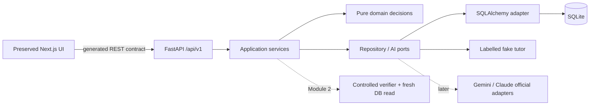

# Module 1 delivery report

Date: 2026-10-31. Scope: architecture and engineering foundation. No commit or push.

## 1. Audit and preserved work

Actual checkout: `C:\Users\soore\OneDrive\Dokumen\ChatGPT\Trace-v1`, `main`
tracking `origin/main`, starting HEAD `a3ea7434ec51f1d70a69ccc7096069d684733a8d`.
Existing frontend: Next.js 16.4.3, React/React DOM 19.3.0, TypeScript 5.9.3 strict,
Tailwind 4.3.3, Motion/GSAP. Root npm lockfile; no backend, migrations, product API,
frontend test suite or CI before this module. Dependencies were initially absent locally.

Existing product guidance distinguishes sample Express snippets from the planned
FastAPI platform. The sample homepage design/content is preserved. Tracked `src/app`,
`src/content`, `src/lib/motion`, `.claude/` and the generated Next.js instruction
block were compared with HEAD and preserved. One small `CodeLens` hydration fix
was necessary after the new browser checks exposed an existing reduced-motion bug;
the wrapper now stays identical during SSR/hydration without changing the design.
Pre-existing uncommitted
Codex setup/logging changes remain; this module did not edit the adapter, hooks or
trust state. Agent logs continue automatically in shared `.claude-logs/`.

Installed Next.js resolved to root `node_modules/next`. Its App Router Vitest,
Playwright, TypeScript and server/client component guides were read before the
corresponding changes. Async server
component testing belongs in browser tests, not unsupported Vitest rendering.

## 2. Selected stack and deviations

| Area | Selected / locked |
|---|---|
| Frontend | Existing Next 16.4.3 / React 19.3.0 / strict TS 5.9.3 / Tailwind 4.3.3 |
| Frontend testing | Vitest 5.0.5, React Testing Library 16.3.3, Playwright 1.64.1 |
| API typing | openapi-typescript 7.13.0 from real exported OpenAPI |
| Runtime | Python 3.13.5, uv 0.12.1; Node 24.x |
| Backend | FastAPI 0.162.0, Pydantic 2.14.2, Pydantic Settings 2.16.2 |
| Persistence | SQLAlchemy 2.0.55, SQLite, Alembic 1.20.1 |
| Server | Uvicorn 0.54.0 |
| Quality | pytest 9.2.0, pytest-cov 7.1.0, Ruff 0.17.3, strict mypy 1.20.2 |

Deviations are intentional:

- Node declarations moved from 20 to 24 to match the local runtime and Vitest's
  supported peer range; Next/React and UI dependencies were not upgraded.
- HTTPX2 2.16.0 replaces HTTPX in development dependencies because installed
  Starlette 1.10.0 explicitly deprecates its old HTTPX TestClient integration.
- No TanStack Query until a frontend learning API consumer exists.
- Only the fake AI adapter is implemented; install official Gemini/Claude SDKs
  when their real adapters are added. No unused SDKs, real keys or external AI calls.
- PostgreSQL is a future option; settings currently reject it instead of claiming
  an untested driver/migration setup works.
- The baseline migration deliberately has no learner tables. No session/auth system
  or partial product schema is represented as a complete feature.

## 3. Architecture and domain boundaries

Catalog owns published lesson versions; sessions own lifecycle/ownership; submissions
own immutable predictions and separate attempts; evaluation owns deterministic
correctness; tutoring owns bounded interpretations/help; verification owns observed
API/DB evidence; progress owns factual history/transfer/revisit. Only health and
infrastructure use cases are implemented now. The composition root binds concrete
adapters; domain code imports no HTTP, ORM or SDK implementation.

## 4. Decisions and database direction

Six ADRs cover monolith boundaries, sync FastAPI/SQLAlchemy/SQLite, vendor-neutral
AI, deterministic grading, controlled verification and append-only evidence.
Each records alternatives, tradeoffs, consequences and revisit criteria.

The proposed ER model relates learners → sessions → immutable prediction / attempts,
with pinned lesson versions, separate tutor interactions, verification runs/checks,
factual learning events and follow-up schedules. Transfer/revisit remain explicit.
Ownership needs a separate high-entropy credential; IDs and CORS are not authorization.
Completion must be server-controlled and based on real observed checks. Retention
and deletion/export policy must be decided before production learner collection.

Currently only `alembic_version` exists. SQLite connections enforce foreign keys,
bound lock waits and Python 3.13 transaction control. Services must explicitly
begin/commit writes; closing a scoped session rolls back uncommitted work. Startup
does not create tables. The new ignored local `backend/trace.db` was initialized
to `0001_foundation`; test databases are separate temporary files.

## 5. Implemented API and AI surface

- `GET /api/v1/health/live`: process liveness without a DB dependency.
- `GET /api/v1/health/ready`: DB query plus migration-head check; 503 on dependency failure.
- `/openapi.json` and `/docs`: development inspection of the actual implemented API.
- Consistent application errors, safe validation details, bounded correlation IDs,
  controlled CORS, JSON request logs, request-size and response-deadline limits.
- DI for settings, DB sessions, health service and a three-operation tutor protocol.
- Deterministic fake hints, evaluated-attempt explanations and possible-misconception
  analysis. Output is labelled `test_fixture` and interpretation-only. No public
  tutoring endpoint or live provider exists.

Lesson/session/prediction/attempt/hint/feedback/verification/progress/transfer/revisit
REST contracts are documented with **not implemented** status. They are absent
from generated OpenAPI, not stubbed with successful responses.

## 6. Files created and modified

Created:

- `docs/architecture/overview.md`, `data-model.md`, `api-contract.md`,
  `testing-strategy.md`, this report, and six numbered `adr/*.md` decisions.
- `backend/pyproject.toml`, `uv.lock`, `.python-version`, `.env.example`, `alembic.ini`,
  `alembic/env.py`, `script.py.mako`, `versions/0001_foundation.py`.
- `backend/app/main.py`; `core/settings.py`, `errors.py`, `logging.py`, `middleware.py`;
  `domain/health.py`; `repositories/health.py`; `services/health.py`;
  `db/base.py`, `session.py`, `migrations.py`, `health.py`;
  `api/dependencies.py`, `api/v1/router.py`;
  `schemas/errors.py`, `tutoring.py`; `ai/interface.py`, `ai/providers/fake.py`;
  package `__init__.py` files for these used boundaries.
- `backend/tests/conftest.py`, `tests/__init__.py`,
  `unit/test_settings.py`, `test_health.py`, `test_architecture.py`,
  `test_network_isolation.py`, `integration/test_api.py`, `test_database.py`,
  `contract/test_tutor.py`.
- `backend/scripts/export_openapi.py`, `backend/openapi.json`, `src/lib/api/schema.d.ts`.
- `.node-version`, `vitest.config.mts`, `playwright.config.ts`, `tests/setup.ts`,
  `tests/components/navigation.test.tsx`, `tests/e2e/homepage.spec.ts`,
  `.github/workflows/quality.yml`.

Modified: root `README.md` (setup and status), `.gitignore` (local DB/cache/browser
artifacts with `.env.example` exception; logs still tracked), `package.json` /
`package-lock.json` (test/type-generation tooling and Node types),
`eslint.config.mjs` (ignore Python environment/browser artifacts).
`src/components/code/code-lens.tsx` has the small reduced-motion hydration fix
described above; all other existing UI implementation files are preserved.
Running `next dev` for the hydration diagnosis also appended the installed Next.js
generated `nextjs-agent-feedback` block to `AGENTS.md` because the existing config
already enables `experimental.agentFeedback`. The original generated rules and all
session-log instructions remain intact; no commit was made by that instruction.

The pre-existing logging files shown by Git status are not new Module 1 edits.
Automatically growing `.claude-logs/` files are retained, with no manual history export.

## 7. Automated checks and actual results

Commands below are from `backend/` unless marked root. All results are local Windows
results; GitHub CI is configured, not remotely executed. Sandbox-only uv runs used
`UV_CACHE_DIR=backend/.venv/.uv-cache` (or `uv --cache-dir .venv/.uv-cache ...`
from backend). Ordinary unsandboxed runs use the default cache.

| Exact command | Result |
|---|---|
| `uv sync` / subsequent locked commands | Resolved/installed successfully; portable public-PyPI lockfile generated |
| `uv run --locked ruff check .` | Pass |
| `uv run --locked ruff format --check .` | Pass, 41 files formatted |
| `uv run --locked mypy` | Pass, 32 source files |
| `uv run --locked pytest --tb=short -o faulthandler_timeout=20` | **45 passed**, 97.48% statement/branch coverage |
| `uv run --locked alembic upgrade head` | Pass |
| `uv run --locked alembic current` | `0001_foundation (head)` |
| `uv run --locked alembic check` | No new upgrade operations |
| Root `npm run lint` | Pass without backend-environment warnings after scope fix |
| Root `npm run typecheck` | Pass; Next route type generation then `tsc --noEmit` |
| Root `npm test` | **3 passed** |
| Root `npm run build` | Pass; `/`, `/_not-found`, `/icon.svg` prerendered |
| `uv run --locked python -m scripts.export_openapi`; root `npm run api:types` | Pass; second generation identical SHA-256 hashes for both artifacts |
| Root `python -B -m unittest discover -s scripts/tests -v` | **23 passed**; logger files unchanged |
| Root `npm run test:e2e` | **2 passed** (desktop/mobile Chromium), no page errors, 41.9 seconds |

Backend tests exercise real temporary SQLite connections, fresh-session reads,
rollback after flush, uncommitted-work cleanup, foreign keys, migration downgrade
and re-upgrade, isolated databases, actual SQL execution failure/recovery, DI
overrides, invalid requests, 404/405/500/503/504 envelopes, CORS, body limits,
safe logging, all three AI contract operations and architecture import boundaries.

External connections are blocked by pytest-socket; loopback/Unix sockets are allowed
for Windows asyncio internals. An explicit test verifies external connections are
blocked before I/O. The restricted process sandbox itself prevented the local
socket pair; rerunning outside that sandbox with the test network guard intact
resolved the hang. HTTPX's installed deprecation was handled through HTTPX2.

Browser tests first exposed the existing reduced-motion CodeLens hydration mismatch:
the server emitted a wrapper that the client's early return removed. Keeping the
wrapper stable and suppressing only its animated children fixed the production
hydration error. The suite now asserts zero page errors, locked predictions,
selection/result behaviour and honest sample labels. Desktop/mobile screenshots
were inspected. No runtime-error assertion was removed or weakened to get a pass.

An additional real Uvicorn process was launched on an ephemeral localhost port,
checked over actual HTTP for `alive`, `ready` and `X-Request-ID`, then terminated.
This smoke check used the intentionally initialized local foundation DB, while
the automated suite used only temporary databases.

## 8. Status and limitations

**Implemented/tested:** backend foundation, migrations, health/errors/logging/limits,
fake-provider injection, generated API contracts, local setup and automated quality gates.

**Documented, not implemented:** all learner entities/endpoints/state transitions,
pseudonymous credential transport/access enforcement, deterministic lesson evaluation,
actual notes verification, progress/transfer/follow-ups and retention/deletion workflows.

**Planned:** one live provider adapter, later the other; PostgreSQL deployment;
TanStack Query with real lesson screens. No claims of teaching effectiveness,
retention improvement, arbitrary-code sandboxing or production readiness.

**Environment limitations:** Windows local checks do not prove Linux CI or
PostgreSQL behaviour. Next warns about an unrelated home-directory lockfile outside
this Git repo and correctly ignores it; no unrelated config/file was changed.
Existing ESLint 9 reports upstream deprecation during install; preserved to avoid
an unrelated toolchain upgrade. Production CORS/session protection, proxy deadlines,
abuse controls and provider budgets still need real deployment requirements.
The ASGI timeout cannot cancel a synchronous DB worker or undo committed effects;
DB waits and future write idempotency/transactions are separate safeguards.
CORS preflight rejections use Starlette's standard response; the documented JSON
error envelope applies to application API requests.

## 9. Recommended Module 2 sequence

1. Implement published lesson/version records for the Python field-mismatch lesson,
   owner-scoped pseudonymous credentials and pinned session creation/retrieval.
2. Migrate immutable prediction, append-only structured attempts/help and evidence
   tables; enforce concurrency/idempotency and same-session associations.
3. Implement the controlled notes request adapter: wrong `body` → actual 422/no row;
   corrected `content` → actual successful response and separately committed-row read.
   Explicitly test rollback, stale/fabricated success, DB outage and two-session isolation.
4. Add deterministic feedback and server-side completion; keep original predictions
   visible after help. Connect a real learning route through generated types and
   TanStack Query without replacing the marketing sample.
5. Add bounded recorded hints with the fake first; activate one official SDK only
   after timeout, token/output budgets, privacy policy and adapter tests are ready.
6. Add transfer/revisit records and factual progress after the original loop works.

No work is committed or pushed. Existing staged logging work remains staged;
Module 1 changes remain reviewable in the working tree.
