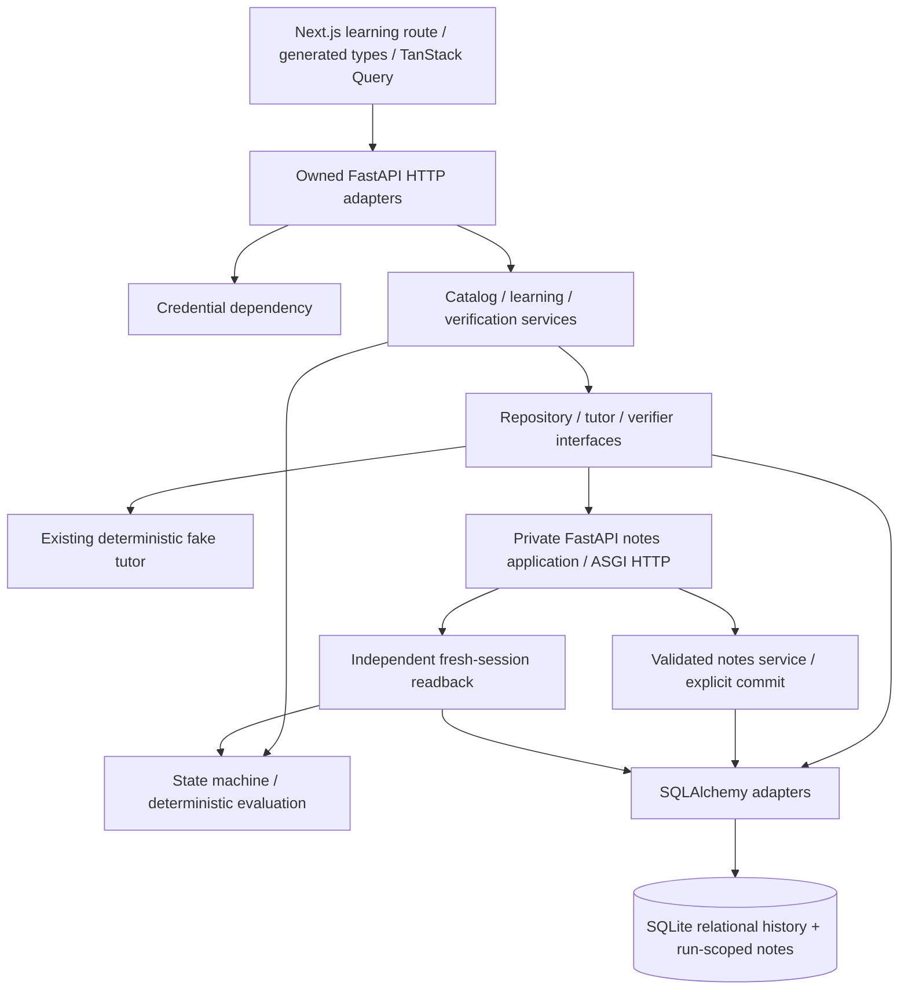
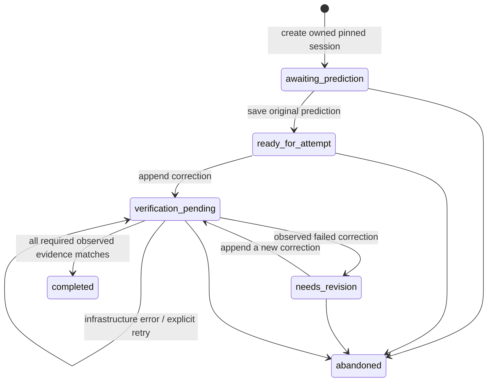

# Module 2 — core learning engine delivery report

Date: 2026-10-31. Local implementation and verification only. Nothing staged,
committed or pushed by this module; the earlier staged logging work is preserved.

## 1. Compatibility audit

Actual cwd/root: `C:\Users\soore\OneDrive\Dokumen\ChatGPT\Trace-v1`. Branch main
tracks origin/main; HEAD remains a3ea7434ec51f1d70a69ccc7096069d684733a8d.
Module 1 was present as uncommitted work, including its backend, tests, generated
contracts and docs. Five previously staged logging-related files were also present.
Read AGENTS, README, the four architecture documents, six ADRs and Module 1 report;
inspected application/settings/DB/DI, migrations, fake provider, API contracts,
frontend, tests and workflow. Installed Next.js page/server-client/Link docs were
read before modifying Next.js code.

Verified installed versions: Next 16.4.3, React 19.3.0, TypeScript 5.9.3, Tailwind
4.3.3, Python 3.13.5, FastAPI 0.162.0, Pydantic 2.14.2, SQLAlchemy 2.0.55, Alembic
1.20.1, HTTPX2 2.16.0. Frameworks were not upgraded. Existing marketing code/content
and its sample labels remain unchanged. The Module 1 CodeLens fix is preserved.
The historical Module 1 report, Codex adapter/hooks, Claude integration and trust
state were not edited for Module 2.

## 2. Implemented product features

One published lesson, fastapi-payload-mismatch / 1.0.0, now supports anonymous
ownership, version-pinned sessions, immutable predictions, multiple preserved
corrections, deterministic feedback, three recorded fixture-guidance requests,
actual API/DB verification, server-side completion and history after reload.
No arbitrary submitted Python is executed. No successful placeholder endpoint or
frontend response mock is used to stand in for persistence.

## 3. Final architecture



HTTP handlers contain no database implementation or domain grading. Domain rules
import neither FastAPI nor SQLAlchemy nor SDKs. Services depend on repository and
verifier ports. Composition dependencies choose adapters. Runtime notes use a
separate run-scoped table in the same DB, refining the earlier separate-DB concept;
this avoids cross-database consistency and preserves FKs. ADR-007 records that choice.

## 4. Schema and migrations

Thirteen tables: learners, learner_credentials, lessons, lesson_versions,
learning_sessions, predictions, attempts, tutor_interactions, verification_runs,
verification_checks, learning_events, runtime_notes and write_gate. All associations
are relational; only variable lesson content uses JSON. Check observations include
rendered JSON response/readback snapshots, not an entire history JSON document.

0002_learning creates these tables, FK/unique/check constraints and history guards.
0003_constraint_names repairs the unreleased draft's colliding composite names
without resetting rows. Its regression test populates a completed session first,
migrates, compares the entire history afterwards and verifies immutability remains.
The full FK integrity check and preserved trigger definitions are part of the repair.
Upgrade/downgrade/re-upgrade and schema-drift tests pass. Startup performs no DDL.
The local development DB is migrated to 0003_constraint_names and seeded; tests use
separate temporary databases.

## 5. Anonymous ownership

Credentials are 32-byte secrets.token_urlsafe values, with only SHA-256 digests
stored. The raw value is issued only via host-only HttpOnly/SameSite=Lax cookie at
/api/v1. Secure is default; explicit local-HTTP configuration permits non-Secure
cookies only for loopback origins. Expiration is configurable, revocation is real,
and valid credentials reuse the same learner. Tokens never enter ordinary JSON,
JS storage or application logs. IDs alone do not authenticate.

Writes require an exact allowed Origin and X-Trace-Client: learning-web. CORS is
credential-aware with explicit origins/headers. Owner-scoped lookups return identical
404 semantics for absent and foreign sessions. Public lesson projection contains
educational snippets, not evaluator configuration. ADR-007 documents alternatives
and operational limitations. No email/password/OAuth or recovery system was added.

## 6. Public endpoint inventory

Paths are relative to /api/v1; generated OpenAPI contains 15 paths / 17 operations.

| Operation | Method/path |
|---|---|
| Liveness/readiness | GET /health/live; GET /health/ready |
| Anonymous identity | POST /learners/anonymous; GET /learners/me |
| Revocation | POST /learners/me/revoke |
| Published lesson | GET /lessons/{lesson_id}, optional exact version query |
| Session | POST /sessions; GET /sessions/{session_id} |
| Abandon | POST /sessions/{session_id}/abandon |
| Original prediction | POST and GET /sessions/{session_id}/prediction |
| Attempts | POST and GET /sessions/{session_id}/attempts |
| Guidance | POST /sessions/{session_id}/hints |
| Verify | POST /sessions/{session_id}/attempts/{attempt_id}/verify |
| Verification history | GET /sessions/{session_id}/verifications |
| Progress | GET /sessions/{session_id}/progress |

The actual private /notes route exists only in the controlled ASGI application;
it is not an unrestricted public runtime endpoint. Public inputs use bounded,
extra-forbid schemas and explicit response models. Learning responses are no-store.
Module 1's safe error envelope and request correlation remain.

## 7. Learning state machine



No separate committed CREATED intermediate state is necessary. Completed/abandoned
sessions are terminal; harmless idempotent reads/replays remain possible. The browser
cannot submit a status. Completion requires a real passed run and completion time.
DB triggers also enforce state/pin/completion constraints.

## 8. Prediction immutability

Exactly one row per session. Original selection and reasoning, including whitespace,
are retained. Same-key/same-payload retries return the same record. A changed payload
or second original with another key conflicts. UPDATE/DELETE are rejected by DB
guards. Guidance and corrections never amend the original. Tests read it through
new sessions and after database reopen/browser reload.

## 9. Attempts, assistance context and retries

Each correction has its own UUID, sequence, mapping, explanation, timestamp, key and
server-derived guidance-request count. Unique session/number and session/key constraints
protect concurrency. Explicit transactions reserve SQLite's writer with a DB gate
before checking keys/counters; real independent-session tests exercise replay races.
Different payloads cannot reuse a key. Failed and revised attempts stay distinct.

Verification returns an existing final passed/failed run without another note write.
Same-key error replays stay stable, including while another retry is pending. A
new key after error can request a new isolated run. Active pending work conflicts;
stale interrupted work can be recorded as an error after the recovery deadline.
These are server rules, not frontend flags.

## 10. Actual body evidence

The integration suite and desktop/mobile browser test submit a saved body mapping
through the genuine private FastAPI/Pydantic route:

```json
{"title":"Trace verification note","body":"Understanding request validation"}
```

Observed HTTP status: 422. Native validation contains missing:content and
extra_forbidden:body. An independent fresh-session query finds zero runtime_notes
for that exact run ID. Stored check sources identify ASGI HTTP and fresh DB read.
The run is failed; the session needs revision. This is observed rejection/no-row
evidence, not a conditional fabricated response.

## 11. Actual content evidence

The saved corrected mapping sends:

```json
{"title":"Trace verification note","content":"Understanding request validation"}
```

Observed HTTP status: 201. The notes service commits before returning. A different
SQLAlchemy session reads one row for that run and compares the exact ID/title/content.
The response fields must also match the fixture and readback; contradictory/forged
success is an error. All mandatory checks match, the run passes and the server saves
completion. Repeating the completed verification creates no duplicate note.

INSERT/commit failure, unavailable readback, inconsistent response/row data and DB
outage are tested separately. Unavailable readback is never represented as zero rows.
Infrastructure errors never rewrite a learner attempt into an incorrect grade.

## 12. Tutor fixture behaviour

The existing three-operation provider interface/fake is reused. Only bounded hint
requests are exposed for the lesson. The server chooses levels 1–3 and records
attempt context, sequence, fake provider/fixture ID, prompt version, outcome and time.
Failed provider requests are recorded without invented text. Help events and original
predictions stay separate. The UI says fixture guidance and never claims a Gemini
or Claude response. Zero Trace hints does not establish absence of outside help.

## 13. Frontend learning route

/learn/fastapi-payload-mismatch uses the existing design tokens/components, readable
code windows and accessible native form controls. TanStack Query performs real
server reads/mutations through one typed generated-contract client. Requests include
cookies and the client header, have a deadline, and preserve retry keys/drafts on
failure. Only the non-secret session link is kept in browser storage. Reload resolves
the credential and retrieves the saved server history. Stale/inaccessible links have
an explicit recovery path. Loading/errors do not become successful results.

The screen contains scenario/objective/code, prediction form/locked original,
constrained correction, fixture guidance, all attempts, source-labelled expected
and observed checks, deterministic feedback and factual completion/progress. Live
regions announce results. Desktop/mobile completed-screen captures were inspected.
The existing marketing homepage/demo remains unchanged from Module 1.

## 14. Files created and modified

New backend files: domain/learning.py; db/models.py and learning.py;
repositories/learning.py and verification.py; services/identity.py, catalog.py,
learning.py, notes.py, verification.py; api/presentation.py and v1/learning.py;
schemas/learning.py; verification/__init__.py and asgi_notes.py; scripts/seed.py and
e2e_server.py; migrations 0002_learning_learning_engine.py and 0003_constraint_names.py.

Extended existing backend files: main.py, core/settings.py/errors.py,
api/dependencies.py, db/base.py, alembic/env.py, pyproject.toml, uv.lock, .env.example,
test fixtures and the Module 1 API/schema inventory tests. HTTPX2 moved from dev-only
to runtime dependencies for ASGI verification; no live provider SDK was added.

New frontend/test files: src/app/learn/fastapi-payload-mismatch/page.tsx;
src/components/learning/{forms,evidence,workspace}.tsx; src/lib/api/client.ts;
tests/fixtures/learning.ts; components/learning.test.tsx and api-client.test.ts;
e2e/learning.spec.ts. Added backend unit/test_learning_domain.py and integration
test_learning.py, test_learning_failures.py, test_retry_replay.py.

Regenerated backend/openapi.json and src/lib/api/schema.d.ts. Updated package/lock,
Playwright/Vitest configuration, CI (Python backend for browser tests), README,
four architecture docs and .gitignore's example-file exception. Added .env.local.example,
ADR-007 and this report. Created an ignored local backend/.env from the example
only after confirming it did not exist. Existing configuration was not overwritten.
No logging-adapter, trust, marketing-design or Module 1 report changes.

## 15. Tests written

The suite covers all credential states/hash/logging/cookie/origin rules; lesson
seed/hash/pinning/immutability/projection; state and abandoned/completed rules;
original preservation; append/retry/conflict/concurrency behaviour; actual 422/no-row
and 201/fresh-row; repeated/foreign/old-run isolation; forged success flags and
contradictory response fields; real commit/readback failures; interrupted-run recovery;
hint progression/limits/errors; reload/reopen; architectural boundaries.
Frontend tests cover forms, locking, guidance, feedback/evidence/error/history,
progress and session resume, as well as credentialed requests and stable retry headers.

## 16. Exact executed commands and outputs

Backend cwd is backend/; root commands are marked. Sandbox-only runs used
`uv --cache-dir .venv/.uv-cache run --locked ...` where necessary; ordinary terminal
commands below use the normal cache. Windows TestClient needed loopback permission
outside the restricted process sandbox; pytest's external-connection guard remained on.

| Command | Actual final output/result |
|---|---|
| uv sync | Resolved 40 packages; existing compatible locked dependencies |
| uv run --locked ruff check . | All checks passed |
| uv run --locked ruff format --check . | 64 files already formatted |
| uv run --locked mypy | Success: no issues found in 51 source files |
| uv run --locked pytest --tb=short -o faulthandler_timeout=25 | 95 passed in 75.06s |
| uv run --locked alembic upgrade head | Success |
| uv run --locked alembic current | 0003_constraint_names (head) |
| uv run --locked alembic check | No new upgrade operations detected |
| uv run --locked python -m scripts.seed | Published fastapi-payload-mismatch 1.0.0; hash c3231631019829efe5cd1882b361cf22b8bdcdd51caca2a67a60dd73b326707e; repeated seed preserved the row |
| Root npm run lint | Pass, no lint errors |
| Root npm run typecheck | Next route types generated; tsc --noEmit passed |
| Root npm test | 3 files / 14 tests passed |
| Root npm run build | Pass; marketing, not-found, icon and learning route prerendered |
| uv run --locked python -m scripts.export_openapi; root npm run api:types | Two generations have identical SHA-256 hashes for both artifacts; 15 public paths |
| Root npm run test:e2e | 4 passed (50.7s) |
| Root python -B -m unittest discover -s scripts/tests -v | 23 tests, OK |

Tests were not declared successful before execution. Early test failures identified
the composite naming issue and an ambiguous browser evidence selector. The constraint
repair is data-preserving and regression-tested; the selector now asserts the exact
validation summary. No runtime-error or correctness assertion was weakened.

## 17. Coverage

Final backend statement/branch coverage: **98.82%**, compared with the Module 1
97.48% baseline. New domain rules have 100% measured coverage. This measures code
execution, not teaching effectiveness; it is not proof against all possible bugs.

## 18. Browser results

Both desktop Chromium and Pixel 7 Chromium completed the real learning journey:
cookie identity, published lesson, session, locked prediction, body correction,
real 422/zero-row observations, recorded hint, content correction, real 201/exact
fresh-read evidence, saved completion, reload and original/both attempts/hint retained.
Both preserved-marketing smoke tests passed too. No page errors were observed.

No successful API response is mocked. The backend uses a new temporary fixture DB;
the learning test aborts API calls outside the fixture origin. Credential-bearing
traces are off; screenshots contain visible fixture learning evidence only. CI pins
the browser API base to loopback. GitHub-hosted CI has not run because nothing was pushed.

## 19. Status, limitations and Git state

**Implemented/tested and passed:** the complete first lesson and all Module 2
acceptance paths described above; Module 1 regression checks remain passing.

**Documented only/planned:** public deployment/PostgreSQL, live providers, account
recovery, retention/deletion/export tooling, transfer/revisit and curriculum authoring.
No real participant learning improvement, Gemini call or Claude call is claimed.
Local HTTP requires the explicit development flags and matched browser/API hostnames.
An ASGI timeout cannot undo a synchronous worker's already committed side effect;
run isolation, idempotency and independent readback remain necessary.
The schema-repair migration is an online SQLite operation. No production rollout or
arbitrary-code execution sandbox was implemented. No remaining Module 2 blocker.

**Git categories:**

- Pre-existing staged: .codex/hooks.json, AGENTS.md, scripts/CODEX_LOGGING.md,
  scripts/codex_session_log.py, scripts/tests/test_codex_session_log.py. Their earlier
  staged snapshots remain; no new paths were staged by Module 2.
- Unstaged tracked changes: .gitignore, AGENTS.md, README.md, eslint.config.mjs,
  package-lock.json, package.json, scripts/CODEX_LOGGING.md and CodeLens. AGENTS,
  logging-document and CodeLens differences predate Module 2; their presence does
  not mean this module rewrote them. Root config changes include Module 1 tooling.
- Untracked: shared automatic .claude-logs files, .env.local.example, .github/,
  .node-version, backend/, docs/, Playwright/Vitest/test files, src/app/learn/,
  src/components/learning/ and src/lib/api/. These include both modules because
  Module 1 was never committed. Ignored DB/env/cache/browser artifacts stay excluded.

The shared log directory remains unignored. No per-agent log directory was created.
No commit, push, branch switch or trust-state change was performed.

## 20. Recommended Module 3

First review the real lesson with a small human walkthrough without claiming measured
improvement. Then add a deliberately different transfer exercise and explicit phase
records, factual follow-up scheduling, and owner-controlled history export/deletion.
Improve pending-run recovery UX and review consent/retention before participants.
If live guidance is needed, implement one official provider adapter with validated
outputs, timeout/token/cost limits, privacy controls and contract tests; keep correctness
and completion deterministic. Public deployment needs a separate operational/security
plan and database/backup validation. Do not broaden into arbitrary code execution.
