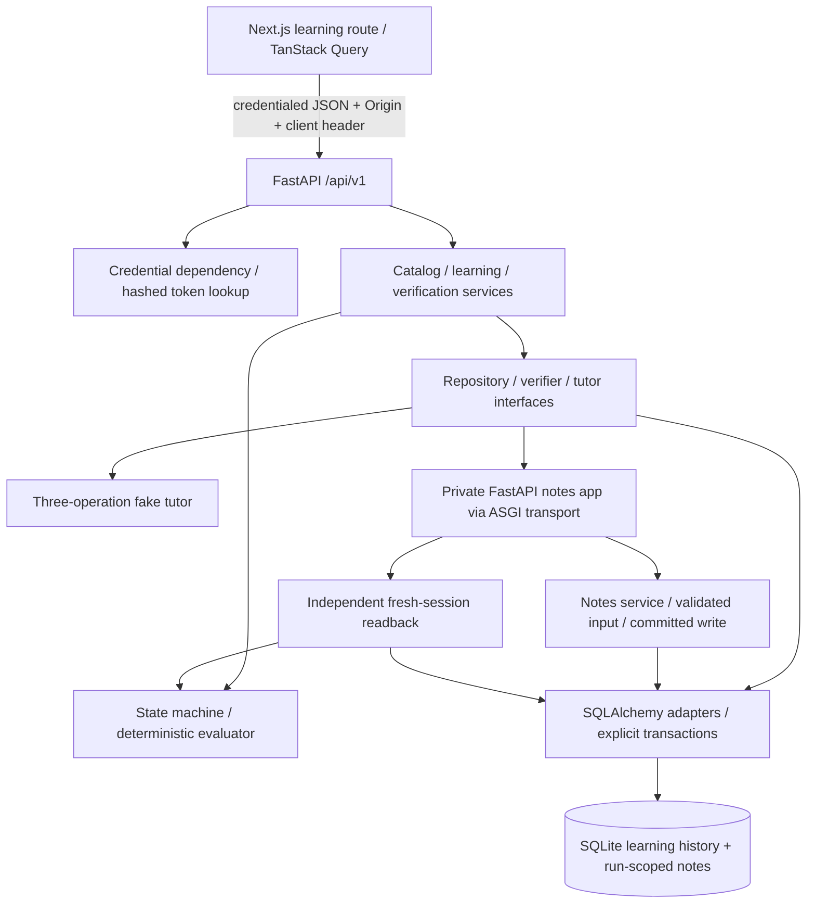
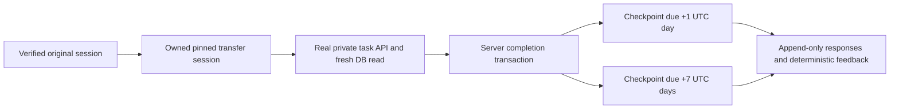

# Trace architecture

## Current account foundation (Module 4)

Supabase Auth is the credential/session authority. Trace retains SQLAlchemy/SQLite
and its existing boundaries: verified JWT → internal user/subject mapping → trusted
database roles → exclusively owned learner → existing learning services. New users
receive learner only; creator/admin grants are audited local operator actions.
There is no Supabase Data API or application database migration.

Official browser/SSR SDK clients share cookies. Next 16 `proxy.ts` refreshes them;
protected server components verify claims under Suspense and wait for a real
request before SDK clock reads. The central browser client sends access tokens;
FastAPI independently verifies ES256/RS256 against bounded cached JWKS. Invalid
supplied Authorization fails without guest fallback.

Account inspection leaves the learner unallocated, allowing explicit guest claim
before starting separate authenticated learning. One ownership association
preserves every history row while atomically revoking guest credentials. Conflicting
histories remain separate. See [ADR 009](adr/009-supabase-account-identity.md),
[authentication](authentication.md), [setup](account-setup.md) and the
[Module 4 report](module-4-report.md). Historical audits below describe their own
delivery-time state.

Trace develops independent code-reading and engineering judgment through a bounded
scenario → prediction → investigation → correction → evidence → reflection loop.
Modules 2 and 3 implement original, transfer and scheduled retrieval activities. It is not a chatbot, a code
executor or a course-authoring platform.

## Historical Module 2 audit

The actual checkout remains `C:\Users\soore\OneDrive\Dokumen\ChatGPT\Trace-v1`,
branch main tracking origin/main, HEAD a3ea7434ec51f1d70a69ccc7096069d684733a8d.
Module 1 and staged logging changes were present and preserved. Installed versions
were checked again: Next 16.4.3, React 19.3.0, TypeScript 5.9.3, Tailwind 4.3.3,
FastAPI 0.162.0, Pydantic 2.14.2, SQLAlchemy 2.0.55, Alembic 1.20.1, Python 3.13.5.
The installed Next.js page, server/client and Link guides were read. No framework
upgrade or marketing-page replacement occurred.

The backend is still a modular monolith. The existing Express marketing sample is
preserved and remains labelled sample output. The real lesson is a separate route:
`/learn/fastapi-payload-mismatch`. TanStack Query now manages actual server state;
OpenAPI generates its request/response types. No vendor SDK is installed or called.

API handlers validate/translate HTTP and present explicit public projections. Services
own use cases and transaction scope through ports. Domain code contains no routers,
ORM or provider SDK. Concrete adapters depend inward; API dependencies are composition
bindings. App resources are per instance and disposed by their owner, not globals.

## Domain responsibilities

| Boundary | Implemented responsibility |
|---|---|
| Identity | Random opaque cookie, digest storage, expiry/revocation, authenticated owner |
| Catalog | Immutable published lesson versions, content hash, idempotent seed |
| Sessions | Exact version pin, owned reads, server-only lifecycle/completion |
| Submissions | One immutable prediction, append-only numbered attempts, retry identity |
| Evaluation | Deterministic mapping/HTTP/readback consistency checks |
| Tutoring | Three progressive recorded fixture requests; errors recorded separately |
| Verification | Real Pydantic route, committed note, fresh read, run-scoped evidence |
| Progress | Stored prediction/attempt/help/run/check/event facts; no learning scores |

## Ownership and browser boundary

Only SHA-256 digests of 32-byte random credentials are stored. The raw token is
issued in an HttpOnly, SameSite=Lax, host-only cookie at `/api/v1`, never ordinary
JSON/JS storage/logs. Secure is the default; explicit local-HTTP settings allow a
non-Secure cookie only with loopback frontend origins. Credentials expire after a
configurable interval (default: 30 days) and can be revoked. The protected bootstrap
renews a still-valid credential in its latter half of life; expiry/revocation is
checked again inside the write transaction. IDs are not auth.
The public lesson projection is educational content; owner-specific routes require
credentials and return the same 404 for another owner's session or an absent one.

All learner writes require an exact configured Origin and `X-Trace-Client:
learning-web`. CORS permits credentials only for explicit origins and headers.
Use matching frontend/API hostnames locally. The browser stores only the non-secret
session ID; reload always fetches owner-scoped state from the server. See ADR-007.

## Actual first-lesson flow

1. Bootstrap/reuse an anonymous identity and retrieve published lesson 1.0.0.
2. Create a session pinned to its version UUID. Save the prediction once.
3. Accept only `rename_payload_field` with `body` or `content`; never execute source.
4. Save a distinct attempt and its server-recorded guidance-request count.
5. Reserve a unique verification run, then close that transaction before execution.
6. Send the constructed fixture payload through a real private FastAPI `/notes`
   route using HTTPX2 ASGI transport. This executes Pydantic `extra="forbid"`, the
   injected notes service, SQLAlchemy INSERT and explicit commit.
7. Open a separate repository context/SQLAlchemy session and read only that run's
   note. `body` yields actual 422 plus missing/extra-field errors and zero rows.
   `content` yields actual 201 and a committed row with matching ID/title/content.
8. Persist individual observations and deterministic feedback. Complete the session
   only for mandatory matching evidence. Dependency failures/inconsistent evidence
   are errors, not learner mistakes. AI never controls these decisions.

Runtime notes use a dedicated run-scoped table in the same DB, rather than a second
DB, so FKs and transaction consistency remain straightforward. The private ASGI app
is not mounted on the public server and cannot execute arbitrary learner requests.
This refinement to the earlier separate-database concept is recorded in ADR-007.

## Concurrency and failure handling

Explicit write transactions first reserve SQLite's writer using a singleton gate.
This serializes idempotency/counter/state decisions across independent sessions;
constraints remain the final guard. No process-local lock is relied upon.
Finalized history is immutable in both the public API and SQLite triggers.
A final passed/failed verification is replayed without another note. Same-key error
retries replay the error; a deliberate new key may run again with a fresh run ID.
Active concurrent verification conflicts. Stale incomplete runs can be retired as
infrastructure errors after the recovery deadline, without invented observations.

Readiness checks connectivity and current migration head. Startup performs no DDL
or seeding. CLI migrations/seed are explicit; Playwright uses a separately documented
temporary fixture bootstrap. Request logs exclude raw paths, bodies, headers and
exception strings. Responses for learning routes are not cacheable. DB waits,
request bodies and response waiting are bounded; an ASGI deadline cannot cancel an
already-running synchronous worker or undo its commit.

## Local and future deployment

Run Next at localhost:3000 and Uvicorn on 127.0.0.1:8000 (reachable as localhost).
The API client uses the browser hostname on port 8000 unless its public API-base URL
is configured. No credentials or AI keys belong in public environment variables.
Keep the SQLite file local and out of Git. PostgreSQL, public deployment, abuse
controls, account recovery, retention/deletion tooling and real providers remain
future work. Do not infer learning improvement
from the engineering verification tests.

See the data model, API contract, testing strategy, seven ADRs and Module 2 report.
The Module 1 report is a historical record and has not been rewritten.

## Module 3 — transfer and return

Work began only after PR #1 was verified merged into main. The new branch is
feat/trace-module-3-transfer-retention. The nested task lesson has its own stable ID,
published version/hash, prediction and append-only attempts. Transfer availability
requires an owned completed original; prediction and observed flat-request rejection
precede the nested correction. The original lesson and canonical hash are unchanged.

The shared verification orchestration selects its trusted adapter by the pinned
lesson identity. A private /tasks FastAPI route validates TaskMetadata/TaskCreate,
commits runtime_tasks and independently reads that run through a fresh session.
HTTP/body/priority/row-ID evidence must agree. Errors cannot complete a session.
Task and note runtime tables never substitute for each other's evidence.

Session/version rows already identify original and transfer phases. The journey API
projects phase availability, completion, attempt counts and last completed activity;
it does not duplicate mutable phase state in another table. Checkpoints are separate
persisted activities linked to their completed transfer session. Scheduling shares
the completion transaction and is unique per source session/ordinal. An interrupted
finalization cannot leave a completed transfer without its schedule.

UTC-aware injected time controls due boundaries (+24/+168 hours); production uses
UTC now, while authentication still uses real security time. There is no public clock
override. Missed checkpoints remain due. New shipping/report questions are versioned
with hashes, have hidden answer keys, and reveal feedback only after submission.
Responses are immutable, numbered and idempotent; first correct response completes
once. The existing SQLite write gate/ownership/CSRF/error boundaries are reused.

Both learning routes show the small factual journey/revisit panel. Server-owned
history can restore a session even when its optional local-storage link is absent.
Refreshing checkpoints recalculates availability on the server. No mastery, retention
percentage, delivered reminder or empirical benefit is claimed. See ADR-008 and the
Module 3 report for the credential-lifetime adjustment and retention limitations.
