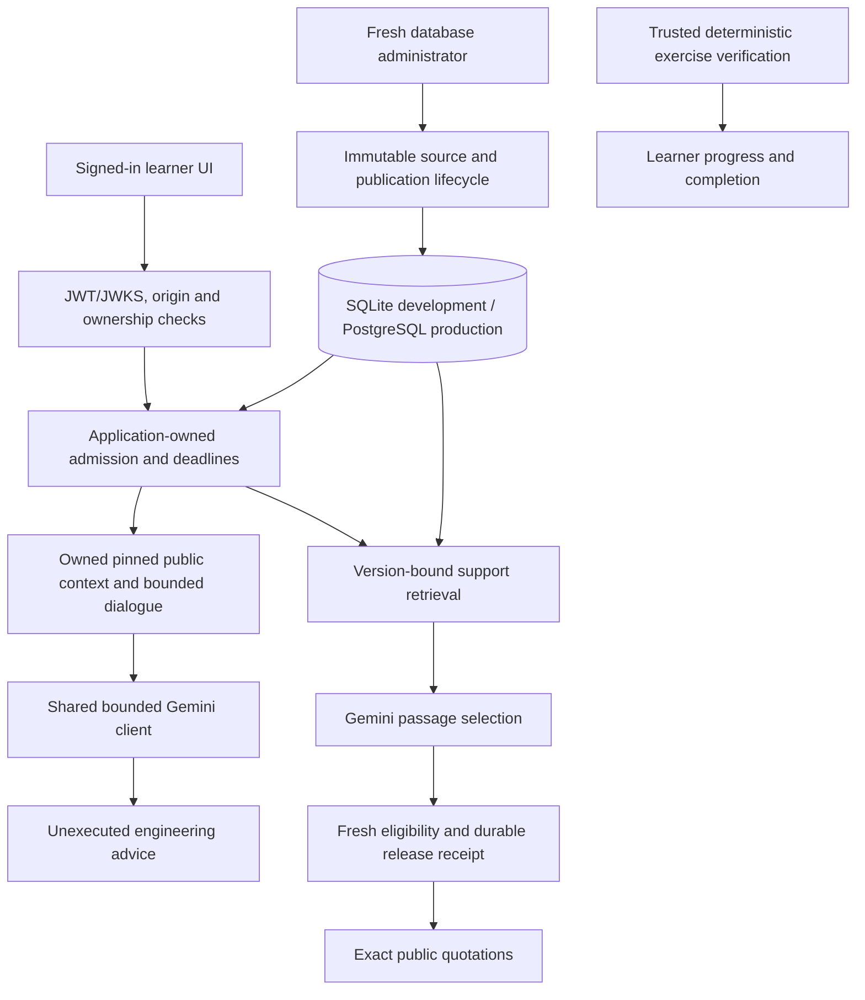

# Trace AI platform implementation and validation

Date: 2026-11-03. This report distinguishes implementation, local verification,
live-provider verification, real-account use and public deployment. Passing local
tests does not establish a production service.

## Executive status

The existing Trace learning architecture has been extended with portable private
Gemini activation, conversational engineering advice, genuine embedding and
hybrid-retrieval infrastructure, durable knowledge governance, PostgreSQL,
shared admission/accounting, authentication hardening and deployment artifacts.
Deterministic verification remains the sole completion authority.

Two conversational questions and one sourced support question succeeded through
the signed-in localhost UI using the approved Gemini profile. The separate live
embedding experiment returned `rate_limited`; no semantic quality result was
fabricated and production vector retrieval remains disabled. No backend hosting
resource was provisioned, no backend service deployed and no billing enabled.
The repository's existing Vercel integration automatically builds frontend
previews after authorized Git pushes; those previews are not a deployed backend.

| Requirement | Status | Evidence boundary |
| --- | --- | --- |
| A: private Gemini onboarding and diagnostics | IMPLEMENTED AND VERIFIED | Local configuration checks, portable/PowerShell launchers and deterministic tests; Sohaib must repeat acceptance on his machine |
| B: conversational tutor and existing panel adapter | IMPLEMENTED AND VERIFIED | Focused security tests, frontend tests, desktop/mobile fixture journeys and two genuine signed-in Gemini UI responses |
| C: embedding contracts, Gemini adapter, immutable index and hybrid ranking | IMPLEMENTED, NOT LIVE-VERIFIED | Genuine provider operation implemented; artificial-vector contract tests pass; live embedding request was rate-limited |
| C: semantic quality comparison and production activation | BLOCKED BY EXTERNAL DEPENDENCY | Free embedding quota and independently reviewed benchmark labels are missing; no production activation |
| D: immutable archive, approvals, publication and receipts | IMPLEMENTED AND VERIFIED | Disposable SQLite and PostgreSQL, restart, tampering, concurrency, expiry and revocation tests; no real corpus publication or role grant |
| Customer copy for the expanded tutor | BLOCKED BY EXTERNAL DEPENDENCY | The exact replacement article is a draft awaiting human review; the preserved pilot paragraph describes the older guided mode and must not be treated as the new conversation contract |
| E: PostgreSQL, shared controls, container and HTTPS boundary | IMPLEMENTED AND VERIFIED | Actual disposable PostgreSQL 15/17 and TLS/container validation; hosting-specific behavior remains unverified |
| E: cloud release, monitoring and hosting configuration | IMPLEMENTED, NOT LIVE-VERIFIED | Terraform/provider-schema and workflow guards validated; no plan/apply, cloud identity, alert or deployment executed |
| F: authentication and ownership implementation | IMPLEMENTED AND VERIFIED | JWT/JWKS/security tests and existing real-account JWT/owned UI use; this does not certify fresh login, mail delivery or Google OAuth |
| F: external Supabase email/Google/session acceptance | BLOCKED BY EXTERNAL DEPENDENCY | Dashboard ownership and manual acceptance checklist required |
| G: API contracts, setup and operational handoff | IMPLEMENTED AND VERIFIED | Actual application export, generated types, safe templates and source-derived instructions |

The fresh full backend gate passed 4,212 tests. Final browser and release
metadata are recorded below. This document is not an
approval to provision resources or publish a retrieval strategy.

## Repository and preservation

Starting `origin/main`: `9a9d2e1af88b0666fde816fdb3214130518dff83` (merged PR #18).
A later fetch initially confirmed that main had not advanced. Sohaib subsequently
merged PR #19 at 10:02:59 UTC as
`c3b9d784cc511d12e3a4980ef4ed760f0e39f51c`. Its source tree matched the reviewed
onboarding/tutor milestone; PR #20 was then retargeted to main. That GitHub merge
was performed by `Sohaib7932`, not this agent.
Working branch: `codex/trace-ai-platform-completion`.

The exact [file inventory](trace-ai-platform-files.json) lists 181 intended
changed files: 126 additions and 55 modifications, with no Git deletions.
It includes all dependent branches relative to the starting main commit and
excludes private runtime state and the four preserved unrelated logs.

Local milestones already recorded:

- `935601f`: portable private Gemini setup and safe diagnostics.
- `28c73ba`: conversational tutor and panel integration.
- `e5ea514`: schema/service boundary and optional deadline hooks.

Implementation and review provenance:

| Milestone | Commit | Review |
| --- | --- | --- |
| Onboarding/conversation foundation | `e5ea5145383e00f9bf056ff5329c62cfa4cc6867` | [PR #19](https://github.com/Sohaib7932/trace/pull/19), merged by Sohaib |
| Governed backend | `01261b07f233126deb8629cebbba8d3cece77378` | [PR #20](https://github.com/Sohaib7932/trace/pull/20), targets main |
| Modern Docker inspection | `4bd6c2fec078bac8794bd731a9e2cdc5bb63a9e2` | Existing PR #20 branch |
| Final PostgreSQL TCP readiness | `33c74956a47056c6ae223dde0a3fe73fce528a68` | Existing PR #20 branch |
| Reproducible historical checkout bytes | `5a73995b0691512c62081b5ad1ffd6fb569105da` | Existing PR #20 branch |
| Deployment artifacts and handoff | `9f32b3eedc2852f28db5367031f594b031915988` | [PR #21](https://github.com/Sohaib7932/trace/pull/21), depends on #20 |
| Final integrated implementation | `26fedf24596076f314aeb6c3bdc575c64a2d6e77` | Feature-branch integration of the verified repairs |

The following documentation-only commit records this report and inventory. Its
own future hash cannot be embedded in the file; the final handoff and PR head
identify it. Published history was preserved. Feature-branch integration did
not merge either remaining PR or change main. Review/merge order is #20, then
#21, retargeting #21 to main after #20 merges.

Historical migrations 0001–0007, lesson definitions/hashes, trusted exercise
runtimes and deterministic verification implementations were preserved. There
was no reset, clean, stash, force push, history rewrite, automatic merge,
learner-data deletion or private environment-file rewrite. Genuine cohort logs
remain included under the repository policy. Four pre-existing injected-context
log files remain untracked and preserved; they are not promoted as user sessions.

## Architecture and API integration

The public tutor path is extended, not duplicated:
`POST /api/v1/sessions/{session_id}/tutor/ask`. Existing `{question}` requests
retain finite authored-guidance behavior. Explicit `mode:"conversation"`
supports natural questions, styles, optional code and bounded history. The
backend builds context from an owned pinned session and reauthorizes after
external work. Responses fix `execution_status:"not_executed"`,
`interpretation_only:true` and `can_complete_lesson:false`.

The existing panel supports natural questions, follow-ups, direct/Socratic
styles, explicit worked examples, loading, stopping and clearing. History is
client-page/session memory, not permanent evidence: no more than six bounded
messages are sent. Account/session changes clear it. AI POSTs are not silently
replayed after 401. Responses are rendered as text, not executable HTML.

Open-ended advice can infer a likely prediction or repair from visible code,
including before prediction. It is not the former finite guidance's pedagogical
answer-withholding guarantee. Hidden evaluator data is not supplied. Schema and
text guards reject bounded classes of privacy/authority violations; they are not
a formal semantic proof that arbitrary model prose contains no bad inference.
Advice never runs code, writes verification or marks completion.

`POST /api/v1/support/ask` remains authenticated and returns exact eligible source
quotations. Requests cannot select files, source scope, vectors, model IDs or
account data. Fresh source revalidation performs no second query-embedding RPC.
Production requires a published database manifest and a committed minimal
receipt before releasing quotes; receipt failure withholds the answer.

Seven new operations beneath `/api/v1/admin/knowledge` support revision
ingestion/history/transitions, explicit historical-review adoption, publication,
receipt inspection and server-selected index building. They require fresh
database-admin authorization, allowed origin, bounded operations and no-store
responses. Building an index does not activate it. Bulk history responses have
an explicit 256 KiB administrative cap; learner response bounds are unchanged.

Current OpenAPI: **31 paths / 33 operations**, including all **24 existing
paths / 26 operations** and seven protected administration operations. The
pre-existing operation objects remain unchanged relative to the conversational
milestone. Exports: `backend/openapi.json`, `docs/api/gemini-openapi.json`;
generated types: `src/lib/api/schema.d.ts`. The historical original export and
handoff remain historical. There is no new public generation endpoint, competency
score, automatic assignment or automatic publication.

Concrete database construction stays in application/dependency composition.
HTTP handlers use services; services use repository/embedding protocols and
schemas. Existing architecture tests remain enabled and unchanged.

## Semantic retrieval evidence

Selected embedding model: `gemini-embedding-001`, 768 dimensions, separate
document/query task types, manual L2 normalization and immutable profile/input/
source/chunk/vector/index digests. Standard embedding requests use the existing
Google SDK; they do not use the paid asynchronous Batch API. A local MiniLM
alternative was considered and not installed. See the
[semantic decision](../architecture/adr-semantic-retrieval.md).

The index is a derived artifact. Approved, current source snapshots are always
the citation authority. Exact cosine ranking and configurable reciprocal-rank
fusion are implemented with lexical fallback. Incompatible model/profile,
dimension, source or index identities fail validation. Production rejects
unreviewed vector ranking; internal experiments require explicit configuration.

The live experiment was capped at two RPCs, 113 public/synthetic items and a
16,000 reserved-input estimate, with zero retries or paid fallback. It returned
`rate_limited` after 9.58 seconds. The CLI did not emit failure counters, so actual
RPC/item/token counts are unknown within those caps. No usable persisted index
or semantic performance result was produced. See
[the safe attempt record](semantic-retrieval-live-attempt-2026-11-03.json).

The unchanged lexical 94-case engineering-reference benchmark was rerun:
65/69 answerable cases had sufficient retrieved evidence at three passages;
macro recall 0.93478, MRR 0.92512. The deterministic oracle produced 21/21
expected abstentions, four expected unavailable cases and no unsupported
citations. These are engineering-reference/oracle results, not independent gold
labels or measured Gemini semantic judgment. The complete report is
[the lexical evaluation](trace-platform-lexical-evaluation.json).

Google does not expose an immutable embedding-weight revision through this
tested SDK response; unknown revision/usage stays unknown. Cached vector bytes
and their provenance are immutable; this is not a claim of immutable remote
model weights or provider billing measurement.

## Durable knowledge and operational controls

Shared migration `0008_knowledge_archive` adds seven append-only archive tables.
They retain canonical original/normalized content, versioned chunks, chained
lifecycle events, lexical artifacts, manifests/publications, genuine derived
embedding artifacts and minimal release receipts. SQL constraints and immutable
guards protect history. New revisions and publications preserve earlier values.
Current source eligibility is checked again after slow provider work.

Human review, production approval and technical validation are distinct. Existing
pilot review can be adopted only through an explicit authorized operation that
preserves historical attribution. It does not fabricate a new human review or
automatically publish. No real user was granted admin privileges in this task.

The exact approved nine-article/nineteen-passage pilot corpus was not rewritten.
Its tutor paragraph describes the legacy guided mode, not the new conversation
capability. A strict draft replacement and review notes exist under
`backend/app/support/drafts/`; it must be reviewed before serving. Drafts, agent
logs, private files and arbitrary paths are not ingested by the learner retriever.
Production corpus publication and support escalation destination remain owner
acceptance steps; no contact or support policy was invented.

Shared migration `0009_durable_ai_controls` adds six accounting/admission tables.
Short transactions reserve provider attempts and shared rate/concurrency leases;
no learner write transaction spans provider work. A stable operator scope is
cumulative, not an invented daily quota. Duplicate attempt identities do not
repeat RPCs. Restart does not refund or expire unknown work. Reconciliation
requires a freshly authorized administrator and proof the worker stopped.

Application-owned ingress jobs reserve before scheduling and retain ownership
through queued/cancelled acquisition and actual final SQL release. Worker and
provider cancellation retains real leases. Shutdown shares a bounded grace,
then defers owned cleanup instead of disposing a database beneath abandoned
threads. Nonpreemptible OS DNS and cancellation-resistant code are documented
limits; no arbitrary Python thread is claimed to be forcibly terminated.

Privacy-safe `ai_delivery` events expose only validated categorical outcomes,
including HTTP-200 unavailable replies. The read-only `scripts.platform_status`
reports schema health, corpus expiry/revocation, index/receipt counts and durable
usage/token/latency aggregates. It makes no live AI probe and emits no learner
identity, prompt, answer, token, credential or raw exception. Hosted polling,
alert destinations and incident/restore drills are not activated locally.

## Database and production infrastructure

SQLite remains the development/test persistence layer. PostgreSQL uses the same
SQLAlchemy repositories, bounded pools, short consistent reads and portable
invariants. A separate explicit PostgreSQL baseline represents 0007; the shared
0008/0009 line then advances both dialects. The seven historical SQLite migration
files were not edited. PostgreSQL baseline downgrade and populated-history
destruction fail closed.

The authorized real development upgrade inspected 0007, verified integrity and
foreign keys, created a consistent external SQLite backup and verified every
legacy table against it before upgrading. Final head: `0009_durable_ai_controls`.
Integrity passed, foreign-key violations were zero, and content plus row counts
in all 25 legacy tables were identical across the upgrade. No reset, replacement
or deletion occurred. A separate disposable Alembic metadata check found no drift.

Production requires PostgreSQL with `sslmode=verify-full`, a private application
schema, secure cookies, explicit HTTPS origins and durable controls even when AI
is disabled. Only explicit verified proxy peers may establish the HTTPS scheme.
Raw forwarded headers cannot bypass the ASGI guard. Loopback health probes are
the narrowly defined plaintext exception.

The nonroot OCI image, controlled migrator, strict production launcher,
safe environment template, disposable PostgreSQL harness, backup/rollback
procedures and version-pinned PostgreSQL CI matrix are implemented.

The hosted artifact also supplies an optional runtime-only free Gemini text
profile. It remains disabled by default and requires application activation,
separate approval and explicit unbilled-project attestation. All 20 profile
settings were validated against the actual backend schema. Only the runtime
receives the pinned numeric Secret Manager reference/access grant; the migrator
remains disabled and keyless. No key payload enters Terraform. Model IDs,
zero paid budget, zero retries, durable caps, disabled embeddings and lexical
retrieval are fixed. The Developer API key remains separate from the paid
hosting project; no ambient Vertex AI or paid fallback is activated.

Selected hosting architecture: existing Vercel frontend and Supabase identity,
Cloud Run backend and same-region private Cloud SQL PostgreSQL 17. Render,
Railway, Fly and Supabase database alternatives were evaluated. This selection
is not a free-hosting or spending authorization. Terraform defines networking,
separate workloads/roles, secret containers, backups/PITR, deletion protection,
manual OIDC release controls and disabled-default monitoring. It contains no
private secret payloads. Budget alerts are not hard spending caps.

See [hosting ADR](../architecture/adr-production-hosting.md),
[production operations](../deployment/production-backend.md) and
`infra/gcp/README.md`. Schema validation is not a cloud plan, deployment, IAM
acceptance, tested Cloud SQL certificate or verified Cloud Run proxy peer.

## Authentication acceptance

JWT verification retains the original UTC authentication clock independently of
controlled learning/retrieval test clocks. ES256/P-256 and RS256 public signing
keys are validated with issuer, audience, signature, issuance, expiry and role
checks. Public JWKS rejects private key members, including RSA CRT fields.
Configured HTTPS JWKS refresh has an absolute asynchronous I/O deadline, bounded
body, no redirects/proxies/token-selected URL and explicit cleanup ownership.
Expired caches fail closed during outages. Database account status/roles and
session ownership remain authoritative.

Existing real-account JWT and owned-session use succeeded through localhost.
No password, access/refresh token or cookie was extracted. Fresh signup, genuine
confirmation/recovery delivery, Google consent/callback and real refresh/logout
acceptance were not executed. Synthetic JWT and browser fixtures do not prove
those external settings. Follow
[the manual acceptance matrix](../deployment/authentication-acceptance.md).

## Validation and review ledger

| Gate | Observed result |
| --- | --- |
| Initial complete backend diagnostic | 4,018 passed / 8 failed, 31m35.91s; 91.84% coverage; source was subsequently repaired |
| Completed backend regression before 17 additional fault cases | 4,195 passed in 1,695.89s (28m15.89s), with network sockets disabled except the existing test-fixture allowances |
| Disk-affected release attempt | Incomplete; one immutable-evidence failure observed before confirmed `ENOSPC`; no complete-regression claim from this attempt |
| Recovered release regression with all additional fault cases | 4,212 passed in 1,597.97s (26m37.97s), with fail-fast diagnostics and pytest's built-in passed-fixture cleanup |
| Fresh global coverage | 95.46%; previous main baseline 96.62%, a decrease of 1.16 percentage points; project threshold remains unchanged at 85% |
| Backend Ruff / formatting / mypy | Passed: 348 Python files formatted after CI test repairs; 210 source files type-checked |
| Frontend unit suite | 145 passed across 12 files, 139.78s; earlier resource-contention timeout and isolated repeat preserved |
| Frontend typecheck / ESLint | Passed after regenerated types; final browser-readiness test lint also passed |
| Frontend production build | Final real-configuration build passed: compilation 10.5s, TypeScript 12.6s, 14 pages; private files unchanged |
| AI browser acceptance | Final 6 passed in 81.54s, desktop/mobile, no retries; explicit fixture provenance, natural questions/history/clear/no-execution and failure paths |
| Complete legacy browser acceptance | Final 58 passed / 4 pre-existing mobile skips / 0 failures in 259.22s; earlier failed runs retained |
| Authentication-focused gates | 88 JWT/JWKS/security tests; account/configuration gate 41 passed |
| Immutable archive | Current SQLite archive 36 passed; targeted source/schema guards 65 passed with 96.91% scoped coverage |
| Shared operation/deadline tracking | 43 passed; late acquisition/final-release/queued cancellation and fail-closed cleanup covered |
| Actual PostgreSQL 15.19 / 17.11 | Complete 36-test suite passed on each; exact versions/digests recorded separately |
| PostgreSQL TLS / container acceptance | Final explicit suite: 16 passed on each PostgreSQL 15/17 target, including four real security checks and 12 Docker/readiness regressions; app image unchanged |
| Cross-platform checkout integrity | All seven frozen raw hashes and Git blobs unchanged; 19 existing configuration tests passed in each fresh autocrlf=true/false export |
| Terraform / release workflow | Formatting, locked initialization, provider-schema validation and 16 Google mock-provider cases passed; 17 manual workflow guard cases passed; no cloud action |
| Native logging and release guards | 43 unittest cases passed: 24 existing logging cases plus 17 input and two release-wiring checks |
| Client secret scan | 24 built client assets inspected; no configured server secrets or credential markers found; no values printed |
| Publication privacy review | All 181 files reviewed; zero credentials/private runtime files selected; one explicit synthetic negative-test marker reviewed |
| Final CI-repair regression | 38 focused configuration/Docker/readiness cases passed in the integrated checkout after the test-only repairs; application code unchanged |
| Historical contracts | No deterministic runtime, legacy definition/hash, +1/+7 schedule or historical migration edit |

After fixture teardown the real-mode frontend build was restored. All 24 client
JavaScript assets were scanned against actual configured server credentials and
credential patterns without printing values; no exposure was found. The approved
loopback Gemini backend was restored and SQL readiness returned HTTP 200. No
additional provider request was made for restoration or readiness.

The next release attempt exhausted the Windows drive. A bounded diagnostic
subset also failed with `OSError: [Errno 28] No space left on device`; it did not
execute its final target. The earlier full-run immutability fixture had an
`error` verification and no runtime-note row, so an UPDATE affecting zero rows
could not test its intended guard. Its exact inner verification exception had
been sanitized and was not recoverable; disk exhaustion is independently
confirmed, not inferred solely from that failed assertion.

Recovery removed only four verified copied generated-cache directories and the
stopped current-task `pytest-383` disposable root, releasing approximately
806 MB. The failed synthetic database was backed up and integrity-checked first.
All real databases/backups, shared logs, reports, source files, live caches and
historical artifacts were preserved. The existing immutability test now checks
successful prediction, delivered fixture hint and passed verification before
its unchanged six UPDATE/IntegrityError assertions. The fresh release command
uses `-x -o tmp_path_retention_policy=failed`: every case still runs on success,
failed fixtures are retained, and passed temporary fixtures do not fill the
drive. No timeout, skip, security assertion or coverage rule was relaxed.

The fresh complete run passed **4,212 tests in 1,597.97 seconds** with
**95.46% branch-inclusive coverage**, versus **96.62%** in the 3,610-test merged
baseline: a decrease of **1.16 percentage points**, not preservation of the
baseline percentage. Statement coverage is **96.68%** and branch coverage is
**90.78%**. Measured statement/branch opportunities increased from 10,856 to
14,972; uncovered opportunities increased from 367 to 680. The 32 new modules
contribute 3,322 opportunities at 93.32% coverage, while expanded existing modules
add 91 uncovered opportunities. The existing Gemini text transport's coverage
is identical in both runs (81.87%), so its old gaps do not explain the decrease.
The 65 additional excluded lines are new protocol declarations using the
unchanged ellipsis-exclusion rule. The separate 96.91% knowledge-guard result is
scoped coverage and is not substituted for this fresh global result.

Regressions repaired instead of weakening checks: derived API inventory tests now
retain all original learner paths/operations plus the explicit admin additions;
old migration tests pin their original 0007 milestone and a separate test covers
upgrade to latest; services/routers obey the existing dependency-layer tests;
receipt metadata/title are bound to the released answer; startup and cancellation
cleanup retain actual resource ownership; administrative bulk responses have a
bounded documented size. Architecture assertions, coverage threshold, original
security checks and existing skip policy were not disabled.

The browser keyboard diagnostic proved that prediction content can render while
the editing control is still disabled during query refresh. Stronger enabled and
focus preconditions were added before programmatic keyboard input; original
actions, outcomes, five-second timeouts and retries were retained. Other early
readiness timeouts and all failed-run artifacts remain visible in the acceptance
record. No production performance or latency SLO was established.

## GitHub CI findings and publication snapshot

The first PostgreSQL runs passed all 36 database tests and then exposed an
infrastructure-probe incompatibility: Docker API 1.52 removed the legacy
`NetworkSettings.IPAddress`. Repair `4bd6c2f` uses the validated per-network
private IPv4 endpoint. All real trusted/untrusted HTTPS assertions remain.
[Docker API changes](https://docs.docker.com/reference/api/engine/version-history/#v152-api-changes)

An initial artifact PG17 job also failed its first positive TLS connection;
other jobs first exposed the old IP field. Inspecting the exact official image
entrypoint confirmed its temporary initialization server listens only on Unix
sockets before stopping and restarting. Repair `33c7495` waits for the final TCP
server within the existing 40-second bound and uses TCP for the service health
probe. Four real security checks plus 12 deterministic compatibility/readiness
cases passed locally on each major. Both the
[PostgreSQL PR run](https://github.com/Sohaib7932/trace/actions/runs/41619358254)
and [push run](https://github.com/Sohaib7932/trace/actions/runs/41619351126)
then passed both versions on GitHub.

The initial Ubuntu Quality runs had one failure and 4,211 passes: three frozen
migration hashes described CRLF working copies, while Linux checked out LF.
Windows was cancelled by the matrix's existing fail-fast behavior. Repair
`5a73995` pins each historical file's checkout line endings in `.gitattributes`.
All seven migration files, Git blobs, frozen hashes and the raw-byte assertion
are unchanged. Fresh autocrlf=true/false exports matched all hashes and each
passed the existing 19-test configuration module and 348-file formatting gate.
[Git checkout attributes](https://git-scm.com/docs/gitattributes)

Terraform CI passed on the artifact branch. The latest
[backend PR Quality run](https://github.com/Sohaib7932/trace/actions/runs/41620615028)
and [push Quality run](https://github.com/Sohaib7932/trace/actions/runs/41620606177)
were running when this provenance record was prepared; the final documentation
push also receives fresh checks. Authoritative current status is on
[PR #20 checks](https://github.com/Sohaib7932/trace/pull/20/checks) and
[PR #21 checks](https://github.com/Sohaib7932/trace/pull/21/checks). No all-green
claim is made from an older head. Cancellation was requested only for known superseded Quality runs
to prioritize the latest head, with their logs retained; current checks run in
full. The final handoff records the observed post-push result separately.

## Team setup and remaining release actions

Use [Sohaib's exact private setup](../frontend/sohaib-gemini-setup.md),
[the current API handoff](../frontend/trace-platform-handoff.md) and
[conversation schema guide](../frontend/open-ended-tutor-contract.md). Each
developer configures their own ignored files and local database; do not distribute
another person's credentials or learner database.

Remaining external actions are precise:

1. Approve hosting project, accountable owner, region, spending and restore
   objectives before any paid resource or public release. Current authorization
   remains zero additional spending.
2. Configure private database roles/secrets, actual verified Cloud SQL CA/SAN,
   same-site owned frontend/API custom domains and verified proxy peers. Do not
   replace verification with wildcard proxy trust or weaker TLS/cookies.
3. Configure protected GitHub release-environment reviewers, actual OIDC/IAM
   identities, verified notification channels and staged incident/restore drills.
4. Complete real Supabase email/Google/refresh/logout/isolation acceptance with
   project-owner dashboard access and authorized accounts.
5. Review the updated tutor support article and publish only the approved,
   current database corpus through an authorized admin. Supply an approved
   escalation destination separately if human escalation is wanted.
6. Inspect free embedding quota privately, authorize a separately bounded rerun
   when capacity exists, independently review labels and evaluate quality before
   any production vector-retrieval release. Do not enable billing or switch to
   a paid fallback.

Both remaining branches are published for review. PR #20 targets main; PR #21
targets the backend feature branch until #20 merges. No automatic PR/main merge,
backend release or infrastructure provisioning is performed by this task.
The final response's native Stop capture occurs after the documentation commit;
any resulting genuine shared-log delta belongs to a subsequent authorized commit,
and was not fabricated in advance.
